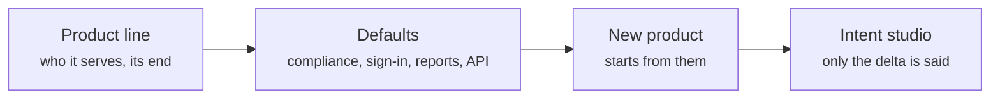
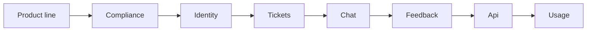

<!-- Generated by tools/docs.ts from docs/src/line/lines.md. Edit the source, then run: node tools/docs.ts --write -->

# Product lines

> Define a line once: who it serves, the end every product in it serves, and the choices every product starts from.

## TL;DR

A product line is a family of products that serve the same people under the same rules. Defining it once (who it serves, its end in mind, compliance, how people sign in, where reports go, the API, use tracking) means every product started in it begins from those 7 choices. The studio then asks only what is different about the new product.

## Explain it simply

A furniture company makes a line of school shelves. Every school shelf uses the same safe finish, the same rounded corners and the same height limits. When a new school orders one, nobody asks about the finish again; they ask only how many shelves and how tall. The line remembers the rest.

## Engineer

### What a line holds

| Field | Used for |
| --- | --- |
| Name | Grouping its products everywhere they appear |
| Who it serves | The people every product in it is for |
| The end it serves | Written into each new product's schematic as its end in mind |
| Compliance | The frameworks every product lives under: chosen from SOC 2, HIPAA Security Rule, FERPA, PCI DSS, GLBA Safeguards Rule, NIST SP 800-171 (CMMC Level 2), NIST SP 800-53 (FedRAMP Moderate) and Section 508 (WCAG 2.2 AA) |
| Sign-in | The identity provider |
| Report a problem | In every environment, testing only, or off |
| Tickets and chat | Where reports and notices go |
| API | Closed, open for some features, or open for all |
| Use tracking | Counts only, with consent, or off |

### Starting a product in a line

A new product opens in the intent studio with its title, the line's end in mind under *The end in mind*, an empty first line under *What it should do* with the cursor on it, and the line's choices on its spec sheet. Each choice can still be changed for that product alone in engineering. A product can also join a line later without changing its own choices.

### Where it is kept

Lines and the library of products are kept in the browser beside the studio's work. The product open in the studio is one record; every other product is kept whole and can be opened again from its line.

## Architect

A line is the first fixture a person makes, and the one that compounds fastest: every product started in it skips the same decisions, and every decision skipped is one that cannot be made inconsistently.

- **Defaults, never locks.** A line's choices are where products start, not rules they cannot leave. A product that departs from its line says so on its own spec sheet, where engineering sees it.
- **The end in mind is shared.** A family of products that serve one end can be measured together: mission control can show whether a line, not just a product, is doing its job.
- **Compliance is decided once per family.** A line under FERPA puts every product in it under FERPA, so no product in the line forgets.
- **Lines are the unit of reuse above parts.** Parts are reused across every product; lines are reused across products that serve the same people.
