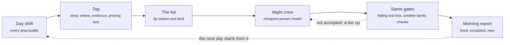
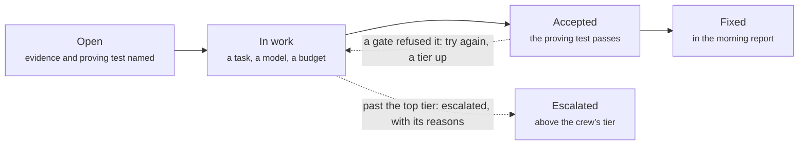
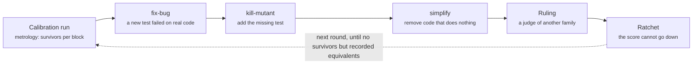
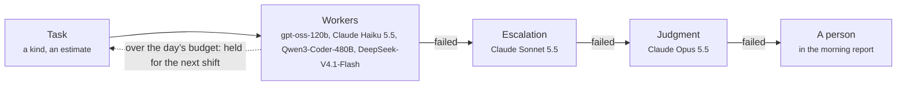
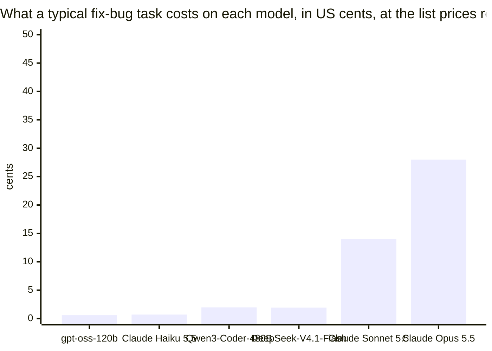
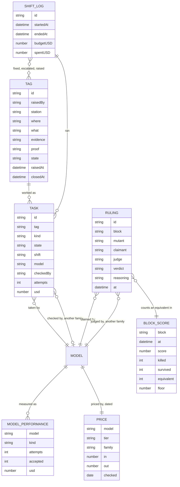

<!-- Generated by tools/docs.ts from docs/src/line/maintenance.md. Edit the source, then run: node tools/docs.ts --write -->

# Maintenance

> The crew that keeps the factory floor running: anyone tags what is not working instead of stopping the line, and a crew works the tags overnight, through the same gates as day work, and reports each morning.

## TL;DR

The plant runs two shifts. The day shift builds. Anyone, and any gate, reviewer, fuzz run, user report or calibration run, tags what is not working instead of stopping the line: what is wrong, where, how it is known, and the test that will prove it fixed. The night shift is maintenance, the support crew that keeps the [factory floor](factory.md) running and getting better: a crew that works the tags, once accepted as work orders, at 5 stations (gauge repair, wear checks, restore drills, scrap review and open suspicions), accepts a fix only through the gates day work passes, escalates anything above its tier, and ends with a morning report: what was fixed, with its evidence; what was escalated, and why; what is new on the list. Where it stands: No shift has run yet: the crew’s runner is not live yet.

## Explain it simply

A plant that runs one shift stops whenever something is wrong. A plant that runs two keeps going: the day crew hangs a tag on anything that is off (this gauge reads high, this belt is fraying, a customer sent back this part) and carries on. At night the maintenance crew walks the tags. They fix what they can, the same way the day crew would have to, and the inspector checks their work. Anything too big for them gets a note for the plant manager. In the morning there is a sheet on the manager's desk: fixed, with the proof; waiting for you, and why; and the new tags.

The lab tests the inspectors' gauges on parts made wrong on purpose. When a gauge says *fine* on a bad part, the lab tags it, and the night crew repairs it.

## Engineer

### What the maintenance page shows

- **The morning report.** The last shift: what was fixed, each with its evidence; what was escalated, to whom and why; what is new on the list.
- **The list, by station and kind.** Open tags at each station, and the queue by task kind in round order, with what each kind must prove to be accepted.
- **Gauge repair.** Each block's mutation score from metrology's certificate, what survived and what is recorded as equivalent: the work orders still open.
- **The crew.** Cost per accepted change, time from tag to fix, pass rate per model per kind, and the dated price table the router reads.

### The stations

| Station | What it checks | Tagged by |
| --- | --- | --- |
| Gauge repair | Work orders from metrology’s calibration: a surviving mutant is a planted defect a test failed to reject; add the test, fix the defect it finds, or remove code that does nothing | metrology’s calibration runs |
| Wear checks | Fuzzing, dependency advisories, and certificates, keys and tokens nearing expiry | fuzz runs, advisories, expiry dates |
| Restore drills | Every backup proved by restoring it and reading it back | backup schedules |
| Scrap review | Problem reports turned into failing tests | user reports and incidents |
| Open suspicions | Doubts a reviewer recorded without blocking: confirmed by a test, or dismissed with reasons another family accepts | reviews and gates |

### What a tag holds

A tag is raised instead of stopping the line, and it is refused without all four of these: **what** is wrong; **where** (the block, the file, the line); **how it is known** (the evidence: the failing run, the surviving mutant, the advisory, the report); and **the test that will prove it fixed**. The tag's life:

### The task kinds

Every tag is worked as tasks of 10 kinds. Mutation work goes in this order each round: fix what a new test found, then kill what survived, then simplify what did nothing.

| Kind, in round order | Stations | The task | Accepted when | Lowest tier |
| --- | --- | --- | --- | --- |
| `fix-bug` | Gauge repair, Wear checks, Scrap review | A test that fails on the real code has found a real defect: fix the code, with the test attached | the attached test failed before the fix and passes after it | worker |
| `kill-mutant` | Gauge repair | A mutant survived: add the test that should have rejected it | the new test fails on the mutant and passes on the real code | worker |
| `simplify` | Gauge repair | An equivalent mutant points at code that does nothing: remove or tighten it | every test still passes, and a judge from another family agrees the mutant was equivalent | worker |
| `patch-dependency` | Wear checks | An advisory names a dependency in use: move to a fixed version | every test passes on the new version, and the advisory no longer matches | worker |
| `renew` | Wear checks | A certificate, key or token nears expiry: prepare its renewal | the renewal is proposed with its new expiry; any person-only act waits for a person | escalation |
| `restore-drill` | Restore drills | Restore a backup into a scratch place and read it back | the restored copy matches its recorded checksums and opens | worker |
| `reproduce` | Scrap review | Turn a problem report into a test that fails for the reason reported | the test fails on the code the person used, for the reason they gave | worker |
| `investigate` | Open suspicions | Settle a reviewer’s open suspicion: a failing test that confirms it, or reasons it is unfounded | a confirming test, or a dismissal another family agrees with | escalation |
| `check` | Gauge repair, Wear checks, Restore drills, Scrap review, Open suspicions | The independent check on every fix: the failing test came first, the fix makes it pass, nothing was weakened | the checker is of another family than the fixer, and finds nothing | worker |
| `rule` | Gauge repair, Open suspicions | Judge a claim another model made: that a mutant is equivalent, or that a suspicion is unfounded | recorded with its reasoning; counts only when the judge is of another family than the claimant | judgment |

Every kind passes the same gates as day work: a failing test first; then the fix; nothing weakened (no test removed or loosened, no floor lowered, no locked path touched); and an independent check by a model of another family than the one that made the fix.

### Gauge repair: the mutation loop

A test is a gauge. Metrology calibrates each block by planting defects (mutants); a mutant that survives is a defect a gauge failed to reject, and each one is a work order here. Metrology measures and certifies; maintenance repairs. The repair has two parts, the tests and then the fixes:

- **fix-bug.** A newly written killing test failed on the real code as well as on the mutant: it found a real defect. The fix is made with that test attached.
- **kill-mutant.** The missing test is added. It must fail on the mutant and pass on the real code.
- **simplify.** An equivalent mutant (one no test can tell from the real code) points at code that does nothing. It is removed or tightened while every test still passes.

A claim that a mutant is equivalent counts only when a judge from a different model family agrees, and the ruling is recorded with its reasoning. The ratchet is the backstop: a block's score cannot go down, and a higher floor is proposed for a person to sign, because floors are person-only. The fixes are the point. The loop repeats until no survivors remain but recorded equivalents.

Scores per block, from metrology's certificates (115 blocks scored, 3 with no survivors but recorded equivalents):

| Block | Score | Floor | Survived | Recorded equivalent |
| --- | --- | --- | --- | --- |
| `accounts` | 62.7% | none | 148 | 0 |
| `activitypub` | 69.5% | none | 342 | 0 |
| `adblock-rules` | 77.2% | none | 133 | 0 |
| `analytics` | 75.9% | none | 41 | 0 |
| `apikeys` | 79.9% | none | 32 | 0 |
| `apiver` | 87.4% | none | 15 | 0 |
| `ask` | 98.2% | none | 16 | 0 |
| `asn1-der` | 96.3% | none | 50 | 0 |
| `audio-tags` | 60.6% | none | 947 | 0 |
| `audit` | 75.0% | none | 32 | 0 |
| `backups` | 79.3% | none | 33 | 0 |
| `booking` | 80.0% | none | 43 | 0 |
| `cache` | 85.5% | none | 9 | 0 |
| `chunker` | 64.9% | none | 182 | 0 |
| `cmi5` | 70.4% | none | 60 | 0 |
| `comments` | 74.5% | none | 53 | 0 |
| `config` | 71.1% | none | 46 | 0 |
| `conflicts` | 90.7% | none | 4 | 0 |
| `consent` | 86.1% | none | 16 | 0 |
| `console` | 98.3% | none | 12 | 0 |
| `contact` | 97.5% | none | 10 | 0 |
| `costmeter` | 79.1% | none | 28 | 0 |
| `crdt-awareness` | 85.8% | none | 76 | 0 |
| `crdt-map` | 77.3% | none | 126 | 0 |
| `crypto` | 89.2% | none | 14 | 0 |
| `datagate` | 80.5% | none | 42 | 0 |
| `dav` | 100.0% | none | 0 | 0 |
| `devices` | 77.6% | none | 32 | 0 |
| `dns-filter` | 72.0% | none | 189 | 0 |
| `docparse` | 92.8% | none | 50 | 0 |
| `drafts` | 82.1% | none | 15 | 0 |
| `etl` | 83.1% | none | 102 | 0 |
| `events` | 72.9% | none | 39 | 0 |
| `expiry` | 72.3% | none | 18 | 0 |
| `factoryreports` | 99.3% | none | 6 | 0 |
| `feedback` | 100.0% | none | 0 | 0 |
| `flags` | 77.7% | none | 21 | 0 |
| `geo` | 78.8% | none | 44 | 0 |
| `grants` | 60.5% | none | 123 | 0 |
| `health` | 75.8% | none | 37 | 0 |
| `history` | 81.6% | none | 18 | 0 |
| `i18n` | 98.2% | none | 4 | 0 |
| `idempotency` | 86.4% | none | 8 | 0 |
| `imagemeta` | 63.8% | none | 135 | 0 |
| `importer` | 78.1% | none | 223 | 0 |
| `invoices` | 68.2% | none | 276 | 0 |
| `jobs` | 99.4% | none | 2 | 0 |
| `leases` | 83.7% | none | 21 | 0 |
| `library-scan` | 73.8% | none | 233 | 0 |
| `loadsoak` | 68.9% | none | 56 | 0 |
| `matroska-probe` | 62.2% | none | 597 | 0 |
| `mcp` | 69.3% | none | 109 | 0 |
| `media-name-parse` | 58.8% | none | 648 | 0 |
| `message-search` | 71.2% | none | 223 | 0 |
| `metadata-match` | 70.9% | none | 159 | 0 |
| `microblog` | 69.0% | none | 313 | 0 |
| `migrations` | 79.9% | none | 32 | 0 |
| `moderation-model` | 77.9% | none | 137 | 0 |
| `money` | 76.1% | none | 43 | 0 |
| `notify` | 75.4% | none | 69 | 0 |
| `objects` | 75.0% | none | 51 | 0 |
| `observe` | 64.1% | none | 137 | 0 |
| `oidc` | 70.6% | none | 67 | 0 |
| `opds-epub` | 61.8% | none | 631 | 0 |
| `oracle` | 53.0% | none | 151 | 0 |
| `paging` | 71.6% | none | 56 | 0 |
| `palette` | 66.4% | none | 48 | 0 |
| `payments` | 77.8% | none | 70 | 0 |
| `pdf` | 96.8% | none | 9 | 0 |
| `pipeline` | 73.2% | none | 71 | 0 |
| `playback-state` | 80.0% | none | 109 | 0 |
| `playlists` | 65.4% | none | 420 | 0 |
| `privacy` | 78.0% | none | 22 | 0 |
| `prompt-store` | 80.4% | none | 155 | 0 |
| `pwa` | 73.8% | none | 34 | 0 |
| `query` | 69.9% | none | 106 | 0 |
| `rag` | 59.2% | none | 251 | 0 |
| `rate-plans` | 76.3% | none | 123 | 0 |
| `ratelimit` | 60.0% | none | 32 | 0 |
| `rbac` | 70.0% | none | 58 | 0 |
| `recurring-billing` | 77.9% | none | 118 | 0 |
| `refdata` | 79.6% | none | 22 | 0 |
| `reports` | 81.9% | none | 41 | 0 |
| `resilience` | 78.7% | none | 19 | 0 |
| `retention` | 70.8% | none | 28 | 0 |
| `search` | 95.3% | none | 16 | 0 |
| `secheaders` | 66.2% | none | 50 | 0 |
| `session-replay-plan` | 69.5% | none | 348 | 0 |
| `sessions` | 78.2% | none | 64 | 0 |
| `sitemap` | 96.9% | none | 7 | 0 |
| `slash-commands` | 80.9% | none | 184 | 0 |
| `slo` | 78.2% | none | 29 | 0 |
| `speech` | 71.2% | none | 327 | 0 |
| `subtitles` | 64.2% | none | 846 | 0 |
| `surfaces` | 66.3% | none | 64 | 0 |
| `sync` | 73.9% | none | 43 | 0 |
| `tabular` | 74.8% | none | 113 | 0 |
| `tax-engine` | 71.6% | none | 282 | 0 |
| `testdata` | 100.0% | none | 0 | 0 |
| `time` | 71.1% | none | 144 | 0 |
| `timeline-assembly` | 76.9% | none | 120 | 0 |
| `token-count` | 70.3% | none | 171 | 0 |
| `tree` | 65.0% | none | 130 | 0 |
| `uat` | 75.2% | none | 58 | 0 |
| `upkeep` | 97.6% | none | 8 | 0 |
| `uploads` | 64.7% | none | 65 | 0 |
| `uploadsafe` | 64.4% | none | 69 | 0 |
| `ux` | 69.5% | none | 117 | 0 |
| `validate` | 97.9% | none | 8 | 0 |
| `walkthrough` | 93.9% | none | 12 | 0 |
| `watchdog` | 75.0% | none | 29 | 0 |
| `webhooks` | 75.1% | none | 67 | 0 |
| `wiki-links` | 84.4% | none | 69 | 0 |
| `workflow` | 81.8% | none | 35 | 0 |
| `xmltv-epg` | 68.8% | none | 466 | 0 |

### The crew

A router staffs every task with the cheapest model proven good enough for its kind. A model is proven for a kind by its measured pass rate there; a model not yet measured is tried on trial; a model below the bar is left out for that kind. A task that fails moves a tier up; past the top tier it goes to a person, in the morning report. A task the day's budget cannot cover waits for the next shift: nothing is skipped.

The router reads a dated price table: Google Cloud Vertex AI partner models, global endpoint, list prices, USD per 1M tokens, as listed on 2026-11-27. It is re-read and re-dated when the list changes, never assumed current.

| Model | Tier | Family | Input | Output | A typical `fix-bug` task |
| --- | --- | --- | --- | --- | --- |
| gpt-oss-120b | worker | openai | 0.09 | 0.36 | $0.0058 |
| Claude Haiku 5.5 | worker | anthropic | 0.10 | 0.50 (0.50 in, 2.50 out, from 200K input) | $0.0070 |
| Qwen3-Coder-480B | worker | qwen | 0.22 | 1.80 | $0.0196 |
| DeepSeek-V4.1-Flash | worker | deepseek | 0.30 | 1.20 | $0.0192 |
| Claude Sonnet 5.5 | escalation | anthropic | 2.00 | 10.00 | $0.1400 |
| Claude Opus 5.5 | judgment | anthropic | 4.00 | 20.00 | $0.2800 |

Pass rates per model per kind, from every settled task:

| Model | Pass rate |
| --- | --- |
| No shift has run yet: every model starts on trial | not measured |

### Where the crew runs

On the owner's Google Cloud project, through Workload Identity Federation: each run is given a short-lived identity, and no key is stored anywhere. The runner is still being built and is not live yet; until it is, no shift runs, and the maintenance page says so.

### What maintenance records

Every figure maintenance reports is read from these records: a shift log per night; per-block mutation scores and survivors; cost per accepted change (not measured: no change accepted yet); pass rate per model per task kind; and time from tag to fix (not measured: no tag fixed yet).

## Architect

Maintenance is total productive maintenance applied to a software line: the instruments are maintained as carefully as the product, and upkeep is scheduled work, not an interruption.

- **A support crew for the factory floor, not a step in the flow.** Tags can come from anywhere, and that is a source of work orders, not a service relationship: maintenance serves the factory floor, keeping its builders, gauges and blocks working. Work does not pass through it, and its report goes to mission control.
- **Tag, do not stop.** Stopping the line for every defect stalls everything behind it; ignoring defects lets them compound. A tag with its evidence and its proving test is neither: the line keeps moving, and nothing found is lost.
- **Same gates at night.** A night fix passes exactly what a day change passes. There is no maintenance exemption, so the night shift cannot be the way around a gate.
- **Repair what metrology finds.** Calibration finds tests that cannot fail and code that does nothing; maintenance closes both. Every later product gains: the gauges it inherits are proven, and the blocks it assembles are smaller.
- **The model is chosen by evidence.** Pass rates per model per kind, and the dated prices, decide who takes a task. The fixture, not the model, carries the quality; the router only finds the cheapest model the fixture accepts.
- **Escalation is a reading.** What the crew cannot settle reaches a person with its reasons, in one report a morning, instead of as interruptions through the day.
