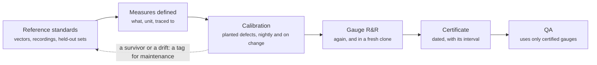
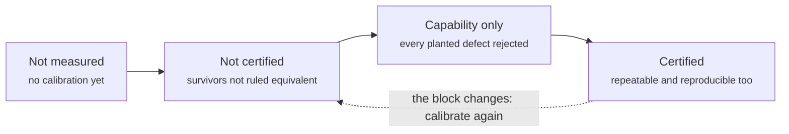
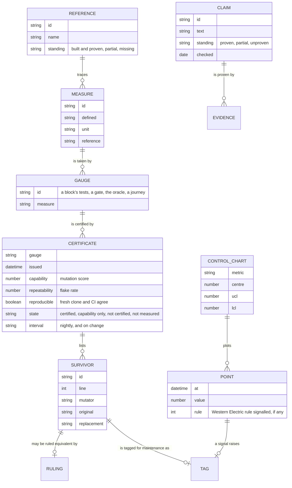

<!-- Generated by tools/docs.ts from docs/src/line/metrology.md. Edit the source, then run: node tools/docs.ts --write -->

# Metrology

> The lab behind QA: it keeps QA's gauges and process true. It defines every measure QA uses, traces each to a reference standard, certifies every gauge before QA may use it, charts the factory's own process for drift, and audits the factory's claims against their evidence.

## TL;DR

QA judges builds; metrology judges QA's instruments. Every measure is defined once, here, and traced to a reference: published test vectors, a recording of the system a product replaces, sealed held-out phrasing sets. Every gauge gets a dated certificate: its capability (the mutation score of its block: does each test reject a planted defect), its repeatability (the flake rate) and its reproducibility (the same verdicts in a fresh clone and on CI), re-checked nightly and whenever its code changes. QA may use only gauges metrology has certified. Where it stands: 84 of 175 blocks calibrated; 0 certified, 82 with survivors still to close, 2 capable but not yet checked for repeatability and reproducibility.

## Explain it simply

An inspector's gauge is only as good as its last check. The lab keeps the master blocks every gauge is compared with, checks each gauge on parts made wrong on purpose, checks that it reads the same twice and in anyone's hands, and puts a dated sticker on it. Inspection may only use a gauge with a current sticker. The lab also keeps charts of how the plant is running, so a slow drift is seen before it becomes a bad batch, and it checks that what the plant says about itself is true.

## Engineer

### What the metrology page shows

- **Gauges QA may use.** Blocks certified, against blocks in the library.
- **Calibration certificates.** Per block: capability, survivors, rulings, repeatability, reproducibility and the date issued.
- **The measures QA uses and the reference standards** they trace to, each with where it stands.
- **Control charts** on the factory's own process, and how many points each has.
- **The internal audit**: every claim the factory makes about itself, against its evidence.

### The measures

| Measure | Defined as | Unit | Traced to |
| --- | --- | --- | --- |
| Gauge capability | Of the planted defects (mutants) in a block, the share its tests reject | % of mutants killed | The block’s own code, mutated |
| Repeatability | The share of tests that give a different verdict when run again, unchanged, on the same machine (the flake rate) | % of tests | AIAG Measurement Systems Analysis, gauge R&R |
| Reproducibility | Whether the same commit gives the same verdict on every test in a fresh clone and on CI | tests that disagree | AIAG Measurement Systems Analysis, gauge R&R |
| Oracle discrimination | Of the differences planted in a recorded corpus, the share the oracle reports; of the rightful differences (etags, ids, dates), the share it masks | % detected, % masked | The recording of the replaced system |
| Journey pass | A person’s goal reached, in every mode and channel the journey names, with nothing forbidden happening | pass, fail or not measured | The signed intent and the held-out phrasings |

### Reference standards

| Reference | What it is the standard for | Where it stands | Evidence |
| --- | --- | --- | --- |
| Published test vectors (RFCs and standards bodies) | Protocol and format blocks: what a correct answer is, from the specification’s own examples | partial | Some blocks’ tests use their RFC’s vectors (tabular, sessions, validate); no catalogue says which measure traces to which vector |
| A recording of a real Nextcloud | The Files oracle: every request a client makes, answered by the system Files replaces | missing | The oracle can check a candidate against a recorded corpus; no recording of a real Nextcloud has been made yet |
| Sealed held-out phrasing sets | Journeys and readings: phrasings the factory never sees, so a pass is not memorised | partial | Held out in control/heldout/, a person-only path; sealed by convention, with no hash a gate checks |

### Certificates

A certificate is earned in order: capable first, then repeatable and reproducible. Calibration runs every block nightly and a block again whenever its code changes; every surviving mutant is tagged as a work order for maintenance, which repairs it. A claim that a mutant is equivalent counts only when a judge of another model family agrees, recorded with its reasoning.

The 84 blocks calibrated so far, of 175:

| Block | Certificate | Capability | Survivors | Ruled equivalent | Issued |
| --- | --- | --- | --- | --- | --- |
| `resilience` | not certified: 19 planted defects not rejected, and not ruled equivalent | 78.7% | 19 | 0 | 2026-11-28 |
| `idempotency` | not certified: 8 planted defects not rejected, and not ruled equivalent | 86.4% | 8 | 0 | 2026-11-28 |
| `money` | not certified: 43 planted defects not rejected, and not ruled equivalent | 76.1% | 43 | 0 | 2026-11-28 |
| `conflicts` | not certified: 4 planted defects not rejected, and not ruled equivalent | 90.7% | 4 | 0 | 2026-11-28 |
| `paging` | not certified: 56 planted defects not rejected, and not ruled equivalent | 71.6% | 56 | 0 | 2026-11-28 |
| `retention` | not certified: 28 planted defects not rejected, and not ruled equivalent | 70.8% | 28 | 0 | 2026-11-28 |
| `watchdog` | not certified: 29 planted defects not rejected, and not ruled equivalent | 75.0% | 29 | 0 | 2026-11-28 |
| `expiry` | not certified: 18 planted defects not rejected, and not ruled equivalent | 72.3% | 18 | 0 | 2026-11-28 |
| `tree` | not certified: 130 planted defects not rejected, and not ruled equivalent | 65.0% | 130 | 0 | 2026-11-28 |
| `objects` | not certified: 51 planted defects not rejected, and not ruled equivalent | 75.0% | 51 | 0 | 2026-11-28 |
| `uploads` | not certified: 65 planted defects not rejected, and not ruled equivalent | 64.7% | 65 | 0 | 2026-11-28 |
| `leases` | not certified: 21 planted defects not rejected, and not ruled equivalent | 83.7% | 21 | 0 | 2026-11-28 |
| `grants` | not certified: 123 planted defects not rejected, and not ruled equivalent | 60.5% | 123 | 0 | 2026-11-28 |
| `devices` | not certified: 32 planted defects not rejected, and not ruled equivalent | 77.6% | 32 | 0 | 2026-11-28 |
| `dav` | capability only: every planted defect rejected; repeatability and reproducibility not measured yet | 100.0% | 0 | 0 | 2026-11-28 |
| `oracle` | not certified: 151 planted defects not rejected, and not ruled equivalent | 53.0% | 151 | 0 | 2026-11-28 |
| `ratelimit` | not certified: 32 planted defects not rejected, and not ruled equivalent | 60.0% | 32 | 0 | 2026-11-28 |
| `uploadsafe` | not certified: 69 planted defects not rejected, and not ruled equivalent | 64.4% | 69 | 0 | 2026-11-28 |
| `validate` | not certified: 8 planted defects not rejected, and not ruled equivalent | 97.9% | 8 | 0 | 2026-11-28 |
| `config` | not certified: 46 planted defects not rejected, and not ruled equivalent | 71.1% | 46 | 0 | 2026-11-28 |
| `observe` | not certified: 137 planted defects not rejected, and not ruled equivalent | 64.1% | 137 | 0 | 2026-11-28 |
| `health` | not certified: 37 planted defects not rejected, and not ruled equivalent | 75.8% | 37 | 0 | 2026-11-28 |
| `jobs` | not certified: 73 planted defects not rejected, and not ruled equivalent | 78.7% | 73 | 0 | 2026-11-28 |
| `audit` | not certified: 32 planted defects not rejected, and not ruled equivalent | 75.0% | 32 | 0 | 2026-11-28 |
| `crypto` | not certified: 14 planted defects not rejected, and not ruled equivalent | 89.2% | 14 | 0 | 2026-11-28 |
| `rbac` | not certified: 58 planted defects not rejected, and not ruled equivalent | 70.0% | 58 | 0 | 2026-11-28 |
| `secheaders` | not certified: 50 planted defects not rejected, and not ruled equivalent | 66.2% | 50 | 0 | 2026-11-28 |
| `apikeys` | not certified: 32 planted defects not rejected, and not ruled equivalent | 79.9% | 32 | 0 | 2026-11-28 |
| `accounts` | not certified: 148 planted defects not rejected, and not ruled equivalent | 62.7% | 148 | 0 | 2026-11-28 |
| `sessions` | not certified: 64 planted defects not rejected, and not ruled equivalent | 78.2% | 64 | 0 | 2026-11-28 |
| `oidc` | not certified: 67 planted defects not rejected, and not ruled equivalent | 70.6% | 67 | 0 | 2026-11-28 |
| `webhooks` | not certified: 67 planted defects not rejected, and not ruled equivalent | 75.1% | 67 | 0 | 2026-11-28 |
| `flags` | not certified: 21 planted defects not rejected, and not ruled equivalent | 77.7% | 21 | 0 | 2026-11-28 |
| `cache` | not certified: 9 planted defects not rejected, and not ruled equivalent | 85.5% | 9 | 0 | 2026-11-28 |
| `consent` | not certified: 16 planted defects not rejected, and not ruled equivalent | 86.1% | 16 | 0 | 2026-11-28 |
| `refdata` | not certified: 22 planted defects not rejected, and not ruled equivalent | 79.6% | 22 | 0 | 2026-11-28 |
| `notify` | not certified: 69 planted defects not rejected, and not ruled equivalent | 75.4% | 69 | 0 | 2026-11-28 |
| `comments` | not certified: 53 planted defects not rejected, and not ruled equivalent | 74.5% | 53 | 0 | 2026-11-28 |
| `history` | not certified: 18 planted defects not rejected, and not ruled equivalent | 81.6% | 18 | 0 | 2026-11-28 |
| `workflow` | not certified: 35 planted defects not rejected, and not ruled equivalent | 81.8% | 35 | 0 | 2026-11-28 |
| `events` | not certified: 39 planted defects not rejected, and not ruled equivalent | 72.9% | 39 | 0 | 2026-11-28 |
| `slo` | not certified: 29 planted defects not rejected, and not ruled equivalent | 78.2% | 29 | 0 | 2026-11-28 |
| `costmeter` | not certified: 28 planted defects not rejected, and not ruled equivalent | 79.1% | 28 | 0 | 2026-11-28 |
| `tabular` | not certified: 113 planted defects not rejected, and not ruled equivalent | 74.8% | 113 | 0 | 2026-11-28 |
| `reports` | not certified: 41 planted defects not rejected, and not ruled equivalent | 81.9% | 41 | 0 | 2026-11-28 |
| `search` | not certified: 99 planted defects not rejected, and not ruled equivalent | 66.3% | 99 | 0 | 2026-11-28 |
| `i18n` | not certified: 94 planted defects not rejected, and not ruled equivalent | 58.6% | 94 | 0 | 2026-11-28 |
| `time` | not certified: 144 planted defects not rejected, and not ruled equivalent | 71.1% | 144 | 0 | 2026-11-28 |
| `booking` | not certified: 43 planted defects not rejected, and not ruled equivalent | 80.0% | 43 | 0 | 2026-11-28 |
| `contact` | not certified: 10 planted defects not rejected, and not ruled equivalent | 97.5% | 10 | 0 | 2026-11-28 |
| `analytics` | not certified: 41 planted defects not rejected, and not ruled equivalent | 75.9% | 41 | 0 | 2026-11-28 |
| `payments` | not certified: 70 planted defects not rejected, and not ruled equivalent | 77.8% | 70 | 0 | 2026-11-28 |
| `pdf` | not certified: 9 planted defects not rejected, and not ruled equivalent | 96.8% | 9 | 0 | 2026-11-28 |
| `docparse` | not certified: 165 planted defects not rejected, and not ruled equivalent | 66.6% | 165 | 0 | 2026-11-28 |
| `imagemeta` | not certified: 135 planted defects not rejected, and not ruled equivalent | 63.8% | 135 | 0 | 2026-11-28 |
| `geo` | not certified: 44 planted defects not rejected, and not ruled equivalent | 78.8% | 44 | 0 | 2026-11-28 |
| `sitemap` | not certified: 71 planted defects not rejected, and not ruled equivalent | 68.2% | 71 | 0 | 2026-11-28 |
| `apiver` | not certified: 15 planted defects not rejected, and not ruled equivalent | 87.4% | 15 | 0 | 2026-11-28 |
| `drafts` | not certified: 15 planted defects not rejected, and not ruled equivalent | 82.1% | 15 | 0 | 2026-11-28 |
| `palette` | not certified: 48 planted defects not rejected, and not ruled equivalent | 66.4% | 48 | 0 | 2026-11-28 |
| `testdata` | capability only: every planted defect rejected; repeatability and reproducibility not measured yet | 100.0% | 0 | 0 | 2026-11-28 |
| `privacy` | not certified: 22 planted defects not rejected, and not ruled equivalent | 78.0% | 22 | 0 | 2026-11-28 |
| `surfaces` | not certified: 64 planted defects not rejected, and not ruled equivalent | 66.3% | 64 | 0 | 2026-11-28 |
| `upkeep` | not certified: 96 planted defects not rejected, and not ruled equivalent | 66.7% | 96 | 0 | 2026-11-28 |
| `backups` | not certified: 33 planted defects not rejected, and not ruled equivalent | 79.3% | 33 | 0 | 2026-11-28 |
| `loadsoak` | not certified: 56 planted defects not rejected, and not ruled equivalent | 68.9% | 56 | 0 | 2026-11-28 |
| `datagate` | not certified: 42 planted defects not rejected, and not ruled equivalent | 80.5% | 42 | 0 | 2026-11-28 |
| `pipeline` | not certified: 71 planted defects not rejected, and not ruled equivalent | 73.2% | 71 | 0 | 2026-11-28 |
| `sync` | not certified: 43 planted defects not rejected, and not ruled equivalent | 73.9% | 43 | 0 | 2026-11-28 |
| `feedback` | not certified: 91 planted defects not rejected, and not ruled equivalent | 63.3% | 91 | 0 | 2026-11-28 |
| `cmi5` | not certified: 60 planted defects not rejected, and not ruled equivalent | 70.4% | 60 | 0 | 2026-11-28 |
| `pwa` | not certified: 34 planted defects not rejected, and not ruled equivalent | 73.8% | 34 | 0 | 2026-11-28 |
| `ux` | not certified: 117 planted defects not rejected, and not ruled equivalent | 69.5% | 117 | 0 | 2026-11-28 |
| `migrations` | not certified: 32 planted defects not rejected, and not ruled equivalent | 79.9% | 32 | 0 | 2026-11-28 |
| `mcp` | not certified: 109 planted defects not rejected, and not ruled equivalent | 69.3% | 109 | 0 | 2026-11-28 |
| `query` | not certified: 106 planted defects not rejected, and not ruled equivalent | 69.9% | 106 | 0 | 2026-11-28 |
| `uat` | not certified: 58 planted defects not rejected, and not ruled equivalent | 75.2% | 58 | 0 | 2026-11-28 |
| `importer` | not certified: 223 planted defects not rejected, and not ruled equivalent | 78.1% | 223 | 0 | 2026-11-28 |
| `ask` | not certified: 16 planted defects not rejected, and not ruled equivalent | 98.2% | 16 | 0 | 2026-11-28 |
| `etl` | not certified: 102 planted defects not rejected, and not ruled equivalent | 83.1% | 102 | 0 | 2026-11-28 |
| `console` | not certified: 12 planted defects not rejected, and not ruled equivalent | 98.3% | 12 | 0 | 2026-11-28 |
| `factoryreports` | not certified: 256 planted defects not rejected, and not ruled equivalent | 70.3% | 256 | 0 | 2026-11-28 |
| `walkthrough` | not certified: 12 planted defects not rejected, and not ruled equivalent | 93.9% | 12 | 0 | 2026-11-28 |
| `speech` | not certified: 327 planted defects not rejected, and not ruled equivalent | 71.2% | 327 | 0 | 2026-11-28 |

### Control charts

Each series is an individuals chart after Shewhart: the centre line is the mean, and the limits are three sigma, with sigma estimated from the average moving range. Drift is read by the Western Electric rules (one point beyond three sigma; two of three beyond two; four of five beyond one; eight in a row on one side), and every signal raises a tag. A series has no limits until it has 25 points, the number the AIAG SPC manual asks for, so until then it raises nothing. The series: test time, flake rate, mutation score and cost per accepted change.

### The internal audit

Every claim the factory makes about itself is checked against its evidence and recorded as proven, partial or unproven. The audit of 2026-11-27 found 73 claims: 10 proven, 43 partial, 20 unproven:

| # | Finding |
| --- | --- |
| 1 | Review by two other model families is designed but not running |
| 2 | Branches are not protected: the record could be bypassed by a direct push |
| 3 | There is no recording of a real Nextcloud for the Files oracle |
| 4 | Held-out sets are sealed by convention, not by a hash a gate checks |
| 5 | The papers’ figures are typed, not generated |
| 6 | Deploys name a movable image tag, not a digest |
| 7 | The reference build was red for 13 days while commits continued |

### What metrology records

## Architect

- **A support crew for QA.** Metrology keeps QA's gauges and process true: it defines the measures QA uses, certifies the gauges, and fixes QA's quality and process. Work does not pass through it, so it sits in the support group beside maintenance: metrology measures and tags; maintenance repairs. Other areas may read its charts, but QA is the area it serves.
- **Methods, not metaphors.** Gauge R&R, control charts and certified gauges are used here because AI workers vary from run to run, and those methods were made for variation; [the standards map](standards.md) says why, and where each stands.
- **A certificate is a reading, not a promise.** It is dated, it names its interval, and it lapses when the gauge's code changes. A gauge without a current certificate is not used, and the page says which.
- **Audit the factory, not only the product.** The claims audit applies the same rule to the factory that QA applies to a build: nothing counts on assertion.
