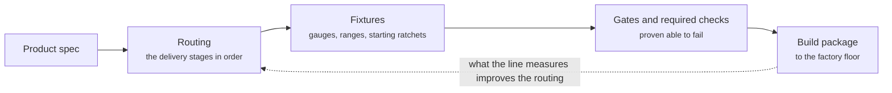

<!-- Generated by tools/docs.ts from docs/src/line/process.md. Edit the source, then run: node tools/docs.ts --write -->

# Manufacturing engineering

> Define how to build the product from the product spec: the build package, its routing, fixtures, gates and required checks. Then keep improving the line and the process from what the line measures.

## TL;DR

Product engineering says *what* is built; manufacturing engineering says *how*. It takes the released product spec and writes the build package the factory floor builds to: the routing (the 8 delivery stages, in order), the fixtures (gauges, working ranges, starting ratchets), the gates, each proven able to fail, and the 10 required checks every change must pass. It then sets up the line to build it, and keeps improving the line, QA and shipping from what the line measures: process capability, which is not measured yet.

## Explain it simply

The drafting office has drawn the shelf. The process planners decide how the shop will make it: which steps, in which order, with which jigs, which gauge at each step, and which checks the shelf must pass before it moves on. They test the checks on purpose-made bad parts, so a check that cannot fail is thrown out. They hand the shop floor a binder, and after that they watch how the shop runs and change the binder when a step is slow, wasteful or lets a defect through.

## Engineer

### The build package

The build package holds what the factory floor needs and nothing it has to invent: the routing, the control plan, the gauges, the working ranges and starting ratchets, the pending tests and the agents' brief. For the worked example it sits inside the released revision, counted by folder:

| In the package | Files |
| --- | --- |
| `admin/` | 2 |
| `AGENTS.md` | 1 |
| `analytics/` | 1 |
| `api/` | 3 |
| `balloons.json` | 1 |
| `build-manifest.json` | 1 |
| `build-manifest.md` | 1 |
| `compliance/` | 6 |
| `connections.json` | 1 |
| `connections/` | 2 |
| `context.md` | 1 |
| `control-plan.yaml` | 1 |
| `datum.json` | 1 |
| `delivery/` | 5 |
| `docs/` | 5 |
| `features.yaml` | 1 |
| `gauges/` | 1 |
| `information/` | 12 |
| `knowledge/` | 32 |
| `manifest.json` | 1 |
| `notes.md` | 1 |
| `ops/` | 5 |
| `outcomes/` | 3 |
| `ratchets.json` | 1 |
| `reports/` | 17 |
| `schematic.md` | 1 |
| `spec-sheet.json` | 1 |
| `tests/` | 2 |
| `tolerances.json` | 1 |
| `training/` | 4 |

### The routing

Every product follows the same routing, written once and neutrally in `src/delivery.ts`, with each cloud as an adapter over it:

| Stage | What it proves | Gate |
| --- | --- | --- |
| Build | dependencies install from the lock file; types check; no secret-shaped value in the source or its history | every check passes |
| Test | every test passes; mutation scores hold their floors; every ratchet holds or tightens; every journey passes on the twins | every gate in the control plan passes |
| Rehearse the data | the schema revision migrates a copy with nothing lost; every integrity rule holds; no drift from the signed schema | the data pipeline rehearsal passes |
| Package and sign | the image is built by the build service, with signed provenance; a bill of materials is recorded; no critical or high vulnerability in the image | the image is signed and clean |
| Deploy without traffic | only a signed image can run; the new revision starts and is healthy; journeys pass against it, before anyone is sent to it | smoke journeys pass on the candidate |
| Canary | a small share of people use it; service levels hold: no fast burn of any error budget | a named person approves in production; the error budget is not burning |
| Release | everyone is moved to it; the previous revision stays ready to take traffic back in one step | service levels hold for the watch window |
| Operate | service levels watched continuously; integrity and drift checked nightly; every alert has a runbook; every incident becomes a defect, a test and a ratchet | an alert opens an incident |

The routing is defined for every product; which stages a product has run is recorded by its pipeline, not here.

### Gates proven able to fail

There are 8 structural gates. A gate counts only while its planted defects still make it fail, so each names the tests that plant them and how many there must be at least; a proof that matches no test, or fewer than it did, fails the run instead of passing quietly.

### Required checks

| # | Required check | Step |
| --- | --- | --- |
| 1 | typecheck | npm run typecheck |
| 2 | changes only a person makes are signed by that person | npm run person-signed |
| 3 | production dependencies audited | npm run dependencies |
| 4 | docs derived and fresh | npm run docs |
| 5 | unit and integration tests | npm run test |
| 6 | proven gates | npm run gates |
| 7 | locked journeys | npm run journeys |
| 8 | exhaustive button walk | npm run explore |
| 9 | exhaustive page walk | npm run crawl |
| 10 | browser walk | npm run walk |

Checks run cheapest first and stop at the first failure.

### What the process page shows

The routing, the gates with their proofs, the required checks and whether the branch rules are recorded, read from the repository when the site is built; the gate proofs and ratchets the latest build measured; and process capability, which shows *not measured yet* until the line's runs are recorded.

## Architect

Manufacturing engineering is the area that makes the line better, not only the product: a defect that reaches QA twice is a defect in the routing.

- **Fixtures before work.** The factory floor does not start from a blank page. Everything it needs to check its own work is in the build package, so a builder designs only the delta.
- **A gate that cannot fail is not a gate.** Every gate is shown to fail on a planted defect before it counts, and goes back to unproven the day its proof stops holding.
- **Enforcement is a record, not a promise.** The required checks are enforced on the branch only where the live branch rules are recorded and compared with GitHub's; until then the page says they are not.
- **Capability is measured from the line.** Whether the process holds its own measures over many runs is read from the line's records and charted by [metrology](metrology.md); nothing is claimed before there are runs to chart.
- **It serves the whole line.** It improves the [factory floor](factory.md)'s routing, [QA](qa.md)'s gates and [shipping](shipping.md)'s stages from what each measures, and hands the next product a better package.
