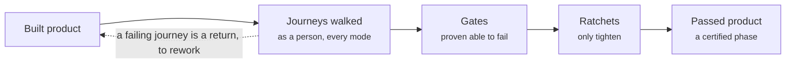
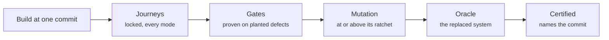

<!-- Generated by tools/docs.ts from docs/src/line/qa.md. Edit the source, then run: node tools/docs.ts --write -->

# QA

> Walk every journey as a person would, prove every gate can fail, hold every ratchet. Only what QA passes ships; what it fails goes to rework and comes back.

## TL;DR

QA judges a build the way its users would: by walking whole journeys in a real browser, at real device sizes, finding things by the names a screen reader uses, in every mode and language a journey names. A gate counts only after planted defects have made it fail. Ratchets only tighten. A phase is certified when its journeys pass; a failing journey is a return: the failed product goes to [rework](rework.md) with its failing evidence, and comes back to QA to be inspected again.

## Explain it simply

An inspector does not just measure each part. They try the finished shelf: a child reaches the bottom row; the shelf does not tip with books on top. And before trusting any gauge, they test it on a shelf built wrong on purpose. A gauge that says *fine* on a bad shelf is thrown out.

## Engineer

### Journeys

Each outcome on the schematic generates a journey: who walks it, the goal in their words, what must never happen on the way, and an action budget. For the worked example, 1 gauges are generated. Journeys are proposed to the factory; only a person locks them into its set. A journey passes only when the goal is reached, within budget, in every mode and channel it names, with nothing forbidden happening.

### Gates and ratchets

Every structural gate carries a proof: planted defects it must catch. A gate whose proof no longer holds counts as unproven. A ratchet starts where the build measured it and only tightens; resetting one is a person's signed act, recorded in the open.

### Reviews

A change is reviewed by two model families other than its author's, each passing with what it checked or blocking with a finding. A pass that says nothing about what was checked is refused.

### What QA shows

The measure (journeys walked as a person would, and passing), every journey by phase and mode, every gate and whether its proof is valid, and every ratchet with its floor, and the returns waiting in rework. When the product in focus is not the one the factory last measured, QA says so first.

## Architect

QA is the functional gauge on the assembly: parts that each meet their drawing can still fail to assemble, and only a whole-activity check catches that.

- **Intent is the primary datum.** A board that is all green while a journey fails is a failure. A failing unit test with every journey intact is a defect to fix before it reaches anyone.
- **QA uses certified gauges.** [Metrology](metrology.md), the lab that serves QA, defines every measure QA uses and certifies each gauge; a gauge without a current certificate is not used.
- **Inspection is against a reference.** Each product's first article is measured against the system it replaces; Files is measured against a stock Nextcloud.
- **Gauges are proven before they are trusted.** Falsification (plant the defect, require the gate to fail) is what makes a pass mean something.
- **Unknown is a state.** Not measured is shown as not measured, never as pass, and an older green result never stands in for a missing current one.
- **Journeys come from the intent, not the code**, so they cannot enshrine what the code happens to do.
- **Failures travel back as returns.** A failing journey is never patched in QA; the failed product goes to rework with its failing evidence, and QA inspects the whole product again once it is fixed.
