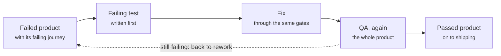

<!-- Generated by tools/docs.ts from docs/src/line/rework.md. Edit the source, then run: node tools/docs.ts --write -->

# Rework

> What fails inspection comes back with the failing journey and the evidence of its failure. The fix starts from a failing test, and the whole product goes through QA again.

## TL;DR

When QA fails a product it does not patch it. The product goes to rework as a **return**, carrying the journey that failed and the evidence of the failure. Rework writes a failing test first, so the defect cannot come back unseen, makes it pass through the same gates as any other change, and hands the fixed product back to QA, which inspects the whole product again, not only the fix. Only QA passes a product; rework cannot pass its own fix.

## Explain it simply

The inspector finds the shelf tips when it is loaded. It does not get a quick fix at the inspection table. It goes to the rework bench with a note of exactly how it tipped. At the bench, the first thing built is a test that tips, so everyone can see the fault. Then the shelf is fixed until the test stops tipping. Then the whole shelf, not just the fixed leg, goes back to the inspector, who checks everything again.

## Engineer

### What a return carries

| Part of a return | What it is |
| --- | --- |
| The failing journey | The journey that failed, by its id and the goal a person could not reach |
| The evidence | What QA saw: the step that failed and what it was compared with |
| The failing test | Written before the fix, and kept as a ratchet afterwards |
| The fix | The change that makes the test pass, admitted through the required checks |
| The re-inspection | QA's verdict on the whole product after the fix |

### The loop

1. QA fails a journey and the product goes to rework with the evidence.
2. A return that blames the intent must name its balloons and be confirmed by a reviewer of another family; a Class II clarification is issued under the holder's delegation, and a Class I goes to the holder.
3. Otherwise the fix is made from a failing test, by an agent working within its budget, through the same required checks as any change. The agent API records the return as a case.
4. QA walks every journey again, checks every gate and ratchet, and either passes the product to [shipping](shipping.md) or returns it.

### What the rework page shows

The returns open now, from the latest build: each failing journey with the evidence of its failure, and the build it came from. Beside them, what the repository records: whether returns are kept, whether the test-first gate is enforced, the work orders waiting and accepted, and whether a returned product has been inspected again. Anything with no record shows *not measured yet*.

## Architect

Rework is the plant's answer to the question *what happens to a bad part?* Without an answer, bad parts are patched where they are found, and the same defect is found again.

- **Nothing is patched where it is found.** QA inspects and never repairs; rework repairs and never passes. The two cannot agree with each other by being the same hand.
- **The failing test comes first.** A fix without a test that failed first proves nothing, and a defect fixed this way becomes a ratchet that holds it.
- **The whole product is inspected again.** A fix can break something near it, so the evidence of a pass is a fresh walk of everything, never only of the changed part.
- **A return is evidence.** It keeps the failing journey, the failing test and the fix together, so the next product starts from what this one learned.
- **Corrective action, not only correction.** Each return asks whether the routing, the gates or the intent let the defect through, and tells [manufacturing engineering](process.md) or the holder when they did.
