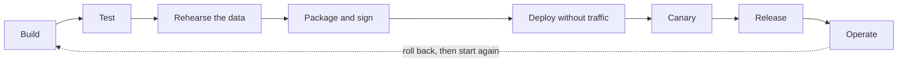
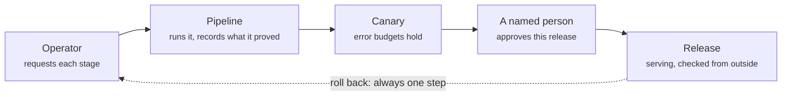

<!-- Generated by tools/docs.ts from docs/src/line/shipping.md. Edit the source, then run: node tools/docs.ts --write -->

# Shipping

> Package the code, the tests, the docs and the version history into a signed release, publish it to the repository and the sites, and deploy it to production with a person approving.

## TL;DR

Shipping takes a product that passed QA and does two things. First it packages: the code, the tests, the docs and the version history become one signed release, with a bill of materials and the licences checked, and it is published to the repository and to the sites. Then it deploys: the release goes to people in 8 stages (build, test, rehearse the data, package and sign, deploy without traffic, canary, release and operate), each with a gate. The operator requests each stage in order; the pipeline runs it under its own identity and records what it proved; a named person approves production after the canary; rolling back is always allowed and takes one step. No one, agent or person, skips a stage. [Deployment engineering](deployment.md) keeps the environments and the pipeline that do the deploying, and the [fleet](fleet.md) takes the release over the air.

## Explain it simply

The shelf is packed with its drawings, its test records and its history, and the shipment is sealed and signed. A copy is filed in the archive. Then it is delivered to one classroom first. Someone watches it for a day. If it holds, a teacher signs for the whole school, and the rest are delivered. If anything wobbles, the old shelves go back in one trip, and the new one goes back to the shop with a note.

## Engineer

### The release

A release is one package that holds what a person needs to trust and rebuild it:

| Part | What it is |
| --- | --- |
| The code | Built reproducibly from the build package, so the same bytes come out anywhere |
| The tests | The product's own, with the journeys QA walked |
| The docs | Built and checked fresh from the source, as a required check |
| The version history | The revision it was made from, with the reason and the change notice |
| The bill of materials and licences | Recorded for the exact artefact; every licence checked |
| The signature | A signed version tag, and signed provenance from the build service |

It is published to the repository and to the sites (zthr.ai is built and deployed from main the same way). What the repository holds today, and what is not there yet, is on the shipping page.

### The stages

The second step: deploying the release to production.

| Stage | What it proves | Gate |
| --- | --- | --- |
| Build | dependencies install from the lock file; types check; no secret-shaped value in the source or its history | every check passes |
| Test | every test passes; mutation scores hold their floors; every ratchet holds or tightens; every journey passes on the twins | every gate in the control plan passes |
| Rehearse the data | the schema revision migrates a copy with nothing lost; every integrity rule holds; no drift from the signed schema | the data pipeline rehearsal passes |
| Package and sign | the image is built by the build service, with signed provenance; a bill of materials is recorded; no critical or high vulnerability in the image | the image is signed and clean |
| Deploy without traffic | only a signed image can run; the new revision starts and is healthy; journeys pass against it, before anyone is sent to it | smoke journeys pass on the candidate |
| Canary | a small share of people use it; service levels hold: no fast burn of any error budget | a named person approves in production; the error budget is not burning |
| Release | everyone is moved to it; the previous revision stays ready to take traffic back in one step | service levels hold for the watch window |
| Operate | service levels watched continuously; integrity and drift checked nightly; every alert has a runbook; every incident becomes a defect, a test and a ratchet | an alert opens an incident |

### Who does what

| Who | Does | Cannot |
| --- | --- | --- |
| Operator | Requests each stage in order; asks a person to approve production; rolls back | Skip a stage, record a result, or touch credentials |
| Pipeline | Runs each stage under its own identity and records what it proved, with the build id | Request, approve or roll back |
| A named person | Approves production after the canary | Be replaced by a tool |

### Service levels

Every product is held to the service levels its schematic sets, watched from the first canary on. For the worked example: 99.5% Requests answered without a server error and 95.0% Requests answered within 1000 ms. A fast burn of any error budget rolls it back first and asks questions after.

### What travels in the package

The delivery pipeline (Cloud Build with verified provenance, image scanning, a software bill of materials and binary authorization), the service definition with a no-traffic tag and canary, the objectives and alerts, and the runbook are all generated into every package, so a product ships the same way as every other.

## Architect

Shipping turns *it passed* into *it is serving*: the system proves that what is running is what passed.

- **A release is one thing.** The code, tests, docs and history ship together and are signed together, so what is running can always be traced to what passed.
- **Stages are evidence, not ceremony.** Each records a result from the pipeline's own identity; the next cannot be requested until the last is recorded as passed.
- **Approval is narrow.** A person approves production with the canary's evidence in front of them; they are not asked to approve anything a machine can decide.
- **Going back is always one step.** Rollback needs no approval and restarts delivery from the first stage once the fix is admitted.
- **Every product ships the same way.** Generated stages, gates and runbooks make the fleet operable as one, whatever each product does.
- **Agents never hold deployment credentials.** The pipeline acts; agents request and read.
