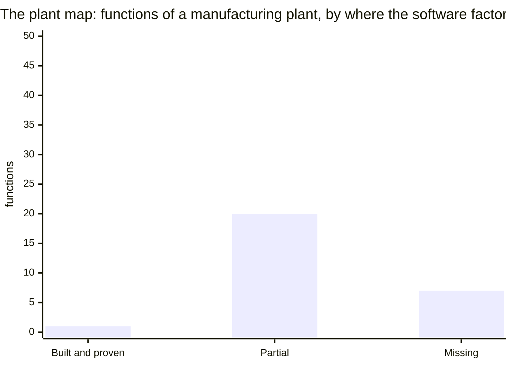

<!-- Generated by tools/docs.ts from docs/src/line/standards.md. Edit the source, then run: node tools/docs.ts --write -->

# The standards map

> Each area's discipline and standard, and each function of a manufacturing plant that brings a method, a number or a standard, its equivalent in the software factory, and where the factory stands on it: built and proven, partial, or missing.

## TL;DR

The plant borrows from manufacturing only where manufacturing brings a method, a number or a standard. Every area of the plant is a manufacturing discipline that works to a standard, and the first table names them. The second lists each function (28 functions: 1 built and proven, 20 partial, 7 missing), grouped by the area that carries it out, what it is in the software factory, and the evidence for where it stands. It is the factory's own audit of itself against the plant it is modelled on, and it says plainly what is missing.

## Explain it simply

This page is not the plant itself: [the plant](index.md) is the areas and how work moves between them, and its view at [/plant](https://zthr.ai/plant/) shows where each area stands today. This page is the list of standards behind it. A plant that makes parts has a lab that checks the gauges, inspectors who use them, a maintenance crew, a dock where supplies are checked as they arrive, a records office, and rules for what happens when a batch is bad. The software factory has, or needs, each of these. This page is the list: for each part of the plant, what it is here, and whether it is really there yet.

## Engineer

### Why these methods apply

A classic software build is deterministic: the same source gives the same result every time, so software never needed the statistics a plant uses to manage variation. AI workers bring variation back. The same task can pass on one run and fail on the next, and models differ in their defect rates. The plant's measurement disciplines (gauge R&R, control charts, certified gauges, first article inspection) were made for exactly that, and the factory's own records (pass rates per model per task kind, flake rates, mutation scores) are the data those methods consume.

### The line of practice

The factory stands in a long line of practice. Shewhart's control charts and Deming's quality system made variation something to measure rather than argue about; the Toyota Production System added stopping the line at a defect and maintaining equipment as planned work; automotive and aerospace quality turned measurement itself into a discipline, with measurement systems analysis (AIAG) and first article inspection (AS9102); lean software and DevOps carried flow and its measures into software delivery (the DORA measures of throughput and stability). AI workers reintroduce the process variation those disciplines were built for, so they apply directly rather than by analogy.

### The disciplines

Each area is one discipline, worked to one standard. This table is drawn from the plant model:

| Area | Discipline | Standard | Who does the work | Takes | Gives |
| --- | --- | --- | --- | --- | --- |
| Mission control | Plant management and production control | ISA-95 level 4 | person and agent | Every area’s evidence feed, and reports from the field | Priorities, approvals and stop-the-line to every area |
| Product lines | Product line management | APQP planning | person | The plant’s priorities | Products to define, each with its family’s defaults |
| Intent studio | Voice of the customer | Quality function deployment | person and agent | A person’s own words about what the product must do | A signed intent package to product engineering |
| Product engineering | Design engineering | Design FMEA and design review | agent | The signed intent package | The product spec to manufacturing engineering |
| Manufacturing engineering | Manufacturing engineering | Process FMEA, control plan, APQP | agent | The product spec | The build package to the line: routing, fixtures, gates and required checks |
| Factory floor | Production | Work instructions under a control plan | agent | The build package, driven along the line by its operator agent | The built product, with its measurements, to QA |
| QA | Quality control and inspection | First article inspection, AS9102 | agent | The built product | A pass to shipping, or a fail to rework with the failing evidence |
| Rework | Nonconformance and rework | ISO 9001 clause 8.7, corrective action | agent | A failed product with its failing evidence | The fixed product back to QA |
| Shipping | Shipping, release and configuration management | AS9100 configuration management | agent | A product that passed QA | A signed release in the repository, on the sites, and in production |
| Fleet | Field service and the installed base | Service bulletins and field updates | agent | Releases, delivered over the air | What the field shows, back to mission control |
| Maintenance | Maintenance | Total productive maintenance | crew | Work orders, from tags anyone raises | A factory floor that keeps running and gets better |
| Metrology | Metrology | ISO/IEC 17025, AIAG MSA | crew | Every gauge QA uses | Certified gauges, and a better QA process |
| Deployment engineering | Installation and field engineering | Commissioning and site acceptance | crew | Releases from shipping | Products running in production, updated over the air |

### The map

| Area | Plant function | Method or standard | In the software factory | Where it stands | Evidence |
| --- | --- | --- | --- | --- | --- |
| Mission control | Registrar audit | ISO 17021 certification audit | An outside party audits the factory against its own claims | missing | No outside audit has been made |
| Intent studio | Engineering change control | AS9100 configuration management | The intent signed by its holder; every change to it a signed revision | partial | A signature is bound to the exact content by hash; unprotected branches leave the repository’s own changes uncontrolled |
| Product engineering | FMEA | AIAG-VDA FMEA Handbook | Failure modes per block, ranked by severity, occurrence and detection, each with its preventive test | missing | No failure-mode analysis is recorded for any block |
| Product engineering | Tool crib | Controlled, certified tooling | The block library, each block certified before a product uses it | partial | The library is catalogued and tested; blocks are not yet issued only on a certificate |
| Manufacturing engineering | Document control | ISO 9001 clause 7.5; AS9100 | Journey cards locked by hash, the hash-chained ledger, signed provenance | partial | The ledger is hash-chained and journeys are locked by hash; branches are not protected, so the record can be bypassed |
| Manufacturing engineering | Control plan | AIAG APQP control plan | The required checks and the delivery stages, each with its gate | partial | Every stage and gate is defined; the reference pipeline does not yet run the data, signing, candidate, canary or operate stages |
| Manufacturing engineering | Poka-yoke | Error-proofing by design | Gates that make the wrong act impossible: person-only acts have no tool | built and proven | A test checks that no agent tool exists for any person-only act and that no tool admits a change |
| Manufacturing engineering | Kaizen | Continuous improvement | The improvement brief: one page a week, what to change and why | partial | Catalogued as a part for products; not yet produced for the factory itself |
| Factory floor | Work instructions | ISO 9001 clause 8.5.1 | Task specifications: what may be edited, the acceptance command, the budget | partial | Every mutation work order carries them; other task kinds have no written specification yet |
| Factory floor | Capacity planning | Load against capacity and cost | The model router: the cheapest model proven for each task kind, within the day’s budget | partial | The router and its dated price table are built and tested; no pass rates are measured yet |
| QA | Inspection (QA) | ISO 9001 clause 8.6 | Journeys walked as a person would; gates proven on planted defects; QA uses only certified gauges | partial | Gates carry planted-defect proofs; no gauge is certified yet, so the rule that QA uses only certified gauges is not met |
| QA | First article inspection | AS9102 | A new product’s first build measured against its reference, characteristic by characteristic | missing | Files is the first product; its reference recording does not exist yet |
| Rework | Nonconformance and review board | ISO 9001 clause 8.7 | A red build stops work on that line until it is dispositioned | missing | The reference build was red for 13 days while commits continued |
| Rework | Corrective and preventive action | ISO 9001 clause 10.2; AS9100 | Every fix with its preventive test: a test that fails first | partial | The acceptance gate enforces failing-first for mutation work orders; it is a rule, not a gate, for other changes |
| Shipping | Incoming inspection | CycloneDX SBOM; licence allow list | Every dependency in an SBOM, every licence checked; model suppliers qualified by measured pass rates | partial | SBOMs and the licence gate run in the supply-chain workflow; model suppliers have a dated price table but no measured pass rates yet |
| Shipping | Lot traceability | AS9100 identification and traceability | Commit to artefact digest to deployed digest | partial | Builds are reproducible and attested by digest; deploys name a movable tag, not a digest |
| Shipping | Certificate of conformance | AS9100 release documentation | The release record: signed provenance and an SBOM for the exact artefact | partial | Provenance and SBOM attestations are made on push; the release record does not yet bind the deployed digest |
| Maintenance | Maintenance | Planned maintenance work orders | The night shift: work orders from every tag, through the same gates as day work | partial | Work orders and their acceptance gate exist (tools/mutation); the crew’s runner is not live, so no shift has run |
| Maintenance | Andon | Stop-and-signal at the station | The tag: what, where, evidence and proving test, raised without stopping the line | partial | Calibration runs tag every survivor; other departments do not raise tags yet |
| Metrology | Metrology lab | ISO 10012 measurement management | Metrology: defines every measure QA uses and certifies every gauge | partial | Calibration runs nightly and on change (night-shift workflow, tools/mutation); repeatability and reproducibility are not measured yet |
| Metrology | Reference standards | Traceability to a reference (ISO/IEC 17025) | Published test vectors, a recording of the replaced system, sealed held-out phrasing sets | partial | Some blocks test against their RFC’s vectors; no Nextcloud recording yet; held-out sets sealed by convention only |
| Metrology | Gauge R&R | AIAG Measurement Systems Analysis | Repeatability: the flake rate. Reproducibility: the same verdicts in a fresh clone and on CI | missing | Neither is measured. Builds are reproducible byte for byte (tools/supply/repro.ts); test verdicts are not yet compared |
| Metrology | Calibration certificates and intervals | ISO 9001 clause 7.1.5 | A dated certificate per block: mutation score, survivors, rulings; re-run nightly and on every change | partial | Certificates are written to eval/mutation/ as blocks are calibrated; most blocks have none yet |
| Metrology | Gauge capability | AIAG Measurement Systems Analysis | Mutation score per block: does each test reject a planted defect | partial | Measured for the blocks calibrated so far; every survivor is a work order |
| Metrology | Measurement system analysis of a fixture | AIAG Measurement Systems Analysis | The Files oracle checked on planted differences: what it must report, what it must mask | partial | The oracle’s unit tests plant differences; there is no recorded corpus to run a planted-difference suite on |
| Metrology | Statistical process control | Shewhart control charts; Western Electric rules | Control charts on test time, flake rate, mutation score and cost per change; a signal raises a tag | missing | The chart logic exists in metrology; no series has the 25 points limits need |
| Metrology | Internal audit | ISO 19011 | The claims-to-evidence ledger: every claim proven, partial or unproven | partial | An audit has been run once (73 claims: 10 proven, 43 partial, 20 unproven); the claim-by-claim ledger is not yet a record the site reads |
| Deployment engineering | Service monitoring | The Site Reliability Workbook, burn-rate alerts | Error budgets watched in service; a fast burn rolls back | missing | Service levels are generated with the package; the reference pipeline does not watch them yet |

## Architect

- **A method, a number or a standard, or nothing.** A plant word is used here only where it brings one of the three, and the standard is named. Everywhere else the plain names are used: tag, gate, improvement brief.
- **Standing is evidence.** Built and proven means a test or a record shows it; partial means some of it exists and the gap is named; missing means it does not exist yet. Nothing on this map is promoted by intention.
- **The gaps are the plan.** Each missing or partial line is work: a reference to record, a measure to take, a gate to add. The areas that own them are named in the first column: [metrology](metrology.md) for the measures and certificates, [maintenance](maintenance.md) for the repairs, [manufacturing engineering](process.md) for the control plan and the gates.
