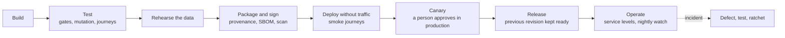

# Delivery and operations

How a signed release becomes running software, and how it is kept running. The pipeline is written once; each cloud is an
adapter over the same stages. Google Cloud is the first.

Each stage proves something and has a gate (generated from `src/delivery.ts`):

<!-- gen:stages -->
| Stage | What it proves | Gate |
| --- | --- | --- |
| Build | dependencies install from the lock file; types check; no secret-shaped value in the source or its history | every check passes |
| Test | every test passes; mutation scores hold their floors; every ratchet holds or tightens; every journey passes on the twins | every gate in the control plan passes |
| Rehearse the data | the schema revision migrates a copy with nothing lost; every integrity rule holds; no drift from the signed schema | the data pipeline rehearsal passes |
| Package and sign | the image is built by the build service, with signed provenance; a bill of materials is recorded; no critical or high vulnerability in the image | the image is signed and clean |
| Deploy without traffic | only a signed image can run; the new revision starts and is healthy; journeys pass against it, before anyone is sent to it | smoke journeys pass on the candidate |
| Canary | a small share of people use it; service levels hold: no fast burn of any error budget | a named person approves in production; the error budget is not burning |
| Release | everyone is moved to it; the previous revision stays ready to take traffic back in one step | service levels hold for the watch window |
| Operate | service levels watched continuously; integrity and drift checked nightly; every alert has a runbook; every incident becomes a defect, a test and a ratchet | an alert opens an incident |
<!-- /gen -->

On Google Cloud they run as:

| Stage | Proves | On Google Cloud |
| --- | --- | --- |
| Build | Dependencies from the lock file, types, no secret-shaped values | Cloud Build |
| Test | Tests, mutation floors, ratchets, journeys on the twins | Cloud Build |
| Rehearse the data | The migration keeps everything, integrity holds, no drift | Postgres beside the build |
| Package and sign | Signed build provenance, a bill of materials, no critical or high vulnerability | Cloud Build with verified provenance, Artifact Registry scanning and SBOM export |
| Deploy without traffic | Only signed images run; journeys pass on the candidate first | Binary Authorization, Cloud Run tagged revision |
| Canary | A share of people use it while error budgets hold | Cloud Run traffic split; production needs approval |
| Release | Everyone moves; the previous revision takes traffic back in one step | Cloud Run traffic |
| Operate | Service levels, nightly integrity and drift, a runbook per alert | Cloud Monitoring, Cloud Scheduler, a Cloud Run job |

## Service levels from the schematic

| Objective | From |
| --- | --- |
| Availability, 99.5% over 28 days | The team minimum |
| Requests within the feedback budget, 95% | The title block |
| People who start an outcome achieve it, at its target | Each outcome's target in use |

Each objective has a fast-burn alert that pages and a slow-burn alert that opens a ticket. Anything that must never happen
pages the first time it is logged. Every alert has a runbook entry, and every incident ends with a defect, a test and a
ratchet.

## Nothing changes a cloud project by itself

`delivery/gcp/setup.md` lists every service to turn on, every identity with the least roles it needs, the database with
point-in-time recovery, the secrets by name, the Binary Authorization policy and the build triggers, as commands a person
runs in Cloud Shell.
