# Rebuilding the most used open-source applications: the block plan

> One library of small, tested, dependency-free TypeScript blocks, chosen so that the hundred most used open-source applications can each be rebuilt from parts instead of from scratch.

## TL;DR

The library holds 310 built blocks, and 40 of the hundred applications below can be assembled entirely from them today: Nextcloud, WordPress, Immich, Home Assistant and Keycloak among them, and every one of the first ten rebuilds. Decomposing the hundred applications people most often self-host or build products on shows that a library of 418 blocks (333 new) lets every one of them be assembled from tested parts. The first 215 new blocks, taken in the order below from the 85-block foundation, bring the library to 300 and make 39 applications (about 72% of the usage-weighted total) fully assemblable. The first ten rebuilds, chosen for value and coverage, need 117 of the new blocks.

## How the blocks were chosen

1. **Inventory.** A hundred applications were ranked by the strongest usage evidence available: share of all websites, registered installations, survey counts, then GitHub stars.
2. **Decompose.** Each application was broken into the capabilities it needs (sign-in, file protocols, mail, search, billing, scheduling and so on) and each capability was assigned to one block.
3. **Reuse.** A capability that two or more applications need becomes one block with one interface. A block is plain TypeScript, takes its clock and randomness as arguments, has no runtime dependencies, and ships with `node:test` tests, as the existing blocks do.
4. **Select.** Blocks were ordered greedily: after the first ten rebuilds, repeatedly finish the application with the highest weight (one over its rank) per missing block, adding that block's own prerequisites first.

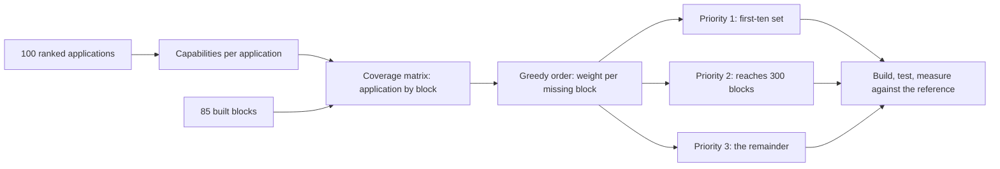

## Coverage as blocks are built

The chart counts applications that can be assembled entirely from tested blocks (first line) and the usage-weighted share of all application capability covered (second line, percent), against the number of new blocks built.

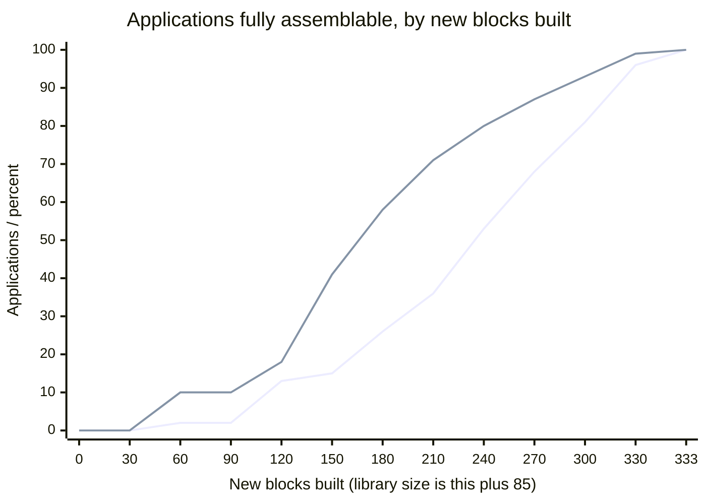

| New blocks built | Library size | Applications fully assemblable | Weighted share of applications |
| ---: | ---: | ---: | ---: |
| 0 | 85 | 0 | 0% |
| 30 | 115 | 0 | 0% |
| 60 | 145 | 2 | 10% |
| 90 | 175 | 2 | 10% |
| 120 | 205 | 13 | 18% |
| 150 | 235 | 15 | 41% |
| 180 | 265 | 26 | 58% |
| 210 | 295 | 36 | 71% |
| 240 | 325 | 53 | 80% |
| 270 | 355 | 68 | 87% |
| 300 | 385 | 81 | 93% |
| 330 | 415 | 96 | 99% |
| 333 | 418 | 100 | 100% |

The library crosses 300 blocks at 215 new blocks. The steep part of the curve after the first ten rebuilds comes from blocks that many applications share: protocols, mail, content, identity and billing.

## The block layers

Blocks sit in layers by what they are for. Each block names the blocks it relies on, so any block can be built and tested as soon as those exist.

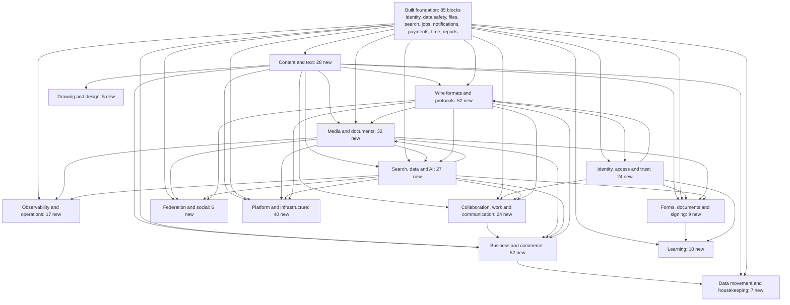

An arrow means the layer at its head draws on the layer at its tail. Inside a layer, blocks draw on one another in the order given under build order.

| Layer | New blocks | Examples |
| --- | ---: | --- |
| Wire formats and protocols | 52 | smtp-protocol, mail-queue, webpush, json-patch, websocket-frames |
| Content and text | 28 | template-engine, html-sanitize, markdown, toc-outline, text-diff |
| Media and documents | 32 | zip-write, pdf-parse, thumbnails, svg-writer, ocr-plan |
| Search, data and AI | 27 | timeseries, custom-fields, llm-provider, agent-loop, storage-policies |
| Identity, access and trust | 24 | jwt, ldap, magic-links, token-service, webauthn |
| Observability and operations | 17 | dashboards, geoip, alert-rules, prometheus-text, chart-spec |
| Collaboration, work and communication | 24 | wiki-pages, call-rooms, spam-heuristics, channels, tasks |
| Forms, documents and signing | 9 | document-templates, embed-protocol, form-builder, esign-envelope, signature-capture |
| Business and commerce | 52 | subscriber-lists, pricing, ledger, inventory, cart |
| Learning | 10 | quiz-engine, xapi-lrs, submissions, rubrics, lti |
| Federation and social | 6 | microblog, timeline-assembly, follow-graph, inbox-delivery, trending |
| Platform and infrastructure | 40 | api-client, credential-vault, workflow-graph, expression-engine, node-registry |
| Drawing and design | 5 | vector-geometry, scene-graph, svg-parse, layout-solver, design-tokens |
| Data movement and housekeeping | 7 | webhook-catalog, tenant-model, snapshot-restore, i18n-content, accessibility-checks |

Blocks the applications do not use directly (oracle, testdata, loadsoak, walkthrough, uat, console, factoryreports, feedback and surfaces) serve the factory itself: they measure and govern every rebuild. The oracle block is what compares a rebuild with its reference implementation.

## Highest-leverage blocks

| Block | Applications that use it | What it gives |
| --- | ---: | --- |
| thumbnails | 24 | Thumbnail and derivative planning with pure-TypeScript resize on raw pixel buffers and a cache key scheme |
| template-engine | 16 | Logic-light template language (Liquid/Handlebars/Jinja subset) with auto-escaping, filters, includes and step limits |
| markdown | 27 | CommonMark and GFM to an AST and escaped HTML, with tables, task lists, footnotes and source positions |
| webhook-catalog | 34 | Registry of outgoing webhook events with payload schemas, sample payloads and delivery log |
| oauth2-server | 22 | Authorization code with PKCE, client credentials, device flow, refresh rotation, scopes and consent |
| crud-from-schema | 10 | Generates REST list, get, create, update and delete routes with filters, permissions and validation from a declared schema |
| custom-fields | 17 | Typed custom fields attached to any record kind with validation, search and report integration |
| ldap | 32 | LDAP filter, DN, bind and search evaluation over a directory model, with attribute mapping and sync |
| plugin-manifest | 13 | Extension manifests, compatibility ranges, permissions requested, signed packages and update checks |
| webpush | 12 | Web Push (RFC 8030) with VAPID keys, payload encryption (RFC 8291) and subscription lifecycle |
| relations | 6 | Foreign keys, many-to-many with order, cascades, soft references and relation integrity checks |
| media-assets | 7 | Asset library with folders, formats, focal points, usage tracking and alt text coverage |
| link-preview | 9 | Open Graph, Twitter card and oEmbed fetch and parse with SSRF-safe fetching and size limits |
| i18n-content | 10 | Translatable content with locale variants, completeness, machine-translation hooks and review state |
| api-client | 10 | Generic outbound API client: auth styles, pagination styles, rate limit headers, retries and pagination state |

## Build order: the first thirty new blocks

Dependencies come first. Each block names what it relies on.

| # | Block | Relies on (new) | Why now |
| ---: | --- | --- | --- |
| 1 | webhook-catalog | built blocks only | used by 34 applications; 6 of the first ten |
| 2 | template-engine | built blocks only | used by 16 applications; 5 of the first ten |
| 3 | tenant-model | built blocks only | used by 10 applications; 4 of the first ten |
| 4 | smtp-protocol | built blocks only | used by 19 applications; 4 of the first ten |
| 5 | mail-queue | smtp-protocol | used by 17 applications; 4 of the first ten |
| 6 | api-client | built blocks only | used by 10 applications; 3 of the first ten |
| 7 | html-sanitize | built blocks only | used by 38 applications; 3 of the first ten |
| 8 | zip-write | built blocks only | used by 17 applications; 3 of the first ten |
| 9 | jwt | built blocks only | used by 27 applications; 3 of the first ten |
| 10 | ldap | built blocks only | used by 32 applications; 2 of the first ten |
| 11 | webpush | built blocks only | used by 12 applications; 2 of the first ten |
| 12 | credential-vault | built blocks only | used by 7 applications; 2 of the first ten |
| 13 | workflow-graph | built blocks only | used by 16 applications; 2 of the first ten |
| 14 | timeseries | built blocks only | used by 12 applications; 2 of the first ten |
| 15 | json-patch | built blocks only | used by 16 applications; 2 of the first ten |
| 16 | websocket-frames | built blocks only | used by 14 applications; 2 of the first ten |
| 17 | ws-rpc | websocket-frames | used by 13 applications; 2 of the first ten |
| 18 | magic-links | built blocks only | used by 5 applications; 2 of the first ten |
| 19 | token-service | jwt | used by 5 applications; 2 of the first ten |
| 20 | webauthn | built blocks only | used by 4 applications; 2 of the first ten |
| 21 | document-templates | template-engine | used by 8 applications; 2 of the first ten |
| 22 | mime | built blocks only | used by 14 applications; 2 of the first ten |
| 23 | pdf-parse | built blocks only | used by 8 applications; 2 of the first ten |
| 24 | asn1-der | built blocks only | used by 9 applications; 2 of the first ten |
| 25 | email-html | html-sanitize | used by 8 applications; 2 of the first ten |
| 26 | password-policy | built blocks only | used by 2 applications; 2 of the first ten |
| 27 | argon2id | built blocks only | used by 4 applications; 2 of the first ten |
| 28 | password-hash | argon2id | used by 4 applications; 2 of the first ten |
| 29 | xml-dsig | built blocks only | used by 27 applications; 2 of the first ten |
| 30 | saml | xml-dsig | used by 27 applications; 2 of the first ten |

## The hundred applications

Rank follows the usage evidence; the evidence for each is in `intent/catalog/oss100.json`. Where no figure could be retrieved the rank is a judgement and is marked so there.

| Rank | Application | Category | Blocks | Already built | Needs new |
| ---: | --- | --- | ---: | ---: | ---: |
| 1 | WordPress | CMS | 63 | 52% | 30 |
| 2 | n8n | Automation | 39 | 62% | 14 |
| 3 | Nextcloud | Files and collaboration | 62 | 55% | 28 |
| 4 | Immich | Photos | 52 | 60% | 21 |
| 5 | Home Assistant | Home automation | 42 | 57% | 18 |
| 6 | Supabase | Backend platform | 46 | 39% | 28 |
| 7 | Jellyfin | Media server | 49 | 61% | 19 |
| 8 | Gitea | Code hosting | 58 | 52% | 28 |
| 9 | Grafana | Observability | 37 | 49% | 19 |
| 10 | Uptime Kuma | Monitoring | 32 | 59% | 13 |
| 11 | Vaultwarden | Password manager | 34 | 59% | 14 |
| 12 | Syncthing | File sync | 15 | 53% | 7 |
| 13 | Open WebUI | AI | 44 | 57% | 19 |
| 14 | Moodle | Learning management | 52 | 44% | 29 |
| 15 | Odoo | ERP and CRM | 63 | 38% | 39 |
| 16 | Hoppscotch | API tooling | 35 | 51% | 17 |
| 17 | Superset | Business intelligence | 36 | 58% | 15 |
| 18 | Strapi | Headless CMS | 37 | 49% | 19 |
| 19 | Stirling-PDF | Document tools | 30 | 60% | 12 |
| 20 | Dify | AI | 41 | 54% | 19 |
| 21 | Ghost | Publishing | 54 | 54% | 25 |
| 22 | Mastodon | Social network | 48 | 50% | 24 |
| 23 | Plane | Project management | 41 | 56% | 18 |
| 24 | Penpot | Design | 40 | 62% | 15 |
| 25 | NocoDB | Low-code database | 34 | 59% | 14 |
| 26 | Twenty | CRM | 42 | 60% | 17 |
| 27 | Pi-hole | Network | 20 | 65% | 7 |
| 28 | Metabase | Business intelligence | 34 | 59% | 14 |
| 29 | Cal.com | Scheduling | 42 | 62% | 16 |
| 30 | Paperless-ngx | Document management | 43 | 63% | 16 |
| 31 | Discourse | Forum | 51 | 45% | 28 |
| 32 | Rocket.Chat | Team chat | 45 | 51% | 22 |
| 33 | Outline | Wiki | 40 | 62% | 15 |
| 34 | Appsmith | Low-code | 36 | 53% | 17 |
| 35 | Chatwoot | Customer support | 43 | 56% | 19 |
| 36 | Umami | Web analytics | 28 | 54% | 13 |
| 37 | Mattermost | Team chat | 45 | 53% | 21 |
| 38 | PostHog | Product analytics | 38 | 50% | 19 |
| 39 | Directus | Headless CMS | 39 | 49% | 20 |
| 40 | Forgejo | Code hosting | 39 | 59% | 16 |
| 41 | Keycloak | Identity | 41 | 44% | 23 |
| 42 | Medusa | Commerce | 38 | 50% | 19 |
| 43 | Plausible | Web analytics | 24 | 58% | 10 |
| 44 | Jitsi | Video conferencing | 23 | 61% | 9 |
| 45 | Harbor | Container registry | 32 | 59% | 13 |
| 46 | Wiki.js | Wiki | 38 | 63% | 14 |
| 47 | BookStack | Wiki | 40 | 75% | 10 |
| 48 | Bagisto | Commerce | 35 | 54% | 16 |
| 49 | Zulip | Team chat | 37 | 65% | 13 |
| 50 | Firefly III | Personal finance | 30 | 63% | 11 |
| 51 | Listmonk | Newsletters | 35 | 66% | 12 |
| 52 | Saleor | Commerce | 35 | 54% | 16 |
| 53 | Matomo | Web analytics | 32 | 62% | 12 |
| 54 | Excalidraw | Whiteboard | 12 | 17% | 10 |
| 55 | MinIO | Object storage | 32 | 62% | 12 |
| 56 | Authentik | Identity | 31 | 58% | 13 |
| 57 | Navidrome | Music server | 27 | 67% | 9 |
| 58 | Audiobookshelf | Audiobooks and podcasts | 28 | 68% | 9 |
| 59 | Memos | Notes | 20 | 80% | 4 |
| 60 | OpenProject | Project management | 42 | 60% | 17 |
| 61 | ERPNext | ERP | 43 | 42% | 25 |
| 62 | Invoice Ninja | Invoicing | 34 | 59% | 14 |
| 63 | Lemmy | Link aggregator | 34 | 53% | 16 |
| 64 | Baserow | Low-code database | 31 | 61% | 12 |
| 65 | Mealie | Recipes | 24 | 67% | 8 |
| 66 | PeerTube | Video | 40 | 62% | 15 |
| 67 | Pixelfed | Photo social network | 35 | 66% | 12 |
| 68 | Owncast | Live streaming | 28 | 64% | 10 |
| 69 | Woodpecker | CI | 29 | 66% | 10 |
| 70 | Seafile | File sync | 35 | 74% | 9 |
| 71 | Docuseal | E-signature | 29 | 66% | 10 |
| 72 | Documenso | E-signature | 32 | 62% | 12 |
| 73 | OpenSign | E-signature | 23 | 78% | 5 |
| 74 | Kimai | Time tracking | 27 | 78% | 6 |
| 75 | Leantime | Project management | 26 | 73% | 7 |
| 76 | Vikunja | Tasks | 28 | 68% | 9 |
| 77 | Formbricks | Surveys | 27 | 67% | 9 |
| 78 | LimeSurvey | Surveys | 27 | 74% | 7 |
| 79 | Typebot | Conversational forms | 25 | 72% | 7 |
| 80 | Postal | Mail delivery | 30 | 60% | 12 |
| 81 | Mautic | Marketing automation | 30 | 60% | 12 |
| 82 | PrestaShop | Commerce | 34 | 56% | 15 |
| 83 | Lago | Billing | 29 | 66% | 10 |
| 84 | Kill Bill | Billing | 27 | 70% | 8 |
| 85 | Hi.Events | Event ticketing | 27 | 74% | 7 |
| 86 | Pretix | Event ticketing | 28 | 71% | 8 |
| 87 | osTicket | Helpdesk | 28 | 64% | 10 |
| 88 | Zammad | Helpdesk | 31 | 61% | 12 |
| 89 | FreeScout | Helpdesk | 27 | 67% | 9 |
| 90 | Canvas LMS | Learning management | 32 | 56% | 14 |
| 91 | Wekan | Kanban | 26 | 73% | 7 |
| 92 | Huly | Project platform | 29 | 62% | 11 |
| 93 | SuiteCRM | CRM | 33 | 58% | 14 |
| 94 | Akaunting | Accounting | 30 | 60% | 12 |
| 95 | Snipe-IT | Asset management | 28 | 71% | 8 |
| 96 | GLPI | IT service management | 34 | 53% | 16 |
| 97 | Ghostfolio | Wealth tracking | 26 | 77% | 6 |
| 98 | Linkwarden | Bookmarks | 28 | 71% | 8 |
| 99 | FreshRSS | Feed reader | 26 | 77% | 6 |
| 100 | Miniflux | Feed reader | 25 | 72% | 7 |

## Evidence and limits

- [Awesome selfhosted sorted by stars (snapshot of GitHub star counts)](https://doreapp.github.io/awesome-selfhosted-sorted): GitHub stars for most ranked apps; snapshot date not stated on the page.
- [selfh.st 2025 Self-Host User Survey results (4,081 completed responses; raw JSON in the selfhst/cdn repository)](https://selfh.st/survey/2025-results/): Usage counts for file sync, media servers, wikis and notes, git; favourites for photos, passwords, automation, finance, recipes.
- [Open-source projects by GitHub stars, 2026 (ossalt)](https://ossalt.com/guides/best-open-source-projects-github-stars-2026): Stars for Supabase, Uptime Kuma, Grafana, Hoppscotch, Plane.
- [25 trending self-hosted projects on GitHub (DEV Community)](https://dev.to/web_dev-usman/25-trending-self-hosted-projects-on-github-4nom): Independent star figures for n8n, Open WebUI, Dify, Authentik and others, used as a cross-check.
- [W3Techs: usage statistics of WordPress](https://w3techs.com/technologies/details/cm-wordpress): 38.3% of all websites, 57.3% of sites with a known CMS (27 November 2026).
- [Moodle statistics](https://moodle.org/stats/): 161,020 registered sites, 412,226,523 users.
- [Keycloak celebrates 30k stars](https://www.keycloak.org/2025/10/30k-stars-celebration): 30,000 stars, over 1,350 contributors, CNCF incubating project.

- GitHub's API was not reachable from the build environment, so star counts come from the third-party snapshots above and are not all from the same date.
- Docker Hub pull counts could not be retrieved in this run; no pull figures are used.
- Apps whose usageEvidence says no figure was retrieved are ranked by judgement, placed among measured apps by how widely they are deployed; their ranks are the least certain.
- Stars measure interest, not use: where the survey or W3Techs give a use measure, it takes precedence in the ordering.
- The specification references in the catalogue name the nearest specified item; in a few cases that item is broader than the block.
- Applications considered and left out of the hundred for lower evidence or overlap: Traefik, AdGuard Home, Taiga, Tandoor, Wallabag, Answer, Actual Budget, Sylius, Joplin.

## The first ten rebuilds

Each rebuild is measured against a reference implementation, the way the Files application is measured against Nextcloud: the same requests go to both, and the answers are compared. A rebuild is complete when it matches the reference on the behaviours people use and fails on the planted defects the tests introduce.

| Order | Application | Rank | New blocks it needs | Reference |
| ---: | --- | ---: | ---: | --- |
| 1 | Vaultwarden | 11 | 14 | Bitwarden server API and official clients |
| 2 | Uptime Kuma | 10 | 13 | Uptime Kuma 2.x |
| 3 | Umami | 36 | 16 | Umami collection and statistics API |
| 4 | Listmonk | 51 | 13 | listmonk REST API |
| 5 | Cal.com | 29 | 27 | Cal.com slots and bookings API |
| 6 | Paperless-ngx | 30 | 17 | Paperless-ngx REST API |
| 7 | BookStack | 47 | 11 | BookStack REST API |
| 8 | Documenso | 72 | 17 | Documenso API and a PDF signature validator |
| 9 | Keycloak | 41 | 24 | Keycloak and the OpenID conformance suite |
| 10 | n8n | 2 | 14 | n8n workflow format and semantics |

### 1. Vaultwarden

**What it is.** A server for a password manager. People keep logins, cards, notes and keys in an encrypted vault that their phone, browser and desktop apps share. The server stores and syncs the vault but cannot read it, because the apps encrypt everything before it leaves the device.

**Who uses it.** Individuals, families and small teams who self-host; the most favoured password manager in the 2025 self-hosting survey.

**Why it is high value.** It guards the most sensitive data a person owns, its server surface is small, and the wire protocol is fixed by official clients, so every behaviour can be compared byte for byte with a reference.

**Blocks it uses.** 34 blocks in all: 20 already built and 14 new.

- Already built: validate, config, observe, health, secheaders, accounts, sessions, rbac, audit, migrations, paging, ratelimit, crypto, jobs, watchdog, backups, retention, cache, objects, uploads.
- New: argon2id, password-hash, vault-model, password-policy, webauthn, magic-links, secret-sharing, password-generator, jwt, token-service, webpush, smtp-protocol, mail-queue, snapshot-restore.

**What is missing.**

- Mobile push relay (provider interface and twin only)
- Duo, YubiKey cloud and other third-party second factors (interface and twin only)
- Client applications themselves

**Reference implementation.** The Vaultwarden server and the official Bitwarden server API, exercised by the official Bitwarden command-line client and browser extension through the oracle block.

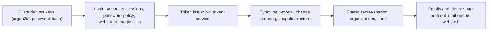

### 2. Uptime Kuma

**What it is.** A monitor that checks websites, servers and services on a schedule, alerts people when one fails, and publishes status pages.

**Who uses it.** Self-hosters, small teams and agencies that want to know before their customers do.

**Why it is high value.** Almost every product needs uptime checks and a status page, the checks are well defined, and it exercises probes, alert rules and public pages that every other rebuild reuses.

**Blocks it uses.** 32 blocks in all: 19 already built and 13 new.

- Already built: validate, config, observe, health, secheaders, accounts, sessions, rbac, audit, migrations, paging, ratelimit, crypto, jobs, watchdog, backups, retention, cache, notify.
- New: uptime-probes, push-monitors, status-pages, alert-rules, asn1-der, cert-store, dns-wire, timeseries, prometheus-text, webpush, api-client, websocket-frames, ws-rpc.

**What is missing.**

- ICMP ping and other raw-socket probes (provider interface; the runtime supplies the socket)
- Real-browser probes
- Most of the 90 or so notification providers (each is an adapter over api-client)

**Reference implementation.** Uptime Kuma 2.x: its monitor semantics, socket events, status page JSON and badge output.

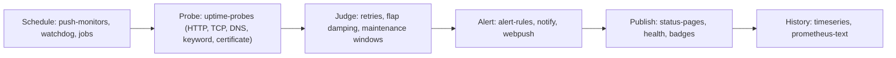

### 3. Umami

**What it is.** Privacy-first web analytics. A small script on a site sends page views and events; the server counts visitors, sessions, sources, funnels and retention without cookies or personal data.

**Who uses it.** Site owners, product teams and agencies that want analytics without a consent banner or a data broker.

**Why it is high value.** Analytics is a universal need, the data model is simple, and it reuses ingest, rollups and charts that every dashboard product needs.

**Blocks it uses.** 28 blocks in all: 15 already built and 16 new.

- Already built: validate, config, observe, health, secheaders, accounts, sessions, rbac, audit, migrations, paging, ratelimit, crypto, consent, analytics.
- New: web-analytics, ua-parse, geoip, timeseries, columnar-agg, cohorts, sketches, rest-filter-syntax, view-engine, dashboards, svg-writer, chart-spec, stats-basic, experiments, tenant-model, webhook-catalog.

**What is missing.**

- The browser tracker script (a UI asset, not a block)
- IP-to-place data files (licensed data, supplied at deploy time)
- Database back ends beyond the store the factory generates

**Reference implementation.** Umami's collection and statistics API, compared by replaying the same event stream into both.

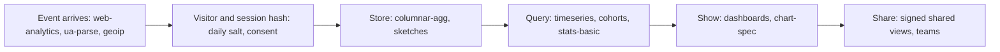

### 4. Listmonk

**What it is.** A mailing-list and newsletter server: people subscribe, an editor writes a campaign, and the server sends it in throttled batches and tracks bounces and clicks.

**Who uses it.** Publishers, nonprofits and product teams that send their own newsletters instead of paying per subscriber.

**Why it is high value.** Email at volume is hard to get right, costs real money on hosted services, and the same blocks serve receipts, digests and marketing automation.

**Blocks it uses.** 35 blocks in all: 23 already built and 13 new.

- Already built: validate, config, observe, health, secheaders, accounts, sessions, rbac, audit, migrations, paging, ratelimit, crypto, jobs, watchdog, backups, retention, cache, importer, consent, analytics, reports, query.
- New: smtp-protocol, mail-queue, mail-tracking, campaigns, subscriber-lists, segments, mime, bounce-classify, html-sanitize, email-html, template-engine, email-address, dkim-sign.

**What is missing.**

- POP3 bounce mailbox polling (a thin addition to imap-protocol)
- Provider-specific bounce webhooks (adapters)
- Visual email editor (UI)

**Reference implementation.** listmonk's REST API and its template functions, compared on the same subscriber and campaign fixtures.

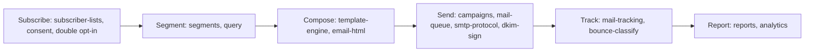

### 5. Cal.com

**What it is.** Scheduling: a person publishes their availability, others pick a time, and both calendars update with a meeting link and reminders.

**Who uses it.** Consultants, sales and support teams, clinics and anyone who sells time.

**Why it is high value.** Booking is a daily-use product with a sharp definition of correct: no double bookings, correct across time zones and daylight-saving changes. The library already holds the time and booking cores.

**Blocks it uses.** 42 blocks in all: 26 already built and 27 new.

- Already built: validate, config, observe, health, secheaders, accounts, sessions, rbac, audit, migrations, paging, ratelimit, crypto, jobs, watchdog, backups, retention, cache, i18n, notify, pwa, palette, ux, booking, time, payments.
- New: icalendar, caldav, sun-calc, pricing, ledger, inventory, cart, checkout, assignment-rules, smtp-protocol, mail-queue, sequences, embed-protocol, webhook-catalog, jwt, client-registry, oauth2-server, websocket-frames, ws-rpc, webrtc-signaling, call-rooms, entitlements, tenant-model, api-client, credential-vault, formula-engine, form-builder.

**What is missing.**

- Google and Microsoft calendar provider connections (adapters over api-client and credential-vault)
- Video provider integrations (adapters)
- Payment provider apps beyond the provider interface

**Reference implementation.** Cal.com's availability and bookings API (its slots endpoint), compared across a matrix of zones, buffers and recurring rules.

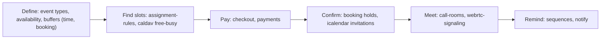

### 6. Paperless-ngx

**What it is.** A document archive. Scans and emails arrive in an inbox, are read by OCR, are filed with tags, correspondents and dates by matching rules, and become searchable.

**Who uses it.** Households, accountants and small offices going paperless.

**Why it is high value.** Every organisation drowns in documents; the pipeline (intake, extract, classify, search) is what most document products need.

**Blocks it uses.** 43 blocks in all: 27 already built and 17 new.

- Already built: validate, config, observe, health, secheaders, accounts, sessions, rbac, audit, migrations, paging, ratelimit, crypto, jobs, watchdog, backups, retention, cache, objects, uploads, uploadsafe, imagemeta, tree, pdf, search, docparse, privacy.
- New: fuzzy-match, doc-classify, consume-inbox, pdf-parse, ocr-plan, thumbnails, storage-policies, imap-protocol, mime, email-threading, custom-fields, workflow-graph, unicode-text, template-engine, document-templates, zip-write, multipart-parse.

**What is missing.**

- The OCR engine itself (provider interface and twin; a real engine runs outside)
- PDF/A conversion
- Mobile scanner apps

**Reference implementation.** Paperless-ngx's REST API and its matching rules, checked on a corpus of sample documents.

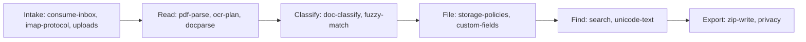

### 7. BookStack

**What it is.** A wiki organised as shelves, books, chapters and pages, with a rich editor, revisions, permissions and PDF export.

**Who uses it.** Teams and IT departments documenting how things work.

**Why it is high value.** Documentation is every team's second product; the page tree, revisions and permissions are reused by every knowledge product, and the library already holds history, search and tree.

**Blocks it uses.** 40 blocks in all: 30 already built and 11 new.

- Already built: validate, config, observe, health, secheaders, accounts, sessions, rbac, audit, migrations, paging, ratelimit, crypto, jobs, watchdog, backups, retention, cache, i18n, notify, pwa, palette, ux, oidc, pdf, search, grants, drafts, history, tree.
- New: html-sanitize, markdown, wiki-pages, toc-outline, text-diff, xml-dsig, saml, ldap, template-engine, webhook-catalog, zip-write.

**What is missing.**

- The visual editor (UI)
- Diagram editing (external service)
- High-fidelity HTML to PDF layout

**Reference implementation.** BookStack's REST API and export formats, with its permission model compared page by page.

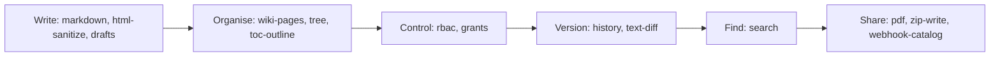

### 8. Documenso

**What it is.** Electronic signing. A sender uploads a document, places signature fields, invites signers in order, and receives a sealed PDF with a certificate of completion.

**Who uses it.** Small businesses, landlords, freelancers and HR teams that sign contracts every week.

**Why it is high value.** Signing is high-value and high-trust, the process is a precise state machine, and the sealing and evidence blocks are reused anywhere a record must be provably unchanged.

**Blocks it uses.** 32 blocks in all: 20 already built and 17 new.

- Already built: validate, config, observe, health, secheaders, accounts, sessions, rbac, audit, migrations, paging, ratelimit, crypto, jobs, watchdog, backups, retention, cache, pdf, oidc.
- New: pdf-parse, pdf-forms, esign-envelope, signature-capture, asn1-der, trusted-timestamp, pdf-sign, document-seal, template-engine, document-templates, webhook-catalog, tenant-model, smtp-protocol, mail-queue, html-sanitize, email-html, zip-write.

**What is missing.**

- Qualified electronic signatures from trust service providers
- Hardware-backed signing certificates
- In-browser PDF viewer (UI)

**Reference implementation.** Documenso's document and recipient API, with the sealed PDF checked by an independent PDF signature validator.

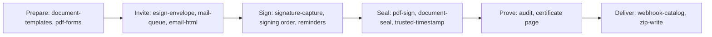

### 9. Keycloak

**What it is.** An identity server: one place where people sign in once and every application trusts the answer, using OpenID Connect, OAuth 2, SAML, LDAP and passkeys.

**Who uses it.** Enterprises, platform teams and every company with more than a handful of internal apps.

**Why it is high value.** Identity is the shared dependency of every other rebuild and has a public conformance suite, so correctness can be proved rather than argued.

**Blocks it uses.** 41 blocks in all: 18 already built and 24 new.

- Already built: validate, config, observe, health, secheaders, accounts, sessions, rbac, audit, migrations, paging, ratelimit, crypto, jobs, watchdog, backups, retention, cache.
- New: realm-model, client-registry, jwt, oauth2-server, token-service, oidc-provider, xml-dsig, saml, ldap, json-patch, scim, identity-brokering, login-flows, webauthn, argon2id, password-hash, password-policy, magic-links, signing-keys, access-policy, iam-policy, tenant-model, webhook-catalog, cors-cookies.

**What is missing.**

- Kerberos and SPNEGO
- Hardware attestation trust stores for passkeys
- The administration console (UI)
- Rarely used UMA authorisation services

**Reference implementation.** Keycloak itself, plus the OpenID Foundation conformance suite for OpenID Connect.

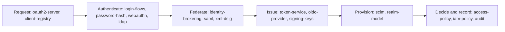

### 10. n8n

**What it is.** Workflow automation. People draw a graph of triggers and steps that move data between services, and the engine runs it on a schedule, on a webhook, or on demand.

**Who uses it.** Operations teams, developers and citizen builders connecting systems without writing integrations.

**Why it is high value.** It is the most-starred application in the inventory, and its engine (graph, expressions, credentials, retries, run history) is the connective tissue the factory itself needs.

**Blocks it uses.** 39 blocks in all: 24 already built and 14 new.

- Already built: validate, config, observe, health, secheaders, accounts, sessions, rbac, audit, migrations, paging, ratelimit, crypto, jobs, watchdog, backups, retention, cache, webhooks, etl, importer, tabular, mcp, resilience.
- New: workflow-graph, expression-engine, json-schema, node-registry, credential-vault, api-client, trigger-polling, execution-log, json-patch, jsonpath, llm-provider, agent-loop, webhook-catalog, template-engine.

**What is missing.**

- The several hundred integration nodes (each an adapter over node-registry and api-client)
- A sandbox for user-written code steps
- Community node marketplace

**Reference implementation.** n8n's workflow JSON format and its node execution semantics, run on exported workflows and compared item by item.

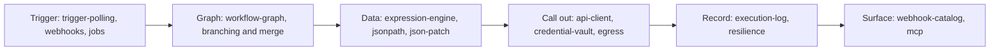
