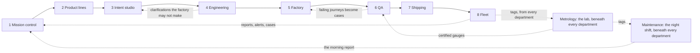

# The line, walked by the people who use it

zthr.ai's tools are one line of departments, in the order work moves through them. Eight people walk it below, each with their own job to get done. A script walks every step in a real browser, and checks each page against WCAG 2.2 A and AA.

| Department | What it is for | What carries forward |
| --- | --- | --- |
| Mission control | Every line and product, where each stands, what is waiting on a person | The product in focus |
| Product lines | Who a line serves, its end in mind, its compliance, sign-in and other spec-sheet defaults | The defaults, into every product started in the line |
| Intent studio | The words, the questions only the expert can settle, the review, and the signature | The signed schematic |
| Engineering | The complete specification (outcomes, information, compliance, operations, measures and tests, spec sheet and manifest) with a checklist, and the release | The released package |
| Factory | What the factory built and measured | The build |
| QA | Journeys walked as a person would, gates proven able to fail, ratchets | The certified phases |
| Shipping | The delivery stages and their gates, and the service levels the product will be held to | The shipped build |
| Fleet | What is in service, the library where it is used, and sensitive data across every app | Reports and alerts, back to mission control |
| Metrology, beneath the line | The measures QA uses and their references, gauge certificates, control charts, and the claims audit | Certified gauges, to QA; tags, to maintenance |
| Maintenance, beneath the line | What every department tagged, the morning report, gauge scores per block, and the crew's cost and pass rates | The morning report, back to mission control |

Every page carries the same bar: the departments, numbered in order, then metrology and maintenance beneath them, unnumbered, the product in focus, and a lamp for where that product stands in each department. Every page ends with one handoff to the next department. The handoff is filled in only when the work there is ready to go on.

## Who walked it

| Persona | Job | Path |
| --- | --- | --- |
| Dana, program director | See what needs her, and whether anything shipped is hurting | Mission control, then Fleet |
| Marcus, product-line owner | Set up a line once, so every product in it starts right | Product lines |
| Rosa, director of student success | Say what Bill help must do, and sign it | Product lines, then the intent studio |
| Priya, engineer | Make the specification complete, and release it | Engineering |
| Ken, factory operator | See what is being built for which product | Factory |
| Alma, QA lead | See what was walked and what holds | QA |
| Lee, release manager | See how a product will ship, and what holds it in service | Shipping |
| Jo, low-vision keyboard user | All of the above, by keyboard, zoomed, on a phone | Every page |

## Grades

Seven axes, A to F:
- **Find:** they reach the department.
- **Grasp:** they know what it is for within ten seconds.
- **Act:** the next action is obvious.
- **Carry:** the product in focus and its choices come with them.
- **Truth:** every number is sourced, or shown as not measured.
- **Access:** keyboard, screen reader and narrow screens all work.
- **Delight:** the density and the craft.

Grades are given for the tools as they were (three surfaces joined by a bar), and after joining the line and fixing what the first walk found.

| Persona | Find | Grasp | Act | Carry | Truth | Access | Delight | Overall |
| --- | --- | --- | --- | --- | --- | --- | --- | --- |
| Dana, before | B | C | D | D | A | A | B | C |
| Dana, after | A | A | A- | A- | A | A | B+ | A- |
| Marcus, before | F | F | F | F | n/a | n/a | n/a | F |
| Marcus, after | A | A | A | A | A | A | B+ | A |
| Rosa, before | A | A- | B | C | A | A | B+ | B |
| Rosa, after | A | A | A | A | A | A | B+ | A |
| Priya, before | C | C | C | B | A | A | B | C+ |
| Priya, after | A | A | A | A | A | A | A- | A |
| Ken, before | B | B | C | D | B | A | B | C+ |
| Ken, after | A | A | B+ | A- | A | A | B | A- |
| Alma, before | C | B | C | D | A | A | B | C+ |
| Alma, after | A | A | A- | A- | A | A | B | A- |
| Lee, before | F | F | F | F | n/a | n/a | n/a | F |
| Lee, after | A | A | B | A- | A | A | B | B+ |
| Jo, before | B | B | B | C | A | A- | B | B |
| Jo, after | A | A | A- | A | A | A | B | A- |

Before, a product line could not be defined at all, and shipping existed only inside the operations view of one intent. The specification was eight of twelve tabs inside the studio. QA was most of the factory page. The fleet was a figure on mission control. Nothing carried the product from one surface to the next.

## What the first walk found, and what changed

- The form for defining a line did not submit: a field named `id` hid the form's own id. Renamed; the walk now defines a line and starts a product in it.
- A new product arrived in the studio with its words folded away. It now opens on its first blank line, with the cursor there and a note saying what the line filled in.
- Engineering showed as holding for an empty intent. It now waits until the product is signed, fails only on a signed schematic with a gap, and holds once a revision is released.
- Mission control listed products twice. The older list went; the table of products along the line stayed, and each of its lamps opens that department with the product in focus.
- Shipping repeated eight stages, each not measured, for the reference product. They are now one row of lamps.
- The factory and QA showed the reference product's build with nothing saying so while another product was in focus. Each now says first where the product in focus stands, and that the readings below are the reference product's.
- Signing and releasing were one panel in the studio. Signing stays with the person who holds the intent, in the studio. Releasing moved to engineering, which shows whether the schematic is signed and by whom.
- On a phone, the line opened at its start on every page, so the department you were in was off screen. It now opens on the department you are in.
- Engineering's checklist did not show the housekeeping each product inherits. It now counts it, and says how much starts from tested blocks.
- Starting a new intent cleared the old one. Now the old one is kept whole and can be opened again from product lines.

## What is still open

- **Shipping stage results.** The reference factory's feed does not yet carry a result for each delivery stage, so shipping shows each stage as not measured. The feed needs a `delivery` block written by the pipeline's own `stage_record` calls.
- **The factory's own decisions.** Mission control's list of what is waiting on a person shows only what the browser knows. The factory's proposals (clarifications it may not make, production approvals, cases that stopped converging) are read with `intent agents proposals` until the ledger publishes them into the feed.
- **Agreement among raters.** The persona grades are one rater's. A second family grading the same walk would show whether the grades agree.
