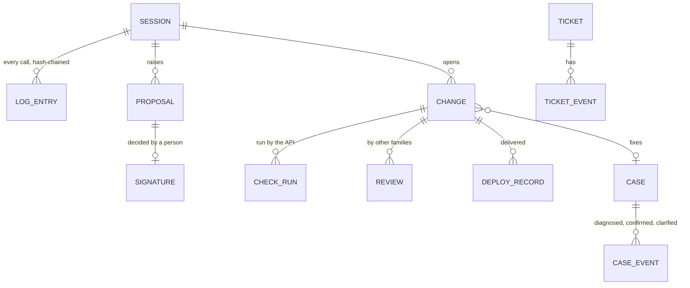

# Architecture

> One deterministic engine, the surfaces that use it, the package it releases, and the records that keep every department honest.

## TL;DR

The engine reads intent by rule, prepares a numbered schematic, specifies it in full, and releases a hashed package. The surfaces (intent studio, engineering, the consoles) are views over that engine. The agent API runs the factory over the same engine, with roles defined by what they are denied and a hash-chained record of every call. Everything is plain TypeScript with no server of its own; the site is static and the engine runs in the browser.

{{diagram:architecture}}

## Explain it simply

There is one rulebook, and everyone uses the same copy. The customer's words go in one end; a numbered drawing comes out; a sealed packet of everything the shop needs comes out of that. Every department reads from the same rulebook and writes only in its own logbook, and every page of every logbook is numbered so a torn-out page shows.

## Engineer

### Modules

| Module | Does |
| --- | --- |
| `src/intake` | Reads every form ({{intake.forms}}) into one canonical model |
| `src/pipeline.ts` | Prepares: readings merged, statements ballooned, gaps checked, questions ranked |
| `src/lexicon.ts`, `src/derive.ts` | The design lexicon ({{lexicon.terms}} terms) and derivation rules ({{derive.rules}}) |
| `src/manifest.ts` | The build manifest from {{catalog.parts}} catalogued parts and the library |
| `src/schema.ts`, `src/prisma.ts`, `src/datapipeline.ts` | The information, its DDL and migrations, provided Prisma, and data CI/CD |
| `src/outcomes.ts` | The outcome framework, with platform outcomes mapped introduced, refined or mastered |
| `src/compliance.ts` | Scope, controls, the sensitive-data inventory, the gate policy and the OSCAL component |
| `src/interfaces.ts`, `src/connectors.ts` | API, events, agent tools, training and documentation; connector stubs |
| `src/delivery.ts`, `src/reports.ts` | Delivery stages, service levels, runbook; reports and use tracking |
| `src/release.ts` | The hashed package, its change notice and its agents' brief |
| `src/agents/` | The agent API: roles, ledger, tools, correction cases, cost, MCP server, supervisor |
| `src/studio`, `src/console` | The intent studio and engineering; mission control, lines, factory, QA, shipping, fleet |
| `blocks/` | Housekeeping blocks: tested code every product starts from |

### The package

{{table:package}}

{{diagram:package-erd}}

### The records

### Testing the system itself

{{tests.intent}} tests cover the engine, the agent API, the generated SQL (run in DuckDB), the information pipeline (run on PostgreSQL), the compliance set (validated against NIST's schema), the Rego policy, the Prisma output and the blocks. Every page of the site is walked in a real browser and checked against WCAG 2.2 A and AA, and these docs are regenerated and compared on every run.

## Architect

### Decisions that hold the system together

- **Determinism first.** Rules do everything they can; models only read. The same input gives the same package bytes, so every change of meaning is a diff and every package can be rebuilt.
- **One source per fact.** Every figure and table in these docs is generated from the code by `tools/docs.ts`, and a test fails when a doc is stale. The package's brief for agents is generated from the package.
- **Static by default.** The site is static; the engine runs in the browser; the only server-side state is sign-in, invitations and reports. Nothing about a person's intent leaves their browser unless they release it.
- **Authority by absence.** Person-only acts have no tool; agents never hold deployment credentials; generated files cannot be hand-edited without failing their freshness check.
- **Plain files as the interface.** The package is files a person can read and any factory can build to; nothing requires this tool to interpret it.

### Where it runs

| Piece | Runs on |
| --- | --- |
| zthr.ai pages | Firebase Hosting, static, behind Google sign-in by invitation |
| Sign-in, invitations, reports | Firebase Auth and Firestore, with rules tested in the emulator |
| The engine | The browser, and Node for the command line and the agent API |
| The factory's model calls | Vertex AI and Ollama, through one OpenAI-compatible loop, metered against a ceiling |
| Builds and delivery | Cloud Build and Cloud Run, from the generated pipeline |
