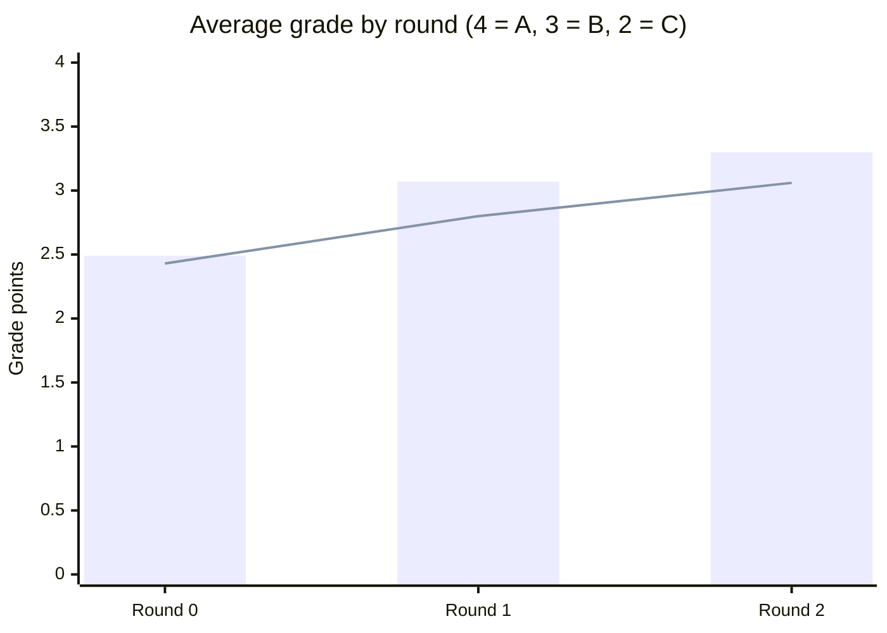

# Persona evaluation

Each persona walks the real pages in Chrome, cold, at their own screen size, trying the task they would come with. Every grade cites findings from that walk. Three personas are held out: they are graded every round but never used to choose a fix, so a rise in their grades is evidence the fixes are general rather than fitted.

Bars are the 10 driving personas; the line is the 3 held out. Driving: C+ → B → B+. Held out: C+ → B- → B.

```mermaid
xychart-beta
  title "By axis, driving personas: round 0 to round 2"
  x-axis ["First-open", "Process", "Effort", "Trust", "Depth", "Craft", "Openness"]
  y-axis "Grade points" 0 --> 4
  bar [1.86, 2.42, 2.37, 2.64, 3.26, 2.65, 2.25]
  bar [3.15, 3.40, 2.87, 3.55, 3.65, 3.24, 3.23]
```

## The axes

| Axis | What it asks |
| --- | --- |
| First-open value | Opening the example, does the value leap out within a minute, and does it make me want to drill in? |
| Process clarity | Do I always know where I am, what happens next, and why I am being asked? |
| Effort to express intent | Is getting my meaning in, and settling what is open, fast and natural for someone like me? |
| Trust and honesty | Is every claim checkable, every source shown, and nothing overstated, including sample data? |
| Depth on demand | Can I drill from any summary to the exact statement, rule, part, journey or file behind it? |
| Craft and access | Is it well made, readable and accessible: layout, type, contrast, phone, keyboard, screen reader? |
| Openness and extensibility | Can I see how it works, extend its rules and parts, integrate its outputs, and contribute? |

## The personas

| Persona | Role | Screen | Comes to |
| --- | --- | --- | --- |
| Denise Harper | Director of Student Success at a community college | laptop, 1440 | Get a tool built that warns students before a missed bill becomes a crisis, without waiting a year for IT |
| Raj Mehta | Senior product manager, B2B SaaS | laptop, 1440 | Turn a PRD into something engineering cannot misread, and see the acceptance tests before sprint planning |
| Lena Okafor | Non-technical founder, home-health services startup | phone, 390, between client visits | Find out what it would take to build her scheduling app and what it would cost to keep honest |
| Tom Brennan | Staff engineer, payments platform | desktop, 1920 | Find the hole: where does the model get to decide, and what stops it shipping wrong code |
| Aiko Sato | Product designer | laptop, 1440 | Judge whether the experience is crafted, and whether feel words like calm survive to the build |
| Grace Liu | QA lead and test architect | desktop, 1920 | See whether the journeys and coverage would actually catch defects, and how many tests she would get |
| Marcus Reed | CISO, regional health system | desktop, 1920 | Decide whether anything built this way could pass his review |
| Dr. Priya Raman | Research scientist, evaluations team at an AI lab | laptop, 1512 | Judge whether this is a real contribution to specification and evaluation, or a nice UI over prompts |
| Sam Whitaker | Partner, seed and Series A fund focused on developer tools and AI | laptop, then phone | Decide in five minutes whether there is a wedge and a moat |
| Jordan Ellis | Open source maintainer and advocate | laptop, 1440 | See whether this is genuinely open: licence, source, formats, and whether outsiders can extend it |
| Rosa Delgado *(held out)* | Accessibility consultant; low vision, uses a screen reader and 200% zoom | laptop at 200% zoom, screen reader | Find out whether a non-sighted or low-vision person can state intent and sign it |
| Kenji Watanabe *(held out)* | Manufacturing engineering manager at an automotive supplier | desktop, 1920 | Check whether the manufacturing vocabulary is used correctly or just borrowed |
| Keisha Moore *(held out)* | Community health worker who would use an app built this way | phone, 360, mid-shift | A colleague sent her the example link: does she understand what it is and whether it would help her clients |

## Round 2

**Build:** Your own end in mind settles a reading difference; chain aligned and counts suggested journeys; map text larger; contributing guide. **Walk:** Same walk as round 1. **Closed:** N1, N2, N4, N5. **Partly:** N3, F12.

| Persona | First-open value | Process clarity | Effort to express intent | Trust and honesty | Depth on demand | Craft and access | Openness and extensibility | Average |
| --- | :---: | :---: | :---: | :---: | :---: | :---: | :---: | :---: |
| Denise Harper | B+ | B+ | B | B+ | B+ | B+ | B- | B+ |
| Raj Mehta | B+ | A- | B | A- | A- | B+ | B+ | B+ |
| Lena Okafor | B- | B- | C+ | B | B- | B- | C+ | B- |
| Tom Brennan | B | B+ | B | A- | A | B+ | B+ | B+ |
| Aiko Sato | B+ | B+ | B | B+ | A- | B+ | B | B+ |
| Grace Liu | B+ | A- | B | A- | A | B+ | A- | A- |
| Marcus Reed | B | A- | B- | A- | A- | B+ | B+ | B+ |
| Dr. Priya Raman | B+ | A- | B- | A- | A | B+ | A- | B+ |
| Sam Whitaker | B+ | B+ | B | A- | A- | B+ | B+ | B+ |
| Jordan Ellis | B | B+ | B | A- | A- | B+ | A- | B+ |
| Rosa Delgado *(held out)* | B | B+ | B | A- | B+ | B+ | B | B+ |
| Kenji Watanabe *(held out)* | B+ | A- | B | A- | A | B+ | B | B+ |
| Keisha Moore *(held out)* | B- | C+ | C+ | B | C+ | B- | C+ | B- |

- **O1**: On zthr.ai there is still no model to read your words: two readings mean copying the request into two other models (structural: needs a reading service, with its data flow stated)
- **O2**: On a phone the questions are two screens below the drawing; a person has to know to scroll for them
- **O3**: The intent map is readable at 72% but still asks for Full width on a laptop
- **O4**: Mission control's factory row is empty until the reference build publishes its feed

> **Lena Okafor**, Non-technical founder, home-health services startup: "Better. I would like the questions to follow me on the phone."
>
> **Dr. Priya Raman**, Research scientist, evaluations team at an AI lab: "Letting the person's own end in mind settle a disagreement between readings, by rule, is the right call, and it is tested. The remaining gap is a real reading service with its data flow written down."
>
> **Sam Whitaker**, Partner, seed and Series A fund focused on developer tools and AI: "I would take the meeting. Show me the live factory row filled in and a second intent built end to end."
>
> **Kenji Watanabe**, Manufacturing engineering manager at an automotive supplier: "Standard assemblies, catalogued parts, custom assemblies, a team minimum inherited and maintained by the fleet: that is how a platform is run."

## Round 1

**Build:** drawing-first layout, value chain, honest samples, glossary, hand-off, open-source section, mission control pipeline at three levels, team minimum and who maintains what. **Walk:** Same walk as round 0, plus mission control at platform, intent and item levels. **Closed:** F1, F3, F4, F5, F6, F8, F9, F10, F11, F17, F18. **Partly:** F2, F7, F12.

| Persona | First-open value | Process clarity | Effort to express intent | Trust and honesty | Depth on demand | Craft and access | Openness and extensibility | Average |
| --- | :---: | :---: | :---: | :---: | :---: | :---: | :---: | :---: |
| Denise Harper | B | B | B- | B+ | B | B | B- | B |
| Raj Mehta | B | B+ | B | B+ | A- | B | B | B+ |
| Lena Okafor | C+ | B- | C+ | B | B- | B- | C+ | B- |
| Tom Brennan | B- | B | B | B+ | A | B | B | B |
| Aiko Sato | B | B | B- | B+ | A- | B | B- | B |
| Grace Liu | B | B+ | B | B+ | A | B | B+ | B+ |
| Marcus Reed | B- | B+ | B- | B+ | A- | B | B | B |
| Dr. Priya Raman | B | B+ | B- | B+ | A | B | B+ | B+ |
| Sam Whitaker | B | B | B- | B+ | B+ | B | B | B |
| Jordan Ellis | B- | B | B | B+ | A- | B | B+ | B |
| Rosa Delgado *(held out)* | B- | B | B | B+ | B+ | B | B- | B |
| Kenji Watanabe *(held out)* | B | B+ | B- | B+ | A | B | B- | B |
| Keisha Moore *(held out)* | C+ | C+ | C | B- | C+ | C+ | C | C+ |

- **N1**: Value chain boxes are uneven heights at 1440
- **N2**: The example still opens on a question its own end in mind answers (which of two readings' reasons is right)
- **N3**: The intent map fits at 67%; card text is legible but small
- **N4**: The chain says one journey proves it, though fifteen more are suggested: it undersells the testing
- **N5**: No contributing guide
- **M1** (holds): Drawing starts at 397 px on desktop (was 2,248) and 253 px on a phone (was 3,986)
- **M2** (holds): Mission control shows intent in to software out across five stations, with a journey's trail from intent to release, and the library and team minimum every app inherits
- **M3** (holds): Every manifest line says who maintains it: the fleet, with updates pushed to every app, or the app's own team

> **Denise Harper**, Director of Student Success at a community college: "I see what I get before I answer anything now, and the hire tab is how I talk to my provost."
>
> **Lena Okafor**, Non-technical founder, home-health services startup: "On my phone I see the promise and the example button straight away. The questions are still a long scroll below the drawing."
>
> **Tom Brennan**, Staff engineer, payments platform: "Formats documented, hashes, honest measure lines. The ask-a-question-it-already-knows on the example is the one wart left."
>
> **Dr. Priya Raman**, Research scientist, evaluations team at an AI lab: "Sample readings are labelled as written by hand. Good. I still have to paste into two models myself on the public site."
>
> **Sam Whitaker**, Partner, seed and Series A fund focused on developer tools and AI: "Six numbers across the top tell me the story: my words became 62 parts, 39 of them new to the library. Mission control is the slide."
>
> **Jordan Ellis**, Open source maintainer and advocate: "Licence, formats and extension docs are one click away. A contributing guide would close it."
>
> **Keisha Moore**, Community health worker who would use an app built this way: "I get that it turns what you want into a plan. Still long for my phone."

## Round 0

**Build:** intent-surface after the build manifest (studio as published 2026-11-26). **Walk:** Chrome, cold, localStorage cleared; 1440x900 and 390x844; open /intent, Try an example, scroll to the drawing, open mission control.

| Persona | First-open value | Process clarity | Effort to express intent | Trust and honesty | Depth on demand | Craft and access | Openness and extensibility | Average |
| --- | :---: | :---: | :---: | :---: | :---: | :---: | :---: | :---: |
| Denise Harper | C- | C | C | B | B | B- | C+ | C+ |
| Raj Mehta | C | B- | C+ | B | B+ | B- | C+ | B- |
| Lena Okafor | D | C- | C- | B- | C+ | C | C | C |
| Tom Brennan | C+ | B- | B | C- | A- | B | C+ | B- |
| Aiko Sato | C- | C+ | B- | B | B+ | C+ | C | C+ |
| Grace Liu | C+ | B- | B- | B | A- | B- | C+ | B- |
| Marcus Reed | C | B- | C+ | B- | B+ | B- | C+ | B- |
| Dr. Priya Raman | C+ | B- | C+ | C | A- | B | B- | B- |
| Sam Whitaker | D+ | C | C | C+ | B | B- | C+ | C+ |
| Jordan Ellis | C | B- | B- | B | B+ | B- | C | B- |
| Rosa Delgado *(held out)* | C | B- | B- | B | B | B- | C+ | B- |
| Kenji Watanabe *(held out)* | C+ | B | B- | B | A- | B | C+ | B |
| Keisha Moore *(held out)* | D | D+ | C- | B- | C | C | C | C- |

- **F1**: After Try an example, the drawing starts 2,248 px down on desktop and the intent map 3,130 px; on a phone the map is 5,209 px down (six screens)
- **F2**: The example lands on a quiz: redline 1 asks what you are ultimately trying to achieve, although the example states its end in mind; the payoff is out of sight
- **F3**: A stray progress-track line is drawn across the top bar, through the ZTHR mark on a phone
- **F4**: Empty state contradicts itself: 'Step 1 of 6: Your words are in' and 'Open redlines 3' before anything is typed
- **F5**: The example's readings are hand-written but labelled with the families gemini and llama, and the status says 'sample readings from two model families'
- **F6**: Nothing on first open says who this is for or what you will get; redline, balloon, datum, gauge and ratchet are used without a gloss
- **F7**: The intent map opens at 55% to fit the sheet column; card text renders near 7 px until Full width is pressed
- **F8**: Mission control's headline reads '0 of 47 journeys pass' when nothing was measured, which reads as failure
- **F9**: Question hints are ungrammatical, for example 'It decides choosing between ways of meeting it'
- **F10**: After release, nothing shows what happens next: how the package reaches the factory, who signs its journeys in, and where the measure appears
- **F11**: No link from any page to the source, the licence, the package formats or how to extend the lexicon, roles, catalogue or manifest rules
- **F12**: On zthr.ai there is no model to read your words, so the two-reading path means copying a prompt into two other models and pasting JSON back
- **F13** (holds): Every part of the drawing opens a drawer with source, relations, open questions and the package file; the release preview shows every file and the build manifest every part
- **F14** (holds): Accessibility checks are clean in light and dark at desktop and phone; focus moves to the next question; diagrams have labelled boxes and a Parts list text view
- **F15** (holds): Your own words are quoted beside every interpretation, each statement says who supplied it, and 'Why this is asked' explains each question
- **F16** (holds): Manufacturing terms are used correctly: datum, balloons, title block, redlines, control plan, special characteristics, bill of materials with find numbers, make or buy, revisions with reasons
- **F17**: The intake already reads Spec Kit, Kiro, OpenSpec, Gherkin and HTML, and there is a command line, but the page never says so
- **F18**: Mission control shows intents, journeys and the factory side by side, but not the stages the factory runs (design, build, QA, release), and offers one level of view; you cannot see the platform as one system, intent in to software out

> **Denise Harper**, Director of Student Success at a community college: "It quoted me back, which I liked. But I opened it and got a quiz about something I had already said, and I had to scroll forever to find what I was getting."
>
> **Raj Mehta**, Senior product manager, B2B SaaS: "The traceability is the best I have seen. I only found it because I kept scrolling, and nothing told me it would read my Gherkin."
>
> **Lena Okafor**, Non-technical founder, home-health services startup: "On my phone it was a text box and a long page. I never saw the drawing or the part list, which is what I came for."
>
> **Tom Brennan**, Staff engineer, payments platform: "The package preview and the hashes are real engineering. Then I saw sample readings labelled gemini and llama, and the dashboard saying zero of forty-seven pass. Which numbers do I believe?"
>
> **Aiko Sato**, Product designer: "The drafting sheet is a real point of view and the map is lovely once you go full width. The first screen is a form, there is a line through the nav, and the best thing is three screens down."
>
> **Grace Liu**, QA lead and test architect: "Refusal journeys, a coverage matrix with red squares, tolerances as ratchets: that is how I think. I would like to see the card format documented so I can add my own outside the UI."
>
> **Marcus Reed**, CISO, regional health system: "Staff seeing student data became forbidden outcomes and controls on its own, which I rarely see. I need to know where my words go when I press Read with Claude, and where the package goes after."
>
> **Dr. Priya Raman**, Research scientist, evaluations team at an AI lab: "Agreement between independent readings becoming fact, held-out personas, planted defects: this is serious. Which is why hand-written readings labelled as two model families in the example is exactly the thing I would write up."
>
> **Sam Whitaker**, Partner, seed and Series A fund focused on developer tools and AI: "In five minutes I saw a form and a quiz. Someone had to tell me to scroll to the build manifest, and that is the slide that matters: what exists, what is new, and how it is proven."
>
> **Jordan Ellis**, Open source maintainer and advocate: "Apache 2.0 in the README, data-driven catalogue and lexicon: good bones. None of it is linked from the app, and I cannot find a schema for the package or how to add a rule."
>
> **Rosa Delgado**, Accessibility consultant; low vision, uses a screen reader and 200% zoom: "Focus moves where it should and the diagrams have labelled boxes. At 200% the page is very long and the drawing is far from the questions it depends on."
>
> **Kenji Watanabe**, Manufacturing engineering manager at an automotive supplier: "Whoever built this has worked under a document control system: the terms hold up. The sheet should lead, as a drawing does, not sit under a form."
>
> **Keisha Moore**, Community health worker who would use an app built this way: "I did not understand what it was. A box to type in and a long page."
