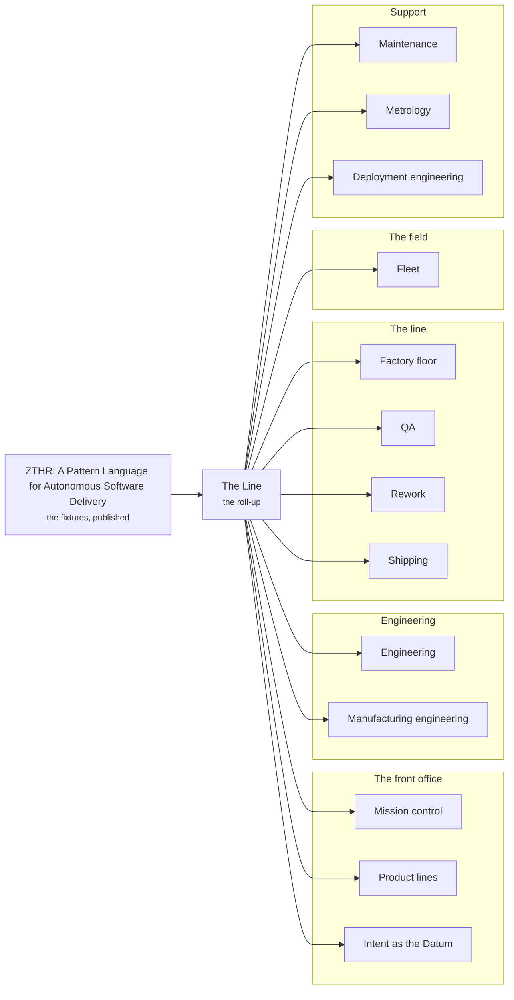

# The plant, in papers

Drafts for review. Each area of the plant has a pattern paper; one paper rolls them up.

| Paper | What it covers |
| --- | --- |
| [The Line](the-line.md) | Thirteen areas in five groups, one hand-off each, separation of duties, and how value compounds; the plant map; Files as the worked example |
| [Mission control](mission-control.md) | The front office: priorities, approvals, stop-the-line and spend, and one view of every product with honest lamps and what waits on a person |
| [Product lines](product-lines.md) | Deciding once for a family of products; inherited choices shown as inherited; the intent studio inside each line |
| [Intent as the Datum](../PAPER.md) | Capturing what software must do, in the expert's words, as a signed, toleranced schematic |
| [Engineering](engineering.md) | Two steps: the complete product spec and the bill of materials that shows what already exists, then the build package |
| [Manufacturing engineering](manufacturing-engineering.md) | The routing, gates proven able to fail, required checks enforced on the branch, fixtures, and a line that improves from what it measures |
| [Factory floor](factory.md) | An operator agent, roles defined by denial, computed admission, correction without a person, and cost held to a budget |
| [QA](qa.md) | Journeys that judge, gauges proven to bite, ratchets that only rise, and the replaced system as the gauge |
| [Rework](rework.md) | Returns that carry their evidence, fixes from a failing test, and re-inspection of the whole product |
| [Shipping](shipping.md) | A signed release packaged and published, then staged delivery with a gate at every stage, a person on production, and one step back |
| [Fleet](fleet.md) | The installed base: updates over the air with rollback, budgets that decide, incidents that become ratchets, and the field reporting back |
| [Maintenance](maintenance.md) | Keeping the factory floor running: the night shift that works every tag through the same gates as day work, a crew staffed by measured pass rates, and the morning report |
| [Metrology](metrology.md) | Keeping QA's quality and process true: measures defined once and traced to a reference, gauges certified before QA uses them, control charts on the plant, and the claims audit |
| [Deployment engineering](deployment-engineering.md) | Serving shipping and the fleet: environments as code, deploys a person approves, over-the-air updates with rollback, and monitoring of everything in service |

Where each area stands is not typed in the papers. It is read from the repository and shown on [/plant](https://zthr.ai/plant) and in the generated docs.
