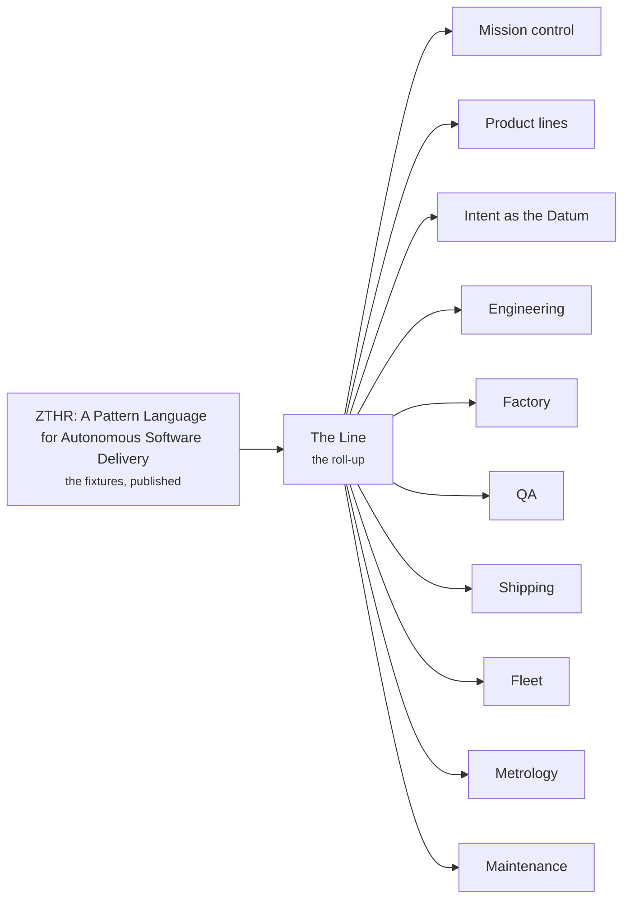

# The line, in papers

Drafts for review. Each department of the line has a pattern paper; one paper rolls them up.

| Paper | What it covers |
| --- | --- |
| [The Line](the-line.md) | Eight departments, one hand-off each, separation of duties, and how value compounds; the two functions beneath the line; the plant map; Files as the worked example |
| [Mission control](mission-control.md) | One view of every product, honest lamps, and what waits on a person |
| [Product lines](product-lines.md) | Deciding once for a family of products; inherited choices shown as inherited |
| [Intent as the Datum](../PAPER.md) | Capturing what software must do, in the expert's words, as a signed, toleranced schematic |
| [Engineering](engineering.md) | The complete specification and the bill of materials that shows what already exists |
| [Factory](factory.md) | Roles defined by denial, computed admission, correction without a person, and cost held to a budget |
| [QA](qa.md) | Journeys that judge, gauges proven to bite, ratchets that only rise, and the replaced system as the gauge |
| [Shipping](shipping.md) | Staged delivery with a gate at every stage, a person on production, and one step back |
| [Fleet](fleet.md) | Shared assemblies maintained once, budgets that decide, and incidents that become ratchets |
| [Metrology](metrology.md) | Beneath the line: measures defined once and traced to a reference, gauges certified before QA uses them, control charts on the factory, and the claims audit |
| [Maintenance](maintenance.md) | Beneath the line: the night shift that works every tag through the same gates as day work, a crew staffed by measured pass rates, and the morning report |
