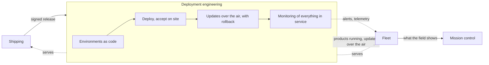
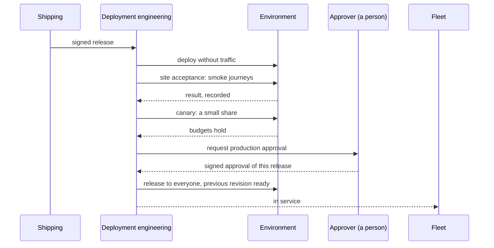
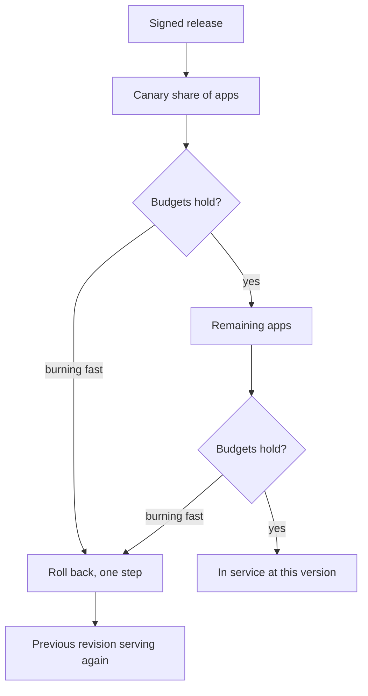
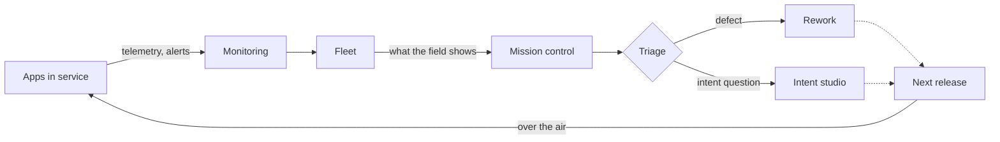
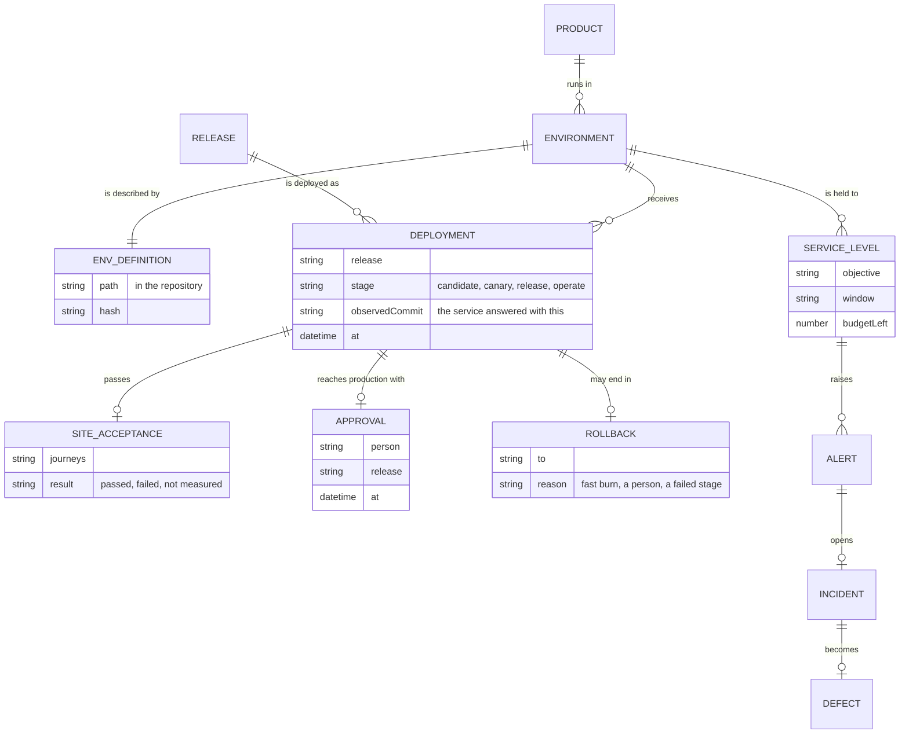

# Deployment Engineering: Standing Up Where Products Run, and Keeping Them Updated

**Patterns for environments as code, deploys a person approves, updates over the air with rollback, monitoring of everything in service, and bringing back what the field shows**

Russ Little · Pattern paper · Draft for review · Nov 28, 2026

v0.1 · Request for comments · © 2026 Russ Little. Licensed under CC BY 4.0. Part of the series rolled up in [The Line](the-line.md).

## Abstract

A signed release is not software in service. Someone has to stand up the place it runs, put it there, check that it works where it is, send it its updates, watch it, and carry back what it shows. In a plant that is installation and field engineering: commissioning a machine on site, accepting it against a site test, and servicing it afterwards. Here it is deployment engineering, the cloud and field engineers of the plant, to the standard of commissioning and site acceptance. It is a support crew. It serves shipping, which hands it signed releases, and the fleet, which holds what is running. It stands in no flow of work; it keeps one part of the plant, the path from release to service and back, working and improving. This paper sets out six patterns for that work.

> **Central proposition.** Describe every place a product runs as code, put releases there only through stages a person approves, send updates over the air with a way back, watch everything in service, and carry what the field shows back to the office.

## 1. Where it sits

Deployment engineering is installation and field engineering, to the standard of commissioning and site acceptance. It is a crew. It takes in releases from shipping and gives products running in production, updated over the air.

## 2. The problem

- **Environments by hand.** A place that was set up once by hand cannot be set up again, or checked against what it should be.
- **A deploy that returned success.** Nothing confirmed that the service answering is the release that was approved.
- **Updates that cannot be undone.** A new version reaches every app and the way back was never rehearsed.
- **The field is quiet.** Apps run and nothing tells the office how they are doing, until someone complains.

## 3. Patterns

### Pattern 1. Environments as Code

**Problem.** An environment that exists only in a console cannot be reviewed, reproduced or compared with intent.

**Pattern.** Every place a product runs (the service definition, the storage, the secrets, the identities, the runbook) is described as code, held in the repository and changed through the same gates as any other change. Standing up a new environment is running its description, not following a procedure.

**Consequences.** What is running can be compared with what should be, and a lost environment is rebuilt, not remembered.

### Pattern 2. Commission, Then Accept On Site

**Problem.** A release that passed every test elsewhere has not yet shown it works where it is.

**Pattern.** Deployment engineering commissions each release in its environment without traffic, and runs the site acceptance test: smoke journeys against the candidate, with its own identity and its own data. Only a release that passes site acceptance is offered a canary.

### Pattern 3. A Person Approves Production

**Problem.** Fully automated releases remove the one judgement that should be a person's: whether to expose everyone.

**Pattern.** Deployment engineering requests production approval after the canary; it cannot give it. The approval is a person's signed act on the exact release, and has no tool in the agent interface. This is the same rule as [Shipping](shipping.md): deploys a person approves.

### Pattern 4. Updates Over the Air, With Rollback

**Problem.** An update that reaches every app at once, with no way back, turns one defect into an outage.

**Pattern.** A release reaches apps in service as an update over the air: signed, delivered in the same stages, and recorded per app. Every update can be rolled back in one step, to the previous revision that stays ready. A fast burn of any error budget rolls back without waiting for anyone.

### Pattern 5. Watch Everything in Service

**Problem.** A service nobody watches fails first in front of the person using it.

**Pattern.** Every app in service is monitored against the service levels its package set: availability, latency and achievement rates, each with an error budget, with a runbook for every alert. The same walks that QA runs are run against production on a cadence, and the site's own security scan runs alongside, so the plant sees what a person would.

**Consequences.** A reading about the field exists before a complaint does.

### Pattern 6. Bring Back What the Field Shows

**Problem.** What happens in service never reaches the place that could change it.

**Pattern.** Telemetry, alerts and incidents are reported to the fleet and, through it, to mission control, against the product and the balloon they concern. An incident is closed only when it has become a defect, a test and a ratchet in the assembly where it began (see [Fleet](fleet.md)); a defect then goes to [Rework](rework.md) as a return.

## 4. What it records

## 5. Files, and the plant's own site

The plant runs one thing in production today that it can observe end to end: its own site, zthr.ai. The site is deployed from the main branch; it is walked and security-scanned on a schedule, and its deploy is recorded against the commit the running service answered with. No product of the line is deployed yet. Files, when it ships, runs as one container on Cloud Run with its state in one Cloud Storage bucket, described as code like any other environment, and enters the fleet when it is serving. The live standing is on [/plant](https://zthr.ai/plant).

## 6. What it needs, and how it is judged

Deployment engineering needs environments as code, deploys a person approves, over-the-air updates with rollback, and monitoring of everything in service. Which are met is shown on [/plant](https://zthr.ai/plant).

- **Reproducible.** Every environment can be rebuilt from its definition.
- **Observed.** Every deployment records the identity the running service answered with.
- **Approved.** Every production release has a person's signed approval of that release.
- **Reversible.** Rollback time, measured on every update.
- **Reported.** Every incident reaches mission control and ends as a defect, a test and a ratchet.

## 7. What it does not claim

Deployment engineering does not make a release correct: shipping packages it and QA passed it. It makes each step of putting it in front of people prove something, keeps every step reversible, and makes the field visible to the office.
