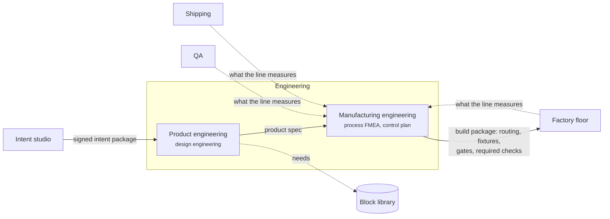
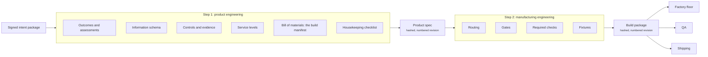
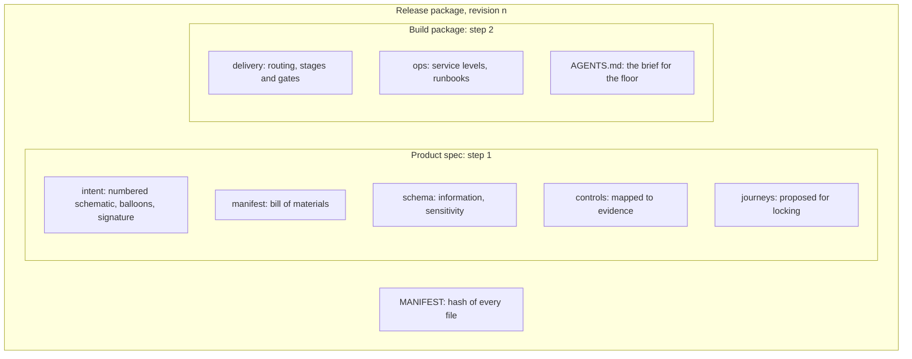
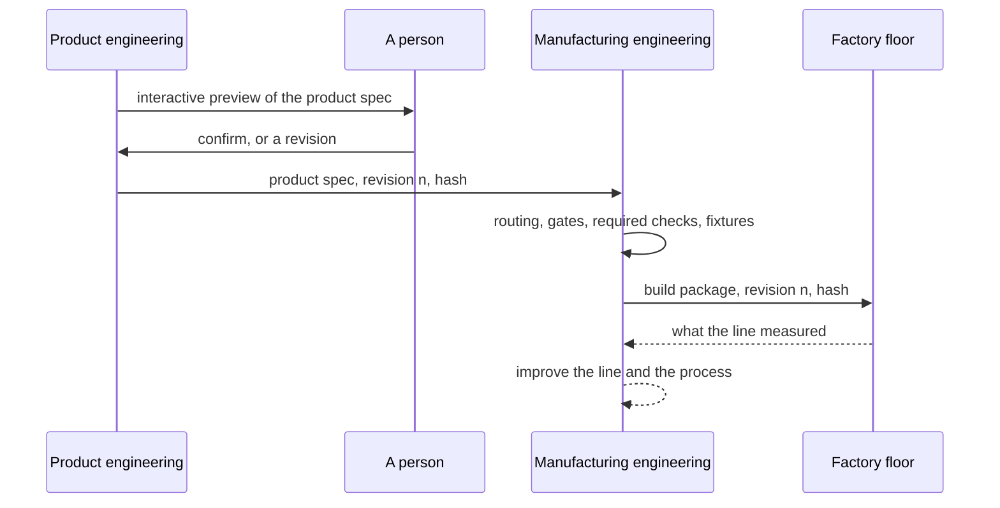
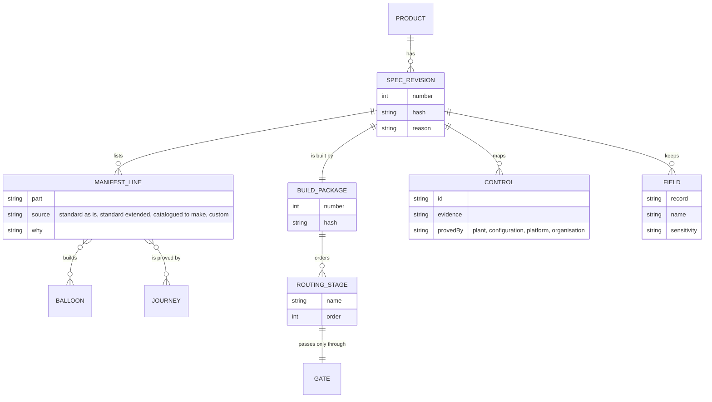

# Engineering: From a Signed Intent to a Package a Plant Can Build

**Patterns for engineering in two steps: the complete product spec (outcomes, information, controls, service levels, and the bill of materials), then the build package that says how to build it**

Russ Little · Pattern paper · Draft for review · Nov 26, 2026

v0.1 · Request for comments · © 2026 Russ Little. Licensed under CC BY 4.0. Part of the series rolled up in [The Line](the-line.md); follows *Intent as the Datum*.

## Abstract

A signed intent says what a person means. It does not yet say what will be built, from what, kept how, held to which controls, judged by which gauges, or in what order it will be made. Engineering answers those questions before any code is written, in two steps. **Product engineering** defines the thing: it turns the signed intent package into the product spec, which holds the outcomes and how each is assessed; the information the product keeps, with every field's sensitivity; the compliance controls and the evidence each requires; the service levels; the interfaces; and the bill of materials, a manifest that says, line by line, what is taken from the library as it is, what is extended, what catalogued part must be made, and what is custom to this product. **Manufacturing engineering** then defines how to build it and sets up the line to do so, releasing the build package: the routing, the fixtures, the gates and the required checks. Both are released as hashed revisions. This paper sets out nine patterns for the first step, summarises the second (which has [its own paper](manufacturing-engineering.md)), and shows how the manifest makes the cost of the next product visible before it is built.

> **Central proposition.** Before anything is built, engineering turns the signed intent into a complete, released product spec whose bill of materials shows how much is already made, and then into a build package; every later area builds and judges to them.

## Where it sits

Engineering is the second group in the flow, after the front office. Product engineering is design engineering, to the standard of design FMEA and design review. Manufacturing engineering is manufacturing engineering, to the standard of process FMEA, the control plan and APQP. Both are done by an agent, with a person reviewing the preview before release.

## 1. The problem

- **The first build decides the design.** Without a specification of the information kept, the first build's tables become the data model, and the product inherits them for ever.
- **Controls arrive as an audit.** Compliance is checked after the build and finds what should have been designed in.
- **Nobody knows what already exists.** Each product reimplements sign-in, retention, uploads and money, because nothing says which of them is already built and proven.

## 2. Principles

**Specify before building.** Everything a later area will be judged by is in the package before the floor starts.

**Say where every line comes from.** Every line of the specification is either the person's, inherited from the product line or the catalogue, derived by a rule, or new to this product, and is marked so.

## 3. Patterns

### Pattern 1. The Manifest Is a Bill of Materials

**Problem.** A product is described as features, which hides that most of it is the same as every other product.

**Pattern.** The build manifest lists every part the product needs, grouped by family (trust and evidence, identity and access, data, work and integrations, content, experience, appearance, data movement, intent), each with its source:

| Source | Meaning | Who maintains it |
| --- | --- | --- |
| Standard, as is | A library assembly, used unchanged | Product engineering, for every product using it |
| Standard, extended | A library assembly with this product's additions | Product engineering; the additions by the product |
| Catalogued, to make | A part the catalogue describes but the library has not built yet | Product engineering, once built |
| Custom | An assembly particular to this product, made of the parts that build its balloons | The product's team |

Each line says why it is there (the statement, rule or inherited minimum that calls for it), which balloons it builds, and which journeys prove it.

**Consequences.** The share of a product already built is a number on its manifest before the first line of code. The block library belongs to this step: it is where blocks are designed, catalogued and tested, and the fleet shows only where each is used and which version each app runs. A catalogued part needed by many products is the next block to build.

### Pattern 2. The Team Minimum

**Problem.** Every product needs the same housekeeping (audit, backups, error pages, paging, configuration, health checks), and each forgets a different part of it.

**Pattern.** A minimum set of parts is inherited by every product, whatever its intent says, and marked inherited. Further housekeeping is called for by what the schematic says: money calls for whole-unit amounts and one rounding rule; uploads call for upload safety; things that can be changed in two places call for edit conflicts and leases; things that nest call for folders and paths.

**Consequences.** The recurring pain of application work is solved once, in the library, and every product starts past it.

### Pattern 3. Custom Is an Assembly

**Problem.** "Build feature X" hides that X is mostly parts that already exist.

**Pattern.** What no catalogued part does is a custom assembly, and it lists the parts it is made of: those that build the same balloons. Its own work is the joining.

**Consequences.** Custom work is small and visible. A custom assembly that appears in many products is a candidate for the catalogue.

### Pattern 4. The Information Is Signed

**Problem.** The data model is whatever the first build created.

**Pattern.** The information the product keeps (records, fields, relations, and a sensitivity class for each field) is specified from three sources (common business patterns, the person's own sentences, and any schema the team already has), drawn as an entity-relationship diagram, and signed with the intent. A revision's change to it is a migration that never drops a record, rehearsed before it ships.

### Pattern 5. Controls Mapped to Evidence

**Problem.** A control without named evidence is a promise.

**Pattern.** Each control in scope is mapped to the evidence that proves it and to who proves it: the factory on every release, a configuration, a shared platform, or the organisation. The package carries the sensitive-data inventory and the component definition in a machine-readable form.

### Pattern 6. Service Levels From the Title Block

**Problem.** Service levels are set after launch, against whatever the system turns out to do.

**Pattern.** Service levels are derived from the schematic: availability from the team minimum; latency from the feedback the person asked for; achievement rates from the outcomes' tolerances. Each becomes an objective with an error budget that shipping and the fleet enforce.

### Pattern 7. Every Interface Defined, Each Enabled by Choice

**Problem.** APIs, events and agent tools are bolted on later, with weaker security than the screens.

**Pattern.** Every interface the intent implies is defined in the package from the start, held to the same roles, row-level rules and audit as the screens; the spec sheet decides which are switched on.

### Pattern 8. Preview Before Build

**Problem.** People discover what they specified only when it is built.

**Pattern.** This is design review. Product engineering shows the person an interactive preview of the specification (the screens the journeys walk, the records they touch, the controls that apply) before release, so a misunderstanding costs a revision, not a rebuild.

### Pattern 9. Release Is a Hash

**Problem.** A specification that can change while it is being built cannot be built to.

**Pattern.** Each step releases a numbered revision of a plain package whose every file is hashed in its manifest: the product spec from step one, the build package from step two. The floor, QA and shipping all refer to the revision by number and hash. A later revision states why it exists and lists every balloon that moved.

## 4. Step two: manufacturing engineering

The product spec says what to build. The second step says how: a routing every product follows from build to operation, the gates on it proven able to fail, the required checks enforced on the branch, and the fixtures (jigs, blocks, gauges) each station uses. It then keeps improving the lines and the process from what the line measures. Its patterns are in [Manufacturing engineering](manufacturing-engineering.md).

## 5. Files, engineered

The Files intent produces a manifest in which every line has one of the four sources; the generated engineering doc shows the live split. Beyond the team minimum every product inherits (error monitoring, backups, status, a delivery pipeline), the intent calls for file upload and storage, upload safety, authorization, API keys and tokens, folders and paths, and locks and leases.

A file server is made of assemblies the library holds as separately tested blocks: the namespace tree, the object store, resumable uploads, leases, grants, device sessions, the DAV core and the differential oracle, with rate limits and upload safety beside them. File upload and storage, upload safety, authentication, authorization, API keys and tokens, HTTP routing and API contracts are standard-extended parts; folders and paths, and locks and leases, are covered by the catalogue; and each custom assembly lists the blocks it joins.

Its service levels come from its intent: availability from the team minimum, and a latency objective from the feedback it asks for. The small-files outcome (25,000 files within ten minutes) is held by a journey, measured on every build.

## 6. Evaluating it

- **Completeness.** Every balloon reaches at least one manifest line, and every manifest line at least one journey. A balloon nothing builds is listed as a gap.
- **Reuse.** The share of manifest lines that are standard (as is or extended) is a reading on every product; it should rise with each block built.
- **Stability.** A released revision's hash never changes; the floor's build records the hash it built to.

## 7. What it does not claim

Engineering does not choose the implementation inside a custom assembly; the floor does. It fixes what must be built, from what, and how it will be judged.

Product engineering needs a library of 300 or more tested blocks, journeys locked by hash, and a spec every later area can check against; manufacturing engineering's needs are listed in its own paper. The number of blocks built, and the share of common application needs they cover, are generated on [/plant](https://zthr.ai/plant); the library is short of its target until that page says otherwise.
