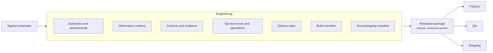
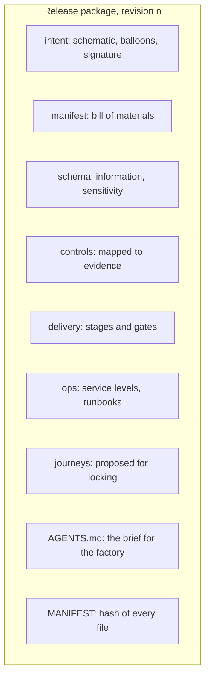

# Engineering: From a Signed Intent to a Package a Factory Can Build

**Patterns for the complete specification: outcomes, information, controls, service levels, and the bill of materials**

Russ Little · Pattern paper · Draft for review · Nov 26, 2026

v0.1 · Request for comments · © 2026 Russ Little. Licensed under CC BY 4.0. Part of the series rolled up in [The Line](the-line.md); follows *Intent as the Datum*.

## Abstract

A signed intent says what a person means. It does not yet say what will be built, from what, kept how, held to which controls, or judged by which gauges. Engineering is the department that answers those questions before any code is written, and releases the answers as one hashed package: the outcomes and how each is assessed; the information the product keeps, with every field's sensitivity; the compliance controls and the evidence each requires; the service levels; the delivery plan; and the build manifest, a bill of materials that says, line by line, what is taken from the library as it is, what is extended, what catalogued part must be made, and what is custom to this product. This paper sets out nine patterns for that work, and shows how the manifest makes the cost of the next product visible before it is built.

> **Central proposition.** Before anything is built, engineering turns the signed intent into a complete, released specification whose bill of materials shows how much is already made, and which every later department builds and judges to.

## 1. The problem

- **The first build decides the design.** Without a specification of the information kept, the first build's tables become the data model, and the product inherits them for ever.
- **Controls arrive as an audit.** Compliance is checked after the build and finds what should have been designed in.
- **Nobody knows what already exists.** Each product reimplements sign-in, retention, uploads and money, because nothing says which of them is already built and proven.

## 2. Principles

**Specify before building.** Everything a later department will be judged by is in the package before the factory starts.

**Say where every line comes from.** Every line of the specification is either the person's, inherited from the line or the catalogue, derived by a rule, or new to this product, and is marked so.

## 3. Patterns

### Pattern 1. The Manifest Is a Bill of Materials

**Problem.** A product is described as features, which hides that most of it is the same as every other product.

**Pattern.** The build manifest lists every part the product needs, grouped by family (trust and evidence, identity and access, data, work and integrations, content, experience, appearance, data movement, intent), each with its source:

| Source | Meaning | Who maintains it |
| --- | --- | --- |
| Standard, as is | A library assembly, used unchanged | The fleet, for every product using it |
| Standard, extended | A library assembly with this product's additions | The fleet; the additions by the product |
| Catalogued, to make | A part the catalogue describes but the library has not built yet | The fleet, once built |
| Custom | An assembly particular to this product, made of the parts that build its balloons | The product's team |

Each line says why it is there (the statement, rule or inherited minimum that calls for it), which balloons it builds, and which journeys prove it.

**Consequences.** The share of a product already built is a number on its manifest before the first line of code. A catalogued part needed by many products is the next block to build.

### Pattern 2. The Team Minimum

**Problem.** Every product needs the same housekeeping (audit, backups, error pages, paging, configuration, health checks), and each forgets a different part of it.

**Pattern.** A minimum set of parts is inherited by every product, whatever its intent says, and marked inherited. Further housekeeping is called for by what the schematic says: money calls for whole-unit amounts and one rounding rule; uploads call for upload safety; things that can be changed in two places call for edit conflicts and leases; things that nest call for folders and paths.

**Consequences.** The recurring pain of application work is solved once, in the library, and every product starts past it.

### Pattern 3. Custom Is an Assembly

**Problem.** "Build feature X" hides that X is mostly parts that already exist.

**Pattern.** What no catalogued part does is a custom assembly, and it lists the parts it is made of: those that build the same balloons. Its own work is the joining.

**Consequences.** Custom work is small and visible. A custom assembly that appears in many products is a candidate for the catalogue.

### Pattern 4. The Information Is Signed

**Problem.** The data model is whatever the first build created.

**Pattern.** The information the product keeps (records, fields, relations, and a sensitivity class for each field) is specified from three sources (common business patterns, the person's own sentences, and any schema the team already has), drawn as an entity-relationship diagram, and signed with the intent. A revision's change to it is a migration that never drops a record, rehearsed before it ships.

### Pattern 5. Controls Mapped to Evidence

**Problem.** A control without named evidence is a promise.

**Pattern.** Each control in scope is mapped to the evidence that proves it and to who proves it: the factory on every release, a configuration, a shared platform, or the organisation. The package carries the sensitive-data inventory and the component definition in a machine-readable form.

### Pattern 6. Service Levels From the Title Block

**Problem.** Service levels are set after launch, against whatever the system turns out to do.

**Pattern.** Service levels are derived from the schematic: availability from the line's minimum; latency from the feedback the person asked for; achievement rates from the outcomes' tolerances. Each becomes an objective with an error budget that shipping and the fleet enforce.

### Pattern 7. Every Interface Defined, Each Enabled by Choice

**Problem.** APIs, events and agent tools are bolted on later, with weaker security than the screens.

**Pattern.** Every interface the intent implies is defined in the package from the start, held to the same roles, row-level rules and audit as the screens; the spec sheet decides which are switched on.

### Pattern 8. Preview Before Build

**Problem.** People discover what they specified only when it is built.

**Pattern.** Engineering shows the person an interactive preview of the specification (the screens the journeys walk, the records they touch, the controls that apply) before release, so a misunderstanding costs a revision, not a rebuild.

### Pattern 9. Release Is a Hash

**Problem.** A specification that can change while it is being built cannot be built to.

**Pattern.** A release is a numbered revision of a plain package whose every file is hashed in its manifest. The factory, QA and shipping all refer to the revision by number and hash. A later revision states why it exists and lists every balloon that moved.

## 4. Files, engineered

The Files intent produces a manifest of 135 lines: 6 standard assemblies used as they are, 37 extended, 81 catalogued parts still to make, and 11 custom assemblies. Beyond the team minimum every product inherits (error monitoring, backups, status, a delivery pipeline), the intent calls for file upload and storage, upload safety, authorization, API keys and tokens, folders and paths, and locks and leases.

Before the factory ran, the library lacked the assemblies a file server is made of, so eight blocks were built and catalogued first: the namespace tree, the object store, resumable uploads, leases, grants, device sessions, the DAV core and the differential oracle. With them, and two more for rate limits and upload safety, file upload and storage, upload safety, authentication, authorization, API keys and tokens, HTTP routing and API contracts moved from catalogued to standard-extended; folders and paths, and locks and leases, entered the catalogue already covered; and each of the eleven custom assemblies lists the blocks it joins.

Its service levels come from its schematic: 99.5% availability from the team minimum, and a latency objective from the feedback it asks for. The small-files outcome (25,000 files within ten minutes) is held by a journey, measured on every build.

## 5. Evaluating it

- **Completeness.** Every balloon reaches at least one manifest line, and every manifest line at least one journey. A balloon nothing builds is listed as a gap.
- **Reuse.** The share of manifest lines that are standard (as is or extended) is a reading on every product; it should rise with each block built.
- **Stability.** A released revision's hash never changes; the factory's build records the hash it built to.

## 6. What it does not claim

Engineering does not choose the implementation inside a custom assembly; the factory does. It fixes what must be built, from what, and how it will be judged.
