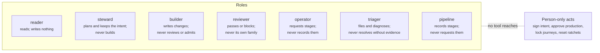
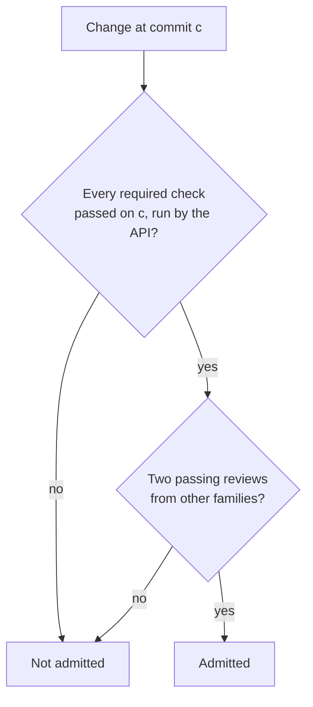
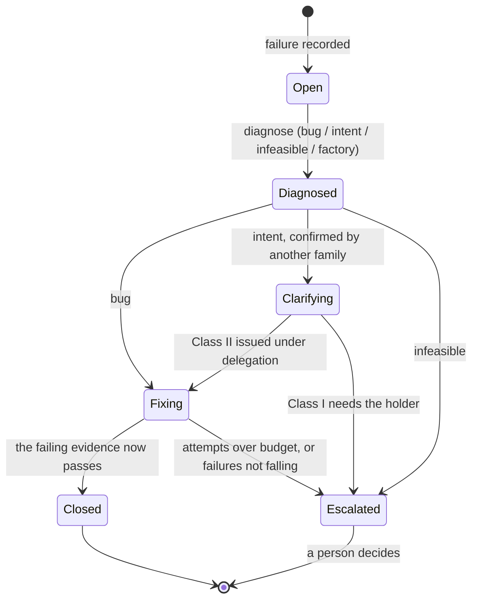

# The Factory: Agents That Build to a Package, and Cannot Grade Their Own Work

**Patterns for roles defined by what they may not do, admission computed from the record, correction without a person, and cost held to a budget**

Russ Little · Pattern paper · Draft for review · Nov 26, 2026

v0.1 · Request for comments · © 2026 Russ Little. Licensed under CC BY 4.0. Part of the series rolled up in [The Line](the-line.md); the fixtures it relies on are set out in *ZTHR: A Pattern Language for Autonomous Software Delivery* ([10.5281/zenodo.23826734](https://doi.org/10.5281/zenodo.23826734)).

## Abstract

The factory is where agents write the software. Its design problem is not how to make an agent write good code; it is how to make the result trustworthy when every worker is a model that is confident, fast and sometimes wrong. The answer here is organisational. Agents work in seven roles, each defined by what it may not do. The acts only a person may perform have no tool, so no role can reach them. A change is admitted only when every required check has been run by the factory itself and two reviewers from model families other than the author's have passed it, and admission is computed from the record, never set. When a check, a review or a stage fails, a case is opened and diagnosed (a bug, an intent problem, something infeasible, or a fault in the factory) and corrected without a person until the attempts, the trend or the budget say a person must decide. Cheap checks run first, review happens only on green, the builder must run the existing tests before it pushes, and every call is metered against a budget. This paper sets out eleven patterns for that factory and the agent interface that implements them.

> **Central proposition.** Build trust in agent-written software from structure, not from any one agent: roles that cannot approve their own work, admission computed from the record, and a correction loop that settles everything except what truly needs a person.

## 1. The problem

- **Self-certification.** An agent that writes a change and reports it done has graded its own work.
- **Correlated review.** A reviewer from the same model family shares the author's blind spots.
- **Retry until green.** Re-running a failing check until it passes hides real races; re-prompting until a test passes produces tests that test nothing.
- **Unbounded cost.** An agent loop with no budget spends whatever it takes, including on work that cannot succeed.

## 2. Principles

**Define a role by its denials.** What a role may do grows with its tools; what it may never do is fixed, and that is what makes the separation hold.

**Compute, never declare.** Whether a change is admitted, whether a stage passed, whether a case is closed: each is a function of recorded evidence.

## 3. The roles

| Role | May | May never |
| --- | --- | --- |
| reader | Read the intent, the package, the record | Write anything |
| steward | Plan, propose clarifications, keep the intent's schematic | Build, review, or sign for a person |
| builder | Open changes, run checks | Review or admit its own change; push without running the existing tests |
| reviewer | Pass or block a green change with findings | Review a change from its own model family; confirm its own family's diagnosis |
| operator | Request delivery stages; request production approval | Record a stage as passed; approve production |
| triager | File tickets in the reporter's words; diagnose; attach defects | Resolve a bug without evidence and a defect |
| pipeline | Run and record stages | Request a stage |

## 4. Patterns

### Pattern 1. Person-Only Acts Have No Tool

**Problem.** A permission check can be misconfigured; a tool that exists can be called.

**Pattern.** Signing an intent, approving production, locking a journey, and resetting a floor or ratchet are not tools in the agent interface at all. People perform them as signed proposals, accepted only from signers on a list that only a person changes.

**Consequences.** No prompt, error or compromise of an agent role can perform them, because there is nothing to call.

### Pattern 2. Admission Is Computed

**Problem.** "Approved" is a status anyone with access can set.

**Pattern.** A change is admitted when, and only when, the record shows every required check passing on its exact commit, run by the factory's own interface, and two passing reviews from model families other than the author's. Nothing sets admission; it is read.

### Pattern 3. Cheapest Check First

**Problem.** Running the full suite on every attempt is slow and costly, and most failures are found by the cheapest checks.

**Pattern.** Required checks run in order of cost (types, the person-signed files, dependencies, docs, tests, gates, journeys, explore, crawl, walk) and stop at the first failure. A check that passed on an identical tree is reused, not rerun.

**Consequences.** A broken change costs a typecheck, not a walk.

### Pattern 4. Green Before Review

**Problem.** Reviewing a change that does not pass its checks wastes the review.

**Pattern.** Reviewers are offered only changes whose checks are green and that are not already blocked or admitted, one model family at a time. A review is given a capped diff and the balloons the change serves, not its story.

### Pattern 5. Run the Base First

**Problem.** A builder blamed for a failure that was already on the base branch spends its budget on someone else's bug.

**Pattern.** Before a change is opened, the existing tests run on its base. A red base opens a case against the base and refuses new work except the fix for that case. Then they run on the change; a red change is refused before it is pushed.

**Consequences.** Every failure a builder sees is its own.

### Pattern 6. Diagnose Before Retrying

**Problem.** Retrying a failure without knowing its cause repeats it.

**Pattern.** Every failure (a check, a block in review, a failed stage, a ticket with a defect) opens a case, and the case is diagnosed into one of four classes before anything is tried:

| Diagnosis | Meaning | What happens |
| --- | --- | --- |
| Bug | The code does not do what the intent says | The builder fixes it |
| Intent | The intent is unclear or contradicts itself | A clarification is proposed against the balloons named |
| Infeasible | The intent cannot be met as stated | Escalated to the holder |
| Factory | A check, gate or tool is wrong | Raised against the factory, not the product |

Any diagnosis other than a bug must name the balloons involved and be confirmed by a reviewer from another model family.

### Pattern 7. Class II by Delegation, Class I by Signature

**Problem.** Every clarification sent to a person stalls the factory; every clarification made without one risks changing what they meant.

**Pattern.** A clarification is classed by what it changes. Class II (an example, a note, a tolerance inside the range the person gave) is issued under a delegation the holder signed in advance, and supplied as derived and assumed. Class I (anything that changes what the software must do) becomes a proposal the holder signs.

### Pattern 8. Escalate on Evidence

**Problem.** A correction loop that never gives up spends without end; one that gives up early sends everything to a person.

**Pattern.** A case escalates to a person when its attempts exceed the budget, when its last three attempts show failures not falling, or when its cost passes the case's ceiling. Otherwise the loop continues without anyone.

### Pattern 9. A Seat for Every Role, Priced

**Problem.** Using the most capable model for everything is costly; using the cheapest for everything is unsafe.

**Pattern.** Each role has a seat: the models that may fill it, cheapest first. Planning and orchestration use a capable model; reading, review and operation use inexpensive ones, because the fixtures, not the model, carry the quality. Every call is metered in dollars against a daily budget and a per-case ceiling, and work pauses at the ceiling.

### Pattern 10. The Ledger

**Problem.** A record that can be edited cannot settle a dispute.

**Pattern.** Every act (a change opened, a check run, a review, a stage, a diagnosis, a signature) is appended to a hash-chained log. Verifying the chain shows that nothing was removed or changed.

### Pattern 11. Blocks Before the Delta

**Problem.** Agents asked to build a product build everything, including what every product needs.

**Pattern.** The factory builds to the manifest. Standard assemblies are taken from the library; catalogued parts needed by more than one product are built as library blocks first, each with its own tests; the factory then architects only the delta: the custom assemblies, which join blocks.

## 5. Files, in the factory

Files is built on ten library blocks and a protocol layer. The eight blocks a file server needs were built before its delta, each tested alone (12 tests for the tree, 10 for the object store, 8 each for uploads, grants and the DAV core, 6 each for leases and devices, 4 for the oracle). Its own layer is WebDAV, OCS sharing and the sign-in pages, and is tested end to end against a server in process: 19 tests covering the login flow, sync properties, conditional writes, versions, the trash, chunked uploads with quota, sharing, public links, device revocation and wipe, administration, restarts, the nightly sweep, Cloud Storage against a stand-in, and the oracle script.

## 6. Evaluating it

- **Separation.** No admitted change has a reviewer from its author's family. A query on the ledger.
- **Honesty of admission.** Every admitted change has every required check passing on its exact commit.
- **Correction.** The share of cases closed without a person, and the share escalated by each rule.
- **Cost.** Dollars per admitted change, per case, per day, against the budgets.

## 7. What it does not claim

The factory does not make any single agent trustworthy. It makes the result trustworthy by arranging untrusted workers so that none can approve itself, and by measuring everything they produce against gauges they cannot change.
