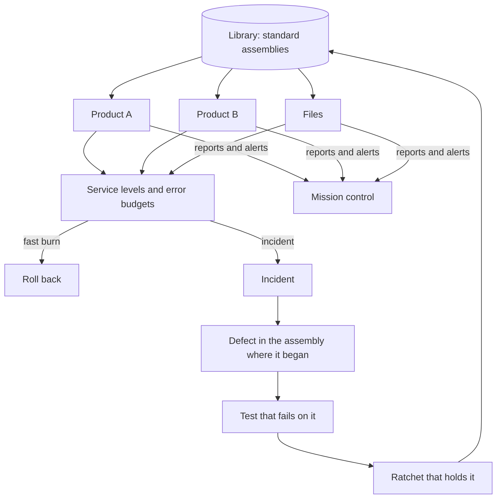
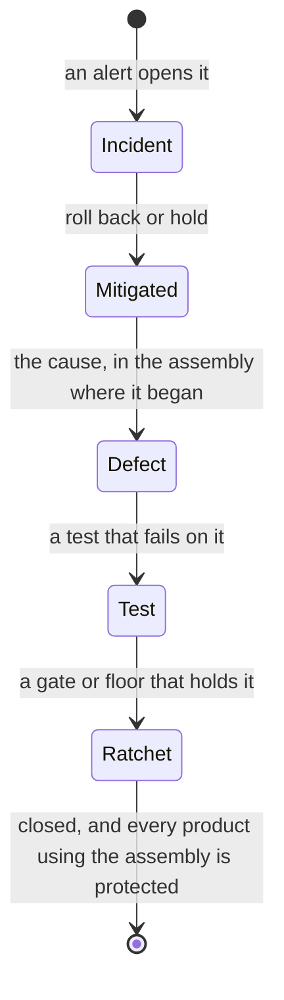

# The Fleet: Keeping Every Product in Service as One

**Patterns for shared assemblies maintained once and updated everywhere, service levels that decide, and incidents that become ratchets**

Russ Little · Pattern paper · Draft for review · Nov 26, 2026

v0.1 · Request for comments · © 2026 Russ Little. Licensed under CC BY 4.0. Part of the series rolled up in [The Line](the-line.md).

## Abstract

Most of the cost of software comes after it ships: fixing what breaks, keeping dependencies current, answering the same incident in a second product a month after the first. A factory that makes products mostly from shared assemblies can do something a set of separate teams cannot: fix a shared assembly once and move the fix to every product that uses it. The fleet is the department that keeps every product in service as one: each held to the service levels its package set, each drawing on the library it was built from, each governed the same way for the data it keeps. Every incident becomes a defect, a test and a ratchet, in the assembly where it began, so no product meets the same failure twice. This paper sets out seven patterns for the fleet, and how its reports close the loop back to mission control.

> **Central proposition.** Maintain what products share once, push each fix to everyone who uses it, let error budgets decide what happens next, and turn every incident into an instrument so no product fails the same way twice.

## 1. The problem

- **The same bug, again.** A defect fixed in one product's copy of sign-in is still in the four other copies.
- **Upkeep nobody owns.** Dependency updates and security fixes wait until something forces them.
- **Opinions about health.** Whether a product is healthy is argued, not read.

## 2. Principles

**Maintained by the fleet, or by the product, never by neither.** Every line of every manifest names who maintains it.

**Budgets decide.** Error budgets, not opinions, decide whether a product takes new changes, is held, or is rolled back.

## 3. Patterns

### Pattern 1. Maintained Once, Updated Everywhere

**Problem.** Copies of the same part diverge, and each fix reaches one copy.

**Pattern.** A standard assembly used as it is, or extended, is maintained by the fleet. A fix to it is made once, in the library, and pushed to every product that uses it as a change through each product's own line, admitted and certified there like any other.

**Consequences.** The cost of a fix is paid once. Each product still proves the fix with its own journeys before it ships.

### Pattern 2. Where Used Before Changed

**Problem.** A change to a shared part breaks a product nobody thought of.

**Pattern.** Before a shared assembly changes, the fleet lists every product that uses it, how (as is, extended, inside a custom assembly) and with which of its data. The change is certified against all of them.

### Pattern 3. Error Budgets Decide

**Problem.** Whether to ship more changes to an unstable product is argued case by case.

**Pattern.** Each product's objectives come from its package, each with an error budget over its window. A budget burning fast rolls the latest release back; a budget spent holds new changes to that product until it recovers; a healthy budget lets changes flow.

| Budget | What the fleet does |
| --- | --- |
| Healthy | Changes flow through the line as usual |
| Burning fast | The latest release rolls back, at once, without waiting |
| Spent for the window | Only fixes ship to that product until it recovers |

### Pattern 4. Every Incident Becomes a Ratchet

**Problem.** An incident is resolved and forgotten, and recurs.

**Pattern.** An incident is closed only when it has become a defect against the assembly where it began, a test that fails on it, and a ratchet or gate that holds it. Because the assembly is shared, the new test protects every product that uses it.

### Pattern 5. Upkeep on a Cadence

**Problem.** Dependency and security updates wait for a crisis.

**Pattern.** The fleet updates dependencies of shared assemblies on a fixed cadence, through the line, and records for each product how far behind the library it is. A product far behind is a reading on mission control, not a surprise.

### Pattern 6. One Governance for the Data

**Problem.** Sensitive data is guarded differently in each product.

**Pattern.** Every product's information carries the same sensitivity classes, and every read, export and query of sensitive data goes through the same gate and the same audit, whichever product holds it. The fleet shows, for each class, which products hold it.

### Pattern 7. Reports Close the Loop

**Problem.** What people report about a product in service never reaches the place that could change it.

**Pattern.** Problems people report are filed in their own words, triaged into defects or intent questions, and shown on mission control against the product and the balloon they concern. An intent question goes to the holder as a clarification; a defect goes to the factory as a case.

## 4. Files, in the fleet

Files draws on ten library blocks. A fix to any of them (the tree's etag propagation, the object store's checksums, the uploads' expiry, the grants' throttling) is made once in the library, and reaches Files and every later product that uses the same block, each through its own line. Its service levels come from its package, and its nightly sweep (the trash after its days, old versions after theirs, idle uploads, expired links) is planned by the retention block and recorded as a run.

A second product in its line (calendars and contacts) would share the device sessions, grants and DAV core with Files. An incident in sign-in found in either would become a test in the devices block, protecting both.

## 5. Evaluating it

- **Reach of fixes.** For each fix to a shared assembly, the share of products using it that have taken it, and how long they took.
- **Recurrence.** The number of incidents whose cause was already covered by a ratchet: it should be zero.
- **Budgets.** The share of time each product's budgets are healthy, burning or spent.

## 6. What it does not claim

The fleet does not prevent incidents. It makes each one cheaper than the last: the fix is shared, the test is shared, and the same failure is caught everywhere before it happens again.
