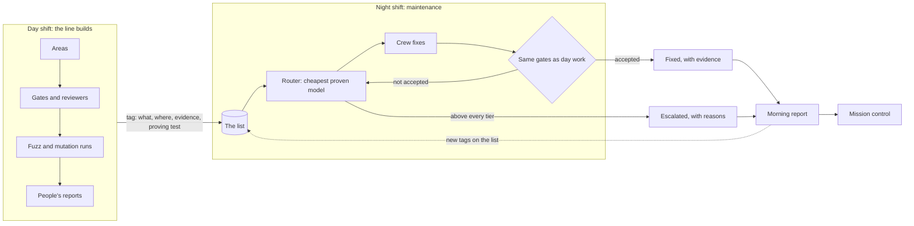
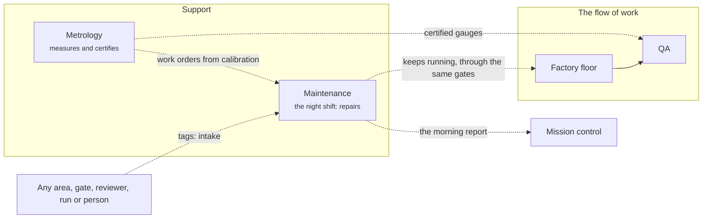
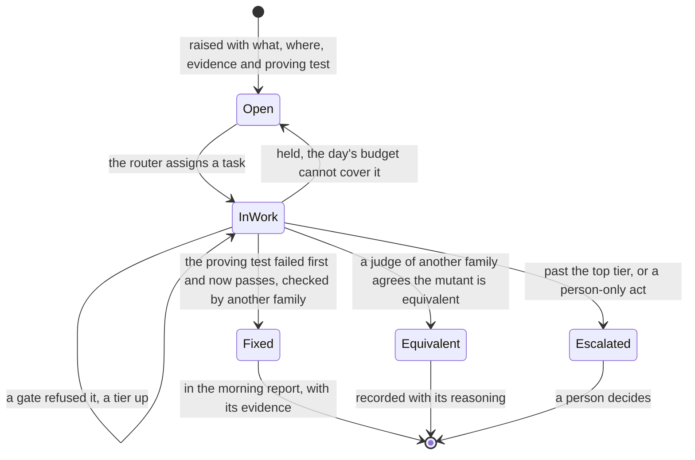
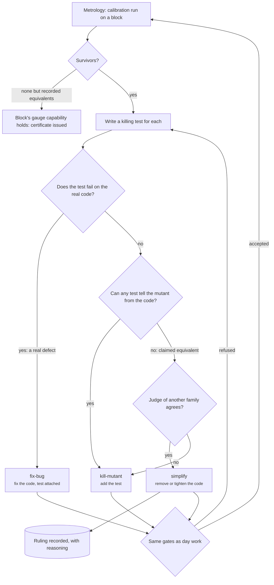
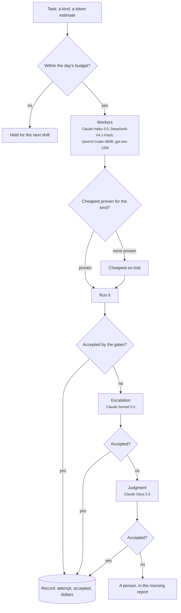
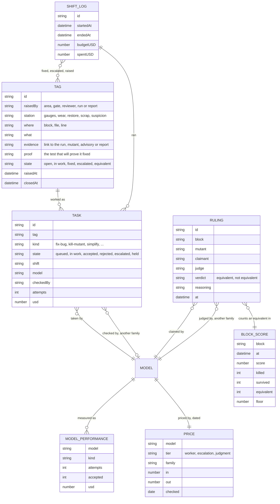
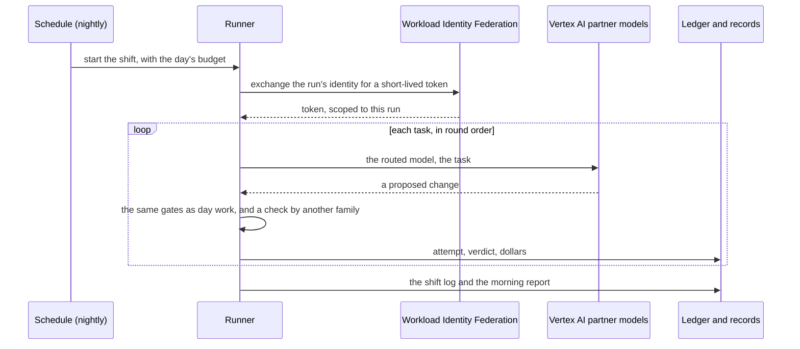

# Maintenance: The Night Shift That Keeps the Factory Floor Running

**Patterns for tagging instead of stopping, fixing through the same gates as day work, repairing the gauges, and staffing the crew by evidence**

Russ Little · Pattern paper · Draft for review · Nov 27, 2026

v0.1 · Request for comments · © 2026 Russ Little. Licensed under CC BY 4.0. Part of the series rolled up in [The Line](the-line.md).

## Abstract

A line that stops for every defect stalls everything behind it; a line that ignores defects lets them compound until a product fails in service. A plant answers this with two shifts. The day shift builds, and anyone who finds something wrong hangs a tag on it and carries on. The night shift is maintenance: a crew that works the tags, fixes what it can to the same standard as production, repairs the instruments the lab finds wanting, and leaves a report on the manager's desk in the morning. This paper applies that structure to a software plant run by agents. Every area, gate, reviewer, fuzz run and user report, and metrology's calibration runs, tag what is not working instead of stopping: what is wrong, where, how it is known, and the test that will prove it fixed. Metrology measures and certifies; maintenance repairs. A crew of models works the tags overnight at five stations, through the same acceptance gates as day work, and escalates what is above its tier. Each task goes to the cheapest model whose measured pass rate at that kind of task is good enough. The crew's output is evidence: a shift log per night, mutation scores per block, cost per accepted change, pass rate per model per task kind, and time from tag to fix. This paper sets out ten patterns for that work, and where maintenance sits: beside the factory floor it keeps running, not in the flow of work. It is maintenance to the standard of total productive maintenance, done by a crew.

> **Central proposition.** Never stop the line and never lose a defect: tag it with its evidence and the test that will prove it fixed, work the tags overnight through exactly the gates day work passes, repair every instrument the lab finds wanting, and let measured pass rates, not reputation, decide which model does each job.

## 1. The problem

- **Stop or ignore.** A failing check either blocks every change behind it or is waved through with a promise to come back. Neither keeps both the line and the product healthy.
- **Findings without a home.** A reviewer's doubt, a fuzz crash, a surviving mutant, an advisory, a certificate near expiry, a person's report: each is noticed somewhere and owned nowhere.
- **Gauges nobody checks.** Tests are trusted because they pass. A test that cannot fail passes forever.
- **The most capable model for everything.** Upkeep is many small tasks. Giving every one to the dearest model is waste; giving every one to the cheapest is a gamble nobody measures.

## 2. Where maintenance sits

Maintenance keeps the factory floor running: it is the crew that serves the floor, as a plant's maintenance department serves its machines without being one of them. It takes in work orders that every area tags and gives back a floor that keeps running and gets better. Intake is open: a tag may come from any area, gate, reviewer or person, and that makes the tag a source of work orders, not a service relationship. What maintenance serves is the floor.

Maintenance is not in the flow of work, and its work never outranks the line's. No one dispatches the crew to a particular repair: the line's work goes first, and the crew works the backlog on its own budget, as far as each night's budget reaches, in the order the queue sets (defects a test has exposed, then the most critical gauges, then the weakest). The backlog is visible and shrinks over time; what one night cannot reach waits for the next.

Its sister crew is [metrology](metrology.md), which keeps QA's quality and process true: metrology measures and certifies, and maintenance repairs what metrology finds wanting.

## 3. Principles

**Tag, do not stop.** Whatever finds a defect records it and the line keeps moving. A defect not tagged is lost; a line stopped for a defect is idle.

**No night exemption.** A fix made at night passes exactly what a change made by day passes. Maintenance is not a way around a gate.

**Evidence picks the worker.** Which model takes a task is decided by its measured pass rate at that kind of task and by a dated price, never by its name.

## 4. Patterns

### Pattern 1. Tag, Do Not Stop

**Problem.** A defect found mid-flow either halts the line or is forgotten.

**Pattern.** Every area, gate, reviewer, fuzz run, mutation run and user report can raise a tag and carry on. Raising a tag is the only thing a finding needs to do; it is never a reason to hold work that does not depend on it. A defect that does block a change (a required check failing on that change) still blocks it there: the tag is for what the change does not own.

**Consequences.** The line keeps moving. The list grows by day and shrinks by night, and its length is a reading on mission control.

### Pattern 2. A Tag Names Its Proof

**Problem.** "Something is wrong with uploads" cannot be fixed, checked or closed.

**Pattern.** A tag is refused unless it holds four things: **what** is wrong; **where** (block, file, line); **how it is known** (the failing run, the surviving mutant, the advisory, the report, linked); and **the test that will prove it fixed**. The last is the tag's acceptance criterion: the fix is accepted when that test, failing first, passes.

### Pattern 3. Same Gates at Night

**Problem.** Upkeep done "on the side" becomes the place where tests are loosened to make a problem go away.

**Pattern.** Every night change passes the gates of every day change, and four more conditions besides: a failing test first; then the fix; nothing weakened (no test removed or loosened, no floor lowered, no locked, person-only or generated path touched); and an independent check by a model of a different family than the one that made the fix. Admission is computed from the record, as in the factory.

**Consequences.** A morning report can be trusted without opening each fix: every line in it passed the same instruments as the product.

### Pattern 4. Fixed Stations

**Problem.** Upkeep is not one job. Treating it as one leaves whole classes of decay unwatched.

**Pattern.** The crew works fixed stations, each repairing one kind of thing the line or the lab tags.

| Station | What it checks | What raises its tags |
| --- | --- | --- |
| Gauge repair | Work orders from metrology's calibration: a surviving mutant is a planted defect a test failed to reject | Metrology's calibration runs |
| Wear checks | Fuzzing; dependency advisories; certificates, keys and tokens nearing expiry | Fuzz runs, advisories, expiry dates |
| Restore drills | Every backup proved by restoring it and reading it back | Backup schedules |
| Scrap review | Problem reports turned into failing tests | People's reports and incidents |
| Open suspicions | Doubts a reviewer recorded without blocking, confirmed by a test or dismissed with reasons another family accepts | Reviews and gates |

Each station has task kinds, and each kind says what it must prove to be accepted.

| Kind | Stations | The task | Accepted when |
| --- | --- | --- | --- |
| `fix-bug` | Gauge repair, wear, scrap | A test that fails on the real code has found a real defect: fix the code | The attached test failed before the fix and passes after it |
| `kill-mutant` | Gauge repair | A mutant survived: add the missing test | The new test fails on the mutant and passes on the real code |
| `simplify` | Gauge repair | An equivalent mutant points at code that does nothing: remove or tighten it | Every test still passes, and a judge of another family agrees the mutant was equivalent |
| `patch-dependency` | Wear | Move a dependency named in an advisory to a fixed version | Every test passes on the new version; the advisory no longer matches |
| `renew` | Wear | Prepare the renewal of a certificate, key or token | The renewal is proposed with its new expiry; a person-only act waits for a person |
| `restore-drill` | Restore | Restore a backup into a scratch place and read it back | The copy matches its recorded checksums and opens |
| `reproduce` | Scrap | Turn a report into a test that fails for the reason reported | The test fails on the code the person used, for their reason |
| `investigate` | Suspicion | Settle an open suspicion | A confirming failing test, or a dismissal another family agrees with |
| `check` | Every station | The independent check on a fix | The checker is of another family than the fixer, and finds nothing |
| `rule` | Gauge repair, suspicion | Judge another model's claim of equivalence or dismissal | Recorded with reasoning; counts only when the judge is of another family |

### Pattern 5. Repair the Gauges

**Problem.** A suite of tests that all pass says nothing about whether any of them could fail.

**Pattern.** Metrology calibrates every block by planting small defects (mutants) and recording which its tests reject; each survivor becomes a work order here. The repair has two parts: the tests, then the fixes. Each round takes its tasks in order:

1. **fix-bug.** A new killing test that also fails on the real code has found a real defect. The code is fixed, with that test attached.
2. **kill-mutant.** A survivor with no defect behind it needs its missing test.
3. **simplify.** An equivalent mutant (one no test could tell from the real code) points at code that does nothing. It is removed or tightened while every test still passes.

The loop repeats until no survivors remain except recorded equivalents.

**Consequences.** Fixes are the point. A survivor is most often a gap in the tests, sometimes a real defect, and sometimes code that does nothing; the loop treats each as what it is.

### Pattern 6. Equivalence Takes Another Family

**Problem.** "This mutant is equivalent" is the easiest way to make a survivor disappear.

**Pattern.** A claim of equivalence counts only when a judge from a different model family than the claimant agrees. The ruling records the block, the mutant, the claimant, the judge, the verdict and the reasoning. A refused claim sends the survivor back as `kill-mutant`. A judge is taken from the judgment tier when its family differs from the claimant's; otherwise from the highest tier that has another family.

### Pattern 7. The Ratchet Is the Backstop

**Problem.** Scores improved one night erode the next.

**Pattern.** A block's mutation score, as metrology certifies it, cannot go down: a change that lowers it fails. When a round raises a score, the crew proposes the higher floor for a person to sign, because floors are person-only. The ratchet keeps what was gained; it is not the aim. The aim is the fixes the loop makes on the way.

### Pattern 8. The Cheapest Proven Crew

**Problem.** Which model should do a task is answered by habit.

**Pattern.** A router staffs every task. For each model and task kind it keeps a measured record: attempts, accepted, dollars. A model is proven for a kind after enough attempts at a high enough rate (five attempts at 80 percent, as configured); below that rate it is left out for that kind; with too few attempts it is on trial. The router gives a task the cheapest proven model allowed to take it; failing any, the cheapest on trial, so the record fills. Every call is metered against a daily budget; a task the budget cannot cover is held for the next shift, never skipped.

Kinds that need judgment start higher: `renew` and `investigate` start at escalation, `rule` at judgment. The independent `check` on any fix is the cheapest proven model of another family than the fixer's.

The router reads a dated price table, not a fixed fact. As read on 27 November 2026 from Google Cloud's Vertex AI partner-model list prices for the global endpoint ([cloud.google.com/model-garden/partner-models/pricing](https://cloud.google.com/model-garden/partner-models/pricing)), in US dollars per million tokens:

| Model | Tier | Family | Input | Output |
| --- | --- | --- | --- | --- |
| gpt-oss-120b | Worker | OpenAI | 0.09 | 0.36 |
| Claude Haiku 5.5 | Worker | Anthropic | 0.10 | 0.50 (0.50 in and 2.50 out from 200K input tokens) |
| Qwen3-Coder-480B | Worker | Qwen | 0.22 | 1.80 |
| DeepSeek-V4.1-Flash | Worker | DeepSeek | 0.30 | 1.20 |
| Claude Sonnet 5.5 | Escalation | Anthropic | 2.00 | 10.00 |
| Claude Opus 5.5 | Judgment | Anthropic | 4.00 | 20.00 |

When the list changes the table is re-read and re-dated; the router never assumes a price is current. Four families sit in the worker tier, so a different-family check is always available among the cheapest models.

### Pattern 9. Escalate Above the Tier

**Problem.** A crew that keeps trying spends without end; a crew that gives up early sends everything to a person.

**Pattern.** A task refused by the gates moves one tier up. Past the top tier it is escalated to a person, with what was tried and why each attempt was refused. Acts only a person may perform (lowering or raising a floor, locking a journey, applying a credential) are escalated at once: the crew prepares them and has no tool to perform them.

### Pattern 10. The Morning Report

**Problem.** Overnight work that nobody reads might as well not have happened; overnight work that interrupts people defeats the point.

**Pattern.** Each shift ends with one report, read from its shift log: what was fixed, each with its evidence; what was escalated, to whom and why; and what is new on the list. It is shown on mission control and on the maintenance page. A person reads one report a morning instead of a stream of interruptions through the day.

## 5. What maintenance records

Every figure the crew reports is read from these records. Nothing is inferred: a record that is not there is reported as not measured, and before the first shift the crew says, plainly, that no shift has run yet.

From these records come the five readings the crew publishes:

| Reading | Read from |
| --- | --- |
| A shift log per night: fixed, escalated, new | Shift logs and the tags they name |
| Mutation score and survivors per block | Block scores, less the equivalents rulings recorded |
| Cost per accepted change | Dollars on every settled task, over the tasks accepted |
| Pass rate per model per task kind | Model performance, from every settled task |
| Time from tag to fix | Each fixed tag's raised and closed times |

## 6. Where the crew runs

The crew runs on the owner's Google Cloud project, calling the partner models on Vertex AI. It authenticates through Workload Identity Federation: each run receives a short-lived identity for that run alone, and no key is stored in the repository, the runner or anywhere else. Until the Vertex AI runner is live, the crew runs as sub-agents. The queue, the work closed so far and the nights that have run are read from the shift records and shown on [/plant](https://zthr.ai/plant); where there is no record, the maintenance page reports "no shift has run yet" rather than any figure it does not have.

## 7. Files, at night

Files is built on library blocks, and every one is a station's work. Metrology calibrates each block (the tree's etag propagation, the object store's checksums, the uploads' expiry, the grants' throttling), and the crew works the survivors in round order; a fix to a block reaches Files and every later product that uses it. Restore drills restore its Cloud Storage data into a scratch bucket and read it back against its checksums. Wear checks watch the dependencies of its protocol layer and the expiry of its sign-in tokens. A report from a person whose desktop app stopped syncing is reproduced as a failing test before anything is fixed. And a reviewer's open doubt about a lease's timeout is settled by a test or dismissed with reasons another family accepts.

## 8. What it needs, and how it is judged

Maintenance needs a budget per shift, work orders each with their acceptance test, and the same gates as day work. Which are met is shown on [/plant](https://zthr.ai/plant). The measures:

- **Nothing lost.** Every finding raised anywhere on the line is a tag, and every tag reaches fixed, equivalent or escalated. A query on the records.
- **No night exemption.** Every accepted night change has a failing-first test, nothing weakened, and a check by another family. A query on the ledger.
- **Repair.** Mutation scores per block rise until only recorded equivalents survive, and the count of real defects found by `fix-bug` is reported, not only the score.
- **Cost.** Dollars per accepted change, per kind and per model, against the claim that the fixture, not the model, carries the quality: the share of tasks a worker-tier model settles should rise as the record fills.
- **Speed.** Time from tag to fix, by station.

## 9. What it does not claim

Maintenance does not make the day shift's work correct: it fixes what the instruments can see, and repairs the instruments metrology finds wanting so they see more. It does not replace a person's judgement: it brings the decisions that need one into one report a morning, with their reasons. And it does not make any model trustworthy: it measures each one at each kind of task and lets the gates, not the model, decide what is accepted.
