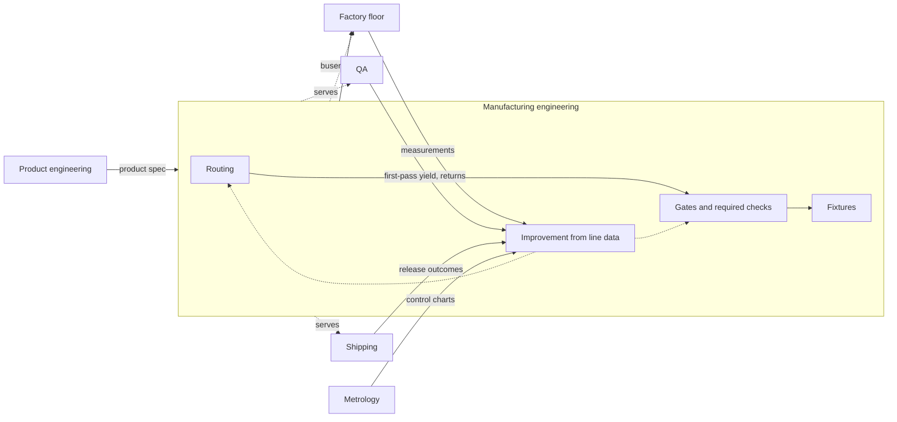
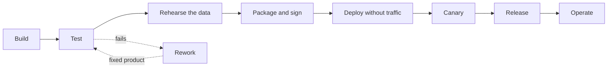
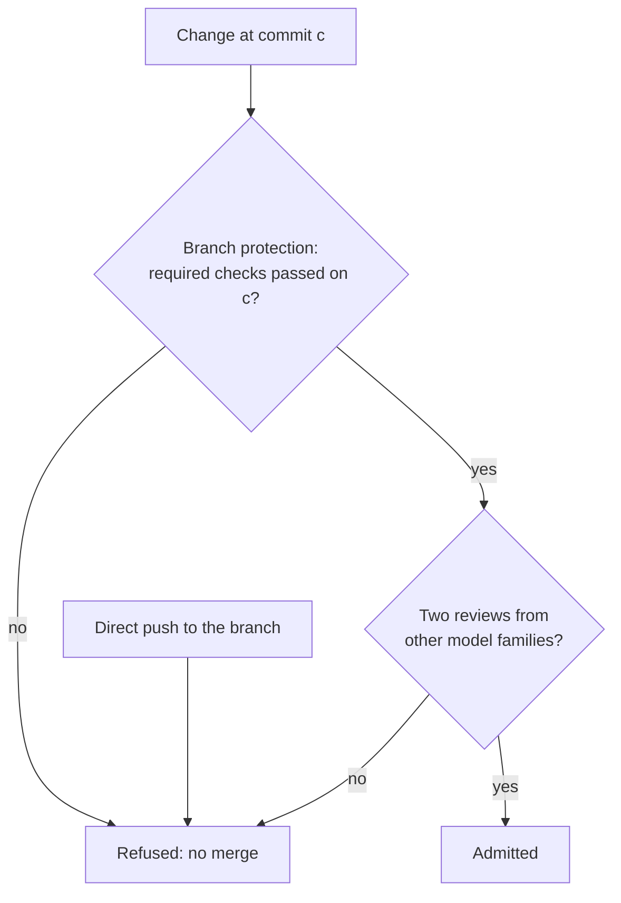
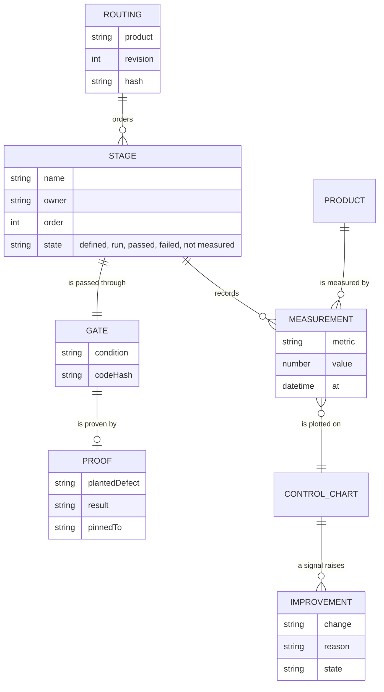
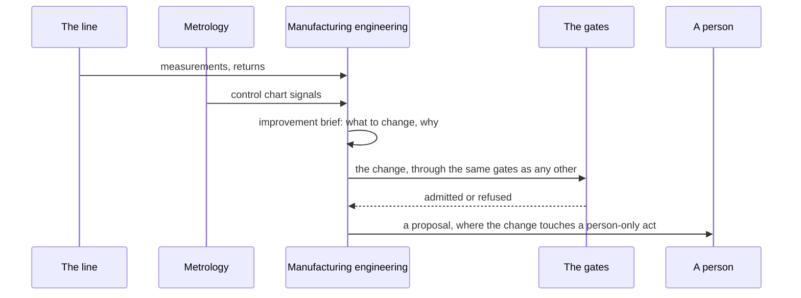

# Manufacturing Engineering: Defining How to Build It, and Improving the Line

**Patterns for a routing every product follows, gates proven able to fail, required checks enforced on the branch, fixtures at every station, and a line that improves from what it measures**

Russ Little · Pattern paper · Draft for review · Nov 28, 2026

v0.1 · Request for comments · © 2026 Russ Little. Licensed under CC BY 4.0. Part of the series rolled up in [The Line](the-line.md); the second step of [Engineering](engineering.md).

## Abstract

A product spec says what to build and from what. It does not say in what order, with which checks, at which gates, or what happens when a step cannot pass. In a plant that is the work of manufacturing engineering: define how to build the thing, set up the line to build it, and keep improving the line from what it measures. Here it is done by an agent, to the standards of manufacturing engineering: process failure mode and effects analysis, the control plan, and advanced product quality planning (APQP). It takes in the product spec and hands the factory floor a build package: the routing, the fixtures, the gates and the required checks. It serves the floor, QA and shipping, and it improves each of them from the line's own measurements. This paper sets out eight patterns for that work.

> **Central proposition.** Define the way to build a product before building it, prove that every gate in that way can fail, enforce the way on the branch so it cannot be bypassed, and improve it from what the line measures.

## 1. Where it sits

Manufacturing engineering is the second step of engineering. It is a different discipline from product engineering: product engineering decides what the product is; manufacturing engineering decides how the plant makes it.

## 2. The problem

- **Every product invents its process.** Without a routing, each product is built in a slightly different order, with different checks, and what one learns never reaches the next.
- **Gates that cannot fail.** A check that always passes is a decoration. The process looks controlled and is not.
- **Rules that can be bypassed.** A required check that a person or an agent can merge around is a suggestion.
- **A process nobody improves.** The line records what it measures and nobody reads it.

## 3. Patterns

### Pattern 1. A Routing for Every Product

**Problem.** The sequence of making a product lives in people's heads and drifts.

**Pattern.** Every product has a routing: the ordered stages it passes from build to operation. Each stage has an owner area, a gate and the evidence it records. The reference routing is the delivery stages: build, test, rehearse the data, package and sign, deploy without traffic, canary, release, operate. A product may add stages; it may not skip one without a recorded reason.

**Consequences.** Where a product is in its making is a position on a routing. A stage the line has not run is shown as defined and not run, never as passed.

### Pattern 2. Process FMEA Ranks the Risks

**Problem.** Controls are added where someone worried, not where the process is weakest.

**Pattern.** For each stage, the failure modes are listed and ranked by severity, occurrence and detection, after the AIAG-VDA FMEA handbook, and each is given a preventive check or a gate. The highest-ranked go first on the control plan.

**Consequences.** The control plan follows the risk. Where no failure-mode analysis has been recorded, the plan is not yet risk-ranked, and says so.

### Pattern 3. The Control Plan: A Gate at Every Stage

**Problem.** A process without stated controls is controlled by whoever is looking.

**Pattern.** The control plan lists, for every routing stage, what is checked, by what, how often and what happens on failure: the required checks and the delivery gates. It is released with the build package and referred to by number and hash.

| Routing stage | Control | On failure |
| --- | --- | --- |
| Build | Types, lock file, no secret-shaped values | The change is refused |
| Test | Every gate, floor and journey for the phase | A failed product returns to rework |
| Rehearse the data | Migration of a copy loses nothing | The release is held |
| Package and sign | Signed provenance, bill of materials, vulnerability scan | The release is held |
| Deploy without traffic | Smoke journeys on the candidate | Roll back, one step |
| Canary | Error budgets hold; a person approves production | Roll back, one step |

### Pattern 4. Gates Proven Able to Fail

**Problem.** A gate nobody has seen fail has not been shown to work.

**Pattern.** Every gate on the control plan holds a planted-defect proof: the gate is green on a clean tree, goes red when the defect is planted, and the proof is pinned to a hash of the gate's own code. Changing the gate makes the proof stale until it is run again. Metrology certifies the gauges the gates use; manufacturing engineering decides which gates the plan needs.

### Pattern 5. Required Checks Enforced on the Branch

**Problem.** A rule that can be bypassed by a direct push is not a rule.

**Pattern.** The required checks are enforced by the branch itself: a change merges only when the record shows them passing on its exact commit, and admission is computed, never set. Configuration that makes the repository itself enforce this is part of the build package, not a convention.

**Consequences.** The record cannot be bypassed. Where branches are not protected, the plant says that its record can be bypassed, and the need is shown unmet.

### Pattern 6. Fixtures at Every Station

**Problem.** Each station is set up by hand for each product.

**Pattern.** The build package names the fixtures each station uses: the library blocks, the tools an agent role may call, the gauges QA uses, the work instructions the floor follows. A fixture inherited from an earlier product is marked inherited; one made for this product is marked new and offered to the library.

### Pattern 7. Capability Is Read From the Line

**Problem.** Whether the process can hold its requirements is argued.

**Pattern.** Process capability is read from the line's own records: how many products pass inspection the first time, how many return to rework and why, time and cost per stage, and the control charts metrology keeps on test time, flake rate, mutation score and cost per change. A series has no limits until it has enough points for limits to mean anything, so a new line raises no false alarms.

### Pattern 8. The Line Improves From What It Measures

**Problem.** Improvements are made when someone is annoyed, not when the data says.

**Pattern.** Manufacturing engineering reads the line's measurements and the returns from rework, and proposes changes to the routing, the gates and the fixtures: an improvement brief, one page a week, saying what to change and why. A proposed change goes through the same gates as any other change, and a change that touches a person-only act becomes a proposal for a person to sign. Improvements to QA's gauges and process belong to metrology; improvements to the floor's upkeep belong to maintenance; manufacturing engineering sets the process they work within.

## 4. What it needs

Manufacturing engineering needs a routing for every product; gates proven able to fail; required checks enforced on the branch; and process capability measured from the line. Which of these are met, which routing stages have run and which are defined and not yet run, is shown on [/plant](https://zthr.ai/plant); this paper does not restate them. Failure-mode analysis and process capability are methods the plant applies as the line produces the data they need.

## 5. Files, in manufacturing engineering

Files follows the reference routing. Its build package carries its control plan, the required checks on its branch, the Files gates with their planted-defect proofs, and the fixtures it inherits from the library. Its oracle against a recorded Nextcloud is a fixture of QA; its first-article inspection is set up here as a stage QA runs.

## 6. Evaluating it

- **Routing.** Every product has a routing, and every stage on it is marked run, defined and not run, or not measured.
- **Gates.** Every gate on the plan has a valid proof for its current hash.
- **Enforcement.** No change reaches the branch except by admission. Checkable on the branch and the ledger.
- **Capability.** First-pass yield and returns per stage, read from the line's own records.

## 7. What it does not claim

Manufacturing engineering does not build the product, inspect it or ship it. It defines the way and sets up the line, and it cannot make a gate that does not bite useful; it can only show that it does not. Where the line has not yet produced the data a method needs, the method is named and the figure is not invented.
