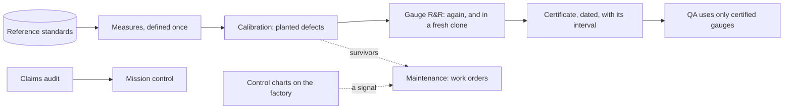
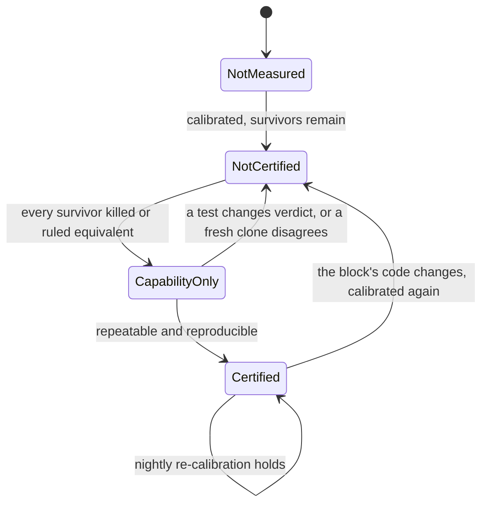
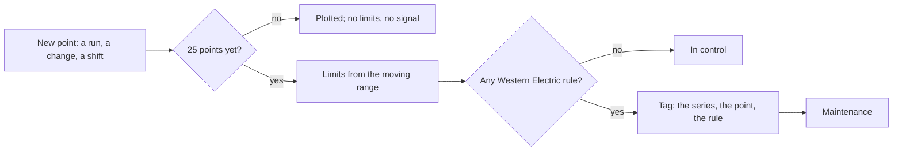
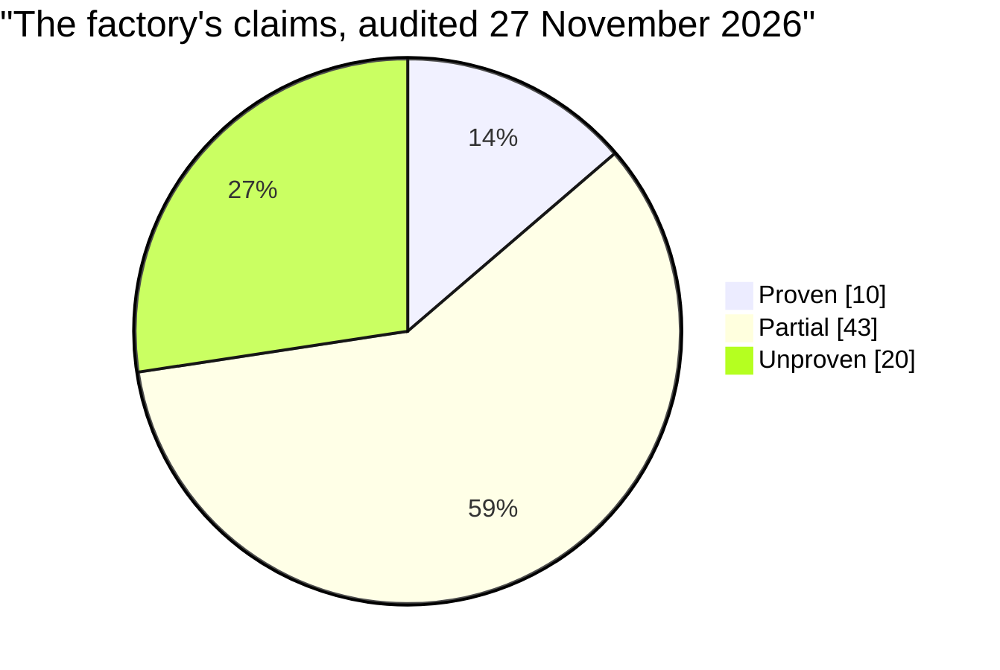
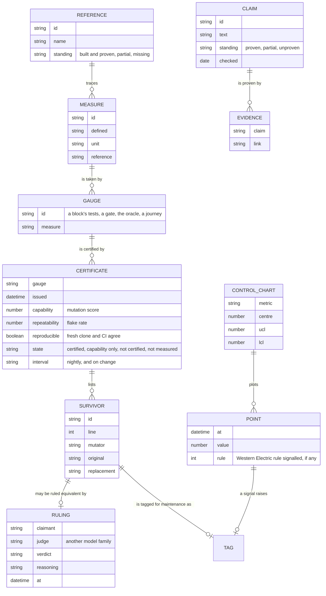

# Metrology: Certifying the Instruments Before They Judge

**Patterns for measures defined once and traced to a reference, gauges certified for capability, repeatability and reproducibility, control charts on the factory's own process, and an audit of the factory's claims**

Russ Little · Pattern paper · Draft for review · Nov 27, 2026

v0.1 · Request for comments · © 2026 Russ Little. Licensed under CC BY 4.0. Part of the series rolled up in [The Line](the-line.md).

## Abstract

QA certifies that a build does what was meant, and it does so with instruments: tests, gates, an oracle, journeys. Nothing in QA says whether those instruments are any good. Metrology is the department that does. It defines every measure QA uses and traces each to a reference standard: published test vectors, a recording of the system a product replaces, sealed held-out phrasing sets. It certifies every gauge before QA may use it: capability (the mutation score of a block: does each of its tests reject a planted defect), repeatability (the flake rate) and reproducibility (the same verdicts in a fresh clone and on CI), after the gauge R&R method of AIAG's *Measurement Systems Analysis*. Certificates are dated and lapse on change. It charts the factory's own process (test time, flake rate, mutation score, cost per change) after Shewhart, reads drift by the Western Electric rules, and raises a tag on every signal. And it audits the factory's claims about itself against their evidence. Metrology measures and certifies; maintenance repairs what it finds. This paper sets out eight patterns for that work, and says plainly how far the factory has got.

> **Central proposition.** Judge a build only with instruments that have themselves been judged: defined once, traced to a reference, shown to reject planted defects, shown to give the same answer twice and anywhere, and watched over time for drift.

## 1. The problem

- **Tests nobody tests.** A suite that always passes is indistinguishable from a suite that cannot fail.
- **Flaky verdicts.** A test that passes on one run and fails on the next turns every verdict into a coin toss, and is quietly retried until green.
- **Measures without a reference.** "The oracle agrees" means nothing unless the thing it agrees with is the real system, recorded.
- **Drift nobody sees.** Test time creeps up, a model's pass rate slides, cost per change doubles over a month; each day looks like the last.
- **Claims that outrun their evidence.** A factory that describes itself says more than it has proven, and nothing checks.

## 2. Where metrology sits

Metrology serves QA most directly, but also the factory's required checks, the oracle the fleet relies on and the service levels shipping watches. It receives nothing from the department before it and hands nothing to the one after, so it has no place in the order work moves through. It sits beneath the line beside maintenance: metrology measures, certifies and tags; maintenance repairs.

## 3. Principles

**No measure without a reference.** A measure is defined once, with its unit, and traced to a standard outside the factory's control.

**No verdict from an uncertified gauge.** QA may use a gauge only while its certificate is current.

**A claim is a measurement.** What the factory says about itself is proven, partial or unproven, and is checked like anything else.

## 4. Patterns

### Pattern 1. Measures Defined Once

**Problem.** Each department measures "passing" its own way, and the numbers cannot be compared.

**Pattern.** Every measure QA uses is defined in one place: what it is, its unit, and what it is traced to.

| Measure | Defined as | Unit | Traced to |
| --- | --- | --- | --- |
| Gauge capability | Of the planted defects in a block, the share its tests reject | % of mutants killed | The block's own code, mutated |
| Repeatability | The share of tests that change verdict when run again, unchanged, on the same machine | % of tests (the flake rate) | AIAG *Measurement Systems Analysis* |
| Reproducibility | Whether the same commit gives the same verdict on every test in a fresh clone and on CI | tests that disagree | AIAG *Measurement Systems Analysis* |
| Oracle discrimination | Of the differences planted in a recorded corpus, the share reported; of the rightful differences, the share masked | % detected, % masked | The recording of the replaced system |
| Journey pass | A person's goal reached in every mode and channel named, with nothing forbidden happening | pass, fail or not measured | The signed intent and the held-out phrasings |

### Pattern 2. Traced to a Reference

**Problem.** A gauge checked only against the factory's own idea of correct inherits the factory's mistakes.

**Pattern.** Every measure traces to a reference the factory does not write: a specification's published test vectors; a recording of the real system a product replaces, captured once and replayed against every build; sets of phrasings held out from the factory and sealed, so a pass cannot be memorised.

| Reference | Where it stands |
| --- | --- |
| Published test vectors | Partial: some blocks test against their RFC's vectors; no catalogue says which measure traces to which vector |
| A recording of a real Nextcloud, for the Files oracle | Missing: the oracle can replay a recorded corpus, but no recording has been made |
| Sealed held-out phrasing sets | Partial: held in a person-only path, sealed by convention, with no hash a gate checks |

### Pattern 3. Certified Before Use

**Problem.** A gauge is trusted because it exists.

**Pattern.** Each gauge earns a certificate in order. Capability first: every planted defect its tests can tell apart is rejected, and every survivor is either killed or ruled equivalent by a judge of another model family, with its reasoning recorded. Then repeatability and reproducibility. Only a certified gauge may give QA a verdict.

Each survivor is a work order for maintenance: add the missing test, fix the defect a new test finds, or remove code that does nothing.

### Pattern 4. Gauge R&R

**Problem.** AI workers vary from run to run, and so can the tests they write. A gauge whose verdict varies cannot separate a good build from a bad one.

**Pattern.** After AIAG's gauge repeatability and reproducibility study, each block's suite is run again, unchanged, on the same machine (repeatability: the flake rate) and in a fresh clone and on CI (reproducibility: do the verdicts agree). A flaky test is a tag, never a retry. A build that reproduces byte for byte is already checked (the supply chain's reproducible-build tool); test verdicts are not compared yet.

### Pattern 5. A Certificate Has an Interval

**Problem.** A gauge proven once is assumed proven forever.

**Pattern.** A certificate is dated and names its interval: every block is calibrated nightly, and a block again whenever its code changes. A change lapses the certificate until the next calibration holds. The score a certificate records cannot fall: a change that lowers it fails, and a higher floor is proposed for a person to sign, because floors are person-only.

### Pattern 6. Measure the Oracle

**Problem.** An oracle that compares a product with the system it replaces is itself an instrument, and can mask a real difference or report a rightful one.

**Pattern.** The oracle is put through a measurement system analysis of its own: a suite of planted differences in a recorded corpus, each of which it must report, and rightful differences (etags, ids, dates, tokens), each of which it must mask. Its discrimination is a measure like any other. Today the oracle's unit tests plant differences; with no recording yet, there is no corpus to run the suite on.

### Pattern 7. Control Charts on the Factory

**Problem.** A process that drifts slowly looks normal every day.

**Pattern.** Metrology charts the factory's own process: test time, flake rate, mutation score and cost per accepted change. Each is an individuals chart after Shewhart, with the centre at the mean and limits at three sigma estimated from the average moving range. Drift is read by the Western Electric rules, and every signal raises a tag for maintenance.

| Rule | Signal |
| --- | --- |
| 1 | One point beyond three sigma |
| 2 | Two of three consecutive points beyond two sigma, on one side |
| 3 | Four of five consecutive points beyond one sigma, on one side |
| 4 | Eight consecutive points on one side of the centre |

A series has no limits until it has 25 points, as the AIAG SPC manual asks, so a new factory raises no false alarms. No series has its 25 points yet.

### Pattern 8. Audit the Factory's Claims

**Problem.** A factory's description of itself is its least checked output.

**Pattern.** Every claim the factory makes about itself is entered in a claims-to-evidence ledger and checked: proven (a test or record shows it), partial (some of it exists, and the gap is named) or unproven. The audit is repeated, and each finding becomes a tag. The audit of 27 November 2026 found 73 claims: 10 proven, 43 partial, 20 unproven.

Its findings:

1. Review by two other model families is designed but not running.
2. Branches are not protected, so the record can be bypassed by a direct push.
3. There is no recording of a real Nextcloud for the Files oracle.
4. Held-out sets are sealed by convention, not by a hash a gate checks.
5. The papers' figures are typed, not generated.
6. Deploys name a movable image tag, not a digest.
7. The reference build was red for 13 days while commits continued.

## 5. What metrology records

## 6. Files, in the lab

Files would be the factory's first article: its first build measured, characteristic by characteristic, against the system it replaces (AS9102 first article inspection). That needs the reference: a recording of a real Nextcloud answering the requests its clients make. With the recording, the oracle is measured on planted differences, and every one of Files' twelve library blocks is calibrated and certified before QA uses its tests. Without it, the oracle's verdicts are traced to nothing outside the factory, and the first article inspection cannot be made.

## 7. Evaluating it

- **Certified share.** The share of gauges QA uses that hold a current certificate. It should reach all of them; until it does, QA's rule is not met, and that is a reading.
- **Discrimination.** For the oracle, planted differences reported and rightful differences masked.
- **Stability.** Flake rate and reproducibility per block, over time.
- **Drift found.** Signals raised by the control charts, and how many became fixes.
- **Honesty.** The share of the factory's claims proven, audit by audit.

## 8. What it does not claim

Metrology does not make a gauge correct: it shows how well a gauge discriminates, how consistently it reads, and what it is traced to. It does not replace the reference standards: where a reference is missing, it says the measure is traced to nothing outside the factory. And it does not prove the factory's claims: it records which are proven, and which are not yet. The reason these methods apply to software at all is set out in [The Line](the-line.md), with the plant map.
