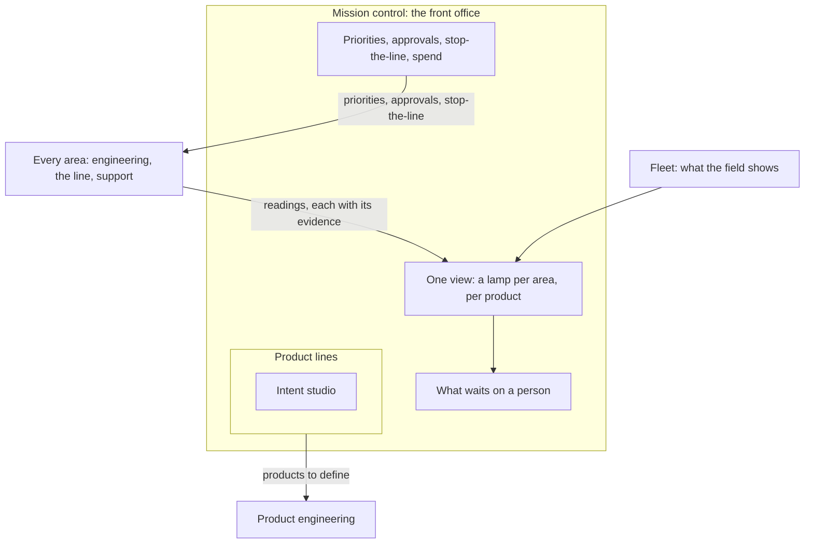
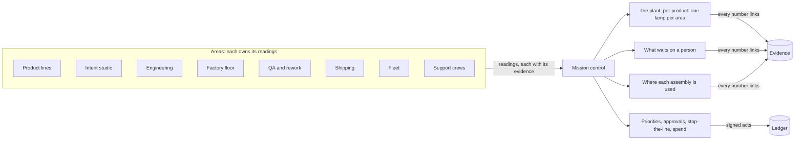
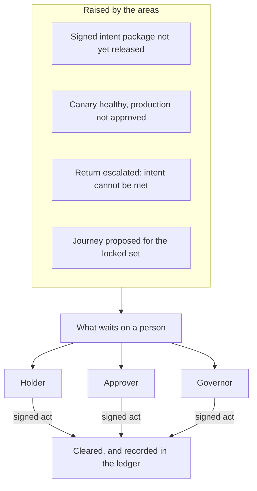
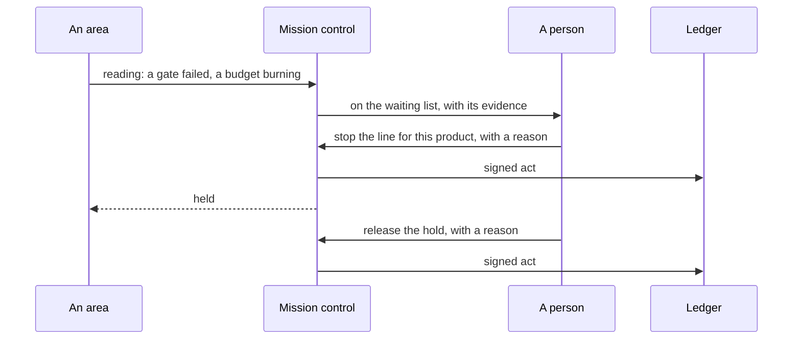

# Mission Control: Running a Software Plant From One Place

**Patterns for the front office: priorities, approvals, stop-the-line and spend, and one view of every product line and product, where each stands, and what waits on a person**

Russ Little · Pattern paper · Draft for review · Nov 26, 2026

v0.1 · Request for comments · © 2026 Russ Little. Licensed under CC BY 4.0. Part of the series rolled up in [The Line](the-line.md).

## Abstract

When agents do the work, the scarce resource is a person's attention. A plant that runs many products through many areas produces more activity than anyone can follow, and most of it needs nobody. Mission control is the front office that runs the plant. It decides what is made and for whom, gives every area its priorities, approvals and the authority to stop the line, holds a spend budget per crew and per product, and houses the product lines, each with its intent studio. It is also the one view that shows, for every product line and product, where each stands in each area, and the short list of things only a person can do. It does no area's work and keeps no readings of its own: every lamp is a reading from the area that produced it, every number links to its evidence, and what was not measured says so. This paper sets out seven patterns for that office, and the rules that keep it honest.

> **Central proposition.** A person should be able to run the whole plant from one place: see it at a glance, trust every light without opening it, find in one list exactly what is waiting on them, and stop the line when it must stop.

## 1. Where it sits

Mission control is plant management and production control, to the standard of ISA-95 level 4: the layer above the machines that schedules, authorises and watches them. It is done by a person and an agent together. It takes in every area's evidence feed and the reports from the field, and gives every area its priorities, approvals and stop-the-line.

Mission control and the product lines carry no work step of their own: nothing is built in the front office. What mission control holds is authority and a reading.

## 2. The problem

Dashboards for software delivery fail in three familiar ways.

- **Green by default.** A panel with no data shows nothing wrong. A check that did not run looks the same as one that passed.
- **Numbers without provenance.** A figure on a screen cannot be traced to the run that produced it, so it cannot be challenged.
- **Everything is urgent.** Every event is a notification. The few decisions that need a person are lost among hundreds that do not.

And a view alone is not enough. Someone must be able to say what comes first, approve what only a person may approve, and stop the line.

## 3. Principles

**Readings are never inferred; authority is explicit.** Mission control computes no reading an area did not record. If an area has not reported, its lamp says not measured. What mission control may do, it does by signed act in the ledger: set a priority, give an approval, stop the line, set a spend budget.

**Four states, never two.** Every lamp is pass, fail, waiting, or not measured. Not measured is never shown as pass, and waiting (nothing to do yet) is never shown as fail.

## 4. Patterns

### Pattern 1. One Lamp per Area

**Problem.** A product's state is spread across tools: the specification in one place, the build in another, the release in a third.

**Pattern.** Every product has one row: its areas in plant order, each with one lamp. The same bar runs across the top of every area's own page, with the product in focus, so a person always knows where they are in the plant and where the product is. The plant flows from the intent studio through product engineering, manufacturing engineering, the factory floor, QA (with rework beside it), shipping and the fleet; the support crews appear beside the area each serves, not in the flow.

**Consequences.** Where a product stands is a reading, not a conversation. A product stuck between areas is visible as the first lamp that is not green. A fleet with nothing in service shows off, not green.

### Pattern 2. Not Measured Is Not Pass

**Problem.** Missing data looks like good news.

**Pattern.** A reading the area did not take arrives as null and is shown as not measured, with the reason when there is one ("the walk for this commit has not finished"). A lamp turns green only from a recorded pass for the exact build in view.

**Consequences.** The board is less green than a conventional one, and every green on it is true.

### Pattern 3. Every Number Links to Its Evidence

**Problem.** A figure nobody can trace cannot be trusted or challenged.

**Pattern.** Every reading carries the address of the evidence it came from: the test report, the gate's proof, the walk, the release record. Opening a lamp shows the reading's source and its build.

**Consequences.** Disagreement about a number becomes a look at its evidence.

### Pattern 4. Waiting Is Work

**Problem.** The decisions that need a person are buried among events that do not.

**Pattern.** Mission control keeps one list: what is waiting on a person, and only that. An intent ready to sign. A revision ready to release. A production approval after a canary. A return the rework loop escalated because the intent cannot be met. A proposal to lock a journey. Each item says what is waiting, who it waits on, and the one action that clears it.

**Consequences.** A person's day starts from a short list that the factory cannot clear on its own. Everything else proceeds without them.

### Pattern 5. Focus Travels

**Problem.** Moving between areas loses the thread of which product a person was looking at.

**Pattern.** The product in focus is carried from page to page. Every area's page opens on it, shows it on the bar, and ends with one hand-off to the next area, enabled only when the work there is ready to move on.

**Consequences.** Following one product through the whole plant is a sequence of clicks, not a search.

### Pattern 6. Where Used

**Problem.** A change to a shared assembly affects products nobody thinks of.

**Pattern.** Mission control shows, for every standard assembly, which products use it, as used, extended or through a custom assembly. Assemblies that touch sensitive data are marked, with the products whose data they govern.

**Consequences.** Before a change to a shared part, its reach is known. After a fix, every product that should receive it is listed.

### Pattern 7. The Plant Along the Portfolio

**Problem.** A list of products hides the shape of the portfolio: which product lines are moving and which are stuck.

**Pattern.** Products are grouped by product line, and each line shows how many of its products stand in each area. A line whose products pile up before one area points at that area.

**Consequences.** Bottlenecks are found by shape, before anyone asks.

### Pattern 8. The Authority to Stop

**Problem.** A plant that can only watch cannot contain a fault, and one where anyone can stop everything is stopped by noise.

**Pattern.** Stop-the-line is an act of mission control, taken by a person and recorded in the ledger, with the area or product it holds and the reason. Priorities and approvals are signed acts of the same kind. A spend budget is set per crew and per product; work pauses at its ceiling. Areas tag what is wrong and carry on; a red base refuses new work except its own fix (see [Rework](rework.md)); beyond that, only mission control stops a line.

**Consequences.** Stopping is rare, recorded and attributable, and every area learns its priorities from one place.

## 5. Files, seen from mission control

Files appears as one row in its product line. Its intent lamp turns green when the holder signs; product engineering's when the spec is released; manufacturing engineering's when the build package is released; the floor's when every manifest line is built and admitted; QA's when every journey passes, including the oracle against a real Nextcloud; shipping's when a signed release is serving with the build's identity; the fleet's when the app is in service and its service levels hold.

The waiting list shows, at each point, the one thing only a person can do for it: sign; release; approve production after the canary; or decide a return the plant escalated (for example, if the intent asks for something the apps' protocol cannot express).

## 6. Evaluating it

- **Honesty.** No lamp is green without a recorded pass for the build shown. Checkable by joining each lamp to its evidence.
- **Attention.** The waiting list contains only acts that have no tool. Checkable against the roles' denials.
- **Reach.** Every product using an assembly appears in its where-used list. Checkable against the manifests.
- **Authority.** Every stop, priority and approval is a signed act in the ledger.

## 7. What it does not claim

Mission control does not rank products by itself or predict delivery, and it does not do any area's work. It runs the plant by signed acts, shows what the areas recorded, and lists the acts that wait on people. Nothing it shows is more certain than the evidence behind it. Its needs are a live feed from every area, stop-the-line authority, the queue of decisions waiting on a person, and a spend budget per crew and per product; which of these are met is shown on [/plant](https://zthr.ai/plant), and results reach the office only from a published build feed.
