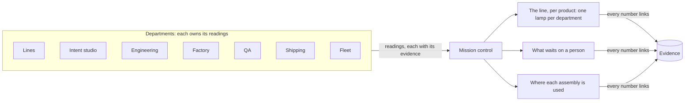
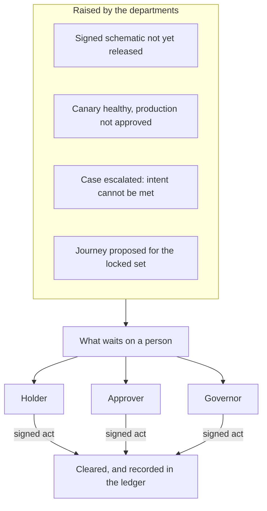

# Mission Control: Seeing a Software Factory From One Place

**Patterns for the view of every product line and product, where each stands, and what waits on a person**

Russ Little · Pattern paper · Draft for review · Nov 26, 2026

v0.1 · Request for comments · © 2026 Russ Little. Licensed under CC BY 4.0. Part of the series rolled up in [The Line](the-line.md).

## Abstract

When agents do the work, the scarce resource is a person's attention. A factory that runs many products through many departments produces more activity than anyone can follow, and most of it needs nobody. Mission control is the one view that shows, for every product line and product, where each stands in each department, and the short list of things only a person can do. It owns no work and stores no state of its own: every lamp is a reading from the department that produced it, every number links to its evidence, and what was not measured says so. This paper sets out seven patterns for that view, and the rules that keep it honest.

> **Central proposition.** A person should be able to see the whole factory at a glance, trust every light without opening it, and find in one list exactly what is waiting on them.

## 1. The problem

Dashboards for software delivery fail in three familiar ways.

- **Green by default.** A panel with no data shows nothing wrong. A check that did not run looks the same as one that passed.
- **Numbers without provenance.** A figure on a screen cannot be traced to the run that produced it, so it cannot be challenged.
- **Everything is urgent.** Every event is a notification. The few decisions that need a person are lost among hundreds that do not.

## 2. Principles

**Read, never hold.** Mission control computes nothing a department did not record. If a department has not reported, its lamp says not measured.

**Four states, never two.** Every lamp is pass, fail, waiting, or not measured. Not measured is never shown as pass, and waiting (nothing to do yet) is never shown as fail.

## 3. Patterns

### Pattern 1. One Lamp per Department

**Problem.** A product's state is spread across tools: the specification in one place, the build in another, the release in a third.

**Pattern.** Every product has one row: the eight departments in line order, each with one lamp. The same bar runs across the top of every department's own page, with the product in focus, so a person always knows where they are on the line and where the product is.

**Consequences.** Where a product stands is a reading, not a conversation. A product stuck between departments is visible as the first lamp that is not green.

### Pattern 2. Not Measured Is Not Pass

**Problem.** Missing data looks like good news.

**Pattern.** A reading the department did not take arrives as null and is shown as not measured, with the reason when there is one ("the walk for this commit has not finished"). A lamp turns green only from a recorded pass for the exact build in view.

**Consequences.** The board is less green than a conventional one, and every green on it is true.

### Pattern 3. Every Number Links to Its Evidence

**Problem.** A figure nobody can trace cannot be trusted or challenged.

**Pattern.** Every reading carries the address of the evidence it came from: the test report, the gate's proof, the walk, the release record. Opening a lamp shows the reading's source and its build.

**Consequences.** Disagreement about a number becomes a look at its evidence.

### Pattern 4. Waiting Is Work

**Problem.** The decisions that need a person are buried among events that do not.

**Pattern.** Mission control keeps one list: what is waiting on a person, and only that. A schematic ready to sign. A revision ready to release. A production approval after a canary. A case the correction loop escalated because the intent cannot be met. A proposal to lock a journey. Each item says what is waiting, who it waits on, and the one action that clears it.

**Consequences.** A person's day starts from a short list that the factory cannot clear on its own. Everything else proceeds without them.

### Pattern 5. Focus Travels

**Problem.** Moving between departments loses the thread of which product a person was looking at.

**Pattern.** The product in focus is carried from page to page. Every department's page opens on it, shows it on the bar, and ends with one hand-off to the next department, enabled only when the work there is ready to move on.

**Consequences.** Following one product through the whole line is a sequence of clicks, not a search.

### Pattern 6. Where Used

**Problem.** A change to a shared assembly affects products nobody thinks of.

**Pattern.** Mission control shows, for every standard assembly, which products use it, as used, extended or through a custom assembly. Assemblies that touch sensitive data are marked, with the products whose data they govern.

**Consequences.** Before a change to a shared part, its reach is known. After a fix, every product that should receive it is listed.

### Pattern 7. The Line Along the Portfolio

**Problem.** A list of products hides the shape of the portfolio: which lines are moving and which are stuck.

**Pattern.** Products are grouped by line, and each line shows how many of its products stand in each department. A line whose products pile up before one department points at that department.

**Consequences.** Bottlenecks are found by shape, before anyone asks.

## 4. Files, seen from mission control

Files appears as one row in its line. Its intent lamp turns green when the holder signs; engineering's when the revision is released; the factory's when every manifest line is built and admitted; QA's when every journey passes, including the oracle against a real Nextcloud; shipping's when the service answers with the build's identity; the fleet's when its service levels hold.

The waiting list shows, at each point, the one thing only a person can do for it: sign; release; approve production after the canary; or decide a case the factory escalated (for example, if the intent asks for something the apps' protocol cannot express).

## 5. Evaluating it

- **Honesty.** No lamp is green without a recorded pass for the build shown. Checkable by joining each lamp to its evidence.
- **Attention.** The waiting list contains only acts that have no tool. Checkable against the roles' denials.
- **Reach.** Every product using an assembly appears in its where-used list. Checkable against the manifests.

## 6. What it does not claim

Mission control does not decide anything. It does not rank products or predict delivery. It shows what the departments recorded, and the acts that wait on people, and nothing it shows is more certain than the evidence behind it.
