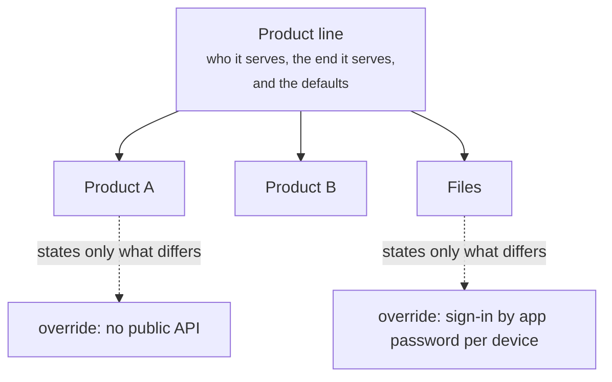
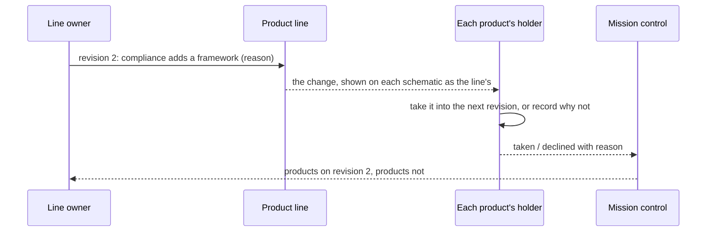

# Product Lines: Deciding Once for a Family of Products

**Patterns for the defaults a line hands every product in it, and how a product states only what is different**

Russ Little · Pattern paper · Draft for review · Nov 26, 2026

v0.1 · Request for comments · © 2026 Russ Little. Licensed under CC BY 4.0. Part of the series rolled up in [The Line](the-line.md).

## Abstract

Most decisions about a new product were already made for the last one: which compliance frameworks apply, how people sign in, where tickets and chat go, whether there is an API, how feedback is taken, how use is measured. When each product makes them again, they come out slightly different each time, and the differences are rarely intended. A product line decides them once, for everyone it serves, and hands every product in it the same starting point. A product inherits the line's decisions, sees each as the line's, and states only what is different. This paper sets out six patterns for lines and the rules that keep inherited decisions visible.

> **Central proposition.** Decide what a family of products shares once, at the line; let each product start from it, see it, and change only what is truly different, on the record.

## 1. The problem

- **Repeated decisions drift.** Ten products decide sign-in ten times and end up with four methods.
- **Hidden defaults.** A default nobody chose is still a decision, and nobody can say who made it.
- **Copying is not inheriting.** A product copied from another keeps its decisions but loses the link: a later fix to the original never reaches the copy.

## 2. Principles

**A line is a decision, not a template.** Its defaults are choices someone made and answers for. Every product shows each inherited choice as the line's until its holder confirms or changes it.

**Inheritance keeps the link.** A product refers to its line; it does not copy it. A change to the line is seen by every product in it, and each holder decides whether their product takes it.

## 3. Patterns

### Pattern 1. The Line Before the Product

**Problem.** Products are started one at a time, and the family they belong to is discovered later.

**Pattern.** A product is started inside a line. The line names who its products serve and the end they serve, so every intent in it starts with its end in mind already stated.

**Consequences.** A product's schematic opens with its why filled in, attributed to the line.

### Pattern 2. Defaults Are Decisions

**Problem.** Defaults that nobody chose become permanent without anyone deciding.

**Pattern.** A line sets each of its spec-sheet choices explicitly: the compliance frameworks in scope; the identity provider people sign in with; where factory progress goes (tickets); where notes go as each department finishes (chat); how people report problems (feedback); which interfaces are open (an API per feature, events, agent tools); and how use is measured. Each is recorded with the line, and none is left blank.

**Consequences.** Every product in a line has the same answers to the same questions, and anyone can see who chose them.

| Choice | What it decides for every product in the line |
| --- | --- |
| Compliance | Which frameworks' controls are in scope, and so which evidence every release carries |
| Identity | How people sign in |
| Tickets | Where the factory's progress is reported |
| Chat | Where a note goes as each department finishes |
| Feedback | How people report a problem, and where it lands |
| API | Which interfaces are switched on: per-feature APIs, events, agent tools |
| Usage | How use is measured, with consent |

### Pattern 3. Inherited, and Shown as Inherited

**Problem.** An inherited decision looks the same as one the product made, so nobody questions it.

**Pattern.** On a product's schematic, every line default is shown with its source (the line) and its state (assumed) until the holder confirms it. Confirming makes it the product's own; changing it records an override with a reason.

**Consequences.** A product's specification says exactly which decisions are its own.

### Pattern 4. An Override Says Why

**Problem.** Exceptions accumulate until the line means nothing.

**Pattern.** A product may change any inherited choice, and the change records a reason. Mission control lists every override across the line, so a choice overridden by most products is visibly the wrong default.

**Consequences.** A line's defaults are tested by its products, and a bad default is found by the count of its overrides.

### Pattern 5. One Product, One Intent, One Line

**Problem.** A product that belongs to two families inherits contradictions.

**Pattern.** A product belongs to exactly one line. Something that seems to belong to two is either two products sharing assemblies, or a line that should be split.

**Consequences.** Every product has one set of defaults and one place they come from.

### Pattern 6. Change the Line on the Record

**Problem.** Changing a line silently changes every product in it.

**Pattern.** A change to a line is a revision with a reason, like a change to an intent. Each product in the line sees the change and its holder decides whether to take it into their next revision. Mission control shows which products have and have not.

**Consequences.** A line evolves without surprising any product, and the lag between line and product is a visible reading.

## 4. Files in its line

Files belongs in a line of self-hosted collaboration services: products that keep people's own information on infrastructure they control, open to the clients they already use. That line's defaults would be that people sign in with credentials the service issues, that APIs are open and documented, that no usage is measured without consent, and that every product is held to the line's privacy controls. Files would inherit them all and record one override: each app signs in with its own app password, issued through a browser sign-in, because the apps it serves expect it.

A second product in the same line (calendars and contacts over CalDAV and CardDAV) would start with all of that already decided, and with the line's blocks for device sessions, grants and the DAV core already built.

## 5. Evaluating it

- **Coverage.** Every spec-sheet choice of every line is set; none is blank.
- **Visibility.** Every inherited choice on a product's schematic is marked as inherited until confirmed.
- **Fitness.** The share of products overriding each default is a reading; a default most products override is reviewed.

## 6. What it does not claim

A line does not make products alike. It makes their shared decisions explicit, and their differences deliberate.
