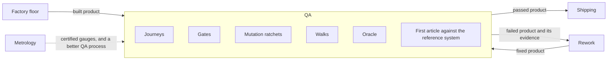
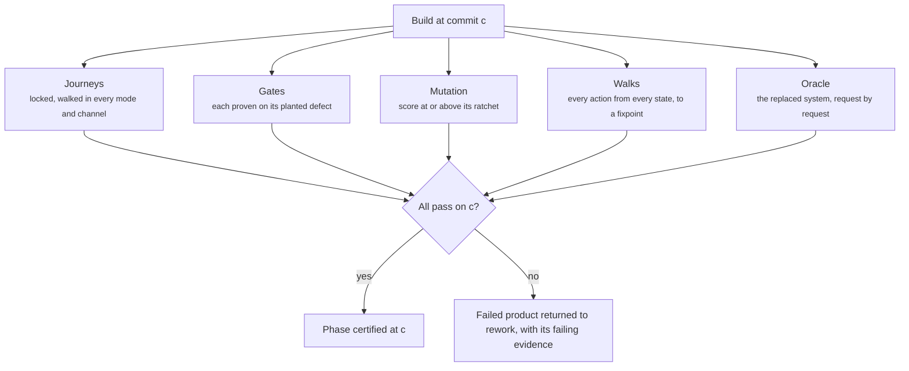
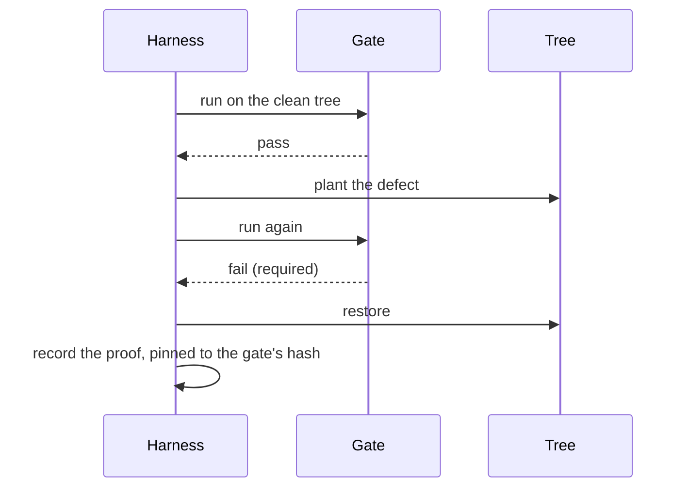
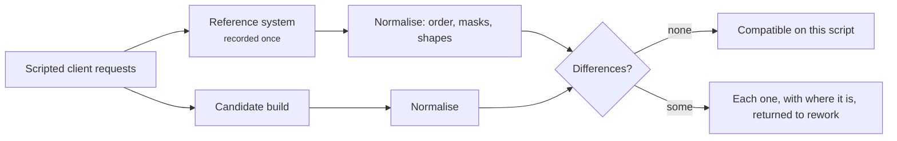
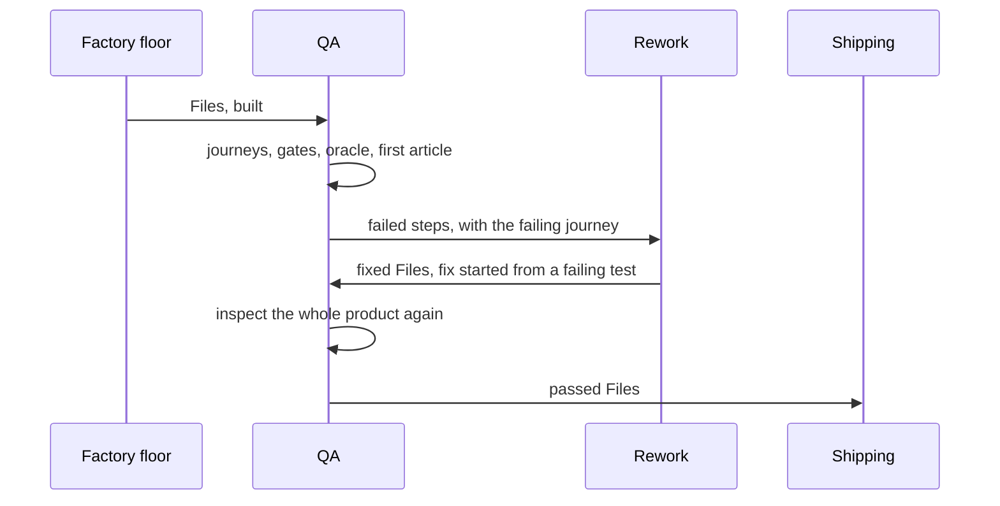

# QA: Proving That What Was Built Does What Was Meant

**Patterns for journeys that judge, gauges proven on planted defects, ratchets that only rise, and the replaced system as the measuring stick**

Russ Little · Pattern paper · Draft for review · Nov 26, 2026

v0.1 · Request for comments · © 2026 Russ Little. Licensed under CC BY 4.0. Part of the series rolled up in [The Line](the-line.md).

## Abstract

Tests written by the same agents that write the code tell you the code does what the agents thought. QA's job is to tell you it does what the person meant. It does that with four kinds of instrument, each of which the builder cannot change: journeys, written in plain words from the intent and locked by a person, that are walked as a person would, in every mode and channel; gates that count only after a planted defect has made each fail; mutation scores held by ratchets that only rise; and, when a product replaces something people already use, the old system itself, queried request by request. A phase is certified only when all of them agree on the exact build. What fails goes back to [Rework](rework.md) with its failing evidence, and QA inspects the fixed product again. QA uses only gauges that [metrology](metrology.md) has certified. This paper sets out nine patterns for QA, and the rule that an instrument that cannot fail never passes anything.

> **Central proposition.** Judge software by instruments the builder cannot edit, each proven able to fail, and certify only what every one of them passes on the same build.

## Where it sits

QA is quality control and inspection, to the standard of first article inspection (AS9102): a product's first build is measured, characteristic by characteristic, against its reference system, and every later build is inspected against the same gauges. It is done by an agent. It takes in the built product from the floor and gives shipping a pass, or gives rework a fail with the failing evidence. Metrology stands beside it and keeps its gauges and process true.

## 1. The problem

- **Tests that test nothing.** An agent iterating to green will satisfy an assertion trivially if it can.
- **Checks that cannot fail.** A scanner pointed at an empty path, a gate whose condition is always true, a walk that stops early: each reports success and proves nothing.
- **Green components, broken intent.** Every unit test passes and a person still cannot do what they came to do.
- **The spec is not the system.** For a product that replaces another, the documentation says one thing and the real clients depend on what the old system actually does.

## 2. Principles

**Proven to bite.** An instrument counts only after it has been shown to fail on the defect it exists to catch.

**Three values.** Every verdict is pass, fail or unknown. Unknown withholds what a pass would grant, and is never shown as pass.

## 3. Patterns

### Pattern 1. Journeys Judge

**Problem.** Requirements and tests drift apart, and the tests win.

**Pattern.** Every outcome on the signed intent generates journeys: a named person, a goal in plain words, the steps they take, and what must be true at the end. A person locks them by hash. The factory may propose journeys; it cannot lock, edit or remove one.

### Pattern 2. Every Mode, Every Channel

**Problem.** A journey that passes on a desktop screen in English says nothing about a phone, a text message, a screen reader, or someone in a hurry.

**Pattern.** A journey declares the modes it is walked in (standard, brief, walk-me-through) and the channels (the app, a text message, an API); it passes only when every declared combination passes.

### Pattern 3. Proven to Bite

**Problem.** A gate that cannot fail is indistinguishable from one that works.

**Pattern.** For each named gate, a harness holds a case that plants exactly the defect the gate exists to catch. Running it confirms the gate is green on the clean tree, plants the defect, requires the gate to go red, restores the tree, and records a proof pinned to a hash of the gate's own code. Changing the gate makes its proof stale until it is proven again.

### Pattern 4. Ratchets Only Rise

**Problem.** Test strength erodes quietly, one weakly tested change at a time.

**Pattern.** Mutation testing plants small defects (a flipped comparison, a changed constant, a deleted call) and requires the tests to fail on each. Each module's score is held by a ratchet: new code that lowers it fails the change, and only a person can lower a floor.

### Pattern 5. Walk to a Fixpoint

**Problem.** Scripted tests cover the paths someone thought of.

**Pattern.** A walker drives every action from every reachable state, checking invariants at each step, until no new state appears. The number of states, transitions and violations is recorded; a walk cut short says so.

### Pattern 6. Held Out

**Problem.** A generator that sees the evaluation set learns it.

**Pattern.** Some phrasings and cases are held out: the builder never sees them, dashboards count but never show them, and they are run only by QA.

### Pattern 7. The Replaced System Is the Gauge

**Problem.** For a product that replaces another, the specification is incomplete, and the real clients depend on undocumented behaviour.

**Pattern.** The differential oracle sends the same scripted requests a real client makes to the system being replaced and to the candidate, reduces each answer to what a client can depend on (status, the headers that matter, the body with ordering normalised and rightly different values such as etags, ids, dates and tokens compared by shape), and reports every remaining difference with where it is. The reference's answers are recorded once into a corpus, so every build is checked against it with no reference running.

### Pattern 8. Calibrated Twins

**Problem.** Tests against a real outside service are slow, rate-limited and cannot be made to fail on purpose.

**Pattern.** Each outside dependency has a behavioural twin calibrated to the service as built, not as documented, by recording the live service and replaying against the twin; journeys and campaigns run against the twin at volumes and failure rates the live service would never allow.

### Pattern 9. Certify the Exact Build

**Problem.** Evidence from different builds is combined into a pass no single build earned.

**Pattern.** A phase is certified at one commit when every gate passes with a valid proof, every walk reaches its fixpoint with no violation, every journey for the phase passes, and mutation is at or above every floor, all for that commit. A certificate names the commit.

## 4. Files, in QA

Files is judged by journeys its own clients define: the desktop app syncs 25,000 small files within ten minutes; a large upload interrupted part way finishes when resumed; a file changed in two places keeps both copies and loses nothing; a link with a password and expiry stops working when it expires; a revoked device is locked out. On every build each runs against a server in process, driving the same protocol the apps use, and the small-files journey is measured; once deployed, the real apps walk them. The measured figures are read from the build, not typed here.

Its oracle script is the sequence a Nextcloud client makes: status, capabilities, the signed-in user, listings with the properties sync depends on, folders, writes and overwrites, ranges, renames, copies with and without overwrite, favourites, a chunked upload, a link share created, read and withdrawn, deletion, the trash, and clean-up. Run against two fresh instances of Files it reports no differences, which proves the masks cover every value that rightly varies. Recorded against a real Nextcloud, it becomes the gauge every build of Files is compared to, and the reference for its first article. Inspection of Files against stock Nextcloud with the real desktop sync client, the differences recorded, and any steps that failed where Nextcloud passed are shown on [/plant](https://zthr.ai/plant); a failed step is a return to rework, not an exception.

## 5. What it needs, and how it is judged

QA needs only certified gauges, journeys walked as a person would, a first article against the reference system, and review by a second model family. Which are met is shown on [/plant](https://zthr.ai/plant); until every gauge it uses is certified, QA's rule that it uses only certified gauges is not met, and that is a reading.

The measures:

- **Bite.** Every named gate has a valid proof for its current hash.
- **Strength.** Every module's mutation score is at or above its floor, and floors have only risen.
- **Fidelity.** Every locked journey passes on the certified commit; for a replacement, the oracle reports no differences on its script.

## 6. What it does not claim

QA does not prove the absence of defects. It proves sensitivity to named ones and to the defects mutation plants, measures how far the walks reached, and turns every escape (a defect that passed every instrument) into a new instrument.
