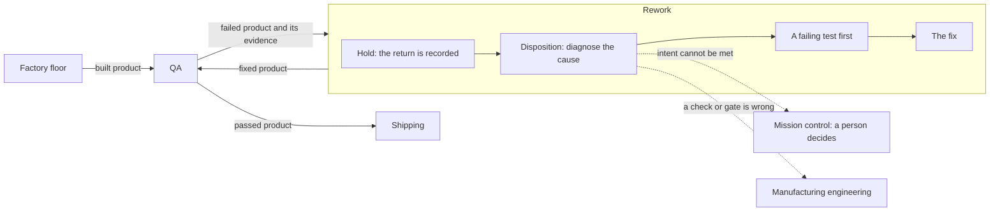
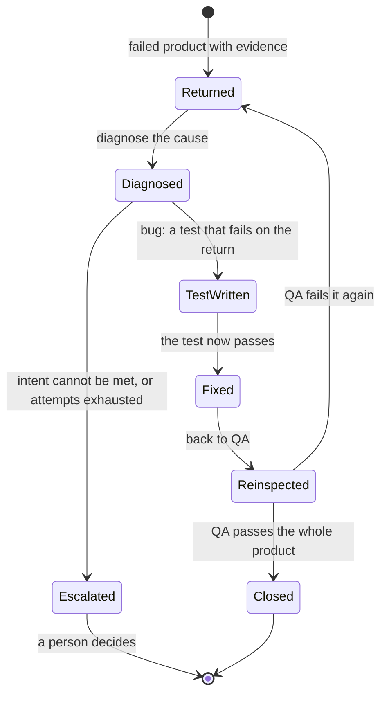
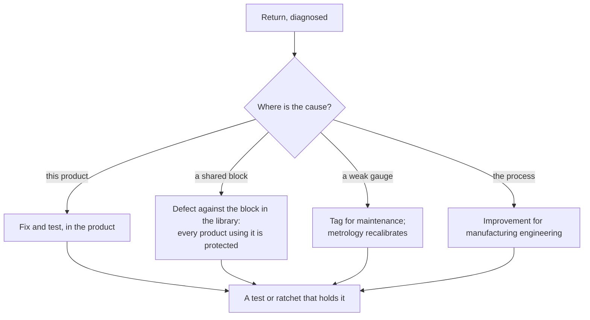
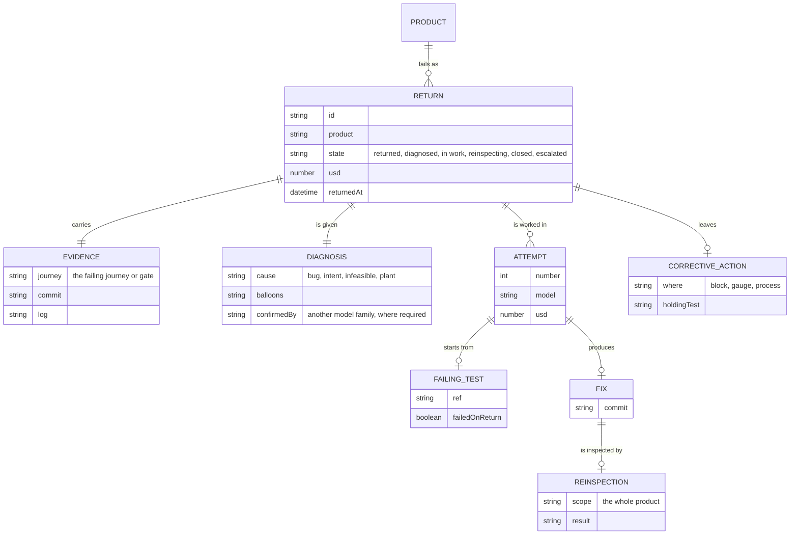

# Rework: What Fails Goes Back, Fixed From a Failing Test, and Is Inspected Again

**Patterns for returns that carry their evidence, fixes that start from a failing test, disposition by cause, and re-inspection of the whole product**

Russ Little · Pattern paper · Draft for review · Nov 28, 2026

v0.1 · Request for comments · © 2026 Russ Little. Licensed under CC BY 4.0. Part of the series rolled up in [The Line](the-line.md).

## Abstract

No line is built so that nothing fails inspection. What matters is what happens to the failure. In a plant it goes through nonconformance control: it is identified, held, dispositioned, fixed or scrapped, and the cause is corrected so it does not recur. Here that is rework, an area of the line beside QA. A failed product returns to the factory floor with the failing evidence attached; the fix starts from a failing test; and the fixed product goes through QA again, whole. Rework is done by an agent, to the standard of ISO 9001 clause 8.7 (control of nonconforming outputs) and corrective action (clause 10.2). This paper sets out seven patterns for that loop, the record it keeps, and the limits at which it hands a decision to a person.

> **Central proposition.** Treat every failure as a return with its evidence, fix it from a test that fails first, inspect the whole product again, and correct the cause, so no product meets the same failure twice.

## 1. Where it sits

Rework is the loop between QA and the floor. It takes a failed product with its failing evidence from QA and gives the fixed product back to QA. It is not a stage a product passes through on the way to shipping; it exists only when something fails.

## 2. The problem

- **A failure without its evidence.** "It failed" cannot be fixed, checked or closed.
- **A fix without a test.** A change that makes a failure go away, with no test that failed first, may have changed nothing.
- **Re-inspecting only the fix.** A fix that passes its own check can break something that passed before.
- **Fixing the product when the cause is elsewhere.** The intent may be unclear, the gate may be wrong, or the intent may be impossible; patching the product hides all three.

## 3. Patterns

### Pattern 1. A Return Carries Its Evidence

**Problem.** A failure reported without what failed is a second investigation.

**Pattern.** Every failed product returns with the failing journey or gate attached: what a person tried to do, where it stopped, and the build and commit it stopped on. A return with no evidence is refused back to QA.

**Consequences.** Rework starts from the failure, not from a description of it.

### Pattern 2. A Failing Test Before Every Fix

**Problem.** Fixes without a test that failed first cannot be told from changes that did nothing.

**Pattern.** The fix begins by writing a test that fails on the product as returned, for the reason QA gave. Only then is the product changed, until that test passes. The test stays, so the failure cannot return unseen.

### Pattern 3. Disposition by Cause

**Problem.** Every failure is treated as a bug in the product.

**Pattern.** Each return is diagnosed into one of four causes before anything is tried, as in the correction loop of the [factory floor](factory.md).

| Cause | Meaning | Disposition |
| --- | --- | --- |
| Bug | The product does not do what the intent says | Fix it, from a failing test |
| Intent | The intent is unclear or contradicts itself | A clarification is proposed against the balloons named; a person signs a Class I change |
| Infeasible | The intent cannot be met as stated | Escalated to the holder through mission control |
| Plant | A check, gate or tool is wrong | Raised with manufacturing engineering (the process) or metrology (the gauge), not fixed in the product |

Any cause other than a bug names the balloons involved and is confirmed by a reviewer from another model family.

### Pattern 4. Inspect the Whole Product Again

**Problem.** The fix is checked; the product is assumed.

**Pattern.** A fixed product goes back through QA in full: every journey, every gate, the oracle and the ratchets, on the new commit. The agent that fixed it does not inspect it. A passing fix check is not a passing product.

**Consequences.** A fix that breaks something that used to pass is a new return, found by the same instruments, not by a customer.

### Pattern 5. Correct the Cause

**Problem.** The same failure is fixed in each product separately.

**Pattern.** Corrective action does not stop at the product. A failure whose cause is a shared assembly is raised against the assembly in the library; one whose cause is a weak gauge becomes a work order for maintenance and metrology; one whose cause is a gap in the process becomes an improvement for manufacturing engineering. Each leaves a test or a ratchet that holds it.

### Pattern 6. Escalate on Evidence

**Problem.** A loop that never gives up spends without end; one that gives up early sends everything to a person.

**Pattern.** A return escalates to a person when its attempts exceed the budget, when its last three attempts show failures not falling, or when its cost passes the return's ceiling. Otherwise the loop continues without anyone. Acts only a person may perform have no tool here either.

### Pattern 7. A Red Build Holds the Line

**Problem.** Work continues on a base that is already broken, and every new failure is blamed on the wrong change.

**Pattern.** When the base itself fails its tests, the floor opens a return against the base and refuses new work except the fix for it. Other defects are tagged for maintenance and do not stop the line; only a failure on the base does, and only mission control stops a line beyond that.

## 4. What rework records

These are the records the factory floor keeps as cases; a return is a case with its evidence, its diagnosis and its corrective action.

## 5. Files, in rework

When QA inspects Files against Nextcloud with the real desktop sync client and a step fails where Nextcloud passes, Files returns to the floor with that journey attached. The fix, for example to chunked upload or to renaming after it, begins from a test that reproduces the failing step; Files then goes back through QA in full. Which returns are open, and how many defects have been fixed test-first to date, is shown on [/plant](https://zthr.ai/plant). QA's page does not yet list returns with their fix commits and re-inspection results; the evidence is in the floor's case records.

## 6. What it needs, and how it is judged

Rework needs the failing journey attached to every return, a failing test before every fix, and re-inspection of the whole product, not only the fix. Which are met is shown on [/plant](https://zthr.ai/plant).

- **Evidence.** Every return has its failing journey attached. A query on the records.
- **Test first.** Every closed return has a test that failed on the returned product. A query on the ledger.
- **Whole product.** Every closed return has a full re-inspection on the fixed commit.
- **Recurrence.** The number of returns whose cause a ratchet already held: it should be zero.
- **Without a person.** The share of returns closed without a person, and the share escalated by each rule.

## 7. What it does not claim

Rework does not make a failing product pass; it makes each failure traceable, fixed from a test that failed first, and checked again by an instrument other than the one that fixed it. It does not decide whether an unmet intent should change: that is a person's act.
