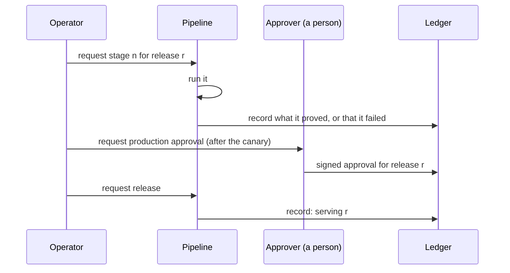

# Shipping: Moving a Certified Build to People, One Proven Stage at a Time

**Patterns for staged delivery with a gate at every stage, a person approving production, and a way back that always takes one step**

Russ Little · Pattern paper · Draft for review · Nov 26, 2026

v0.1 · Request for comments · © 2026 Russ Little. Licensed under CC BY 4.0. Part of the series rolled up in [The Line](the-line.md).

## Abstract

A certified build is not yet software in service. Between the two lie the steps where most outages begin: a data migration that loses records, an image nobody can trace, a revision that starts but fails under real traffic, a release that cannot be undone. Shipping moves a certified build to the people it is for through eight stages, each with a gate it must pass and evidence it must record: build, test, rehearse the data, package and sign, deploy without traffic, canary, release and operate. The operator asks for each stage in order; the pipeline runs it under its own identity and records what it proved; a named person approves production after the canary; and going back is always allowed and always one step. A stage is passed only by what was observed. This paper sets out eight patterns for that work.

> **Central proposition.** Ship in stages that each prove one thing, record what was observed rather than what was intended, put a person's signature on production, and keep the way back one step long.

## 1. The problem

- **Done means deployed.** A deploy command that returned success is reported as a release, though nothing checked what is actually serving.
- **The data is an afterthought.** Code is tested; migrations run for the first time in production.
- **Images from nowhere.** What runs cannot be traced to the build that was certified.
- **No way back.** A bad release is fixed forward, under pressure, because rolling back was never rehearsed.

## 2. The stages

```mermaid
flowchart LR
  B["1 Build<br/><small>lock file, types, no secrets</small>"] --> T["2 Test<br/><small>every gate in the control plan</small>"] --> D["3 Rehearse the data<br/><small>migrate a copy, nothing lost</small>"] --> P["4 Package and sign<br/><small>provenance, bill of materials</small>"] --> N["5 Deploy without traffic<br/><small>smoke journeys on the candidate</small>"] --> C["6 Canary<br/><small>a small share; budgets hold</small>"] --> R["7 Release<br/><small>everyone; previous ready</small>"] --> O["8 Operate<br/><small>watched; alerts open incidents</small>"]
  C -. a named person approves .-> R
  R -. one step back .-> N
```

| Stage | Proves | Gate |
| --- | --- | --- |
| Build | Dependencies install from the lock file; types check; no secret-shaped value in the source or its history | Every check passes |
| Test | Every test passes; mutation holds its floors; every ratchet holds; every journey passes on the twins | Every gate in the control plan passes |
| Rehearse the data | The schema revision migrates a copy with nothing lost; every integrity rule holds; no drift from the signed schema | The rehearsal passes |
| Package and sign | The image is built by the build service with signed provenance; a bill of materials is recorded; no critical or high vulnerability | The image is signed and clean |
| Deploy without traffic | Only a signed image can run; the new revision starts healthy; journeys pass against it before anyone is sent to it | Smoke journeys pass on the candidate |
| Canary | A small share of people use it; no error budget is burning fast | A named person approves production |
| Release | Everyone is moved to it; the previous revision stays ready to take traffic back in one step | Service levels hold for the watch window |
| Operate | Service levels watched; integrity and drift checked nightly; every alert has a runbook | An alert opens an incident |

## 3. Patterns

### Pattern 1. Request and Record Are Different Hands

**Problem.** The agent that wants a release out is the one that reports it went well.

**Pattern.** The operator requests each stage, in order. The pipeline runs it under its own identity and records what it proved. The operator cannot record; the pipeline cannot request.

### Pattern 2. Done Means Serving

**Problem.** A deploy that succeeded is not a service that serves the new build.

**Pattern.** A release is recorded only after the public address answers with the build's own identity (its commit), checked from outside. Anything else is "deployed, not confirmed".

### Pattern 3. Record What Was Observed

**Problem.** A pipeline that writes "passed" when it finishes, rather than when it checks, records intentions.

**Pattern.** Each stage's record is what it observed: the commit the service answered with, the checksums of the parts it published, the journeys it ran and their results. A stage the pipeline does not have yet is recorded as not measured, and says which step it lacks.

### Pattern 4. Rehearse the Data

**Problem.** Migrations are the least tested and most destructive step.

**Pattern.** Every revision's change to the information schema runs first against a copy of the data. It must lose no record, keep every integrity rule, and match the signed schema exactly, before any stage that touches real data.

### Pattern 5. Only Signed Images Run

**Problem.** What runs in production cannot be traced to what was certified.

**Pattern.** The build service builds the image and signs its provenance; the runtime admits only signed images; the bill of materials is kept with the release.

### Pattern 6. A Person Approves Production

**Problem.** Fully automated releases remove the one judgement that should be a person's: whether to expose everyone.

**Pattern.** After the canary, production waits for a named person's signed approval of the exact release. The approval has no tool in the agent interface.

### Pattern 7. Back in One Step

**Problem.** A rollback that has never been done does not work when it is needed.

**Pattern.** The previous revision stays ready to take traffic. Rolling back is always allowed, to any role that may request stages, and takes one step. A fast burn of any error budget rolls back without waiting for anyone.

### Pattern 8. Service Levels Come With the Package

**Problem.** Service levels set after launch measure what the system happens to do.

**Pattern.** The objectives shipping enforces come from the released package: availability from the team minimum, latency from the feedback the person asked for, achievement rates from the outcomes' tolerances. The canary and the watch window are judged against them.

## 4. Files, shipped

Files ships as one container to Cloud Run, with its bytes and its state in one Cloud Storage bucket and the first admin's password in Secret Manager. It runs as one instance that scales to zero: its state log has one writer, and refuses a second rather than interleave with it. Its maximum upload chunk is held under Cloud Run's request limit, and advertised to the apps in its capabilities so they never send a larger one.

For the reference product the line already runs, zthr.ai's own deploy is the Release stage's observer: it fetches the copy of the site the running service serves, checks every part against the build's own checksums, and records the commit it verified. The shipping department shows each stage from what was recorded: build and test from the build's own readings, release from that verification, and the stages the reference pipeline does not have yet (data rehearsal, signed images, deploy without traffic, canary, operate) as not measured.

## 5. Evaluating it

- **Observed releases.** Every release recorded as serving has an outside check of the commit it served.
- **Approval.** Every production release has a person's signed approval of that release.
- **Reversibility.** Rollback time, measured on every release.

## 6. What it does not claim

Shipping does not make a release safe. It makes each step of exposing it prove something, and keeps every step reversible.
