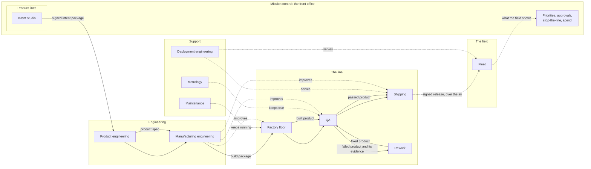
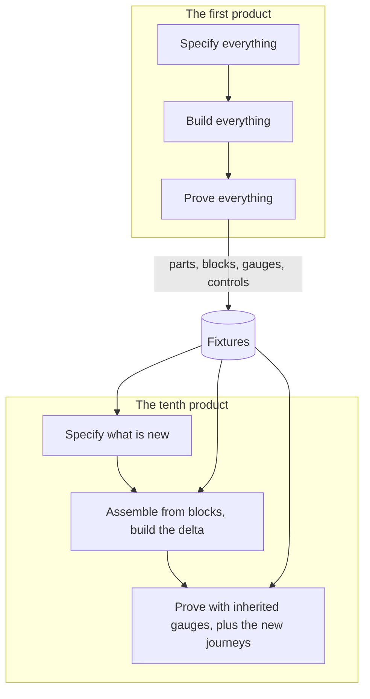
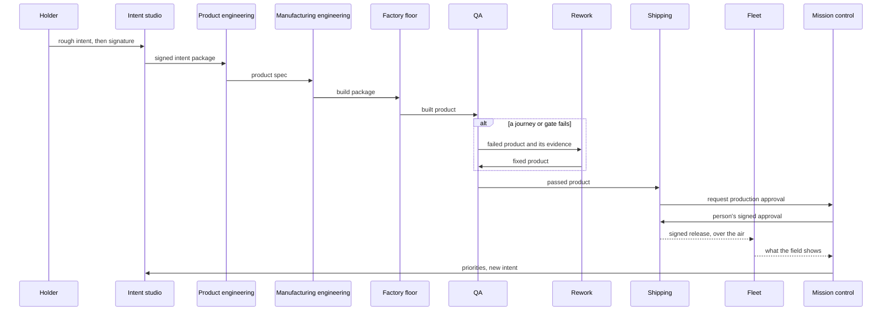
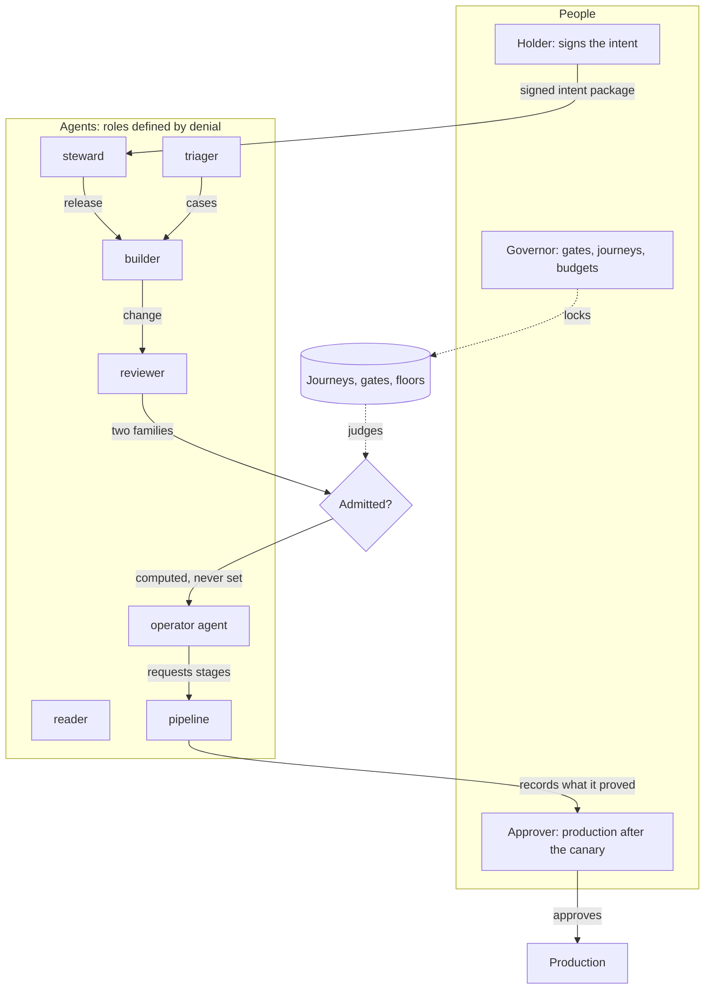
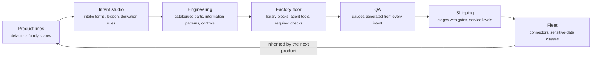
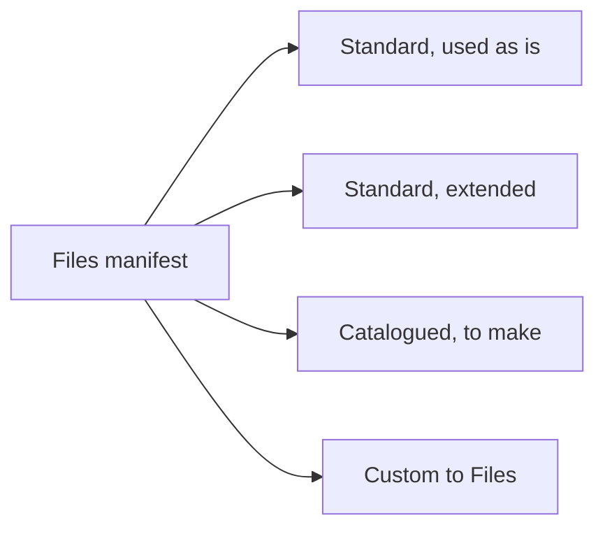
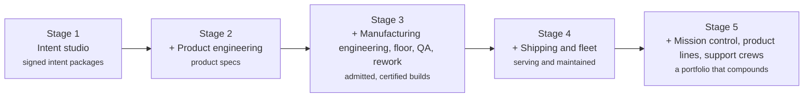
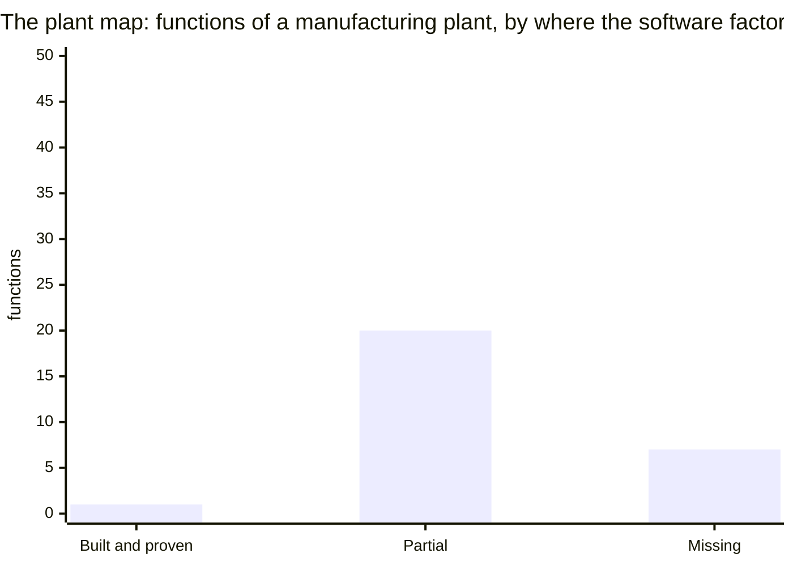

# The Line: How a Software Plant Compounds, From Intent to Field

**Thirteen areas in five groups, one hand-off each, and why every product through them makes the next one cheaper**

Russ Little · Overview paper · Draft for review · Nov 26, 2026

v0.1 · Request for comments · © 2026 Russ Little. Licensed under CC BY 4.0. The roll-up of the series that begins with *ZTHR: A Pattern Language for Autonomous Software Delivery* ([10.5281/zenodo.23826734](https://doi.org/10.5281/zenodo.23826734)) and *Intent as the Datum*. Each area has its own paper: [Mission control](mission-control.md), [Product lines](product-lines.md), [Engineering](engineering.md) and [Manufacturing engineering](manufacturing-engineering.md), [Factory floor](factory.md), [QA](qa.md), [Rework](rework.md), [Shipping](shipping.md), [Fleet](fleet.md); in support, [Maintenance](maintenance.md), [Metrology](metrology.md) and [Deployment engineering](deployment-engineering.md).

## Abstract

When agents write the code, a software organisation stops being a set of teams and becomes a plant. What it produces is not code but evidence that software does what a person meant, delivered to the people it is for and kept that way. This paper describes the plant as thirteen areas in five groups. A front office, mission control, runs the plant and houses the product lines, each with an intent studio. Engineering works in two steps, product engineering and then manufacturing engineering. The line builds on the factory floor, inspects in QA, sends failures to rework and ships what passes. The field, the fleet, runs what shipped, takes updates over the air and reports back to the office. Support crews (maintenance, metrology and deployment engineering) each keep one part of the plant working and improving. Each area does one job, hands the next a signed or computed artefact the next can check without trusting it, and turns what it learns into fixtures that every later product inherits.

Two properties follow. **Separation of duties** is structural: no area, agent or person can both make a thing and approve it, and the acts only a person may perform have no tool at all. **Value compounds**: each product through the plant leaves behind parts, gauges, controls and checklists, so the next product is mostly assembled from what is already specified, built and proven, and people and models design only what is new.

> **Central proposition.** A software plant is worth what it keeps. Arrange the work as areas that each hand the next something checkable and keep what they learned as a fixture, and the cost of the next product falls with every product before it.

## 1. Why a plant

### 1.1 The problem with teams of agents

Agents can now plan, write, test and ship software. Put several of them together without structure and three things go wrong.

- **Everything grades its own work.** The agent that wrote the change also says it is done. A second agent from the same model family agrees with the first for the same reasons it was wrong.
- **Nothing is kept.** Each product starts from a prompt. What the last product learned about sign-in, retention, money or uploads is in its code, not in anything the next product can reuse with confidence.
- **Nobody can say where it stands.** Work moves through conversations and pull requests. Whether a product is specified, built, proven or in service is an opinion, not a reading.

### 1.2 What a plant changes

Manufacturing solved all three a century ago. Work moves through stations in a fixed order. Each station receives a drawing, a part or a certificate it can check. Inspection uses gauges proven on known-bad parts. What fails inspection goes back for rework and is inspected again. Support crews keep the machines and the gauges true. And the shop keeps its jigs, fixtures and standard parts, so the next order is set up, not invented.

Here "the factory" means the whole plant. The hall where products are built is the factory floor.

Solid arrows carry work forward. The loop between QA and rework carries defects. The dotted arrows from shipping to the fleet and from the fleet to mission control carry updates out and reports back. Support crews stand beside the area each keeps working; none stands in the flow.

### 1.3 The areas and what each is

Each area is a manufacturing discipline, and each works to the standard of that discipline. The lineage is kept to a line.

| Group | Area | Discipline | Standard | Done by |
| --- | --- | --- | --- | --- |
| Front office | [Mission control](mission-control.md) | Plant management and production control | ISA-95 level 4 | A person and an agent |
| Front office | [Product lines](product-lines.md) | Product line management | APQP planning | A person |
| Front office | Intent studio (inside a product line) | Voice of the customer | Quality function deployment | A person and an agent |
| Engineering | [Product engineering](engineering.md) | Design engineering | Design FMEA and design review | An agent |
| Engineering | [Manufacturing engineering](manufacturing-engineering.md) | Manufacturing engineering | Process FMEA, control plan, APQP | An agent |
| The line | [Factory floor](factory.md) | Production | Work instructions under a control plan | An agent |
| The line | [QA](qa.md) | Quality control and inspection | First article inspection, AS9102 | An agent |
| The line | [Rework](rework.md) | Nonconformance and rework | ISO 9001 clause 8.7, corrective action | An agent |
| The line | [Shipping](shipping.md) | Shipping, release and configuration management | AS9100 configuration management | An agent |
| The field | [Fleet](fleet.md) | Field service and the installed base | Service bulletins and field updates | An agent |
| Support | [Maintenance](maintenance.md) | Maintenance | Total productive maintenance | A crew |
| Support | [Metrology](metrology.md) | Metrology | ISO/IEC 17025, AIAG MSA | A crew |
| Support | [Deployment engineering](deployment-engineering.md) | Installation and field engineering | Commissioning and site acceptance | A crew |

## 2. Two principles

### 2.1 Hand over something the next can check

Every hand-off is an artefact the receiving area can verify without trusting the sender. One name is used for each artefact throughout.

| From | To | What is handed over | How it is checked |
| --- | --- | --- | --- |
| Intent studio | Product engineering | The signed intent package | The signature is bound by hash to the exact content |
| Product engineering | Manufacturing engineering | The product spec | Every file is hashed in its manifest; every later area refers to the revision by number and hash |
| Manufacturing engineering | Factory floor | The build package: routing, fixtures, gates and required checks | The floor builds only to a released revision of it |
| Factory floor | QA | The built product, with its measurements | Admission is computed from the record: every required check, and two reviews from other model families |
| QA | Rework | A failed product, with the failing evidence | The failing journey is attached to every return |
| Rework | QA | The fixed product | A test that failed first now passes; the whole product is inspected again |
| QA | Shipping | A passed product | Every journey walked as a person would; every gate proven able to fail |
| Shipping | Fleet | A signed release, over the air | The running service answers with the build's own identity |
| Fleet | Mission control | What the field shows | Each reading links to the evidence it came from |
| Mission control | Every area | Priorities, approvals, stop-the-line | Each is a signed act in the ledger |
| Metrology | QA | Certified gauges | QA uses a gauge only while its certificate is current |
| Every area | Maintenance | Tags: what is wrong, where, the evidence, and the test that will prove it fixed | A tag missing any of the four is refused |
| Maintenance | Every area, and mission control | Fixes, and the morning report | Each fix passes the gates of day work, with a failing test first and a check by another model family |

Nothing is accepted on a claim. An area that receives something it cannot check sends it back.

### 2.2 Keep what you learn as a fixture

A **fixture** is anything a later product inherits instead of making: a default, a catalogued part, a tested block, a gauge, a control mapped to its evidence, a routing with its gates. Fixtures are what make the plant compound.

## 3. The areas

Each area has its own paper. This section gives the job, the artefact it hands on, and what it keeps.

### 3.1 The front office

**Mission control** runs the plant. It decides what is made and for whom, holds the priorities, approvals and the authority to stop the line, and holds a spend budget per crew and per product. It sees every product line and product, where each stands in each area, and the short list of what waits on a person. Its lamps are readings from the area that owns each, never inferred, and every number links to its evidence. What it keeps is the shape of the portfolio: which products share which assemblies, so a change to one is seen in all.

**Product lines** sit inside mission control. A product line is a family: it names who its products serve and the end they serve, and sets the defaults every product in it starts from. One family holds many products, each built separately on the line. A new product inherits the defaults and states only what is different.

**The intent studio** sits inside a product line. The person who knows the work says what the product must do, in their own words. Two model families read it independently; agreement becomes a numbered schematic and disagreement becomes a question. The holder signs it as what they mean, and it leaves the studio as the signed intent package. The companion paper *Intent as the Datum* sets out its patterns.

### 3.2 Engineering, in two steps

**Product engineering** defines the thing. It turns the signed intent package into a complete, interactive product spec: outcomes and how each is assessed; the information the product keeps, with every field's sensitivity; the compliance controls and the evidence each needs; the service levels it will be held to; and the bill of materials, naming which standard assemblies are used as they are, which are extended, which catalogued parts must be made, and what is custom.

**Manufacturing engineering** defines how to build it, then sets up the line to build it: the routing every product follows, the fixtures, the gates and the required checks, released as the build package. It also improves the line and the process from what the line measures. It serves the floor, QA and shipping.

### 3.3 The line

**The factory floor** builds. An operator agent drives each product down the line, station by station, building to the build package and measuring what was built. Agents work in seven roles, each defined by what it may not do. A change is admitted only when every required check has been run by the plant's own interface and two reviewers from model families other than the author's have passed it.

**QA** inspects every product as a person would use it: every locked journey walked in every mode and channel; every gate proven to fail on its planted defect before it counts; mutation scores held by ratchets that only rise; and, when the product replaces something, the old system as the gauge. It uses only certified gauges.

**Rework** takes what fails. A failed product returns to the floor with its failing evidence; the fix starts from a failing test; the product goes through QA again, whole.

**Shipping** packages the code, the tests, the docs and the version history into a signed release, publishes it to the repository and the sites, and deploys it in stages with a person approving production. Going back is always allowed and takes one step.

### 3.4 The field

**The fleet** is everything in service: each app, the blocks it draws on and the data it keeps. Updates arrive over the air, with rollback. Every incident becomes a defect, a test and a ratchet. What the field shows goes back to mission control, and the plant runs again.

### 3.5 Support

Each support crew keeps one part of the plant working and improving. Intake is open: any area can tag what is wrong. That is a source of work orders, not a service relationship.

**Maintenance** keeps the factory floor running. By day every area, gate, reviewer and run tags what is not working instead of stopping the line. By night a crew works the tags through the same gates as day work, within its budget, staffed by a router that gives each task the cheapest model proven good enough, and leaves a morning report.

**Metrology** keeps QA's quality and process true. It defines every measure QA uses, traces each to a reference, certifies every gauge before QA may use it (capability, repeatability and reproducibility, after AIAG's *Measurement Systems Analysis*), charts the plant's own process for drift and audits the plant's claims against their evidence.

**Deployment engineering** serves shipping and the fleet. It is the cloud and field engineering: it stands up where products run, deploys them, sends updates over the air, watches them in service and brings back what the field shows.

The same loop shows how one product moves, and where it can be sent back or out again.

## 4. Separation of duties

The plant separates who makes from who approves at every level.

Five rules hold everywhere.

1. **No one approves their own work.** The builder cannot review; a reviewer cannot review a change from its own model family; the operator cannot record a stage as passed; the pipeline cannot request one.
2. **A person's act has no tool.** Signing an intent, approving production, locking a journey and resetting a ratchet are done by people through signed proposals. No agent role can call them, because no tool exists to call.
3. **Admission is computed.** Whether a change may merge is a function of the record, not a decision anyone makes.
4. **Every act is in the ledger.** An append-only, hash-chained log records who did what, so the record of the plant cannot be edited after the fact.
5. **A return is inspected again in full.** What rework fixes goes back through QA as a whole product, and the agent that fixed it does not inspect it.

## 5. How value compounds

Each area adds fixtures that every later product inherits. The totals are generated from the plant's own catalogues and shown on [/plant](https://zthr.ai/plant) and in the generated line docs; they are not typed here.

Compounding shows up in three places.

- **Specification.** A new intent's manifest is mostly lines the catalogue already describes. The person signs what they mean; the catalogue supplies the rest, each line marked as inherited so it can be questioned.
- **Construction.** Blocks are built and tested once. A product that uses them assembles them and builds only the delta.
- **Proof.** Gauges are proven once. Gates proven on planted defects stay proven until their code changes; a product inherits them with their proofs.

## 6. A worked example: Files

The first product through the plant is a file server that the Nextcloud apps people already use connect to and sync with, unchanged, running on Cloud Run and Cloud Storage. It is the only product in the first product line: file services compatible with Nextcloud.

### 6.1 Intent to manifest

Eleven rough lines (the apps sync unchanged; 25,000 small files sync in minutes; large files resume; nothing is silently lost; sharing with people and links; trash and versions; quotas; per-device sign-in with revoke and wipe; an admin manages people; thumbnails; scale to zero) and two model readings produce a manifest. Each manifest line has one of four sources, and the generated engineering doc shows the live split.

A file server is made of generic, separately tested blocks: a namespace tree with stable ids and etags that change up the ancestors; an object store with streamed checksums and joins; resumable uploads; leases; grants; device sessions; the DAV core; and a differential oracle. Each custom line is an assembly of library blocks, and what is particular to Files is a thin protocol layer.

### 6.2 The old system as the gauge

Files replaces something people already run. So the most demanding gauge is the original: the oracle sends the same requests a client makes to a real Nextcloud and to Files, reduces each answer to what a client can depend on, masks what rightly differs (etags, ids, dates, tokens), and reports every remaining difference. The reference's answers are recorded once; every build compares against the recording. QA inspects Files with the real desktop sync client against stock Nextcloud; the standing of that inspection, and of any return it caused, is on [/plant](https://zthr.ai/plant).

### 6.3 What it is judged on

| Journey | What must hold |
| --- | --- |
| 25,000 small files written as the desktop app sends them | Sync completes within the outcome's tolerance |
| Checking that nothing changed | One root etag answers it |
| One small file write | The log entry stays small whatever the size of the tree |
| A write against an etag the client last saw, after someone else changed it | Refused (412), so the client keeps both copies |

The headline problem of the system it replaces (a single file-index table that reaches hundreds of millions of rows, and sync that slows to days on many small files) is answered by architecture, not tuning: folder etags let a client skip every unchanged subtree, and the state is a log of the records each change touched. Each journey is measured on every build; the figures are read from the build record, not typed here.

## 7. Adoption

The plant does not have to be adopted at once. Each area is useful alone, and each adds to the ones before.

## 8. Evaluating it

The plant makes claims that can be tested.

- **Compounding.** The share of a new product's manifest that is inherited, built and proven should rise product by product. It is a reading on every manifest.
- **Fidelity.** Every statement on a signed intent should reach a gauge, and every gauge a result. A statement nothing measures is a gap, and is counted.
- **Separation.** No admitted change should have a reviewer from its author's family, and no production release should lack a person's approval. Both are queries on the ledger.
- **Cost.** Spend per admitted change, per return and per release is metered against budgets; the claim that fixtures, not the most capable model, carry the quality is tested by running the same work with cheaper and dearer models against the same gauges.

## 9. What it does not claim

The plant does not make a bad intent good: it makes a stated intent measurable and shows where it is not. It does not remove people: it moves them to the acts that need judgement (stating intent, approving production, governing the gauges) and gives those acts no shortcut. And it does not make the first product cheap: the first product pays for the fixtures. The claim is about the ones after it.

## 10. Where each area stands, and the plant map

Every area is checked against what it needs, and its standing is read from the repository and its CI, not typed. [/plant](https://zthr.ai/plant) shows each area's lamp (go, part, stop or off), the needs it meets and the needs it does not, and the generated docs carry the same facts. Where an area has not been built or measured, the page says so; this paper does not repeat figures that page generates.

The plant borrows from manufacturing only where manufacturing brings a method, a number or a standard. A classic software build is deterministic: the same source gives the same result every time, so software never needed the statistics a plant uses to manage variation. AI workers bring variation back. The same task can pass on one run and fail on the next, and models differ in their defect rates. The plant's measurement disciplines were made for exactly that, and the plant's own records (pass rates per model per task kind, flake rates, mutation scores) are the data those methods consume.

The plant stands in a long line of practice. Shewhart's control charts and Deming's quality system made variation something to measure rather than argue about; the Toyota Production System added stopping the line at a defect and maintaining equipment as planned work; automotive and aerospace quality turned measurement itself into a discipline, with measurement systems analysis (AIAG) and first article inspection (AS9102); lean software and DevOps carried flow and its measures into software delivery (the DORA measures of throughput and stability). AI workers reintroduce the process variation those disciplines were built for, so they apply directly rather than by analogy.

Each plant function below is mapped to its equivalent in the software plant, with where it stands and the evidence. The table is generated from the plant's own source, so it changes as the plant does.

<!-- gen:diagram:plant -->

<!-- /gen -->

<!-- gen:plant-map -->
| Plant function | Method or standard | In the software factory | Where it stands | Evidence |
| --- | --- | --- | --- | --- |
| Metrology lab | ISO 10012 measurement management | Metrology: defines every measure QA uses and certifies every gauge | partial | Calibration runs nightly and on change (night-shift workflow, tools/mutation); repeatability and reproducibility are not measured yet |
| Reference standards | Traceability to a reference (ISO/IEC 17025) | Published test vectors, a recording of the replaced system, sealed held-out phrasing sets | partial | Some blocks test against their RFC’s vectors; no Nextcloud recording yet; held-out sets sealed by convention only |
| Gauge R&R | AIAG Measurement Systems Analysis | Repeatability: the flake rate. Reproducibility: the same verdicts in a fresh clone and on CI | missing | Neither is measured. Builds are reproducible byte for byte (tools/supply/repro.ts); test verdicts are not yet compared |
| Calibration certificates and intervals | ISO 9001 clause 7.1.5 | A dated certificate per block: mutation score, survivors, rulings; re-run nightly and on every change | partial | Certificates are written to eval/mutation/ as blocks are calibrated; most blocks have none yet |
| Gauge capability | AIAG Measurement Systems Analysis | Mutation score per block: does each test reject a planted defect | partial | Measured for the blocks calibrated so far; every survivor is a work order |
| Measurement system analysis of a fixture | AIAG Measurement Systems Analysis | The Files oracle checked on planted differences: what it must report, what it must mask | partial | The oracle’s unit tests plant differences; there is no recorded corpus to run a planted-difference suite on |
| Inspection (QA) | ISO 9001 clause 8.6 | Journeys walked as a person would; gates proven on planted defects; QA uses only certified gauges | partial | Gates carry planted-defect proofs; no gauge is certified yet, so the rule that QA uses only certified gauges is not met |
| Maintenance | Planned maintenance work orders | The night shift: work orders from every tag, through the same gates as day work | partial | Work orders and their acceptance gate exist (tools/mutation); the crew’s runner is not live, so no shift has run |
| Incoming inspection | CycloneDX SBOM; licence allow list | Every dependency in an SBOM, every licence checked; model suppliers qualified by measured pass rates | partial | SBOMs and the licence gate run in the supply-chain workflow; model suppliers have a dated price table but no measured pass rates yet |
| Document control | ISO 9001 clause 7.5; AS9100 | Journey cards locked by hash, the hash-chained ledger, signed provenance | partial | The ledger is hash-chained and journeys are locked by hash; branches are not protected, so the record can be bypassed |
| Engineering change control | AS9100 configuration management | The intent signed by its holder; every change to it a signed revision | partial | A signature is bound to the exact content by hash; unprotected branches leave the repository’s own changes uncontrolled |
| FMEA | AIAG-VDA FMEA Handbook | Failure modes per block, ranked by severity, occurrence and detection, each with its preventive test | missing | No failure-mode analysis is recorded for any block |
| Control plan | AIAG APQP control plan | The required checks and the delivery stages, each with its gate | partial | Every stage and gate is defined; the reference pipeline does not yet run the data, signing, candidate, canary or operate stages |
| First article inspection | AS9102 | A new product’s first build measured against its reference, characteristic by characteristic | missing | Files is the first product; its reference recording does not exist yet |
| Statistical process control | Shewhart control charts; Western Electric rules | Control charts on test time, flake rate, mutation score and cost per change; a signal raises a tag | missing | The chart logic exists in metrology; no series has the 25 points limits need |
| Service monitoring | The Site Reliability Workbook, burn-rate alerts | Error budgets watched in service; a fast burn rolls back | missing | Service levels are generated with the package; the reference pipeline does not watch them yet |
| Nonconformance and review board | ISO 9001 clause 8.7 | A red build stops work on that line until it is dispositioned | missing | The reference build was red for 13 days while commits continued |
| Corrective and preventive action | ISO 9001 clause 10.2; AS9100 | Every fix with its preventive test: a test that fails first | partial | The acceptance gate enforces failing-first for mutation work orders; it is a rule, not a gate, for other changes |
| Andon | Stop-and-signal at the station | The tag: what, where, evidence and proving test, raised without stopping the line | partial | Calibration runs tag every survivor; other departments do not raise tags yet |
| Poka-yoke | Error-proofing by design | Gates that make the wrong act impossible: person-only acts have no tool | built and proven | A test checks that no agent tool exists for any person-only act and that no tool admits a change |
| Tool crib | Controlled, certified tooling | The block library, each block certified before a product uses it | partial | The library is catalogued and tested; blocks are not yet issued only on a certificate |
| Work instructions | ISO 9001 clause 8.5.1 | Task specifications: what may be edited, the acceptance command, the budget | partial | Every mutation work order carries them; other task kinds have no written specification yet |
| Lot traceability | AS9100 identification and traceability | Commit to artefact digest to deployed digest | partial | Builds are reproducible and attested by digest; deploys name a movable tag, not a digest |
| Certificate of conformance | AS9100 release documentation | The release record: signed provenance and an SBOM for the exact artefact | partial | Provenance and SBOM attestations are made on push; the release record does not yet bind the deployed digest |
| Internal audit | ISO 19011 | The claims-to-evidence ledger: every claim proven, partial or unproven | partial | An audit has been run once (73 claims: 10 proven, 43 partial, 20 unproven); the claim-by-claim ledger is not yet a record the site reads |
| Registrar audit | ISO 17021 certification audit | An outside party audits the factory against its own claims | missing | No outside audit has been made |
| Kaizen | Continuous improvement | The improvement brief: one page a week, what to change and why | partial | Catalogued as a part for products; not yet produced for the factory itself |
| Capacity planning | Load against capacity and cost | The model router: the cheapest model proven for each task kind, within the day’s budget | partial | The router and its dated price table are built and tested; no pass rates are measured yet |
<!-- /gen -->
