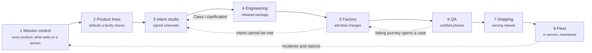
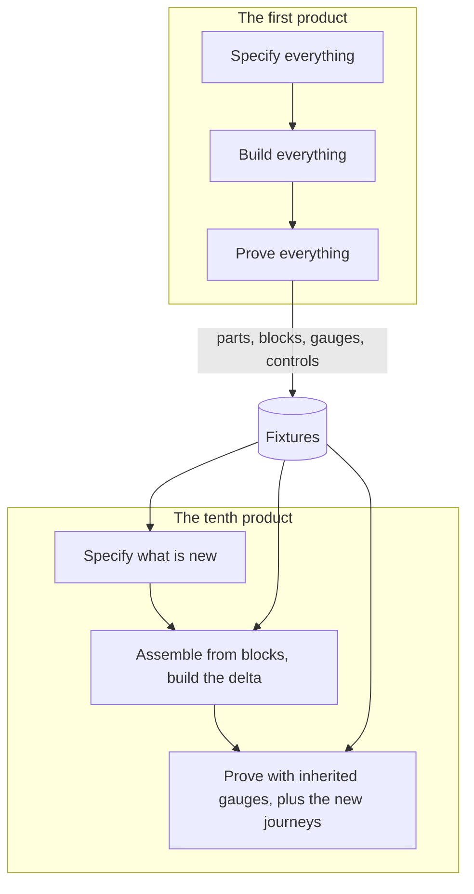
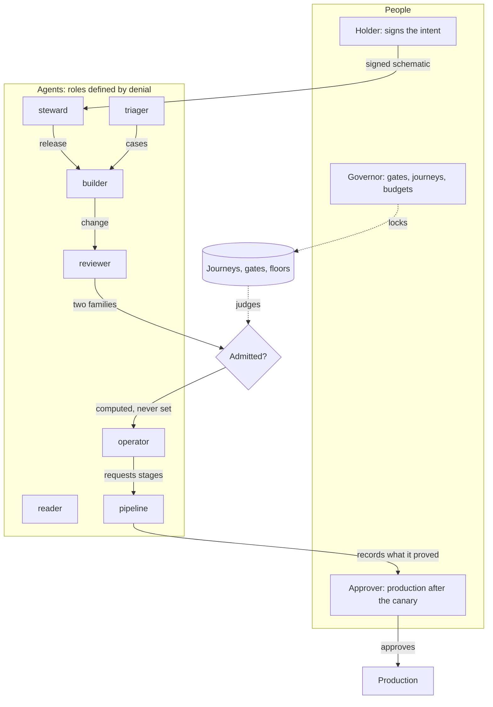
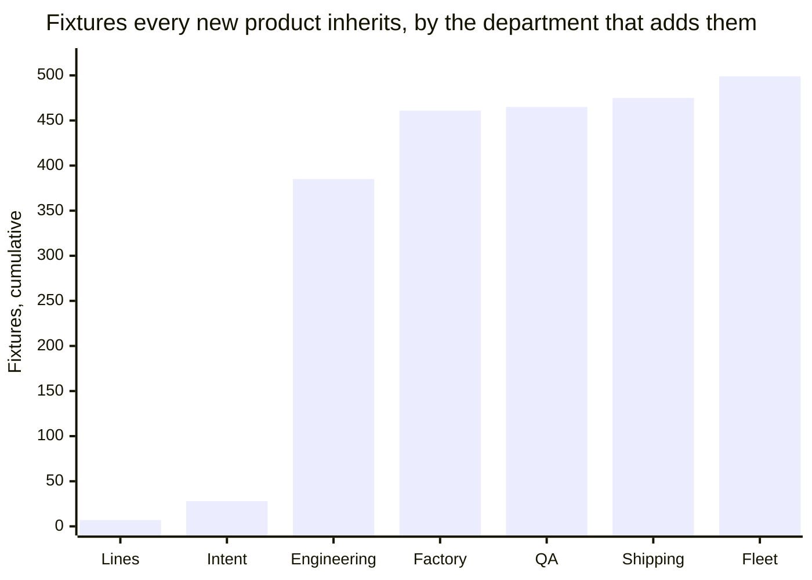
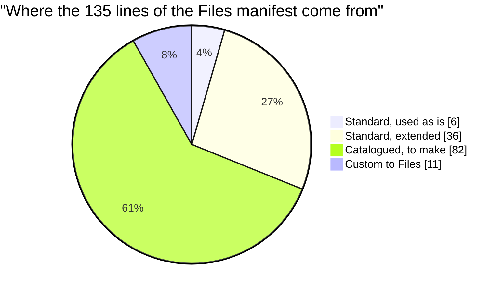
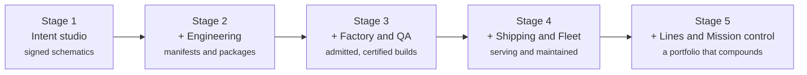

# The Line: How a Software Factory Compounds, From Intent to Fleet

**Eight departments, one hand-off each, and why every product through them makes the next one cheaper**

Russ Little · Overview paper · Draft for review · Nov 26, 2026

v0.1 · Request for comments · © 2026 Russ Little. Licensed under CC BY 4.0. The roll-up of the series that begins with *ZTHR: A Pattern Language for Autonomous Software Delivery* ([10.5281/zenodo.23826734](https://doi.org/10.5281/zenodo.23826734)) and *Intent as the Datum*. Each department has its own paper: [Mission control](mission-control.md), [Product lines](product-lines.md), [Engineering](engineering.md), [Factory](factory.md), [QA](qa.md), [Shipping](shipping.md) and [Fleet](fleet.md).

## Abstract

When agents write the code, a software organisation stops being a set of teams and becomes a production line. What it produces is not code but evidence that software does what a person meant, delivered to the people it is for and kept that way. This paper describes that line as eight departments in a fixed order: mission control, product lines, the intent studio, engineering, the factory, QA, shipping and the fleet. Each department does one job, hands the next a signed or computed artefact the next can check without trusting it, and turns what it learns into fixtures that every later product inherits.

Two properties follow. **Separation of duties** is structural: no department, agent or person can both make a thing and approve it, and the acts only a person may perform have no tool at all. **Value compounds**: each product through the line leaves behind parts, gauges, controls and checklists, so the next product is mostly assembled from what is already specified, built and proven, and people and models design only what is new.

> **Central proposition.** A software factory is worth what it keeps. Arrange the work as a line of departments, each handing the next something checkable and keeping what it learned as a fixture, and the cost of the next product falls with every product before it.

## 1. Why a line

### 1.1 The problem with teams of agents

Agents can now plan, write, test and ship software. Put several of them together without structure and three things go wrong.

- **Everything grades its own work.** The agent that wrote the change also says it is done. A second agent from the same model family agrees with the first for the same reasons it was wrong.
- **Nothing is kept.** Each product starts from a prompt. What the last product learned about sign-in, retention, money or uploads is in its code, not in anything the next product can reuse with confidence.
- **Nobody can say where it stands.** Work moves through conversations and pull requests. Whether a product is specified, built, proven or in service is an opinion, not a reading.

### 1.2 What a line changes

Manufacturing solved all three a century ago. Work moves through stations in a fixed order. Each station receives a drawing, a part or a certificate it can check. Inspection uses gauges proven on known-bad parts. And the shop keeps its jigs, fixtures and standard parts, so the next order is set up, not invented.

The line in this paper applies that structure to software made by agents.

The forward arrows carry work. The dotted arrows carry what was learned back to the department that can act on it.

## 2. Two principles

### 2.1 Hand over something the next can check

Every hand-off is an artefact the receiving department can verify without trusting the sender.

| From | To | What is handed over | How it is checked |
| --- | --- | --- | --- |
| Product lines | Intent studio | A product with its line's end in mind and spec-sheet defaults | Shown as the line's until the holder confirms them |
| Intent studio | Engineering | The schematic, signed by the person who holds the intent | The signature is bound by hash to the exact content |
| Engineering | Factory | A released revision: a plain, hashed package | Every file is hashed in its manifest; the factory builds only to a release |
| Factory | QA | An admitted change | Admission is computed from the record: every required check, and two reviews from other model families |
| QA | Shipping | A certified phase | Every journey walked as a person would; every gate proven able to fail |
| Shipping | Fleet | A release that is serving | The running service answers with the build's own identity |
| Fleet | Mission control | Readings, incidents, reports | Each reading links to the evidence it came from |

Nothing is accepted on a claim. A department that receives something it cannot check sends it back.

### 2.2 Keep what you learn as a fixture

A **fixture** is anything a later product inherits instead of making: a default, a catalogued part, a tested block, a gauge, a control mapped to its evidence, a delivery stage with its gate. Fixtures are what make the line compound.

## 3. The departments

Each department has its own paper. This section gives the job, the artefact it hands on, and what it keeps.

### 3.1 Mission control

One view of every product line and product, where each stands in each department, and what is waiting on a person. It holds no work of its own: every lamp is a reading from the department that owns it, and every number links to its evidence. What it keeps is the shape of the portfolio: which products share which assemblies, so a change to one is seen in all.

### 3.2 Product lines

A product line names who its products serve and the end they serve, and sets the defaults every product in it starts from: the compliance frameworks in scope, how people sign in, where tickets and chat go, how feedback is taken, which interfaces are open, and how use is measured. A new product inherits all of it and states only what is different.

### 3.3 The intent studio

The person who knows the work says what the product must do, in their own words. Two model families read it independently; agreement becomes the schematic and disagreement becomes a question. Every statement is ballooned, toleranced and traced. The holder signs it as what they mean. The companion paper *Intent as the Datum* sets out its patterns.

### 3.4 Engineering

Engineering turns the signed schematic into a complete, interactive specification: outcomes and how each is assessed; the information the product keeps, with every field's sensitivity; the compliance controls and the evidence each needs; the service levels it will be held to; the delivery plan; and the build manifest, a bill of materials naming which standard assemblies are used as they are, which are extended, which catalogued parts must be made, and what is custom. It releases a hashed package.

### 3.5 The factory

Agents build to the released package. Seven roles are defined by what each may not do; acts only a person may perform have no tool. A change is admitted only when every required check has been run by the API and two reviewers from model families other than the author's have passed it. Failures open cases that are diagnosed (bug, intent, infeasible, factory) and corrected without a person, until the budget or the trend says a person must decide.

### 3.6 QA

QA certifies that what was built does what was meant: every locked journey walked as a person would, in every mode and channel; every gate proven to fail on its planted defect before it counts; mutation scores held by ratchets that only rise; and, when the product replaces something, the old system as the gauge.

### 3.7 Shipping

A certified build moves to people in stages: build, test, rehearse the data, package and sign, deploy without traffic, canary, release, operate. Each stage has a gate. A named person approves production. Going back is always allowed and takes one step. A stage is passed only by what was observed, never by what was intended.

### 3.8 The fleet

Everything in service, held to its service levels, and maintained as one. A fix to a standard assembly reaches every product that uses it. Every incident becomes a defect, a test and a ratchet. What people report flows back to mission control, and the line runs again.

## 4. Separation of duties

The line separates who makes from who approves at every level.

Four rules hold everywhere.

1. **No one approves their own work.** The builder cannot review; a reviewer cannot review a change from its own model family; the operator cannot record a stage as passed; the pipeline cannot request one.
2. **A person's act has no tool.** Signing an intent, approving production, locking a journey and resetting a ratchet are done by people through signed proposals. No agent role can call them, because no tool exists to call.
3. **Admission is computed.** Whether a change may merge is a function of the record, not a decision anyone makes.
4. **Every act is in the ledger.** An append-only, hash-chained log records who did what, so the record of the line cannot be edited after the fact.

## 5. How value compounds

Each department adds fixtures that every later product inherits. The totals below are generated from the line's own catalogues, not typed.

| Department | What it adds | Fixtures | In all |
| --- | --- | --- | --- |
| Product lines | Spec-sheet defaults a line hands every product | 7 | 7 |
| Intent studio | Intake forms, design-lexicon terms, derivation rules | 21 | 28 |
| Engineering | Catalogued parts, information patterns, controls, platform outcomes | 357 | 385 |
| Factory | Library blocks, agent tools, required checks | 76 | 461 |
| QA | Gauges generated from every intent, review families | 4 | 465 |
| Shipping | Delivery stages with gates, service levels | 10 | 475 |
| Fleet | Connectors, sensitive-data classes | 24 | 499 |

Compounding shows up in three places.

- **Specification.** A new intent's manifest is mostly lines the catalogue already describes. The person signs what they mean; the catalogue supplies the rest, each line marked as inherited so it can be questioned.
- **Construction.** Blocks are built and tested once. A product that uses them assembles them and builds only the delta.
- **Proof.** Gauges are proven once. Gates proven on planted defects stay proven until their code changes; a product inherits them with their proofs.

## 6. A worked example: Files

The first product through the whole line is a file server that the Nextcloud apps people already use connect to and sync with, unchanged, running on Cloud Run and Cloud Storage.

### 6.1 Intent to manifest

Eleven rough lines (the apps sync unchanged; 25,000 small files sync in minutes; large files resume; nothing is silently lost; sharing with people and links; trash and versions; quotas; per-device sign-in with revoke and wipe; an admin manages people; thumbnails; scale to zero) and two model readings produce a manifest of 135 lines.

Before the run, the library lacked the assemblies a file server is made of. Eight blocks were built first, each generic and tested on its own: a namespace tree with stable ids and etags that change up the ancestors; an object store with streamed checksums and joins; resumable uploads; leases; grants; device sessions; the DAV core; and a differential oracle. With them, the eleven custom lines are each an assembly of library blocks, and what is particular to Files is a thin protocol layer.

### 6.2 The old system as the gauge

Files replaces something people already run. So the most demanding gauge is the original: the oracle sends the same requests a client makes to a real Nextcloud and to Files, reduces each answer to what a client can depend on, masks what rightly differs (etags, ids, dates, tokens), and reports every remaining difference. The reference's answers are recorded once; every build compares against the recording.

### 6.3 What was measured

| Journey | Result |
| --- | --- |
| 25,000 small files written as the desktop app sends them (six at a time) | 14.1 s in process, p95 7.3 ms |
| Checking that nothing changed | 0.7 ms: one root etag |
| One small file write, as logged | under 2 KB, whatever the size of the tree |
| A write against an etag the client last saw, after someone else changed it | refused (412), so the client keeps both copies |

The headline problem of the system it replaces (a single file-index table that reaches hundreds of millions of rows, and sync that slows to days on many small files) is answered by architecture, not tuning: folder etags let a client skip every unchanged subtree, and the state is a log of the records each change touched.

## 7. Adoption

The line does not have to be adopted at once. Each department is useful alone, and each adds to the ones before.

## 8. Evaluating it

The line makes claims that can be tested.

- **Compounding.** The share of a new product's manifest that is inherited, built and proven should rise product by product. It is a reading on every manifest.
- **Fidelity.** Every statement on a signed schematic should reach a gauge, and every gauge a result. A statement nothing measures is a gap, and is counted.
- **Separation.** No admitted change should have a reviewer from its author's family, and no production release should lack a person's approval. Both are queries on the ledger.
- **Cost.** Spend per admitted change, per case and per release is metered against budgets; the claim that fixtures, not the most capable model, carry the quality is tested by running the same work with cheaper and dearer models against the same gauges.

## 9. What it does not claim

The line does not make a bad intent good: it makes a stated intent measurable and shows where it is not. It does not remove people: it moves them to the acts that need judgement (stating intent, approving production, governing the gauges) and gives those acts no shortcut. And it does not make the first product cheap: the first product pays for the fixtures. The claim is about the ones after it.
