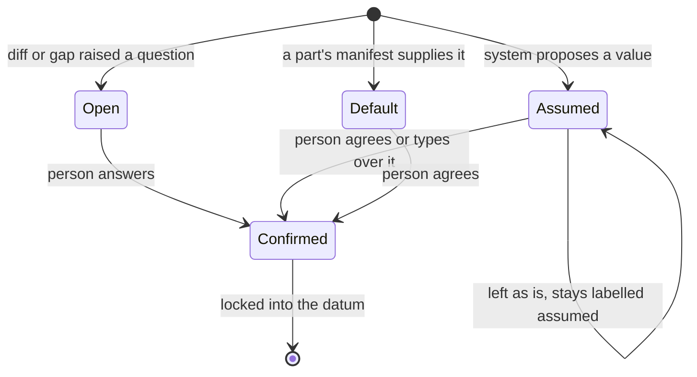
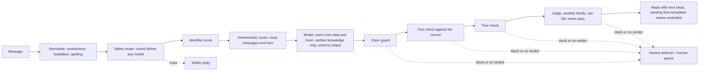
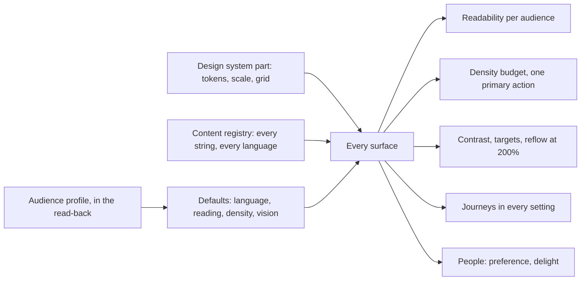
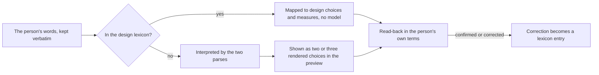
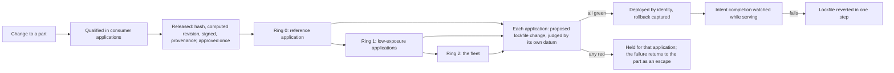
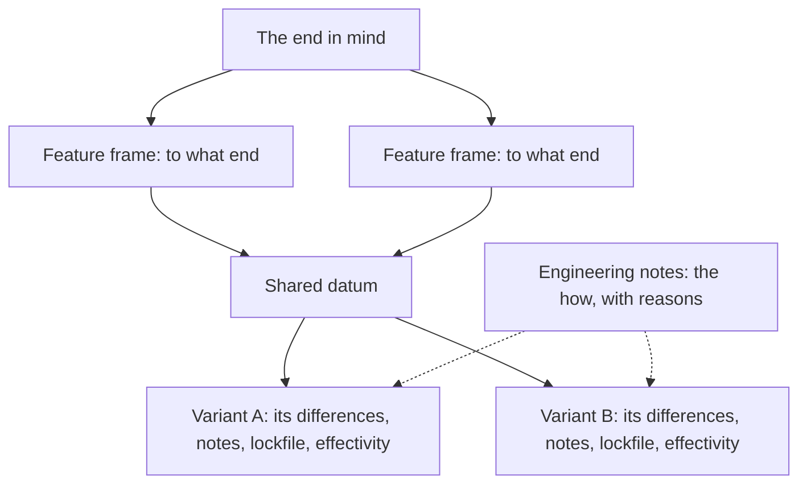
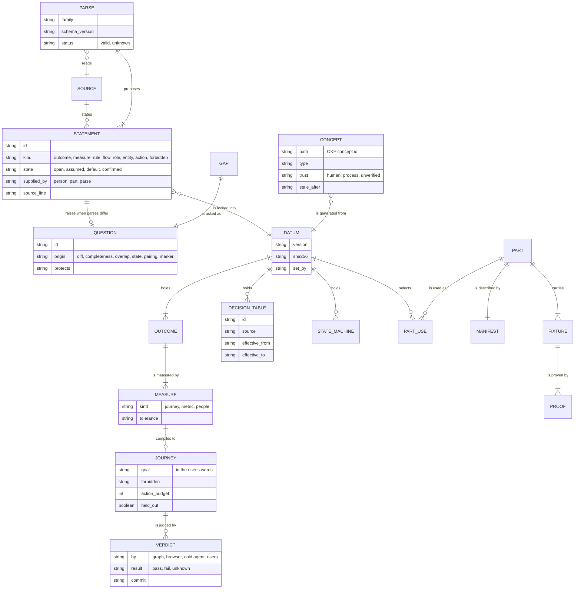

# Feature Specification: ZTHR Intent, from rough intent to proven software

**Status**: Draft · **Home**: zthr.ai/intent · **License**: Apache 2.0

ZTHR Intent turns intent, written as roughly as a person likes, into a datum: a locked, measurable statement of what the software must let people do. Everything downstream is assembled from proven parts, configured from the datum, and measured against it. The output is a complete package (configuration, parts, journeys, checks, rules and evidence) that can be deployed without a person reviewing the code, because every claim a reviewer would have checked is carried by a fixture that has been shown to fail.

Intent is the primary datum. Nothing is measured against the previous build; everything is measured against the intent, and the intent never moves to make a part pass.

```mermaid
flowchart LR
    RAW[Rough intent, any form] --> P1[Parse: model family A]
    RAW --> P2[Parse: model family B]
    P1 --> DIFF[Structural diff]
    P2 --> DIFF
    DIFF --> GAPS[Gap checks: decision tables, state machines, pairings]
    GAPS --> RB[Read-back: confirmed, open, assumed, default]
    RB -->|answers| LOCK[Datum locked: outcomes, measures, journeys, scenarios]
    LOCK --> CFG[Executable spec: tables, state machines, part compositions]
    CFG --> ENGINE[Generic engine + parts from the catalog]
    ENGINE --> FIX[Fixtures proven to fail]
    FIX --> EVID[Evidence: intents completed first]
    EVID --> RUN[Serving]
    RUN --> DRIFT[Re-measured against the datum on every change]
    DRIFT --> RAW
```

## Principles

- **The intent outlives the technology.** The organised intent (the frame, the datum, the measures, the rules and flows as data) is the lasting asset. It names no language, framework, cloud or model; those belong to whichever factory realises it. The same intent given to another factory, on another stack, is another working application, judged by the same journeys.
- **Start with the end in mind.** Every feature is built to some end; that end leads the package and travels with every piece of work as its context.
- **Ask what the work is hired to do.** Every product is hired for a job, as a person would be: what the job is, how anyone would know it is being done well, and what at the end of the year would show it was a good hire. These are Clayton M. Christensen's jobs-to-be-done questions (Christensen, Hall, Dillon and Duncan, *Competing Against Luck*, 2016), and they are the frame's problem, measures and end in the words leaders already use.
- **Capture the intent first.** Every other capability exists to carry the intent from the person who holds it to the software without loss, and every record says which intent it serves.
- **Intent is the datum.** User outcomes are the primary measure. Feature tests are a redundant fail-safe, never the measure of quality.
- **Deterministic first.** Models are used only where nothing deterministic can do the job, and every model sits inside a deterministic guard.
- **Friction where intent is set, none where it is executed.** Questions, read-back and confirmation happen before anything is built. After that, nothing waits on a person except a decision only a person can make.
- **Independent instruments.** A measurement taken twice with the same tool is repeatability, not accuracy. Agreement counts only between instruments that read different representations or were built independently.
- **The experience is part of the intent.** An outcome a person cannot comfortably read, see, reach or understand in their own language is not fulfilled. Human factors have fixtures like everything else; taste is judged by people.
- **Every defect closes a class and ratchets.** A failure that gets through becomes a fixture, proven to bite, and can never pass again in any application that inherits the part.

## User Scenarios & Testing

### User Story 1 - Bring rough intent in any form (Priority: P1)

An intent holder starts from whatever they have: a Spec Kit spec, Kiro requirements, an OpenSpec change, Gherkin features, plain markdown, or a few paragraphs. Structured forms are parsed without a model.

**Independent Test**: run intake on one file of each supported form and compare the canonical model with the expected one.

**Acceptance Scenarios**:

1. **Given** a Spec Kit spec with user stories, acceptance scenarios and FR-numbered requirements, **When** intake runs, **Then** each scenario becomes a scenario with its given, when and then parts, and each requirement keeps its number.
2. **Given** Kiro EARS criteria, OpenSpec scenarios or a Gherkin feature, **When** intake runs, **Then** each criterion, scenario or outline row becomes its own scenario.
3. **Given** any source containing a NEEDS CLARIFICATION marker, **When** intake runs, **Then** the marker becomes an open question without any model being asked.
4. **Given** the same source, **When** intake runs twice, **Then** both runs produce identical models, identifiers included.

### User Story 1a - The intent frame: what the person means, and why (Priority: P1)

Every intent is captured in one frame. The person's words fill what they state; deterministic derivation fills what follows from it; a model may propose what is only implied, and anything proposed stays an assumption until the person confirms it.

| Slot | What it holds | Filled by |
| --- | --- | --- |
| **Problem** | What is wrong now, for whom, in the person's words | The person, verbatim, then restated |
| **Why** | The value behind it, one step up the ladder from what was asked for | The person; asked only when the answer would change the design |
| **Outcome** | What is true when the problem is solved | The person; proposed from the problem when unstated |
| **People** | Who it is for, and who is on the other side of every activity | The person; the other side derived from roles touching each entity and action |
| **Measures** | How everyone will know the outcome happened | Proposed from the outcome, each with a tolerance |
| **Prerequisites** | What must exist or be true first | Derived: the closure of every chosen part's requires and companions, every entity's source, every action's channel and consent |
| **Implications** | What else changes, who else is affected, what risks open | Derived: actions that reach outside, data that becomes sensitive, people newly contacted, states with no way out |
| **Constraints** | What must always and never happen | The person; forbidden outcomes |
| **Non-goals** | What is deliberately out of scope | The person; proposed where a part offers more than was asked |
| **Assumptions** | What is being taken as given | Everything proposed and not yet confirmed |

The **why** is the slot that resolves the most. Two readings that differ are often settled by asking what the person is trying to achieve, and the answer frequently moves the outcome: someone who asks for reminders before bills are due, so they are not shut off, wants no shut-off, not a reminder. The reminder is one means; a warning that the money will be short, with a way to cover it, is the outcome.

**Acceptance Scenarios**:

1. **Given** a statement that names a means ("send reminders"), **When** the frame is built, **Then** the why is asked or proposed, and the outcome is stated as the end the means serves.
2. **Given** chosen parts, **When** prerequisites are derived, **Then** every requirement and companion in their closure is listed, with the part that needs it, without a model.
3. **Given** an action that contacts a person, moves money, exposes data or cannot be undone, **When** implications are derived, **Then** it is listed with the people it reaches and the constraint it needs.
4. **Given** an activity that ends with someone else, **When** the frame is built, **Then** that person is listed and the outcome is checked from their side too.
5. **Given** a slot a model proposed, **When** the read-back renders, **Then** it is shown as an assumption with its source, and it is never confirmed without the person.
6. **Given** a frame with an empty problem, outcome or measure, **When** the build is requested, **Then** it is refused; these three are never assumed into existence silently.

### User Story 2 - Two parses and a structural diff (Priority: P1)

Rough intent that no parser recognises is parsed into the canonical structure twice, by two different model families, each constrained to the same schema. The two structures are compared field by field. Every difference is a question.

**Why this priority**: this is the only step that needs a model, and the diff replaces debate, moderation and rounds of review with a comparison that gives the same answer every time.

**Independent Test**: run the diff on two fixed parses with known differences and check the questions produced.

**Acceptance Scenarios**:

1. **Given** two parses that agree on a field, **When** the diff runs, **Then** no question is raised for it.
2. **Given** two parses that disagree on a rule's threshold, a role's permission or an outcome's measure, **When** the diff runs, **Then** one question is raised naming the field and both readings.
3. **Given** a parse that does not match the schema, **When** the diff runs, **Then** that parse counts as unknown, the run reports it, and no question is raised from it.
4. **Given** a field only one parse produced, **When** the diff runs, **Then** it is raised as a question, never accepted on one reading.

### User Story 3 - Gaps found by rules (Priority: P1)

Most defects in a spec are not misreadings but omissions. The structure is checked mechanically for what is missing, and each gap becomes a question that names what it protects.

**Acceptance Scenarios**:

1. **Given** a rule set compiled to a decision table, **When** completeness is checked, **Then** every combination of conditions no row covers is raised as a question naming the uncovered case.
2. **Given** two rows of a decision table that both match the same case with different results, **When** overlap is checked, **Then** the overlap is raised as a question.
3. **Given** a flow compiled to a state machine, **When** it is checked, **Then** unreachable states, dead ends and transitions without an owner are each raised.
4. **Given** an outcome with no measure, a role with no negative case, a consequential action with no confirmation, an entity with no owner or sensitivity class, or a term not in the data dictionary, **When** pairings are checked, **Then** each is raised.

### User Story 4 - Read-back before anything is built (Priority: P1)

Before the datum is locked, the system states back what it understood. The read-back is rendered from the compiled structure by fixed templates, so what the person confirms is exactly what will be built, never a paraphrase of it.

**Acceptance Scenarios**:

1. **Given** a structure with open questions, **When** the build is requested, **Then** it is refused; open is unknown, and unknown never becomes pass.
2. **Given** an assumed value the person leaves untouched, **When** the datum is locked, **Then** it is locked as assumed and stays labelled assumed in the evidence; it is never promoted to confirmed.
3. **Given** a part that supplies a default (a session timeout, a language, an accessibility level), **When** the read-back renders, **Then** the default is shown with the part that supplied it.
4. **Given** the read-back, **When** it is shown, **Then** it presents three views of the same structure: a preview assembled from the parts' wireframes, a graph of how everything connects, and the outcomes with their measures.

**The preview.** Each part ships a low-fidelity wireframe of its surfaces and its documentation. The preview assembles the chosen parts into a skeleton that can be clicked through. Wherever the application's own content belongs, a placeholder shows the part's documentation as a prompt; each answer replaces a placeholder. The preview stays deliberately sketchy so it is never mistaken for the product.

**The graph.** Generated from the manifests and the structure, never drawn by hand. Nodes are outcomes, measures, journeys, parts, surfaces, entities, roles and integrations; edges are typed (fulfils, measured by, requires, conflicts with, needs companion, reads, writes, walks). An outcome with no measure is shown as unmeasured; a part that fulfils no outcome is shown as unused; a conflict or a missing companion is shown before the build.

**Outcomes and measures.** Each outcome is stated in the user's words. Each measure must compile to something that can be checked: a journey success condition, an operating metric with a tolerance, or a signal from people. A measure that compiles to nothing is shown as an opinion until it does.

### User Story 5 - The datum is locked (Priority: P1)

Confirmed outcomes, measures, journeys and scenarios are pinned by content hash. A change that alters the datum cannot also change what the datum judges. A subset of journeys is sealed, held out from every generator.

**Acceptance Scenarios**:

1. **Given** a locked journey, **When** its text is changed, **Then** the lock check fails and names it.
2. **Given** a change that edits both a journey and the configuration it judges, **When** it is admitted, **Then** it is refused.
3. **Given** a held-out journey, **When** any generator runs, **Then** the journey is not readable by it, and the held-out check fails if any of its text appears in a rule.
4. **Given** a deliberate change of intent, **When** it is made, **Then** it is a new datum version set by a person through the read-back, with the old version retired explicitly and both in the record.

### User Story 6 - The spec is the application's configuration (Priority: P1)

Rules are decision tables, flows are state machines, screens are compositions of parts, and wording comes from the content registry. A small generic engine runs them. Nothing is translated from spec to code, so nothing can drift in translation. Code is generated only for capabilities no part covers, and a new capability is written back as a part.

**Acceptance Scenarios**:

1. **Given** intent a part already covers, **When** the build is planned, **Then** the part is used as it is and no code is generated for it.
2. **Given** a locked datum, **When** the application is built, **Then** the build reports how much was configured, how much was assembled from parts, and how much was generated.
3. **Given** a decision table, **When** the build runs, **Then** each row carries its source and the dates it applies to, and a rule asked about a date outside every period answers unconfirmed, never a stale value.
4. **Given** intent that asks for a model to act inside the product, **When** the build is planned, **Then** that capability comes only from an approved AI part, and a build in which any other part reaches a model fails.

### User Story 7 - Checks that are proven to fail (Priority: P2)

Every check must fail on a defect planted on purpose before it counts. Where the spec is data, the tests are derived from the data.

**Acceptance Scenarios**:

1. **Given** a decision table, **When** tests are generated, **Then** every threshold is tested at its limit, one below and one above, for every value of every other condition the table names.
2. **Given** a critical calculation, **When** it is built, **Then** a second implementation is written independently, by a different model family, from the same table, and both run on generated inputs on every build; any disagreement fails the build.
3. **Given** a check that still passes with its planted defect, **When** checks are judged, **Then** it is reported unproven and does not count.
4. **Given** a surviving mutant, **When** the mutation run ends, **Then** it is listed by file and line as the next to kill, and the score's floor can only rise.

### User Story 8 - Intent completion, from the state graph to real users (Priority: P2)

Intent completion is computed, not scripted. The application's state graph is explored to a fixpoint; a journey passes when a path exists from its starting state to its goal within its action budget without passing through a forbidden outcome. A browser walk then confirms the path renders and can be operated by accessible name. An agent working cold, with only the generated documentation, completes the journeys too. Real users complete them in production.

**Acceptance Scenarios**:

1. **Given** a journey, **When** the state graph is searched, **Then** the result is pass, fail or unknown, with the shortest path or the step where it fails.
2. **Given** a change to one action handler, **When** the walk runs, **Then** only states that handler touches are re-explored, and the report is current at the commit being certified.
3. **Given** a walk that stopped at its state limit, **When** it is reported, **Then** it says cut short; it is never reported as reaching a fixpoint.
4. **Given** the evidence page, **When** it is generated, **Then** it leads with intents completed (by the graph, by a cold agent, by real users), then delight, then tests, gates, mutation and red team as fail-safes; anything not measured says not measured.

### User Story 9 - A chat in one step, secured and measured (Priority: P2)

Choosing a chat in the read-back brings in the chat part and its required companions, shown as inherited defaults: the safety router, the guard around every model, the identifier scrub, the tone check, an approved AI part, evidence, the red team and held-out sets. The application supplies only its own configuration: its actions, what must always go to a person, what the chat must never say, where its facts come from, and its languages.

**Acceptance Scenarios**:

1. **Given** a message containing crisis words, in any supported language, **When** it arrives, **Then** the safety reply goes out before any account, setup or model.
2. **Given** a model reply that changes a date, amount or phone number from the record, **When** it is checked, **Then** the reply is discarded and the deterministic text is used.
3. **Given** the read-back answers to "what must this chat never do" and "what must always go to a person", **When** the datum is locked, **Then** they become forbidden outcomes and the first attack corpora.
4. **Given** an attack that once got through, **When** it is fixed, **Then** it stays in the corpus forever, and the normaliser and phrasing fuzzer extend it to its variants.

**The harness** reads three representations:

| Layer | Reads | Runs |
| --- | --- | --- |
| Corpora, one test per attack, deterministic | The code | Every change |
| garak (Apache 2.0) against the deployed endpoint | The running service | Nightly |
| DeepTeam (Apache 2.0), multi-turn, judge from another family | The running service, empirically | Optional, nightly |

Held-out sets are sealed, added to only by a person, scored in aggregate, and fail the build if any line is copied into a rule. A scan that did not run is unknown, never a pass.

### User Story 10 - One knowledge bundle (Priority: P2)

Everything the system knows about itself is generated into one Open Knowledge Format bundle in git: parts and their purpose notes, outcomes, journeys, the data dictionary, metric definitions, help and read-back items. The graph, the contextual help, the generated documentation, the cold agent and the chat all read the same bundle.

| Read-back state | OKF trust |
| --- | --- |
| Confirmed | `verified` by `human:<id>` |
| Default | `verified` by `process:<part>` |
| Assumed | `generated` only, unverified |
| Open | `status: draft` |

**Acceptance Scenarios**:

1. **Given** a concept past its `stale_after`, **When** the chat or the cold agent reads the bundle, **Then** the concept is excluded and any answer depending on it is an honest deferral; the freshness gate regenerates it or fails the build.
2. **Given** a chat reply, **When** it is checked, **Then** every factual sentence cites a concept, and a sentence with no citation fails.
3. **Given** a concept verified only by a process, **When** the chat uses it, **Then** it is never the basis of a consequential answer.
4. **Given** a reader's role, **When** the chat assembles context, **Then** only concepts that role may read reach the model; the filter runs before the model.
5. **Given** typed relationships in the manifests, **When** the bundle is generated, **Then** they are written as an additional frontmatter field, and the bundle stays conformant.
6. **Given** a concept with instructions injected into it, **When** the chat reads it, **Then** nothing changes; concept text is data.

### User Story 11 - Drift is distance from the datum (Priority: P2)

Every change, whether to code, a part, a dependency or a model, is re-measured against the same locked datum. A reviewer from a fourth model family re-reads the change in place after merge, asking whether the intent can still be fulfilled. A change that breaks an intent fails, however every feature test was updated.

**Acceptance Scenarios**:

1. **Given** a change that keeps every feature test green and breaks a journey, **When** it is admitted, **Then** it fails.
2. **Given** a model version change, **When** the next build runs, **Then** every fixture judges the new model's output with nothing else changed, and any difference surfaces as drift against the datum.

### User Story 12 - The experience is part of the intent (Priority: P1)

Software that works but is hard to read, crowded, unattractive or unusable for some of its people has not fulfilled its intent. Who the users are, what they can see, read and reach, and where they will be when they use it are part of the datum, set in the read-back like any other intent.

**Why this priority**: an intent a person cannot comfortably complete is an intent not fulfilled. Generated software is usually plain because nothing in the factory measures how it looks or feels to a person; here those qualities have fixtures.

**The audience profile** is confirmed in the read-back: reading level, languages, devices, assistive technology, and the conditions of use (one-handed on a phone at a bus stop, at a desk all day, in a hurry). It sets the defaults for every surface.

**Settings every person controls**, with the whole application changing at once because every string, colour and size comes from a registry:

| Setting | Choices |
| --- | --- |
| Language | Every language the audience profile names; the whole application, including messages, help and dates, switches at once |
| Reading | Plain, standard, detailed, each held to its own reading grade |
| Density | Spacious, comfortable, compact |
| Vision | Standard, low vision (larger text up to 200%, more spacing, one column, stronger focus), high contrast (7:1 or better, honouring the system's forced colours) |
| Motion | Full or reduced, following the system setting by default |
| Mode, palette, style | Light and dark; the palettes and styles in the design system, each contrast-checked |

**Acceptance Scenarios**:

1. **Given** a person who chooses Spanish, **When** they move through the application, **Then** every surface, message, piece of help, date and number is in Spanish, and nothing falls back to English unannounced.
2. **Given** a language offered in settings, **When** the build runs, **Then** every string in the content registry has a translation in it; a missing string fails the build, and a machine translation not yet verified by a person is labelled as such in the bundle.
3. **Given** low vision mode, **When** a journey is walked, **Then** it completes at 200% text with no clipped, overlapping or hidden content, and every target is at least 44 by 44 pixels.
4. **Given** high contrast mode, **When** every surface is checked, **Then** text contrast is 7:1 or better and the system's forced colours are respected.
5. **Given** an audience profile with a reading level, **When** any text is published, **Then** it is checked against that level for the reading setting chosen, and text above it fails.
6. **Given** a surface, **When** it is checked, **Then** it has one primary action, headings in order, a line length under 80 characters, spacing on the design system's grid, type from its scale, and no more choices than its density budget allows.
7. **Given** every journey, **When** it is judged, **Then** it must pass in every language, vision setting, density and reading setting the application offers; a journey that passes only in the default fails.
8. **Given** two versions of a surface, **When** a visual change is proposed, **Then** people's preference between them is recorded as a signal, and taste is never inferred by a model.

### User Story 13 - Understood the way a person means it (Priority: P1)

People describe what they want in metaphor and everyday words: "make it feel calm", "snappy", "tells me at a glance", "like a good concierge", "don't make me think". These are intent, not noise. The system interprets them generously, shows its interpretation in the person's own terms, and never asks a question whose answer would not change what gets built.

**Why this priority**: a pedantic reading, or a stream of questions about wording, is the fastest way to lose the person whose intent this all depends on.

**The design lexicon** is the deterministic layer: a versioned set of concepts in the knowledge bundle, each mapping a human term to the design choices and measures it usually means. "Calm" means soft palette, generous spacing, few items per screen and reduced motion. "Snappy" means visible feedback within 100 milliseconds and a response within one second. "At a glance" means one primary figure per card and a tight density budget. Known terms are resolved from the lexicon without a model; only a term the lexicon does not know goes to the two parses.

**Acceptance Scenarios**:

1. **Given** intent that says "make it feel calm", **When** it is processed, **Then** the person's words are kept verbatim beside the interpretation, and the read-back says what was understood in plain terms ("soft colours, plenty of space, few things on each screen") with the preview showing it.
2. **Given** a metaphor the two parses read differently, **When** the question is raised, **Then** it is shown as two or three rendered versions to choose between by looking, never as a statement that the person's wording is ambiguous.
3. **Given** a question whose answer would not change the build, **When** questions are ranked, **Then** it is not asked; the choice is made as a visible assumption the person can change.
4. **Given** a low-consequence choice, **When** the read-back is built, **Then** it is an assumption with a sensible default, not a question; questions are reserved for what is consequential, irreversible or genuinely unclear.
5. **Given** a round of questions, **When** it is shown, **Then** it holds no more than the question budget, ranked by consequence, in the person's vocabulary and never in schema terms.
6. **Given** a person who corrects an interpretation, **When** the correction is confirmed, **Then** it becomes a lexicon entry, so the next person who uses that term is understood the first time.
7. **Given** an everyday word for a measure ("fast", "reliable", "easy"), **When** it is processed, **Then** it becomes a proposed measure with a stated tolerance, shown as an assumption the person can tighten or loosen.

### User Story 14 - Parts under configuration management, updated across the fleet (Priority: P1)

Parts are controlled the way engineering document management controls physical parts. A fix made once reaches every application built from the part, and each application accepts it only by passing its own intent.

| Engineering document management | Here |
| --- | --- |
| Part number and revision | A part's name and its content hash, with a revision label computed from its contract |
| Form, fit and function rule | A change that breaks the contract (interface, schema, configuration, content keys, permissions) is a new major revision; a compatible change is a new minor or patch revision; a change that fails any consumer's journey is breaking whatever the label says |
| Engineering change order | A release of a shared part: impact taken from where-used, approved once by a person because its blast radius is the fleet |
| Bill of materials | Each application's lockfile, pinning every part by hash |
| As-designed and as-built | The lockfile and what is serving, compared on every deploy |
| Where-used | The fleet register: every application, every part revision it runs, how far behind and why |
| Effectivity | Rollout rings: which applications take a revision, and when |
| First article inspection | Ring 0: the reference application takes every revision first |
| Supersession and obsolescence | Deprecated parts with their replacement and an expiry date |
| Functional baseline | The datum: what each application must let its people do |

**A part** carries its manifest, purpose notes, contract, implementation (code or configuration), schema fragment and migrations with a declared recovery mode, content in every language, registered surfaces with wireframes, knowledge concepts, fixtures (tests, gate proofs, mutation floor, journey templates, red-team corpora, twins), and its qualification evidence from inside a consumer application.

**Acceptance Scenarios**:

1. **Given** a part change, **When** it is released, **Then** its revision label is computed by a deterministic contract diff, never chosen by its author.
2. **Given** a released revision, **When** it reaches an application, **Then** it arrives as a proposed change to the lockfile, never as a write into the application, and is admitted only if that application's journeys, gates and red team pass.
3. **Given** a ring that has served a revision for its soak period with intent completion holding, **When** the rollout continues, **Then** the next ring receives it; a fall in intent completion anywhere halts the rollout everywhere.
4. **Given** a revision that fails one application's journey, **When** it is held, **Then** the failure is recorded against the part as an escape and becomes a fixture before the next revision.
5. **Given** a part whose migration cannot be reversed, **When** it is released, **Then** it says so and waits for a person; every other migration expands before it contracts, so the previous revision still runs.
6. **Given** a copy of a part edited inside an application, **When** hashes are compared, **Then** it is reported as modified and blocks updates until reconciled; applications change parts only through configuration and extension points.
7. **Given** a revision that removes a capability an application's outcome depends on, **When** it is proposed, **Then** it is never applied automatically and goes to that application's owner through the read-back.
8. **Given** a security fix, **When** it is released, **Then** it follows the same path with shorter soak periods and no fixture skipped.

### User Story 15 - Intent described the way engineering describes a part (Priority: P1)

The disciplines that move drawings and specifications of physical parts between designers, shops and inspectors are decades old and proven. Intent takes their structure directly, and the factory's agents use it natively, because the vocabulary (balloons, special characteristics, control plans, failure modes, first-article inspection) is already well understood.

| Engineering practice | In the intent |
| --- | --- |
| Every feature toleranced | Every statement carries its allowed variation; what is not controlled is listed as free, so the factory knows where it may choose |
| Datum reference frame from function in the assembly | The datum chosen from how the software fits the person's situation: the problem and why slots |
| Define the part, not the method; notes for the processes that follow (heat treat, finish) | The intent names no technology; the how is held as engineering notes with their reasons, practical now or ideal, revisable without touching the datum |
| Tabulated drawings with lettered variants, each authoritative for its own line | Variants of one intent in production at once, each with its differences, notes, lockfile and effectivity |
| Title block and general notes, overridden locally | One title block of application-wide defaults (the audience profile among them), inherited by every statement, overridden only explicitly |
| Special characteristics, critical and significant, carried with the same identity onto every control document | Statements marked critical or significant; each mark must reach a control (a gate, a journey, a red-team corpus, a production monitor), or the build fails |
| Ballooned drawing and first-article inspection | Every statement numbered; the evidence answers balloon by balloon; the first build is inspected against every balloon, later builds against the control plan |
| Semantic product information, not text notes | Every statement tied to an entity, action, surface or measure; an untied note is flagged as a broken thread |
| Tolerance stack-up and allocation | Application-level budgets (time, size, cost) allocated across parts, each part declaring its share, the stack checked before release |
| Functional gauging | Journeys, which check the software fits what it mates with |
| Loosest tolerance that keeps the function | No constraint without a reason; each one narrows what the factory may find |

**Acceptance Scenarios**:

1. **Given** a statement with no tolerance and no "free" mark, **When** the read-back renders, **Then** it is shown as undefined and raised as a question.
2. **Given** a statement marked critical, **When** the build runs, **Then** it fails unless the statement is traced to at least one control.
3. **Given** a first build, **When** evidence is reported, **Then** every balloon has a result of pass, fail or unknown.
4. **Given** parts whose declared shares of a budget exceed the application's budget, **When** the stack is checked, **Then** the build fails, naming each share.
5. **Given** a default in the title block and a statement that overrides it, **When** the read-back renders, **Then** the override is shown beside the default it replaces.

### User Story 16 - The end in mind, engineering notes, and variants (Priority: P1)

**The end in mind.** Every intent package opens with the end the whole product serves: the change in people's lives it exists to make. Every feature's frame links up to it, so each feature can say to what end it is built. The end is given as context to every model call and every agent that works on the package, because "build this feature" without "to what end" loses the critical context.

**Engineering notes.** A drawing defines the part and then carries notes for the processes that follow it: heat treat, surface finish, plating. Those notes do not define the part; they say what happens to it once it is made. The how of software is held the same way. Architecture available today, hosting, the database in use, a migration path from the current system: each is a note with its reason, distinct from the intent, revisable without changing the datum, and marked as the practical choice now or the ideal.

**Variants.** Engineering runs variants of one part in production at the same time, each print authoritative for its own line. One intent package can carry variants the same way: a shared datum, and for each variant the statements that differ, its own notes, its own lockfile and its own effectivity (which applications, tenants or markets it applies to). Each variant is authoritative for its scope, and each passes the shared journeys plus its own.

**Acceptance Scenarios**:

1. **Given** an intent package, **When** it is read back, **Then** the end in mind comes first, and every feature shows the end it serves.
2. **Given** any model call or agent working on the package, **When** its context is assembled, **Then** the end in mind and the datum the work touches are included.
3. **Given** an engineering note ("runs on the database already in use, until the move to the new one"), **When** the package is read back, **Then** it is shown as a note with its reason, apart from the intent, and changing it leaves the datum untouched.
4. **Given** two variants, **When** each is built, **Then** each passes the shared journeys and its own, and a statement differing between them is shown beside the shared one it replaces.
5. **Given** a variant with no effectivity, **When** the package is checked, **Then** it is refused; every variant must say where it applies.

### User Story 17 - The release: the datum issued to the factory (Priority: P1)

When the read-back is signed, the datum is released to the factory the way a drawing is released to a shop: one package, revision-numbered, hashed, and complete enough to build to and inspect against. Revisions are numbered, because letters belong to variants. The person always sees where the intent is in the process: rough intent, read, questions, read-back, signed, released.

| In the release | What it is |
| --- | --- |
| `datum.json` | Every statement by balloon, with its state, source, mark and tolerance |
| `drawing.md` | The read-back: the print a person signs |
| `notes.md` | Engineering notes: how, for now |
| `control-plan.yaml` | Every critical or significant balloon and the controls it needs |
| `gauges/` | Journey cards in the factory's own format, proposed for a person to sign into its locked set |
| `features.yaml` | The features, each with the gauges that prove it |
| `tolerances.json` | Each measure's working range, and how firmly it was established |
| `ratchets.json` | The starting ratchets, in the factory's shape: each floor starts at its tolerance and only tightens |
| `tests/` | The confirmed scenarios as pending tests, and a skeleton for each gauge; nothing passes until it is built |
| `knowledge/` | The Open Knowledge Format bundle |
| `context.md` | What every model call and agent reads first |
| `balloons.json` | The balloon register, so numbers survive the next revision |
| `change-notice.md` | From the previous revision, balloon by balloon, with the reason |
| `manifest.json` | Revision, effectivity, sources, every file's hash, and whether it is ready to sign |

**The working range.** The tolerance established in the process is the range the factory works within. It sets each ratchet's starting floor, and how firmly it was established (confirmed by the person, proposed and left, or inherited from a default) sets the confidence the evidence starts with. A tolerance with no number is never guessed into one.

**Acceptance Scenarios**:

1. **Given** the same datum, **When** it is released twice, **Then** the files and the zip are identical, byte for byte.
2. **Given** a release, **When** its gauges are loaded by the factory's own loader, **Then** every one is accepted.
3. **Given** a gauge with no implementation, **When** the factory runs it, **Then** it is reported unknown, never passed.
4. **Given** a revision after the first, **When** it is issued without a reason, **Then** it is refused.
5. **Given** a measure held to "within 1 second", **When** the release is issued, **Then** its starting ratchet is at most 1,000 milliseconds and can only tighten.
6. **Given** work in progress, **When** the person returns, **Then** the workspace holds their sources, readings, answers and every revision, and shows the step they are on.

### Edge Cases

- A source mixes forms: each section is parsed by the form it matches.
- A parse or reader times out: unknown, never agreement.
- A gap check that cannot complete (a table too large to enumerate): unknown, raised as a question, never dropped.
- A measure that depends on people (delight) before anyone has used the software: not measured, never zero.

## Requirements

### Functional Requirements

**Intake and structure**

- **FR-001**: Intake MUST parse Spec Kit, Kiro, OpenSpec, Gherkin and plain markdown into one canonical structure without calling any model.
- **FR-002**: Every element of the structure MUST carry a stable identifier and its source file and line.
- **FR-002a**: Every intent MUST be captured in the intent frame: problem, why, outcome, people, measures, prerequisites, implications, constraints, non-goals and assumptions.
- **FR-002b**: Prerequisites and implications MUST be derived deterministically from the chosen parts, entities, roles and actions wherever they can be; a model MAY propose others only as assumptions.
- **FR-002c**: When a statement names a means, the outcome MUST be recorded as the end it serves, and the why MUST be asked whenever its answer would change the design.
- **FR-003**: Rough intent MUST be parsed by exactly two model families, each constrained to the canonical schema; output that does not match the schema MUST count as unknown.
- **FR-004**: Disagreements MUST be found by a deterministic structural diff, never by asking a model whether two readings agree.
- **FR-005**: Decision tables MUST be checked for completeness and overlap, state machines for unreachable states, dead ends and unowned transitions, and the structure for the required pairings; each gap MUST become a question naming what it protects.

**Read-back and the datum**

- **FR-006**: The read-back MUST be rendered from the compiled structure by fixed templates; no model may write it.
- **FR-007**: Every statement MUST be shown as confirmed, open, assumed or default; open MUST block the build; assumed MUST stay labelled assumed after locking.
- **FR-008**: The read-back MUST show the preview, the graph and the outcomes with their measures, all generated from the same structure.
- **FR-009**: Every measure MUST compile to a journey condition, an operating metric with a tolerance, or a signal from people; one that compiles to nothing MUST be shown as an opinion.
- **FR-010**: Outcomes, measures, journeys and scenarios MUST be pinned by content hash; a change to the datum MUST NOT also change what it judges.
- **FR-011**: A subset of journeys MUST be sealed from every generator, and the build MUST fail if held-out text appears in a rule.

**The executable spec**

- **FR-012**: Rules MUST be decision tables, flows state machines, and screens compositions of parts, run by a generic engine.
- **FR-013**: Planning MUST match intent to catalog parts before generating anything, and MUST report what was configured, assembled and generated.
- **FR-014**: Every decision table row MUST carry its source and effective period; a question outside every period MUST answer unconfirmed.
- **FR-015**: A model MAY be used inside a generated application only through an approved AI part; a build in which any other part reaches a model MUST fail.
- **FR-016**: Every model call MUST pass through a guard: an input schema, a field allowlist, the identifier scrub and classification before; a strict output schema, verification of every value against the record, and template rendering where wording is controlled after.

**Fixtures and evidence**

- **FR-017**: Boundary tests MUST be generated from every decision table at, below and above each threshold.
- **FR-018**: Each critical calculation MUST have an independently written second implementation, and both MUST agree on generated inputs on every build.
- **FR-019**: No check MAY count until it has failed on its planted defect; its proof MUST be pinned to its hash.
- **FR-020**: Mutation scores MUST be held by a ratchet that only rises, with survivors listed by file and line.
- **FR-021**: Journeys MUST be decided by search over the explored state graph, confirmed by a browser walk by accessible name, and completed by an agent working cold from the generated documentation.
- **FR-022**: State-graph exploration MUST be incremental, and certification MUST be reported only for the commit its evidence was measured on.
- **FR-023**: The evidence page MUST lead with intents completed, then delight, then the fail-safes, and MUST say not measured for anything not measured.

**Chat, red team and knowledge**

- **FR-024**: Adding a chat MUST bring in its companion parts as inherited defaults shown in the read-back.
- **FR-025**: Every message MUST be normalised and screened for crisis before any other step, and routed deterministically before any model.
- **FR-026**: Every attack that got through MUST stay in its corpus; the phrasing fuzzer MUST generate variants of every corpus line.
- **FR-027**: The nightly red team MUST run garak against the deployed endpoint, and its results MUST be recorded as pass, fail or unknown.
- **FR-028**: Everything the system knows about itself MUST be generated into one OKF bundle with read-back states mapped to OKF trust; the bundle MUST NOT contain any user's data.
- **FR-029**: The chat MUST answer only from the user's own data and from fresh concepts its user's role may read, and every factual sentence MUST cite a concept.

**Review**

- **FR-030**: Reviewers MUST be given the locked datum the change touches as its intent, never the author's description of the change.
- **FR-031**: A reviewer given less than the whole change MUST return unknown, or the change MUST be split.
- **FR-032**: Each review seat's unique, validated findings MUST be recorded; a finding class caught twice MUST be proposed as a deterministic rule.

**Every application**

- **FR-033**: Every surface MUST be registered with its feature, its help and its content; an unregistered surface MUST fail the build.
- **FR-034**: Every piece of text shown to anyone MUST come from the content registry.
- **FR-035**: Every surface MUST offer help from an i icon, generated from the bundle on every build.
- **FR-036**: Signed-in people MUST be able to choose language, mode, palette, style and density, and every choice offered MUST pass contrast checks in light and dark mode.
- **FR-037**: Secrets MUST live only in a secret manager; a change containing a secret-shaped value MUST fail the build, and the scanner MUST be proven by a planted fake key.
- **FR-038**: Every surface MUST meet WCAG 2.2 Level AA in every mode, style, palette, layout and language, and AAA wherever the content allows.
- **FR-039**: Every surface MUST work on any phone from 320 pixels wide on a slow connection, using enhanced browser features only after detecting them.
- **FR-040**: Administrative parts (impersonation, record inspection, what-if editing) MUST run as a separate service behind named-user access, never mounted on the public surface.

**Human factors and experience**

- **FR-041**: The read-back MUST confirm an audience profile (reading level, languages, devices, assistive technology, conditions of use), and its values MUST set every surface's defaults.
- **FR-042**: Every surface MUST be built from the design system part's tokens, type scale and spacing grid; a value outside them MUST fail the build.
- **FR-043**: Choosing a language MUST switch the whole application at once, dates and numbers included; a language MUST NOT be offered while any string lacks a translation in it, and unverified machine translations MUST be labelled in the bundle.
- **FR-044**: Low vision mode MUST give text up to 200%, more spacing, a single column and stronger focus, with targets of at least 44 by 44 pixels and no clipped or hidden content.
- **FR-045**: High contrast mode MUST give text contrast of 7:1 or better and MUST honour the system's forced colours.
- **FR-046**: Every text MUST be checked against the audience's reading level for the reading setting chosen.
- **FR-047**: Every surface MUST have one primary action, ordered headings, lines under 80 characters, and no more choices than its density budget.
- **FR-048**: Every journey MUST pass in every language, vision setting, density and reading setting offered.
- **FR-049**: People's preference between versions of a surface and their delight after a task MUST be recorded as signals from people, reported beside intent completion, and never inferred by a model.

**Understanding people**

- **FR-050**: The person's own words MUST be kept verbatim beside every interpretation of them, and the read-back MUST state each interpretation in the person's terms, never in schema terms.
- **FR-051**: Human design terms MUST be resolved first from the design lexicon without a model; only terms the lexicon does not hold MAY go to the two parses.
- **FR-052**: A question MUST NOT be asked unless its answer changes what is built; any other choice MUST be made as a visible, changeable assumption.
- **FR-053**: Questions about how something should look or feel MUST be offered as rendered choices to pick between, never as text about ambiguity.
- **FR-054**: Each round of questions MUST stay within a question budget, ranked by consequence.
- **FR-055**: Every confirmed correction of an interpretation MUST become a lexicon entry, verified by the person who made it.
- **FR-056**: The share of interpretations accepted without correction, and the share of questions the intent holder judged worth asking, MUST be recorded as measures of the intent process itself.

**Parts and the fleet**

- **FR-057**: A part's identity MUST be its content hash; its revision label MUST be computed from a contract diff under the form, fit and function rule.
- **FR-058**: Every release MUST be signed by the build's own identity and carry its provenance and the consumer applications it was qualified in.
- **FR-059**: Every application MUST pin its parts in a lockfile by hash, and what is serving MUST be compared with the lockfile on every deploy.
- **FR-060**: Revisions MUST reach applications as proposed lockfile changes, admitted only by each application's own fixtures, through rings advanced on intent completion.
- **FR-061**: The fleet register MUST show every application, every part revision it runs, how far behind it is and why.
- **FR-062**: Every record (a part revision, a change order, a lockfile change, a release, a rollback, a held update) MUST name the intents it serves and why it was made; a record that names no intent MUST be refused. Where-used MUST answer which intents depend on a part, not only which applications.
- **FR-063**: The intent package MUST be technology-neutral and in open formats (the canonical schema and the knowledge bundle), naming no language, framework, cloud or model; technology choices MUST live only in a factory's binding of parts.
- **FR-064**: Portability MUST be proven, not claimed: the reference intent realised by two different factories or stacks MUST pass the same journeys.

**Engineering practice**

- **FR-065**: Every statement MUST carry a balloon number that stays with it through every revision, and evidence MUST be reported balloon by balloon.
- **FR-066**: Every statement MUST state its tolerance or be marked free; an unmarked statement MUST be raised as a question.
- **FR-067**: Statements MUST be classifiable as critical or significant, and each such mark MUST be traced to at least one control, or the build fails.
- **FR-068**: Application-wide defaults MUST live in one title block, and every local override MUST name the default it replaces.
- **FR-069**: Application-level budgets MUST be allocated across parts, each part's manifest MUST declare its share, and the stack MUST be checked before release.
- **FR-070**: The how MUST be held as engineering notes, each with its reason and marked as the practical choice now or the ideal, distinct from the intent; changing a note MUST NOT change the datum.
- **FR-071**: Every intent package MUST open with the end in mind, every feature frame MUST link to it, and it MUST be included in the context of every model call and agent working on the package.
- **FR-072**: An intent package MAY carry variants that are authoritative at the same time, lettered A, B, C so they are never mistaken for version numbers; each MUST state its differences from the shared datum, its own notes and lockfile, and its effectivity, and MUST pass the shared journeys and its own.

**The release**

- **FR-073**: A release MUST be revision-numbered and deterministic: the same datum MUST give the same files and the same zip, every file hashed in its manifest.
- **FR-074**: Gauges MUST be issued in the factory's own journey-card format, as proposals a person signs, and MUST be accepted by the factory's own loader.
- **FR-075**: Each measure's tolerance MUST be issued as a working range with its confidence, and as a starting ratchet whose floor is the tolerance and which only tightens; a tolerance with no number MUST be reported unread.
- **FR-076**: Every gauge MUST be issued with a skeleton that names each forbidden outcome and exports nothing, so it is reported unknown until built.
- **FR-077**: The person MUST always be shown which step the intent is at, and the workspace MUST keep sources, readings, answers and every revision between sittings.
- **FR-078**: A line the person labels with its slot (the hiring questions: the job it is hired for, how one would know it is doing a good job, what at the end of the year makes it a good hire; and who it is for, why, when it works) MUST be taken as theirs, in that slot, with its line, and MUST NOT need a reading. The studio MUST offer these questions as starters and show the frame as the hire, crediting Christensen.
- **FR-079**: The drawing MUST be shown as drawings, each drawn from one graph of the intent so every line is a real relation in the package: an intent map laid out as a FAST diagram (why to the left, how to the right; top to bottom on a phone) from the end in mind to the instruments that check it; the datum structure as an entity diagram with this intent's counts; an inspection plan with each kind of check, where it lives in the package, how many there are, and a coverage matrix that marks every needed check that is missing. Every box MUST open its detail: source, state, tolerance and working range, relations both ways, open questions, and the file that holds it. A revision cloud MUST ring anything with an open question.
- **FR-080**: Before release the person MUST be able to see every file the package will carry, exactly as the factory will read it, with what changed since the last revision marked.
- **FR-081**: Journeys MUST be suggested by rule from the datum, each naming the balloons it comes from and the reason to walk it: the other side of every activity, a refusal for everything that must never happen, taking back what was given, first-time and returning people, every channel, low vision, another language, a small phone, and every input missing or late. A suggestion MUST be in the package only once the person adds it, and the person MUST be able to write their own. Every journey MUST be a card the factory accepts.

### Key Entities

### Where models are used, and nowhere else

| Step | Instrument |
| --- | --- |
| Intake of structured forms | Parsers |
| Parsing rough intent | Two model families, schema-constrained |
| Finding disagreements | Structural diff |
| Finding gaps | Decision-table, state-machine and pairing checks |
| Read-back | Templates over the structure |
| Locks | Content hashes |
| Running the application | Generic engine over tables and state machines |
| Writing parts and the engine | Generators, judged by fixtures |
| Second implementation of a critical calculation | A different model family, once |
| Boundary and differential tests | Generated from the tables |
| Intent completion | Graph search, browser walk, cold agent, real users |
| Plain-language replies | A model inside the guard |
| In-place drift review | A fourth model family, after merge |

## Success Criteria

- **SC-001**: Intents completed is the headline figure for every application, reported by the graph, by a cold agent and by real users, each with its denominator.
- **SC-002**: Every open question can be answered by the intent holder without reading anything but the question.
- **SC-003**: Intake of any structured form, and every step after the two parses, completes without a model call.
- **SC-004**: Certification on the evidence page is always for the commit being served, or says it is not.
- **SC-005**: Of an application's behaviour, the build reports the share configured, assembled and generated, and the generated share falls as the catalog grows.
- **SC-006**: Every journey passes in every language, vision setting, density and reading setting the application offers, and people's delight is reported beside intent completion, or marked not measured.

## Platform

This is the reference factory's realisation. The intent package itself names none of it.

| Concern | Choice |
| --- | --- |
| Interface | React, server-rendered and progressively enhanced, served from Cloud Run; installable as an app where the browser allows |
| Models | Vertex AI Model Garden, so the two parses, the judge and the drift reviewer can each be a different family behind one provider |
| Secrets | Google Cloud Secret Manager only; services read secrets at run time through their own identity |
| Data | A Prisma schema is the one data declaration, with sensitivity classes on each field; PostgreSQL on Cloud SQL, with row-level security in the database |
| Knowledge | One Open Knowledge Format bundle, generated, in git |
| First integration | Google Calendar; CalDAV and iCalendar for other calendars |
| Other tools | The Model Context Protocol or an OpenAPI description, each wrapped as a part with a manifest |
| Red team | Own corpora every change; garak nightly against the deployed endpoint; DeepTeam optional |
| Starting library | The 15 parts in library/, extended from the catalog |

## Assumptions

- The intent holder can decide what the software should do, and need not be a developer.
- Model families for the parses, the judge and the drift reviewer are available through Vertex AI or a command-line agent the user already has.
- Applications built this way are deployed by the ZTHR delivery patterns: deploy by identity, serving verified against built, rollback captured before traffic moves.
