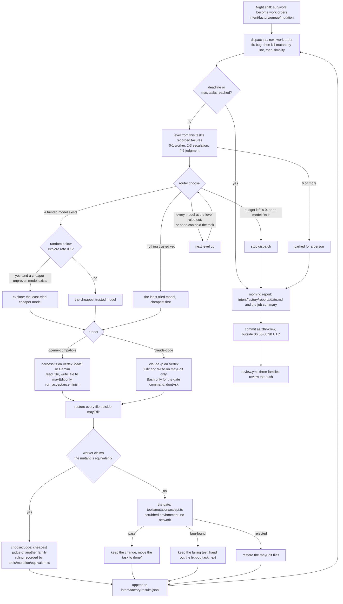
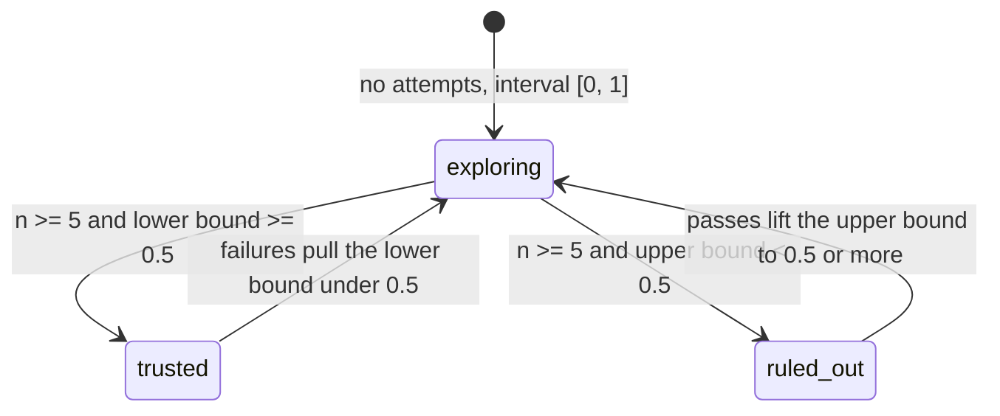
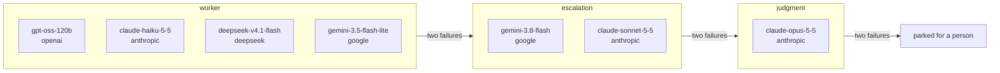
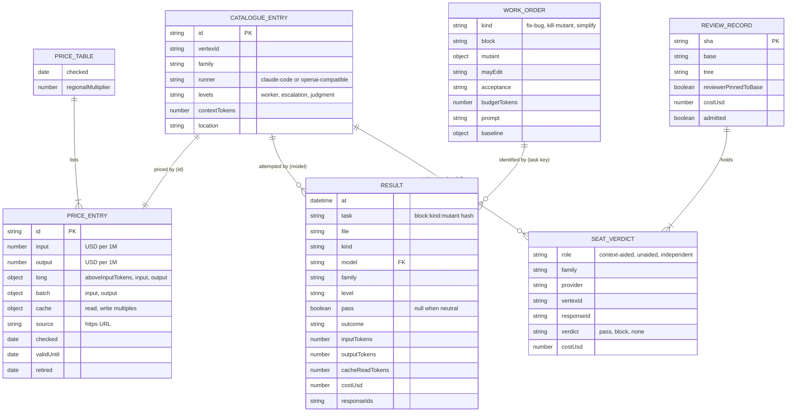
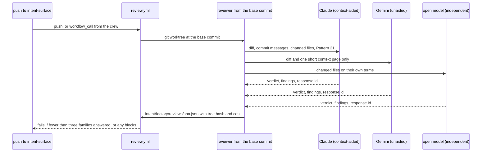

# The crew

The crew works the night shift's work orders on the owner's Google Cloud Vertex project, each with the cheapest model that has been proven good enough for that kind of work. A reviewer panel of three model families then reviews every push. A worker's claim counts for nothing. The gate (`tools/mutation/accept.ts`) decides whether a change is kept. A model is trusted only on its measured pass rate. A review counts only if a provider response id shows that the call really happened.

| Part | File | What it does |
| --- | --- | --- |
| Router | [`intent/blocks/router`](../../intent/blocks/router/index.ts) | Holds the catalogue and the measured pass rates. Picks the model, climbs the escalation ladder, enforces the budget and works out cost |
| Prices | [`intent/factory/prices.json`](../../intent/factory/prices.json) | The dated price table. A test fails when it is more than 30 days old |
| Harness | [`harness.ts`](harness.ts) | The agent loop for OpenAI-compatible models, with four tools confined to the task |
| Dispatcher | [`dispatch.ts`](dispatch.ts) | Takes work orders in order, routes each one, runs the worker and the gate, keeps or restores, records the result, stops at the budget |
| Gate wrapper | [`accept.ts`](accept.ts), [`no-network.sh`](no-network.sh) | Runs the mutation gate with credentials scrubbed, in CI inside a namespace with no network |
| Reviewer | [`review.ts`](review.ts) | Three families review each push to `intent-surface` |
| Report | [`report.ts`](report.ts) | The morning report: what was fixed, escalated and parked, the cost and the pass rates |
| Workflows | [`crew.yml`](../../.github/workflows/crew.yml), [`review.yml`](../../.github/workflows/review.yml) | Run the crew after the night shift and review each push |
| Setup | [`setup-cloudshell.sh`](setup-cloudshell.sh) | The owner's one-time Google Cloud setup |

## Dispatch, routing and escalation



### When a model is trusted

For each model and each kind of task, a model is trusted when it has at least five scored attempts and the Wilson lower bound (z = 1.96) of its pass rate is at least 0.5. It is ruled out when it has at least five scored attempts and the upper bound is below 0.5. Until then it is exploring. A model with few tries can win a task, but it is not trusted on that basis.



| Passes / attempts | Lower bound | Upper bound | Standing |
| --- | --- | --- | --- |
| 0 / 0 | 0 | 1 | exploring |
| 4 / 4 | 0.510 | 1 | exploring (too few) |
| 5 / 5 | 0.566 | 1 | trusted |
| 4 / 5 | 0.376 | 0.964 | exploring |
| 0 / 5 | 0 | 0.434 | ruled out |
| 9 / 10 | 0.596 | 0.982 | trusted |

Some attempts are scored as neither a pass nor a failure. These are a `bug-found` (the new test failed on the real code, so a fix-bug task follows), a mutant ruled equivalent, a "no simplification" ruling and an infrastructure error. Their cost still counts against the budget. A disputed equivalence claim counts as a failure.

### Escalation



Within one run a task gets up to three attempts (`--per-task`). Each failure is recorded, so the next attempt starts at the level the failures give. A model that already failed the task is passed over while its level has another model. Failures recorded in earlier runs count too, so a task that failed at worker last night starts at escalation tonight.

### Cost

Cost is worked out per request, from token counts and the price table:

- When one request's input is over the long-context threshold (100,000 tokens for Haiku 5.5, cached input included), every token of that request is billed at the long rates.
- Regional and multi-region endpoints cost 1.1 times the global rate. The crew uses the global endpoint.
- Claude prompt-cache reads are billed at 0.1 times the input rate and cache writes at 1.25 times.

The harness takes usage from each response. For Claude Code, the dispatcher reads `--output-format stream-json`, so each API message is priced separately. The daily budget covers both crew spending (`results.jsonl`) and review spending (`intent/factory/reviews/*.json`). The day is the UTC day.

## Prices

Global endpoint, USD per million tokens, read on 2026-11-27. Regional endpoints cost about 10% more.

| Model | Vertex model id | Family | Runner | Input | Output | Notes |
| --- | --- | --- | --- | --- | --- | --- |
| Claude Opus 5.5 | `claude-opus-5-5` | anthropic | claude-code | 4.00 | 20.00 | batch 2.50 / 12.50 |
| Claude Sonnet 5.5 | `claude-sonnet-5-5` | anthropic | claude-code | 2.00 | 10.00 | |
| Claude Haiku 5.5 | `claude-haiku-5-5` | anthropic | claude-code | 0.10 | 0.50 | 0.50 / 2.50 above 100K input (threshold unconfirmed) |
| DeepSeek V4.1 Flash | `deepseek-ai/deepseek-v4.1-flash-maas` | deepseek | openai-compatible | 0.30 | 1.20 | global, 1M context |
| gpt-oss 120B | `openai/gpt-oss-120b-maas` | openai | openai-compatible | 0.09 | 0.36 | global, 131,072 context |
| Gemini 3.5 Flash-Lite | `google/gemini-3.5-flash-lite` | google | openai-compatible | 0.30 | 2.50 | |
| Gemini 3.8 Flash | `google/gemini-3.8-flash` | google | openai-compatible | 0.75 | 3.75 | introductory until 2026-12-31, then 1.50 / 7.50 |
| Qwen3 Coder 480B | `qwen/qwen3-coder-480b-a35b-instruct-maas` | alibaba | openai-compatible | 0.22 | 1.80 | retired 2026-10-21; listed, never chosen |

Sources: [partner model pricing](https://cloud.google.com/model-garden/partner-models/pricing), [Vertex AI generative AI pricing](https://cloud.google.com/vertex-ai/generative-ai/pricing), and [Claude on Vertex AI](https://platform.claude.com/docs/build-with-claude/claude-on-vertex-ai) for the model ids and the regional premium.

Endpoints:

- Open models and Gemini use the OpenAI-compatible endpoint: `POST https://aiplatform.googleapis.com/v1/projects/PROJECT/locations/global/endpoints/openapi/chat/completions`. The `model` field takes the form `publisher/model`, as in the table.
- Claude uses the Messages API: `POST https://aiplatform.googleapis.com/v1/projects/PROJECT/locations/global/publishers/anthropic/models/MODEL:rawPredict` with `anthropic_version: vertex-2023-10-16`.
- Claude Code runs with `CLAUDE_CODE_USE_VERTEX=1`, `CLOUD_ML_REGION=global` and `ANTHROPIC_VERTEX_PROJECT_ID`. It also gets `ANTHROPIC_MODEL` and `ANTHROPIC_DEFAULT_{OPUS,SONNET,HAIKU}_MODEL`, each pinned to the ids above.

To refresh the table, re-read each source, update the rows and the `checked` dates, and run `node --test intent/blocks/router/router.test.ts`.

## Data



The task key is the block, the kind and a hash of the mutant's content. Mutant ids and task file names change every run, but the key does not, so failures carry over from night to night.

## What a worker can touch

| | Harness (open models, Gemini) | Claude Code headless |
| --- | --- | --- |
| Read | files tracked by git, and the task's mayEdit files. Never `.git/`, never outside the repository, never through a link | `Read`, `Glob`, `Grep`. `Read(./gha-creds-*.json)` and `.git/` denied |
| Write | `write_file` to paths in mayEdit only | `Edit(./<file>)` and `Write(./<file>)` for each mayEdit file |
| Run | `run_acceptance`, which runs the task's gate and nothing else, at most four times | `Bash(node tools/crew/accept.ts <task>)`, the exact command and nothing else |
| Anything else | refused, and the refusal is returned to the model | `--permission-mode dontAsk` denies it; no MCP servers, no web tools |
| Network | the Vertex AI endpoint only; any other host is refused | Vertex only, with nonessential traffic off |
| Afterwards | every file outside mayEdit is restored, whatever the gate says | the same |

The gate runs code a model wrote. It gets a scrubbed environment, with no `GOOGLE_*`, `CLOUDSDK_*`, `ACTIONS_*`, `GITHUB_TOKEN` or `CREW_*` variables. In CI it also runs in a network namespace that has only loopback. The CI credentials file is moved out of the working tree before any worker runs.

## Review



Each seat gets the cheapest model of its family that is not ruled out for `review`. Today those are `claude-haiku-5-5`, `google/gemini-3.5-flash-lite` and `openai/gpt-oss-120b-maas`. All reviewers are held to Pattern 21 (`zthr-patterns.json`, ZTHR-P21). Every finding must name a location, the expectation it violates and its support.

A reply that cannot be read gives no verdict. A verdict without a provider response id also counts as none. A failed call counts as none too. Each of these leaves fewer than three families, so the job fails.

The reviewer runs from the base commit, so a change cannot approve itself. The only exception is the first run, before the reviewer exists at any base. The record says so.

## What the owner runs

1. **Google Cloud.** In Cloud Shell, from a clone of the repository, run:

   ```sh
   git clone https://github.com/russlittle/ZTHR.git && cd ZTHR && git checkout intent-surface
   bash tools/crew/setup-cloudshell.sh YOUR-PROJECT-ID 5
   ```

   The script:
   - enables the APIs
   - creates `zthr-crew@YOUR-PROJECT-ID.iam.gserviceaccount.com` with `roles/aiplatform.user` only
   - creates the `github` Workload Identity pool and the `zthr` OIDC provider, which accept only this repository (pinned by its GitHub ids) on `refs/heads/intent-surface` and `refs/heads/main`
   - binds the provider to the service account with `roles/iam.workloadIdentityUser`
   - offers a monthly budget alert of 31 times the daily budget
   - prints the variables to set

   It is safe to run again.
2. **Model Garden.** Enable `claude-haiku-5-5`, `claude-sonnet-5-5`, `claude-opus-5-5`, `gpt-oss-120b-maas` and `deepseek-v4.1-flash-maas` in the project, and accept Anthropic's terms. Gemini needs no enabling.
3. **GitHub repository variables** (Settings, Secrets and variables, Actions, Variables). Set `GCP_PROJECT`, `GCP_WIF_PROVIDER`, `GCP_SERVICE_ACCOUNT` and `CREW_DAILY_BUDGET_USD` to the values the script printed. These are identifiers, not secrets.
4. **Workflows on main.** GitHub runs scheduled and `workflow_run` triggers only from the default branch. `crew.yml` must therefore be on `main` to run after the Night shift, and the Night shift must be on `main` too. Both check out `intent-surface`. `review.yml` runs on every push to `intent-surface` from that branch's own copy.
5. **First run.** Run the Crew workflow by hand with `dry_run` ticked. It lists each work order, the model it would get and the estimated cost, and runs nothing. Then run it by hand with `max_tasks` set to 3. After that it runs every night after the Night shift.

To work locally, with `gcloud auth application-default login` and `gcloud auth login` done:

```sh
node --test intent/blocks/router/router.test.ts tools/crew/crew.test.ts   # the tests, fake models only
node tools/crew/dispatch.ts --dry-run --budget-usd 2                      # the plan, nothing run
GCP_PROJECT=YOUR-PROJECT-ID node tools/crew/dispatch.ts --budget-usd 0.50 --max-tasks 2 --report
node tools/crew/harness.ts intent/factory/queue/mutation/geo-11.json --model gpt-oss-120b --project YOUR-PROJECT-ID
```

The harness also works as the mutation loop's worker. In that case the loop runs the gate itself:

```sh
MUTATION_WORKER='node tools/crew/harness.ts {task} --model deepseek-v4.1-flash --no-record' node tools/mutation/loop.ts geo
```
