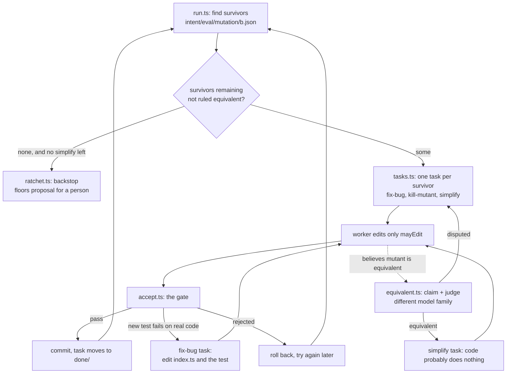

# Mutation loop

Closing surviving mutants is the main path; the ratchet is only the backstop. Mutation testing has two parts: the tests, then the fixes. A surviving mutant is either a missing test, a real bug the missing test would have found, or code that does nothing.

Everything runs from the repo root (`/home/claude/zthr`) on Node 22 with the installed Stryker (command runner, `node --test` per block). Results go to `intent/eval/mutation/`, tasks to `intent/factory/queue/mutation/`.



## The steps

1. **Find.** `node tools/mutation/run.ts <block...> [--incremental]`. Prints, per block, the survivors remaining (the headline; the goal is zero), then score and counts. Writes `intent/eval/mutation/<b>.json`: `{block, ranAt, mutants, killed, timeout, survived, noCoverage, score, survivors:[{id, line, column, endLine, endColumn, mutator, original, replacement, ...}], killedKeys}`. `--incremental` keeps `intent/eval/mutation/.incremental/<b>.json`; an unchanged block re-runs in about 2 seconds instead of about 80.
2. **Task.** `node tools/mutation/tasks.ts <block...>`. Every run, every survivor without an accepted equivalence ruling gets a task. Order: `fix-bug`, then `kill-mutant` (by line), then `simplify`. Each task carries a `prompt` (`tasks.ts --print <task>` shows it). Stale tasks from the previous run are replaced; `fix-bug` tasks stay until the mutant stops surviving.
3. **Close.** A worker adds a test that passes on the real code and fails on the mutant (see below).
4. **Prove.** `accept.ts` decides. A worker's say-so is never evidence.
5. **Equivalents.** If a mutant cannot be told apart from the original, claim it: `node tools/mutation/equivalent.ts <b> <id> --argument "..." --by <model> --judge <model> --verdict equivalent`. It counts only when a judge of a different model family says `equivalent`; otherwise it stays `disputed` and the survivor stays on the queue. Rulings live in `intent/eval/mutation/equivalent/<b>.json` and are matched by mutator + original + replacement + the line and its neighbours, not by line number, so they survive edits elsewhere in the file. An accepted ruling produces a `simplify` task, because code a mutant cannot change usually does nothing. If the worker finds no safe simplification: `node tools/mutation/equivalent.ts --stands <b> <id> --reason "..." --by <model>`; the ruling stands and no more simplify tasks are made for it.
6. **Ratchet.** `node tools/mutation/ratchet.ts [block...]` fails (exit 1) if a block's score fell, or a mutant killed in the last committed result survives again, compared with `HEAD:intent/eval/mutation/<b>.json`. It writes a floors proposal to `tools/mutation/proposals/mutation-floors-<date>.md` for a person to sign and move; it never writes to `control/`.
7. **Repeat** until zero remain.

`node tools/mutation/loop.ts <block...> [--worker "<cmd>"] [--max-rounds 5] [--budget-tokens 2000000] [--incremental]` runs steps 1 to 4 for you: find, tasks, worker per task (fix-bug first), accept, find again. It stops when no survivors remain except recorded equivalents, when nothing untried is left, or at the round or budget limit, and logs every round to `intent/eval/mutation/loop.log.jsonl`. The worker comes from `--worker` or `MUTATION_WORKER`; with neither, it is a dry run that lists what it would hand out. In the command, `{task}` is replaced by the task file path. The prompt is on stdin and in `$MUTATION_PROMPT`; `$MUTATION_TASK`, `$MUTATION_BLOCK`, `$MUTATION_KIND` are set. The loop never commits (the budget counts the per-task `budgetTokens` handed out, not measured use). A rejected attempt is rolled back to the file contents from just before that worker ran; a `bug-found` attempt keeps its test so the fix-bug task can use it.

## The three task kinds

| kind | mayEdit | passes when |
| --- | --- | --- |
| `kill-mutant` | the block's test file | scope, diff guard, whole test file passes on real code, Stryker on just that mutant's range says Killed or Timeout, block score did not drop |
| `fix-bug` | `index.ts` and the test file | scope, diff guard, the test file (new test included) passes, the original mutant no longer survives, score did not drop |
| `simplify` | `index.ts` and the test file | scope, diff guard, tests pass, `index.ts` diff is not longer, the equivalent mutant is gone or the block has fewer mutants, score did not drop |

The diff guard rejects any removed line containing `assert`, and any added line containing `skip`, `todo`, `only:`, `.only` or `Stryker disable`. It is deliberately blunt: a false rejection costs a retry, a false accept costs a hollow test.

**A killing test that fails on the real code has found a bug.** `accept.ts` checks whether the unmodified test file passes on the real code. If it does and the new test does not, the verdict is `outcome: "bug-found"` (not a bad test), it writes `<b>-<id>-fix.json` with the failing output, and prints it as `followUp`. The fix-bug worker decides whether the code or the expectation is wrong, edits accordingly, and the gate then needs everything green.

## How a runner consumes a task

Claude Code headless or any other model harness does the same thing:

1. Read the task JSON, for example `intent/factory/queue/mutation/geo-97.json`. Give the model its `prompt`. Honour `tier` and `budgetTokens`.
2. Edit only the files in `mayEdit`. Nothing else, including `tools/mutation/`. The gate compares file hashes with the `baseline` recorded when the task was made, so any other change is rejected.
3. Run `acceptance` from the repo root: `node tools/mutation/accept.ts intent/factory/queue/mutation/geo-97.json`. It prints a JSON verdict (`pass`, `outcome`, `reasons`, `checks`) and exits 0 only on pass. It takes a minute or two because it re-runs Stryker.
4. Commit only if it passes, with only the `mayEdit` files. If `outcome` is `bug-found`, do not commit and do not revert: pick up the `followUp` task. Otherwise revert your edits.

```sh
# Claude Code headless
MUTATION_WORKER='claude -p "$(jq -r .prompt {task})" --allowedTools Edit,Read,Bash' node tools/mutation/loop.ts geo
# any other harness: a command that reads $MUTATION_PROMPT (or stdin), edits files, exits
node tools/mutation/loop.ts geo --worker "my-harness --prompt-env MUTATION_PROMPT"
```

(`{task}` is the task file path, so the prompt text is pulled out with `jq -r .prompt`.)

## Limits and facts

- `mutate` line ranges work with the command runner. Columns in the range are 0-based while the report is 1-based; `lib.ts` converts.
- Run from `intent/`; sandboxes go to the OS temp directory so nothing is written inside the repo. Concurrency is fixed at 2.
- Mutants are identified by content, not id: ids and lines change every run.
- Two identical mutants on identical neighbouring lines share a ruling.
- With `coverageAnalysis: off` every mutant runs the whole block test file; large blocks are slow (about 80 s for 208 mutants).
- The gate's scope check is relative to the dirty working tree when the task was made, so other people's uncommitted work does not trip it. Regenerate tasks with `tasks.ts` before handing them out; a task made after the worker has already edited has the edit in its baseline.
- `Timeout` counts as killed (Stryker's convention); `CompileError` and `RuntimeError` are not scored.
