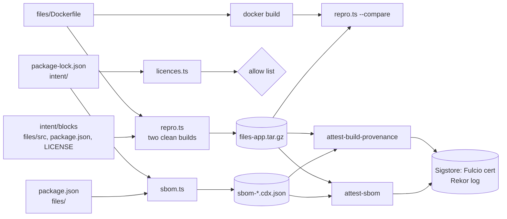
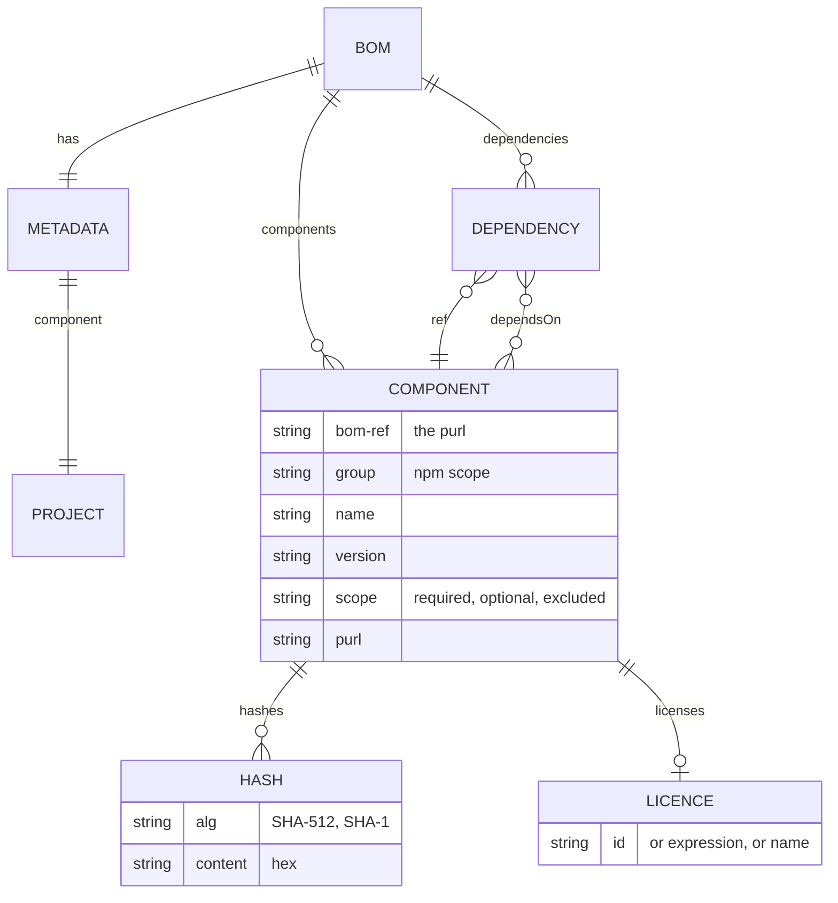

# Supply-chain evidence

Every change gets four pieces of evidence, produced by `.github/workflows/supply-chain.yml` from Node built-ins alone:

| Tool | Produces | Fails when |
| :--- | :--- | :--- |
| `sbom.ts` | `sbom-<project>.cdx.json`: a CycloneDX 1.5 SBOM per npm project | a lockfile is missing for declared dependencies, or predates lockfile v2 |
| `licences.ts` | a table of every production dependency, its licence and where the licence was read | any production dependency has no licence, or one outside the allow list |
| `repro.ts` | `files-app.tar.gz`, its manifest and digests | two builds from the same source differ, or the Dockerfile does something the tool cannot derive |
| `repro.ts --compare` | a byte-for-byte check of the image's `/app` against the artefact | the image holds a file the artefact does not, lacks one, or differs |

On a push to `intent-surface`, the workflow then signs the artefact and the SBOMs with GitHub artifact attestations, and keeps everything as the run's `supply-chain` artefact with a `SHA256SUMS`.



## What is produced

**SBOMs.** One per project directory with a `package.json`: today `intent/` (260 components, 115 of them production) and `files/` (no npm dependencies, so its SBOM is the project alone). The repository root has no `package.json` on this branch and is skipped. Each component carries its purl (`pkg:npm/...`), the lockfile's integrity hashes as hex (SHA-512 for every current package), its licence, its scope (`required`, `optional`, or `excluded` for dev-only), and its install paths; the `dependencies` section is the graph as Node resolves it, nearest `node_modules` first. Output is byte-identical between runs: everything is sorted by byte order, the serial number is derived from the content, and no timestamp is written unless `--timestamp` or `SBOM_TIMESTAMP` gives one.



**Licence check.** Production means installed by `npm ci --omit=dev`; optional platform packages count, since they ship. The licence comes from the lockfile, or the installed `package.json` when the lockfile has none. The allow list is Apache-2.0, MIT, BSD-2-Clause, BSD-3-Clause, ISC, 0BSD, BlueOak-1.0.0, CC0-1.0 and Python-2.0. SPDX expressions are parsed: `OR` passes on any allowed branch, `AND` needs every branch, `WITH` is judged by its licence. There is no exception list.

**The Files artefact.** Files has no build step: Node runs its TypeScript directly, and the image is `node:22-slim` plus what `files/Dockerfile` copies into `/app`, minus the block tests its `RUN` deletes. `repro.ts` reads the Dockerfile to decide that file set, refusing any instruction whose effect on `/app` it does not know, and packs it as a tar.gz whose bytes depend only on each file's path, content and executable bit: entries sorted by path bytes, mtime 0, owner 0:0, mode 0644 or 0755, and a gzip header with no time, name or OS. It copies the sources into two clean temporary directories, the second in reverse order with different mtimes and permission bits, builds from each and compares SHA-256 digests. CI then builds the image from the same commit and checks its `/app` holds exactly those files, byte for byte.

`files-app.digests.json` records two digests. The tar digest depends only on the source. The tar.gz digest also depends on the zlib build, which is recorded beside it with the Node version; rebuilding with a different zlib can change the tar.gz bytes but not the tar inside.

## How anyone verifies it

Download the `supply-chain` artefact from a run on `intent-surface`, then, with the GitHub CLI:

```bash
# Provenance: this exact file was built by this repository's workflow, from a named commit, on GitHub's runners.
gh attestation verify files-app.tar.gz --repo russlittle/ZTHR
gh attestation verify sbom-intent.cdx.json --repo russlittle/ZTHR

# Narrower: signed by this workflow, from this branch.
gh attestation verify files-app.tar.gz --repo russlittle/ZTHR \
  --signer-workflow russlittle/ZTHR/.github/workflows/supply-chain.yml --source-ref refs/heads/intent-surface

# The SBOM attestation bound to the artefact.
gh attestation verify files-app.tar.gz --repo russlittle/ZTHR --predicate-type https://cyclonedx.org/bom
```

Verification checks the Sigstore certificate chain, the transparency-log entry and that the attestation's subject digest is the file's SHA-256. The provenance names the commit; anyone can check out that commit and rebuild:

```bash
node tools/supply/repro.ts --out /tmp/rebuild
sha256sum /tmp/rebuild/files-app.tar.gz   # equals the attested digest, given the same zlib
gunzip -c files-app.tar.gz | sha256sum     # equals tarSha256 in files-app.digests.json, on any zlib
```

Locally, the tools run without an install:

```bash
node --test tools/supply/*.test.ts
node tools/supply/sbom.ts            # writes tools/supply/out/ (ignored by git)
node tools/supply/licences.ts
node tools/supply/repro.ts
```

## What SLSA level this reaches

**SLSA v1.0 Build Level 2, for `files-app.tar.gz` and the SBOM files, on pushes to `intent-surface`.**

- **L1, provenance exists:** the attestation is SLSA provenance (`https://slsa.dev/provenance/v1`) naming the repository, commit, workflow, trigger and runner.
- **L2, hosted build, signed provenance:** the build runs on GitHub-hosted runners, and the provenance is signed with a short-lived Sigstore certificate issued against the job's OIDC identity and recorded in the public transparency log, so a consumer can verify it was not edited after the fact.
- **Not L3.** L3 requires that the build's own steps cannot forge the provenance. Here the signing step runs in the same job as the build steps and has the same OIDC token, so a compromised step in that job could attest a file of its choosing. Reaching L3 means moving the build into a reusable workflow that is isolated from the signer, and adding nothing to that job but the build.

The reproducibility check is beyond what any SLSA build level requires: it shows the attested bytes are a function of the source, so a second builder can confirm them independently.

What this does not cover, stated so it is not assumed:

- **The deployed Cloud Run image.** It is built by Cloud Build from Cloud Shell, not by this workflow, and is not attested. CI proves an image built from the same commit holds exactly the attested files; it does not prove the running image is that image.
- **The base image.** `node:22-slim` is named by tag, not digest, so the runtime under `/app` is outside both the artefact and the SBOMs.
- **Pull requests.** They run every check but sign nothing: an attestation records what was built from a branch that was pushed, not a proposal.
- **The site build from `intent/`.** Its SBOM is attested as a file; the built site is not shown to be reproducible here.
- **Licence data.** Licences are as each package declares them in npm metadata; the tool does not read the licence text inside each package.
