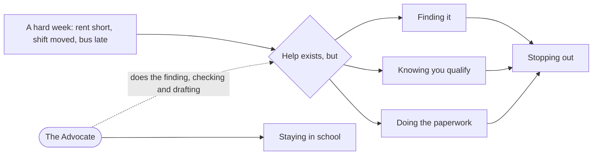
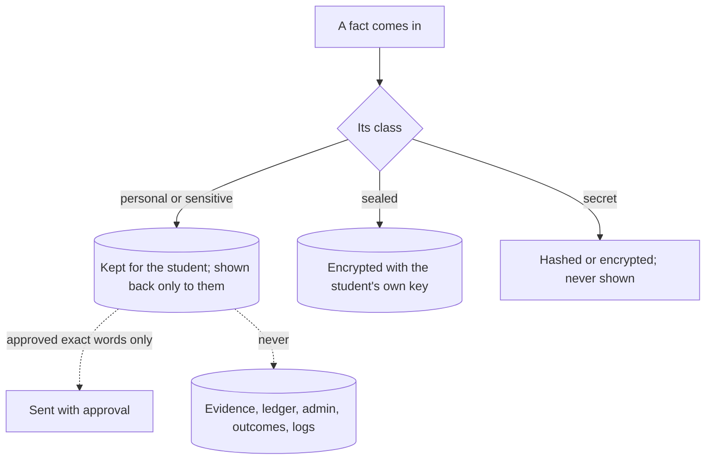
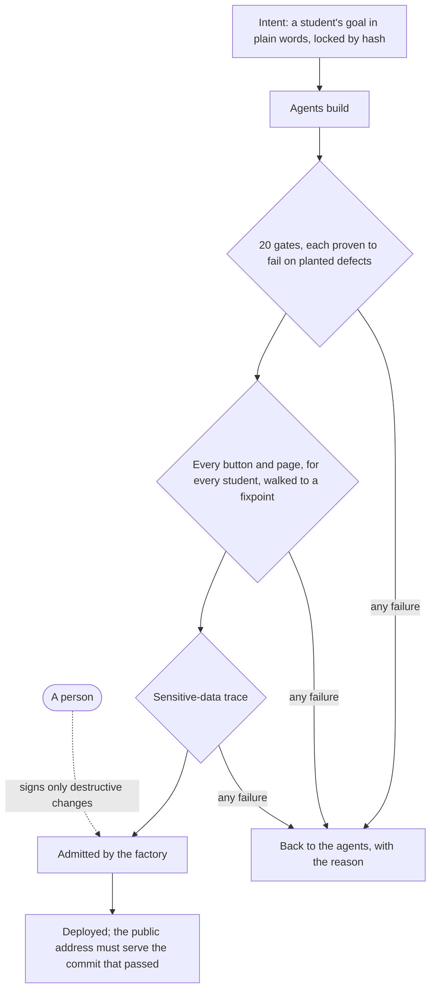
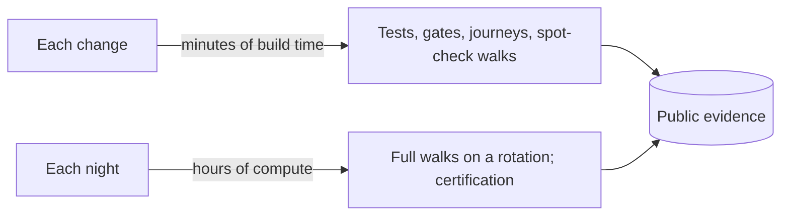

# What an AI factory can build, and what it is worth

The Student Advocate is a complete, working application built entirely by AI agents under ZTHR fixtures: a
student-facing team that runs a student's day, finds the money and help they qualify for, and does the legwork to
get it. It exists to answer one question with evidence instead of argument: **can software written by AI be
trusted, if the environment it is built in decides what is admitted?**

This page makes the case from both sides: what the application is worth to the people it serves, and what the
factory that built it means for anyone who builds software.

## At a glance

| | |
| --- | --- |
| **Built by** | AI agents, inside a factory of gates, locked intent and exhaustive walks. No person wrote the code; a person signs only destructive changes. |
| **Elapsed time** | Days, from an empty repository to a deployed application with five phases of features, five synthetic campus services, fifteen reusable blocks and full documentation. |
| **Direction** | About 125 prompts from the author, from the idea to the deployed application. |
| **Size** | About 22,000 lines of TypeScript and 4,200 lines of documentation, every data structure drawn as an ERD. |
| **Evidence** | 1,192 tests; 23 gates, each proven able to fail; 41 locked user journeys; 110 of 110 red-team attacks held; every button walked for every student, and 886 controls clicked in a real browser down to seven screens deep; 454 browser stops meeting WCAG 2.2 AA; generated input and failing services that never break it; a planted-marker trace of every sensitive field, with no leaks. |
| **Cost to run** | No model spend in the product. Each change is checked in minutes of build time; the exhaustive walks run overnight. The public demo runs on one small server, so a visitor's session holds from start to finish. |
| **Open** | Every test, gate, walk, decision and line of source is public. |

## The problem it solves

Students who stop out rarely do so over ability. They stop out over a few hundred dollars, a missed form, a bus that never
came, a shift that collided with an exam. Help exists for most of it: emergency grants, benefits, food programs,
child care, mentors. Finding it, qualifying for it and doing the paperwork is the barrier, and the students who
most need the help have the least time to do that work.

## What the Advocate does

| For the student | How |
| --- | --- |
| Runs their day | Classes, shifts, child care and due dates on one line; time held for the work that matters; the one thing to do today. |
| Finds money they are missing | SNAP, phone and heating help and campus emergency grants checked against the agencies' published limits, with the rule shown. |
| Finds help and does the legwork | Verified, current programs nearby, what to bring, and a drafted message the student approves before anything is sent. |
| Handles campus life | What is open to eat now, free food today, a study room booked and confirmed, when to leave for the bus with live delays. |
| Keeps up with classes | Reads the syllabus and the class site, follows moved due dates, plans the work into the time available. |
| Keeps them enrolled | Grades from the syllabus weights and what the final needs, academic standing, financial-aid progress with an appeal when it slips, every choice about dropping a class side by side with the aid that would go back, and degree progress on the state's transfer pathway. |
| Brings in their advisor, on their terms | A read-only link the student controls: only the parts they choose, for as long as they choose, with every view recorded. Early alert, run by the student. |
| Opens doors to work | Jobs that fit around classes and shifts, a fair-chance path when the student asks, an introduction to a mentor. |

It works by text or in the app, at the reading level and length the student chooses, with a screen reader or without, and it never scolds. Crisis
words go straight to 988 before anything else. Nothing leaves on a student's behalf without their approval of the
exact words.

## Why it can be trusted with this

A student's money, benefits, family and history are the most sensitive facts they have. The Advocate is built so
that trust does not depend on anyone's good intentions.

- **Every field is classified**, and every build plants a unique marker in each personal, sensitive and secret
  field, uses the app the way a student would, and searches every place data can land. A marker found where its
  class may not go fails the build, naming the field and the place.
- **One door to the network.** The app can reach only the hosts it declared; anything else is refused and recorded.
- **Counts never point at a person.** Outcome measures are never shown for a group smaller than five.
- **The public server is hardened** against the obvious attacks: floods, oversized requests, injected script,
  framing, forged sessions and attempts to reach other hosts. [Each attack, what stops it and what proves it](docs/security.html).

## How the factory works

The application is the example. The factory is the point. Agents write code; the factory decides what is admitted,
by checks that are themselves proven, against intent that the agents cannot edit.

| Fixture | What it guarantees |
| --- | --- |
| **Locked intent** | Each user goal is a card in plain words with outcomes that must never happen, locked by hash. The change being judged cannot edit the goal it is judged by. |
| **Gates proven to fail** | A check counts only after every planted defect makes it fail; the proof is pinned to the check's own definition. |
| **Exhaustive walks** | Every button and every page, for every student, at every depth, until nothing new is left, checking tone, privacy and dead ends at every step. |
| **Walk only what changed** | Each walk records the lines it executed; a later change re-walks only what could alter what the walk saw. |
| **Unknown is a state** | Anything not measured in a build says "not measured"; it never counts as a pass. |
| **Register, don't hide** | Every known gap has an owner and an expiry date, in the open. |
| **Reusable blocks** | Fifteen parts, each with its own tests and mutation score, inherited by the app, never copied. |
| **Published rules as oracles** | Financial-aid progress, the federal aid-return formula and SNAP limits are checked against the regulation and the Handbook's own worked cases, to the cent. |
| **Generated input** | Any text, form, JSON or action name, thousands of times a night; services failing five ways each. Nothing may crash or show a student a programming artifact. |
| **Accessible by construction** | Every screen held to WCAG 2.2 AA and read the way a screen reader reads it, on every change. |

The factory finds what review misses. In building the Advocate it found, without being asked: a webhook signing
secret in a student's export, document names in a permanent ledger, a brief-mode answer too long to deliver, a
bus plan that took a transfer when a direct route existed, a synthetic mentor sharing a first name with a
student, an action name that reached JavaScript's built-in methods, and text that could split a character and
crash a redirect. Each became a fixture, so it cannot return.

## The economics

- **The product costs almost nothing to run.** It makes no model calls in normal use; the public demo is one small server, and a school running its own copy can let it scale to zero between visits.
- **The cost is compute, not people.** More fixtures cost machine time, which is cheap next to unverified output.
  The exhaustive walks are the one cost that grows with the application; more cores shorten the night without
  changing the total.
- **Speed is safe because of the fixtures, not despite them.** Two days of agent output would be a large pile of
  unverified code without them; with them it is an application whose every claim is checked on every change.

## What it could mean, used well

**For colleges.** A support layer that reaches every student at any hour, in their own words, for the price of a
small server. A new college is one declaration file; local help is kept current by scouts the factory admits.
Outcomes are measured without ever exposing a person.

**For anyone who builds software.** The people who know a domain (advisors, nurses, caseworkers, engineers) can
state what users must be able to do and what must never happen, and get software built to that intent, with
evidence anyone can inspect. People govern the gates and sign destructive changes; the factory does the rest.

**What "used well" requires:**

| Condition | Why |
| --- | --- |
| Checks independent of the builder | The strongest evidence comes from checks the author cannot influence: held-out cases, oracles from the record, planted markers, models from other families reviewing. |
| Intent from people who know the work | Journey cards are only as good as the understanding behind them. |
| Real oracles where they exist | Synthetic services prove the app against a contract; a real vendor's feed proves the contract against the world. |
| Compute for the walks | Exhaustive evidence is the strongest the factory produces, and it is paid for in machine time. |
| People governing the gates | The factory admits features; people decide what the gates are and sign anything destructive. |

## Where it stands

Built and deployed: all five phases of features, the factory and its evidence, the block library and the
documentation. Open, each with an owner and a date:

- **Phase certificates** wait for the nightly rotation to give every student a full walk that holds for the
  current code.
- **Spanish** covers starting by text, finding help and crisis replies; the remaining screens are scheduled.
- **Six blocks** score under the 80% mutation target on their own tests; their floors only rise.
- **Model review from several families** is designed and switched off until providers are configured.
- **Persistence and credits** need a college's records for students who opt in; they are never estimated.
- **Screen readers in people's hands.** Every build is checked automatically; testing with people who use NVDA,
  JAWS, VoiceOver and TalkBack every day is next.
- **Sinclair's term dates** were not published in a form that could be read; until they are, its students see
  them as not known rather than guessed.

## Take part

- [Try the app](https://zthr.ai/studentadvocate/) as any of twelve sample students.
- [Read the evidence](factory/index.html): every gate, walk, test and trace from the latest build.
- [Read the source](https://github.com/russlittle/ZTHR/tree/reference-implementation) and the
  [documentation](docs/index.html).
- [Join the discussion](https://github.com/russlittle/ZTHR/discussions): questions, objections and experience
  reports.
- **Pilot it or sponsor compute.** A college pilot would measure what matters most, whether students stay; donated
  compute would let every student be walked every night.

Not affiliated with any educational institution. All data from public sources.
